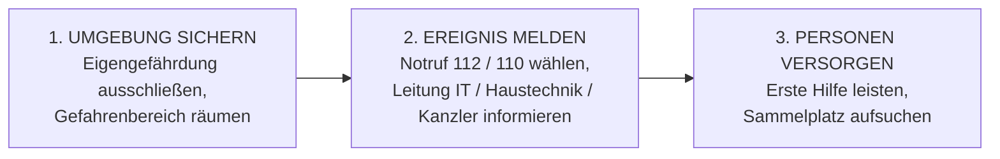
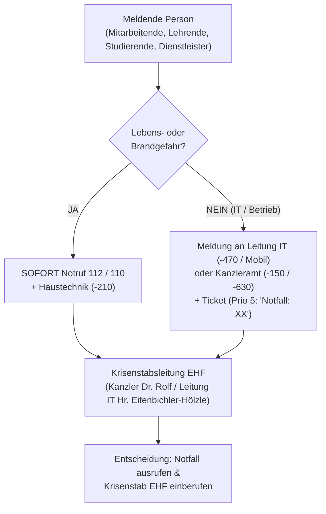

# Notfallhandbuch

**Evangelische Hochschule Freiburg (EHF)**  
*Operatives Handbuch und Checklisten für die reaktive Notfallbewältigung*  
**Klassifizierung:** Vertraulich | **Version:** 1.0 (Entwurf) | **Stand:** November 2026

---

> [!IMPORTANT] **SOFORT-ORIENTIERUNG IM ERNSTFALL (QUICK-REFERENCE)**
> 1. **Ruhe bewahren – Personenschutz geht immer vor Sach- und Datenwerten!**
>    - Bei Gefahr für Leib und Leben (Brand, Unfall, Verletzte): **Sofort Notruf `112` (Feuerwehr/Rettungsdienst) bzw. `110` (Polizei)** wählen!
>    - Erste-Hilfe-Raum & Notfallaushang: **Anbau C, Raum 003** sowie am **Haupteingang**.
> 2. **Bei IT-Sicherheitsvorfall / Ransomware-Verdacht:**
>    - **Gerät NICHT ausschalten**, sondern **sofort Netzwerkkabel ziehen / WLAN trennen**!
>    - **KEINESFALLS mit Administratorkonten** auf potenziell infizierten Systemen anmelden!
> 3. **Sofort-Alarmierung an der EHF:**
>    - **Leitung IT (Johannes Eitenbichler-Hölzle):** Durchwahl **`-470`** | Mobil: **`0162-4614919`**
>    - **Kanzler / Krisenstabsleitung (Dr. Ulrich Rolf):** Durchwahl **`-150`**
>    - **Haustechnik (Peter Trautmann):** Durchwahl **`-210`**
>    - **ISB (Jochen Bauer, Secudor GmbH):** Mobil: **`0172-2776557`**
> 4. **Dokumentation starten:** Sofort das **Notfallprotokoll (Anlage 2)** mit Uhrzeit und Maßnahmen beginnen!

---

## Inhaltsverzeichnis

1. [Dokumenteninformation und Aufbewahrung](#1-dokumenteninformation-und-aufbewahrung)
   - [1.1 Dokumentendaten](#11-dokumentendaten)
   - [1.2 Dokumentenhistorie](#12-dokumentenhistorie)
   - [1.3 Mitgeltende Dokumente](#13-mitgeltende-dokumente)
   - [1.4 Aufbewahrungsorte und Zugriffsberechtigte](#14-aufbewahrungsorte-und-zugriffsberechtigte)
2. [Einleitung und Key-Facts für den Ernstfall](#2-einleitung-und-key-facts-für-den-ernstfall)
   - [2.1 Wann liegt ein Notfall vor?](#21-wann-liegt-ein-notfall-vor)
   - [2.2 Essenzielle Ressourcen und Zuständigkeiten (EHF vs. EOK vs. Dienstleister)](#22-essenzielle-ressourcen-und-zuständigkeiten-ehf-vs-eok-vs-dienstleister)
3. [Sofortmaßnahmen und Alarmierungsplan](#3-sofortmaßnahmen-und-alarmierungsplan)
   - [3.1 Grundsätze der Sofortmaßnahmen (Gebäude & Personen)](#31-grundsätze-der-sofortmaßnahmen-gebäude--personen)
   - [3.2 Sofort-Checkliste bei IT- und Cyber-Notfällen](#32-sofort-checkliste-bei-it--und-cyber-notfällen)
   - [3.3 Alarmierungsplan und Meldewege](#33-alarmierungsplan-und-meldewege)
   - [3.4 Checkliste zur Ereignismeldung (W-Fragen)](#34-checkliste-zur-ereignismeldung-w-fragen)
   - [3.5 Verbindliche Meldefristen (Intern & Behörden)](#35-verbindliche-meldefristen-intern--behörden)
4. [Lagebeurteilung und Ablauf im Krisenstab](#4-lagebeurteilung-und-ablauf-im-krisenstab)
   - [4.1 Checkliste zur Lagebeurteilung](#41-checkliste-zur-lagebeurteilung)
   - [4.2 Organisatorischer Ablaufplan im Notfall (Schritte 1 bis 14)](#42-organisatorischer-ablaufplan-im-notfall-schritte-1-bis-14)
   - [4.3 Krisenstabsraum und Krisenkommunikation](#43-krisenstabsraum-und-krisenkommunikation)
5. [Szenarienbezogene Wiederanlaufpläne (Infrastruktur & Umwelt)](#5-szenarienbezogene-wiederanlaufpläne-infrastruktur--umwelt)
   - [5.1 Stromausfall (intern und flächendeckend)](#51-stromausfall-intern-und-flächendeckend)
   - [5.2 Internet- und WAN-Ausfall](#52-internet--und-wan-ausfall)
   - [5.3 Brand und Gebäudeevakuierung](#53-brand-und-gebäudeevakuierung)
   - [5.4 Naturkatastrophen und Elementarschäden (Wasser, Sturm, Unwetter)](#54-naturkatastrophen-und-elementarschäden-wasser-sturm-unwetter)
   - [5.5 Unfälle in der Nachbarschaft / Unzugänglichkeit / Einbruch & Vandalismus](#55-unfälle-in-der-nachbarschaft--unzugänglichkeit--einbruch--vandalismus)
   - [5.6 Epidemie / Pandemie / Massiver Personalausfall](#56-epidemie--pandemie--massiver-personalausfall)
6. [Dienstbezogene Wiederanlaufpläne (IT-Systeme)](#6-dienstbezogene-wiederanlaufpläne-it-systeme)
   - [6.1 Lokale EHF-Primärsysteme (AD, OpenLDAP, RDS, 3CX, ILIAS)](#61-lokale-ehf-primärsysteme-ad-openldap-rds-3cx-ilias)
   - [6.2 M365 Entra ID (Authentifizierung)](#62-m365-entra-id-authentifizierung)
   - [6.3 M365 E-Mail (Exchange Online)](#63-m365-e-mail-exchange-online)
   - [6.4 M365 SharePoint und OneDrive](#64-m365-sharepoint-und-onedrive)
   - [6.5 M365 Teams](#65-m365-teams)
   - [6.6 Zentrale EOK-/TelemaxX-Fachverfahren & Website](#66-zentrale-eok-telemaxx-fachverfahren--website)
7. [Sonderplan: Cyber-Angriffe und Schadsoftware](#7-sonderplan-cyber-angriffe-und-schadsoftware)
   - [7.1 Beurteilung der Angriffsstufe (Stufen 1 bis 4)](#71-beurteilung-der-angriffsstufe-stufen-1-bis-4)
   - [7.2 Erkennungsmerkmale und technische Sofortmaßnahmen nach Szenario](#72-erkennungsmerkmale-und-technische-sofortmaßnahmen-nach-szenario)
   - [7.3 Technische Isolations-Checkliste für Basis-Infrastruktur](#73-technische-isolations-checkliste-für-basis-infrastruktur)
   - [7.4 Notbetriebs-Maßnahmen nach Angriffsstufe](#74-notbetriebs-maßnahmen-nach-angriffsstufe)
   - [7.5 Wiederherstellungs-Reihenfolge nach Priorität (RTO/RPO)](#75-wiederherstellungs-reihenfolge-nach-priorität-rtorpo)
8. [Rückführung in den Normalbetrieb und Nachbereitung](#8-rückführung-in-den-normalbetrieb-und-nachbereitung)
9. [Anlage 1: Notfallrufnummern und Kontaktverzeichnis](#9-anlage-1-notfallrufnummern-und-kontaktverzeichnis)
10. [Anlage 2: Vorlage Notfallprotokoll (Ereignis-Logbuch)](#10-anlage-2-vorlage-notfallprotokoll-ereignis-logbuch)

---

## 1 Dokumenteninformation und Aufbewahrung

### 1.1 Dokumentendaten

| Merkmal | Ausprägung |
| :--- | :--- |
| **Dokumententitel:** | Notfallhandbuch der Evangelischen Hochschule Freiburg (EHF) |
| **Dokumentenklasse:** | Handlungsanweisung / Operatives Notfallhandbuch |
| **Klassifizierung:** | Vertraulich |
| **Dokumentenverantwortlicher:** | Leitung IT / Informationssicherheitsbeauftragter (ISB) |
| **Version:** | 1.0 (Stand: 09.11.2026) |
| **Freigabe durch:** | Rektorat / Kanzler der Evangelischen Hochschule Freiburg |

### 1.2 Dokumentenhistorie

| Version | Status | Datum | Bearbeiter | Änderung / Bemerkung |
| :--- | :--- | :--- | :--- | :--- |
| **0.1** | Entwurf | 25.03.2026 | S. Spillmann, J. Eitenbichler-Hölzle | Initialer Entwurf |
| **0.2** | Review | 26.03.2026 | J. Bauer, J. Eitenbichler-Hölzle | Ausgliederung der strategischen Teile in das *Notfallkonzept* |
| **1.0** | Entwurf zur Freigabe | 09.11.2026 | J. Bauer (Secudor GmbH) | Vollständige Ausarbeitung als aktionsorientiertes Notfallhandbuch der EHF inkl. Befüllung aller Szenarien-Checklisten |

### 1.3 Mitgeltende Dokumente

- **Notfallkonzept der EHF (`notfallkonzept.md`):** Strategische und organisatorische Rahmenvorgaben.
- **Schutzbedarfsfeststellung (`Schutzbedarfsfeststellung.xlsx`):** Kritikalität (Gewichtung 1–5), Verfügbarkeit, Integrität, Vertraulichkeit sowie RTO- und RPO-Zielwerte aller Anwendungen.
- **Schutzbedarf-IT-Anwendungen (`Schutzbedarf-IT-Anwendungen.xlsx`):** Abhängigkeiten, Angriffserkennung (Detektion) und technische Isolationsmaßnahmen.

### 1.4 Aufbewahrungsorte und Zugriffsberechtigte

Damit dieses Handbuch auch bei einem vollständigen IT- oder Stromausfall jederzeit verfügbar ist, wird es an drei unabhängigen Orten vorgehalten:
1. **Elektronisch (SharePoint):** Im ISMS-Bereich des SharePoints (`ISMS EH-Freiburg`) sowie unter dem EOK-Aktenzeichen `1480-00-10 > 03`.
2. **In Papierform (Ausfallsicher):** Hinterlegt im Tresor / Sicherheitsschrank des Kanzleramts bzw. der Leitung IT am Campus Freiburg.
3. **Offline-Digital (Verschlüsselt):** Auf verschlüsselten USB-Notfallsticks bzw. Offline-Speichern der Mitglieder des Krisenstabs und der Abteilung IT.

**Zugriffsberechtigte Personen:** Mitglieder des Krisenstabs der EHF, Abteilung IT, Rektorat (Rektorin / Kanzler), ISB und DSB.

---

## 2 Einleitung und Key-Facts für den Ernstfall

Dieses Notfallhandbuch dient als **unmittelbares Arbeitsmittel in der akuten Notfallbewältigung**. Es stellt sicher, dass auch unter hohem Zeitdruck und in Stresssituationen keine kritischen Schritte vergessen werden.

### 2.1 Wann liegt ein Notfall vor?

Ein Notfall liegt vor, wenn essenzielle Prozesse, Gebäude oder IT-Ressourcen der EHF ausfallen, die Behebung mit alltäglichen Support-Verfahren nicht möglich ist und die **maximale Wiederherstellungszeit (RTO) überschritten** wird – oder wenn ein **akuter Sicherheitsvorfall** (z. B. Brand, Ransomware-Infektion, Datenabfluss) eintritt.

### 2.2 Essenzielle Ressourcen und Zuständigkeiten (EHF vs. EOK vs. Dienstleister)

| Bereich / Säule | Essenzielle Systeme & Ressourcen | Wer entstört technisch? | Was tut der Krisenstab der EHF? |
| :--- | :--- | :--- | :--- |
| **1. Lokale EHF-IT & Campus Freiburg** | • Lokale ADs (`eh-freiburg`, `eh-lehre`) • `OpenLDAP` • RemoteDesktop (`RDS1`, `RDS2`, `Ncomputing4`) • Telefonserver (`3CX`) • Lernplattform (`ILIAS`) • Lokale Backups, Switches, WLAN, Campus-Gebäude | **EHF-IT** (Hr. Eitenbichler-Hölzle) + **Primus Erlangen** (SLA) + **Haustechnik** (Hr. Trautmann) | Technische Sofortmaßnahmen & Wiederanlauf direkt steuern; Dienstleister Primus Erlangen hinzuziehen; Notbetrieb für Lehre & Verwaltung aktivieren. |
| **2. Zentrale EOK-Dienste (RZ TelemaxX)** | • Finanz-/Personal-/Verwaltungssysteme (`KFM`, `Diamant`, `Phoenix`, `DaviP`, `DKB`, `SF Buchungsplan`, `Fundus`) • `OTOBO` (Ticketsystem), `Citrix`, zentrale DCs & `Fortigate` | **EOK-IT Karlsruhe** (Rechenzentrum TelemaxX) | **Keine eigene technische Reparatur durch EHF!** Störung mit Prio „Notfall“ an EOK-IT melden, SLA-Status einfordern und lokale EHF-Workarounds aktivieren. |
| **3. Microsoft Cloud (M365 / Azure)** | • `Entra ID` (Login) • `Exchange Online` (E-Mail) • `Microsoft Teams` • `SharePoint Online` / `OneDrive` | **Microsoft / EOK-IT** | Störung an EOK-IT melden; Kommunikation sofort auf **Mobilfunk / 3CX** umstellen; lokale EHF-Systeme weiter nutzen. |

---

## 3 Sofortmaßnahmen und Alarmierungsplan

### 3.1 Grundsätze der Sofortmaßnahmen (Gebäude & Personen)

- **Standort Erste-Hilfe-Raum & Notfallaushang:** An der Tür des Erste-Hilfe-Raums (**Anbau C, Raum 003**) sowie am **Haupteingang** hängen die Übersichten mit Notfallrufnummern, Ersthelfern, Sicherheitsbeauftragten, Fachkraft für Arbeitssicherheit und Betriebsarzt.
- **Gebäudepläne:** Flucht- und Rettungswegepläne mit eingezeichneten Notausgängen, Sammelplätzen, Feuerlöschern und Erste-Hilfe-Kästen hängen in allen Gebäudeteilen aus und sind digital in der *Infothek+* („Sicherheit und Notfälle“) hinterlegt.

### 3.2 Sofort-Checkliste bei IT- und Cyber-Notfällen

#### A. Organisatorische Sofort-Checkliste (Krisenstab)
- [ ] **Ruhe bewahren** und überlegt handeln – keine unkoordinierten Einzelaktionen.
- [ ] **Krisenstab der EHF einberufen** (Kanzler + Leitung IT + relevante Stellen gemäß Kapitel 4.2).
- [ ] **Notfallprotokoll (Anlage 2) eröffnen** (Protokollführung benennen).
- [ ] **Alle 2 Stunden im Krisenstab klären:**
  - *Wer macht was bis wann?*
  - *Welche Tagesaufgaben in Verwaltung und Lehre werden sofort zurückgestellt?*
  - *Geht schnelle Wiederherstellung vor oder müssen forensische Spuren für Polizei/Versicherung gesichert werden?*
  - *Wer kommuniziert wann was an Mitarbeitende, Studierende, EOK und Behörden?*
- [ ] **Externe Unterstützung frühzeitig abrufen:** SLA **Primus Erlangen**, **EOK-IT**, **ISB (Secudor)** und bei schweren Cyber-Vorfällen **Leitwerk (Kriseninterventionsteam Hochschulen BaWü)** kontaktieren.

#### B. Technische Sofort-Checkliste (IT-Abteilung)
- [ ] **OBERSTE REGEL:** **Keinesfalls mit privilegierten Konten (Domain-/Server-Admin) auf einem potenziell infizierten System anmelden**, solange dieses noch im Netzwerk oder mit dem Internet verbunden ist!
- [ ] **Sofortige Netzwerkisolation:** Betroffene Systeme sofort vom Netz trennen (**LAN-Kabel ziehen, WLAN deaktivieren**), um Seitwärtsbewegungen (*Lateral Movement*) zu stoppen.
- [ ] **Geräte NICHT ausschalten / herunterfahren:** Arbeitsspeicher (RAM) enthält flüchtige forensische Beweise; stattdessen bei virtuellen Maschinen **„Pause / Suspend“** nutzen.
- [ ] **Remote-Verbindungen kappen:** Nicht zwingend benötigte VPN-/RDP-/Fernwartungszugänge an der Firewall blockieren.
- [ ] **Zugangsdaten schützen:** Alle auf kompromittierten Systemen genutzten Passwörter (Browser, Mail, RDP, WinSCP, PuTTY) als kompromittiert betrachten und aus sauberer Umgebung zurücksetzen. Bei AD-Kompromittierung („Golden Ticket“): Passwort des `KRBTGT`-Accounts **zweimal hintereinander** zurücksetzen.
- [ ] **Backups schützen:** Prüfen, ob saubere, unveränderbare (immutable/offline) Backups vorliegen, und Backup-Server sofort vor Schreibzugriffen aus dem Produktivnetz isolieren.
- [ ] **Kein Lösegeld zahlen:** Bei Ransomware-Erpressung wird grundsätzlich nicht auf Forderungen eingegangen; Wiederaufbau erfolgt aus sauberen Backups.

### 3.3 Alarmierungsplan und Meldewege

**Kontaktmethoden in absteigender Prioritätsreihenfolge:**
1. **Persönlich vor Ort**
2. **Telefon / Mobilfunk (Dienst- bzw. hinterlegte Mobilnummer)** *(zwingend bei Ausfall von E-Mail/Teams/3CX!)*
3. **Microsoft Teams / E-Mail / Ticketsystem** (mit Betreff `Notfall: [Kurzbeschreibung]` und `Priorität 5 – sehr hoch`)

### 3.4 Checkliste zur Ereignismeldung (W-Fragen)

Bei Entgegennahme einer Störungs- oder Notfallmeldung sind folgende Punkte abzufragen und im **Notfallprotokoll (Anlage 2)** festzuhalten:
- [ ] **WER meldet?** Name, Funktion/Abteilung und **Mobilfunk-Rückrufnummer** des Meldenden.
- [ ] **WANN aufgetreten?** Exakter Zeitpunkt der ersten Feststellung.
- [ ] **WO / WAS ist betroffen?** Gebäude/Raum bzw. konkrete Systeme, Server oder Anwendungen.
- [ ] **PERSONENSCHADEN?** Gibt es verletzte oder gefährdete Personen?
- [ ] **WIE äußert sich der Vorfall?** Genaue Symptome (Fehlermeldungen, Lösegeldhinweis, Rauch, Stromausfall).
- [ ] **WAS wurde bereits unternommen?** (z. B. Kabel gezogen, Notruf abgesetzt, Dienstleister informiert).

### 3.5 Verbindliche Meldefristen (Intern & Behörden)

| Empfänger | Zeitfenster | Zuständig für die Meldung | Auslöser / Bedingung |
| :--- | :--- | :--- | :--- |
| **Abteilung IT (EHF) / Haustechnik** | **Sofort** | Meldende Person | Jedes notfallrelevante Ereignis |
| **Leitung IT (Hr. Eitenbichler-Hölzle)** | **$\le$ 15–30 Min.** | IT-Support / Meldende Person | Überschreitung RTO oder Sicherheitsvorfall |
| **Kanzler (Dr. Rolf) & Rektorin (Prof. Dr. Kirchhoff)** | **$\le$ 1 Stunde** | Leitung IT | Bestätigter Notfall / Ausrufung Krisenstab |
| **ISB (Hr. Bauer) & DSB (Hr. Kabir)** | **$\le$ 2 Stunden** | Kanzler / Leitung IT | Jeder IT-Sicherheitsvorfall bzw. Verdacht auf Datenschutzverletzung |
| **EOK-IT Karlsruhe / Primus Erlangen / Leitwerk** | **Sofort nach Lagebild** | Leitung IT | Wenn EOK-Systeme betroffen sind bzw. externe Incident-Response-Hilfe benötigt wird |
| **EKD-Datenschutzaufsichtsbehörde (Art. 33 DSGVO / EKD-DSG)** | **$\le$ 72 Stunden** *(zwingend!)* | **Datenschutzbeauftragter (DSB)** in Abstimmung mit Kanzler | Bei jedem möglichen Abfluss oder Verlust personenbezogener Daten (inkl. Information Betroffener nach Art. 34 bei hohem Risiko) |
| **Polizei / ZAC BaWü / LKA** | **Nach Beschluss Krisenstab** | Kanzler / Leitung IT | Bei Ransomware, Erpressung, Einbruch oder Sabotage |

---

## 4 Lagebeurteilung und Ablauf im Krisenstab

### 4.1 Checkliste zur Lagebeurteilung

Der Krisenstab beurteilt die Situation unmittelbar nach Zusammentritt anhand dieser 6 Kriterien:
1. **Reichweite des Notfalls:** Was und wie viel ist betroffen? (Einzelraum, ganzes Campus-Gebäude, lokale EHF-IT, EOK/TelemaxX oder M365-Cloud?) Besteht Gefahr für Personen?
2. **Auswirkung auf Hochschulprozesse:** Welche Lehr-, Prüfungs- oder Verwaltungsprozesse sind primär gestört? Welche Prozesse fallen durch Folgereaktionen aus?
3. **Mögliche Ausbreitung:** Kann sich der Schaden auf weitere Systeme, Backups oder Gebäudeteile ausbreiten?
4. **Situation außerhalb der EHF:** Ist das Ereignis beim EOK, anderen Hochschulen, Providern oder in den Medien bekannt (z. B. regionaler Strom-/Internetausfall, bekannte Sicherheitslücke)?
5. **Definition des Notbetriebs:** Welche Ausweichprozesse (z. B. mobiles Arbeiten, Papierverfahren, Verlegung von Lehrveranstaltungen) werden sofort aktiviert?
6. **Kriterien für die Deeskalation:** Wann gilt der Notfall als beendet?

### 4.2 Organisatorischer Ablaufplan im Notfall (Schritte 1 bis 14)

| Phase / Schritt | Krisenstabsleitung (Kanzler / Rektorat) | Technische / Operative Leitung (Leitung IT / Haustechnik) | Unterstützung (Kommunikation, Assistenz, ISB/DSB, Fachkräfte) |
| :--- | :--- | :--- | :--- |
| **A. AKTIONEN IM NOTFALL** | | | |
| **1. Initiierung des Notfalls** | Kanzler und Leitung IT stellen nach Lagebeurteilung (§ 4.1) den Notfall fest und rufen den Krisenstab ein. | Ersteinschätzung liefern (Ausmaß, erwartete Dauer > RTO). | — |
| **2. Alarmierung Krisenstab** | Einberufung in den „Raum der Begegnung“ bzw. per Mobilfunk/Teams. | Information des IT-Teams (Teams-Kanal / Mobilfunk, Prio: Hoch). | ISB und bei Bedarf DSB / Haustechnik hinzuziehen. |
| **3. Notfall-Protokoll starten** | — | Technische Eckdaten diktieren. | **Assistenz Kanzler (Fr. Spillmann)** eröffnet das Notfallprotokoll (Anlage 2). |
| **4. Sofortmaßnahmen Support & Gebäude** | — | Vorschaltansage (3CX) schalten, IT-Systeme isolieren bzw. Gebäudesicherung einleiten. | Externe Dienstleister (**Primus Erlangen**, **EOK-IT**, **Leitwerk**) alarmieren. |
| **5. Erstinformation an die Hochschule** | Freigabe der internen Kurzinformation. | Einschätzung der betroffenen Dienste zuliefern. | **Hochschulkommunikation (Fr. Hirth):** Info an Mitarbeitende, Lehrende und Studierende versenden (bzw. Aushang). |
| **6. Abarbeitung Wiederanlaufplan** | Strategische Entscheidungen treffen; Ressourcen & Notbetrieb freigeben. | Koordination der Fehlerbehebung gemäß Kapitel 5–7; **Status-Update alle 2 Stunden**. | Technische Umsetzung durch IT-Fachkräfte, Primus Erlangen bzw. EOK-IT. |
| **7. Prüfung Meldepflichten** | Entscheidung über Behördenmeldung / Strafanzeige. | Technische Forensik-/Logdaten bereitstellen. | **DSB (Hr. Kabir):** Meldung an Datenschutzaufsicht ($\le$ 72h) vorbereiten. |
| **8. Feststellung: Notfall beendet** | Offizielle Aufhebung des Notbetriebs nach erfolgreichem Funktionstest. | Bestätigung: Primärsysteme sind wieder sicher und funktionsfähig. | — |
| **B. NACHBEREitung DES NOTFALLS** | | | |
| **9. Information Krisenstab** | Abschlussmeldung an alle Mitglieder des Krisenstabs. | — | — |
| **10. Rücknahme Notfall-Schaltungen** | — | Vorschaltansagen deaktivieren, temporäre Firewall-/Netzwerksperren kontrolliert aufheben. | — |
| **11. Information Gremien / EOK** | Information an Rektorat, EOK Karlsruhe und ggf. externe Stellen über Abschluss. | — | — |
| **12. Entwarnung an Anwender*innen** | Freigabe der Abschlussmeldung. | Hinweise für Nutzer (z. B. Passwortänderung, Neustart) bereitstellen. | **Hochschulkommunikation:** Entwarnungs-Mail an Haus & Studierende. |
| **13. Fertigstellung Notfallprotokoll** | Abnahme und Freigabe des Notfallprotokolls. | Technische Ursachen- und Maßnahmenbeschreibung ergänzen. | **Assistenz Kanzler:** Ablage unter `ISMS/07_Dokumentationen/Notfallprotokolle`. |
| **14. Lessons Learned (Nachbesprechung)** | Einberufung der Nachbesprechung zur Ableitung von Verbesserungsmaßnahmen. | Umsetzung technischer Korrekturmaßnahmen und Aktualisierung dieses Handbuchs. | **ISB:** Methodische Auswertung und Audit-Nachweis. |

### 4.3 Krisenstabsraum und Krisenkommunikation

- **Treffpunkt Krisenstab:** Konferenzraum **„Raum der Begegnung“** (Campus EHF). Ist das Gebäude nicht nutzbar: Sammelplatz im Freien $\rightarrow$ Ausweichen auf Mobilfunk-/Videokonferenz.
- **Taktung:** Lagebesprechung im Krisenstab **mindestens alle 2 vollen Stunden**; Zusammenfassung für die externe Kommunikation **einmal täglich**.
- **Verantwortung Außenkommunikation:** Ausschließlich über **Hochschulkommunikation (Barbara Hirth)** nach Freigabe durch **Rektorin / Kanzler**.

---

## 5 Szenarienbezogene Wiederanlaufpläne (Infrastruktur & Umwelt)

### 5.1 Stromausfall (intern und flächendeckend)

| Parameter | Handlungsanweisung / Notfallregelung EHF |
| :--- | :--- |
| **Kurzbeschreibung & Eskalationsstufen:** | • **Stufe 1:** Teil-Ausfall im Gebäude (z. B. ausgelöster Leitungsschutzschalter / Sicherung). • **Stufe 2:** Stadtteil- oder stadtweiter Stromausfall in Freiburg. • **Stufe 3:** Überregionaler / landesweiter Blackout. • **Lagebeurteilung binnen $\le$ 10 Min.** durch Haustechnik & Leitung IT (Prüfung Sicherungskasten, USV-Restlaufzeit, Störungsauskunft Stromnetzbetreiber / badenova Netze). Ab Stufe 2 übernimmt der Krisenstab. |
| **Sofortmaßnahmen & Wiederanlauf:** | - [ ] **Stufe 1:** Haustechnik (Hr. Trautmann) prüft Unterverteilung/Sicherung; defekte Verbraucher trennen, Stromkreis wieder einschalten. - [ ] **Ab Stufe 2 (innerhalb der USV-Überbrückungszeit von ca. 15–20 Min.):** Kontrolliertes Herunterfahren der lokalen EHF-Server (`eh-freiburg`, `eh-lehre`, `RDS`, `3CX`, Storage), um Datenverlust und Dateisystemschäden zu verhindern. - [ ] **Mobiles Arbeiten / Lehrbetrieb:** Bei absehbarer Dauer > 2 Std. ordnet der Kanzler mobiles Arbeiten an (Cloud-Dienste M365 und EOK-TelemaxX laufen außerhalb von Freiburg weiter, sofern kein überregionaler Blackout vorliegt). - [ ] **Nach Stromwiederkehr:** Geordnetes Hochfahren der Server in Reihenfolge: 1. Netzwerk/Switches/Firewall $\rightarrow$ 2. Storage $\rightarrow$ 3. Domaincontroller (`eh-freiburg`/`eh-lehre`)/OpenLDAP $\rightarrow$ 4. 3CX/RDS/ILIAS; anschließend Funktionstest. |
| **Kritische Ressourcen:** | Lokale Serverräume, Switches/WLAN, 3CX-Telefonanlage, Beleuchtung/Heizung/Schließanlage. |
| **Ansprechpartner intern:** | Haustechnik (Peter Trautmann, `-210`), Leitung IT (Johannes Eitenbichler-Hölzle, `-470` / `0162-4614919`), Kanzler (Dr. Ulrich Rolf, `-150`). |
| **Ansprechpartner extern:** | Stromnetzbetreiber Freiburg (badenova NETZE Störungsdienst), Elektro-Fachbetrieb, Primus Erlangen (für Server-Wiederanlauf). |
| **Relevante Dokumente:** | Gebäude- und Verteilerpläne Haustechnik, Server-Startreihenfolge (IT-Dokumentation). |

### 5.2 Internet- und WAN-Ausfall

| Parameter | Handlungsanweisung / Notfallregelung EHF |
| :--- | :--- |
| **Kurzbeschreibung & Eskalationsstufen:** | • **Stufe 1:** Lokaler Leitungsschaden (z. B. Baggerschaden vor dem Campus oder Ausfall des Übergabe-Routers/Firewall). • **Stufe 2:** Standortweiter Totalausfall aller Leitungen. • **Stufe 3:** Überregionale Provider-Störung (BelWü / Telekom / EOK-WAN). • **Lagebeurteilung binnen $\le$ 10 Min.** durch Leitung IT (Prüfung Firewall/Router, Provider-Status, Mobilfunknetz). |
| **Sofortmaßnahmen & Wiederanlauf:** | - [ ] **Ursache eingrenzen:** Prüfen, ob das Problem am lokalen EHF-Router/Firewall oder beim Provider (ISP / EOK-Anbindung) liegt. - [ ] **Störungsmeldung absetzen:** Sofortiges Störungsticket per Mobilfunk beim Internet-Provider bzw. der EOK-IT eröffnen. - [ ] **Notbetrieb Kommunikation:** Für den Krisenstab und dringende Arbeitsplätze **mobile LTE/5G-Hotspots (Dienstsmartphones)** aktivieren. - [ ] **Ausweichbetrieb:** Bei längerem Ausfall (> 2–4 Std.) Mitarbeitende für Cloud-/EOK-Tätigkeiten ins **Homeoffice / mobiles Arbeiten** entsenden (dort sind M365 und TelemaxX direkt erreichbar). - [ ] **Nach Entstörung:** Prüfung der VPN-/WAN-Tunnel und Freigabe durch Leitung IT. |
| **Kritische Ressourcen:** | Zugriff vom Campus auf M365 (Mail, Teams, SharePoint), EOK-Fachverfahren (TelemaxX), SIP-Trunk der 3CX-Telefonie sowie externer Zugriff auf ILIAS/RDS. |
| **Ansprechpartner intern:** | Leitung IT (Johannes Eitenbichler-Hölzle, `0162-4614919`), Kanzler (Dr. Ulrich Rolf). |
| **Ansprechpartner extern:** | Internet-Provider (BelWü / Telekom Business Hotline), Primus Erlangen, EOK-IT Karlsruhe. |
| **Relevante Dokumente:** | Provider-Vertragsdaten & Anschluss-IDs, Firewall-Dokumentation. |

### 5.3 Brand und Gebäudeevakuierung

| Parameter | Handlungsanweisung / Notfallregelung EHF |
| :--- | :--- |
| **Kurzbeschreibung:** | Feststellung von Rauch, Feuer oder Auslösung der Brandmeldeanlage in einem Gebäude der EHF am Campus Freiburg. Lebensrettung und Evakuierung haben absolute Priorität. |
| **Sofortmaßnahmen & Wiederanlauf:** | - [ ] **1. ALARM:** Sofort **Feuerwehr (`112`)** alarmieren (Name, Ort: Evangelische Hochschule Freiburg, Bugginger Str. 38, Gebäudeteil/Stockwerk, verletzte Personen). - [ ] **2. EVAKUIERUNG:** Gebäude über die gekennzeichneten Fluchtwege sofort räumen (keine Aufzüge benutzen!), Anwesende warnen, Erste Hilfe leisten, **Sammelplatz** aufsuchen und Vollzähligkeit prüfen. - [ ] **3. EINWEISUNG:** Haustechnik (Hr. Trautmann) weist die eintreffende Feuerwehr ein (Gebäudepläne, Serverräume, Strom-/Gasabschaltung). - [ ] **4. IT- & GESCHÄFTSFORTFÜHRUNG:** Nach Sicherung aller Personen beruft der Kanzler den Krisenstab außerhalb des Gefahrenbereichs ein. Ist das Gebäude nicht betretbar, wird **mobiles Arbeiten / Online-Lehre** angeordnet. - [ ] **5. SCHADENSANALYSE:** Erst nach offizieller Freigabe durch die Feuerwehr prüft die Leitung IT zusammen mit Haustechnik und Primus Erlangen den Zustand der lokalen Serverräume. |
| **Kritische Ressourcen:** | Campus-Gebäude, Hörsäle, Verwaltungsbüros, lokale Serverräume (Cloud-Dienste M365 und EOK-TelemaxX laufen extern weiter). |
| **Ansprechpartner intern:** | Haustechnik (Peter Trautmann, `-210`), Kanzler (Dr. Ulrich Rolf, `-150`), Leitung IT (Johannes Eitenbichler-Hölzle), Sicherheitsbeauftragte / Ersthelfer. |
| **Ansprechpartner extern:** | **Feuerwehr / Rettungsdienst (`112`)**, Polizei (`110`), Gebäudeversicherung, Primus Erlangen (bei beschädigter Serverhardware). |
| **Relevante Dokumente:** | Brandschutzordnung, Flucht- und Rettungswegepläne, Notfallaushang (Anbau C, Raum 003). |

### 5.4 Naturkatastrophen und Elementarschäden (Wasser, Sturm, Unwetter)

| Parameter | Handlungsanweisung / Notfallregelung EHF |
| :--- | :--- |
| **Kurzbeschreibung:** | Eintritt von Unwettern, Starkregen/Wassereinbruch (auch Wasserrohrbruch im Gebäude), Sturm oder Erdbeben mit Auswirkungen auf den Campus Freiburg oder das externe Rechenzentrum TelemaxX (Karlsruhe). |
| **Sofortmaßnahmen & Wiederanlauf:** | - [ ] **Bei Wassereinbruch im Gebäude / Serverraum:** Stromzufuhr im betroffenen Bereich durch Haustechnik sofort spannungsfrei schalten (Lebensgefahr!), Hauptwasserhahn schließen, gefährdete IT-Hardware sichern/herunterfahren. - [ ] **Bei amtlicher Unwetterwarnung / Gebäudeschaden:** Präsenz-Lehrbetrieb durch Rektorat/Kanzler aussetzen und auf **mobiles Arbeiten / Online-Lehre** umstellen. - [ ] **Bei Betroffenheit Standort TelemaxX (Karlsruhe):** Statusabfrage bei EOK-IT; lokale EHF-Dienste (`eh-freiburg`, `ILIAS`, `3CX`) und M365 für den Notbetrieb weiter nutzen. |
| **Kritische Ressourcen:** | Campus-Gebäude, Untergeschosse/Serverräume, Stromversorgung. |
| **Ansprechpartner intern:** | Haustechnik (Peter Trautmann), Kanzler (Dr. Ulrich Rolf), Leitung IT (Johannes Eitenbichler-Hölzle). |
| **Ansprechpartner extern:** | Feuerwehr (`112`), Sanitär-/Gebäudetechnik-Notdienst, Stadtwerke/badenova. |
| **Relevante Dokumente:** | Gebäudepläne (Absperreinrichtungen Wasser/Strom). |

### 5.5 Unfälle in der Nachbarschaft / Unzugänglichkeit / Einbruch & Vandalismus

| Parameter | Handlungsanweisung / Notfallregelung EHF |
| :--- | :--- |
| **Kurzbeschreibung:** | Großräumige polizeiliche Absperrung (z. B. Bombenfund, Gefahrgutunfall in Freiburg), Einbruch/Diebstahl von IT-Geräten, Vandalismus oder akute Bedrohungslage am Campus. |
| **Sofortmaßnahmen & Wiederanlauf:** | - [ ] **Bei akuter Bedrohung / Einbruch:** Sofort **Polizei (`110`)** rufen! Bei Einbruch: Tatort **nicht betreten oder verändern** (Spurensicherung abwarten). - [ ] **Bei polizeilicher Räumung / Absperrung:** Campus geordnet verlassen; Kanzler und Hochschulkommunikation informieren Mitarbeitende und Studierende über die sofortige Umstellung auf **Homeoffice / Online-Lehre**. - [ ] **Bei Diebstahl von IT-Hardware / Datenträgern:** Leitung IT sperrt sofort die betroffenen Benutzer- und Gerätezertifikate (AD, Entra ID, MS Intune Remote-Wipe); **DSB (Hr. Kabir)** und **ISB (Hr. Bauer)** prüfen Meldepflicht nach Datenschutzrecht ($\le$ 72 Std.). |
| **Kritische Ressourcen:** | Physischer Gebäudezutritt, entwendete Endgeräte/Server, Zutrittskontroll-/Schließsystem. |
| **Ansprechpartner intern:** | Kanzler (Dr. Ulrich Rolf), Haustechnik (Peter Trautmann), Leitung IT (Johannes Eitenbichler-Hölzle), DSB (Ziar Kabir), ISB (Jochen Bauer). |
| **Ansprechpartner extern:** | **Polizei (`110`)**, Schlüsseldienst/Sicherheitsdienst, EKD-Datenschutzaufsicht. |
| **Relevante Dokumente:** | Schließplan / Inventarliste IT-Geräte. |

### 5.6 Epidemie / Pandemie / Massiver Personalausfall

| Parameter | Handlungsanweisung / Notfallregelung EHF |
| :--- | :--- |
| **Kurzbeschreibung:** | Hohe Erkrankungszahlen (z. B. Infektionswelle, Pandemie, Lebensmittelvergiftung) führen zum gleichzeitigen Ausfall eines Großteils der Belegschaft oder von Schlüsselpersonen (z. B. in der IT-Abteilung oder Verwaltung). |
| **Sofortmaßnahmen & Wiederanlauf:** | - [ ] **Bei Ausfall der internen IT-Leitung / Schlüsselpersonen:** Kanzler ruft Unterstützung über die bestehenden Dienstleister-SLAs ab (**Primus Erlangen** für lokale EHF-Systeme, **EOK-IT** für zentrale Dienste, **Secudor/ISB** für Sicherheitsthemen). - [ ] **Infektionsschutz:** Krisenstab beschließt in Abstimmung mit Betriebsarzt und Gesundheitsamt Hygienemaßnahmen, Schließung von Präsenzbereichen sowie den Wechsel in **mobiles Arbeiten und digitale Lehre** (via `ILIAS`, `Teams` und `RDS`). - [ ] **Priorisierung:** Nicht zeitkritische Verwaltungsprozesse werden vorübergehend ausgesetzt, um Kernfunktionen (Prüfungswesen, Gehalts-/Finanzläufe, IT-Basisbetrieb) abzusichern. |
| **Kritische Ressourcen:** | Schlüsselpersonal in IT, Haustechnik, Studierendensekretariat/Prüfungsamt und Kanzleramt. |
| **Ansprechpartner intern:** | Kanzler (Dr. Ulrich Rolf), Rektorin (Prof. Dr. Renate Kirchhoff), Personal/Organisation (Sophia Spillmann), Leitung IT (Johannes Eitenbichler-Hölzle). |
| **Ansprechpartner extern:** | Betriebsarzt, Gesundheitsamt Freiburg, MWK Baden-Württemberg, Primus Erlangen (IT-Vertretung). |
| **Relevante Dokumente:** | Hygiene- und Infektionsschutzplan der EHF, Dienstleister-SLAs. |

---

## 6 Dienstbezogene Wiederanlaufpläne (IT-Systeme)

### 6.1 Lokale EHF-Primärsysteme (AD, OpenLDAP, RDS, 3CX, ILIAS)

*Zuständigkeit: **EHF-IT** mit Unterstützung durch **Primus Erlangen** (SLA).*

| Parameter | Handlungsanweisung / Notfallregelung EHF |
| :--- | :--- |
| **Kurzbeschreibung:** | Ausfall eines oder mehrerer lokaler Kernsysteme der EHF: Lokale Active Directories (`eh-freiburg`, `eh-lehre`), `OpenLDAP`, RemoteDesktop-Server (`RDS1`, `RDS2`, `Ncomputing4`), Telefonanlage (`3CX`) oder Lernplattform (`ILIAS`). |
| **Sofortmaßnahmen & Wiederanlauf:** | - [ ] **1. Diagnose & SLA-Abruf:** Leitung IT prüft Virtualisierungs-Hosts (VMware ESX), Storage und Netzwerk; bei Hardware- oder komplexem Systemfehler sofort **Primus Erlangen** hinzuziehen. - [ ] **2. Bei Ausfall `eh-freiburg` / `eh-lehre` (AD) oder `OpenLDAP` (Prio 5):** Höchste Wiederanlaufpriorität! Prüfen, ob sekundärer Domaincontroller übernimmt; andernfalls Wiederherstellung der VM aus dem letzten sauberen Backup. - [ ] **3. Bei Ausfall `3CX` Telefonserver (Prio 5):** Externe Erreichbarkeit sicherstellen (SIP-Trunk-Weiterleitung beim Provider auf Notfall-Mobilnummer des Kanzleramts/Zentrale schalten); intern über Mobilfunk und Microsoft Teams kommunizieren. - [ ] **4. Bei Ausfall `RDS1` / `RDS2` / `Ncomputing4` (Prio 4):** Last auf den verbleibenden RDS-Knoten umschalten; ausgefallenen Server neu starten bzw. aus Snapshot/Backup wiederherstellen. - [ ] **5. Bei Ausfall `ILIAS` (Prio 4):** Lehrende und Studierende informieren; für dringende Lehrveranstaltungen auf Microsoft Teams / E-Mail-Verteiler ausweichen; Restore der ILIAS-Applikation und Datenbank aus dem Backup durchführen. |
| **Kritische Applikationen:** | `eh-freiburg`, `eh-lehre`, `OpenLDAP`, `RDS1`, `RDS2`, `Ncomputing4`, `3CX`, `ILIAS`, lokale Dateiserver. |
| **Ansprechpartner intern:** | Leitung IT (Johannes Eitenbichler-Hölzle, `-470` / `0162-4614919`). |
| **Ansprechpartner extern:** | **Primus Service GmbH Erlangen** (SLA-Support), ggf. **Leitwerk**. |
| **Relevante Dokumente:** | `Schutzbedarfsfeststellung.xlsx`, Backup- & Restore-Konzept EHF. |

### 6.2 M365 Entra ID (Authentifizierung)

*Zuständigkeit Betrieb: **Microsoft / EOK Karlsruhe** | Rolle EHF: **Meldung & lokaler Notbetrieb**.*

| Parameter | Handlungsanweisung / Notfallregelung EHF |
| :--- | :--- |
| **Kurzbeschreibung:** | Ausfall des Cloud-Authentifizierungsdienstes `Entra ID` (ehem. Azure AD). Anmeldungen an sämtlichen Microsoft-365-Diensten (Mail, Teams, SharePoint, OneDrive) schlagen fehl (**Ziel-RTO laut Schutzbedarfsfeststellung: 8h**). |
| **Sofortmaßnahmen & Workaround EHF:** | - [ ] **Verifikation & Meldung:** Prüfen, ob eine globale Microsoft-Störung oder ein Problem des `Domain-Sync`-Servers vorliegt; Meldung an **EOK-IT Karlsruhe**. - [ ] **Lokaler Weiterbetrieb an der EHF:** Anmeldung an lokalen Domänen (`eh-freiburg`, `eh-lehre`), `RDS`-Servern und lokalen Dateiservern funktioniert weiterhin über das lokale AD! - [ ] **Ausweichkommunikation:** Da Teams und Exchange Online nicht erreichbar sind, erfolgt die Kommunikation über die **3CX-Telefonanlage** und **Mobilfunk**. |
| **Kritische Applikationen:** | Microsoft 365 (Exchange Online, Teams, SharePoint, OneDrive, Intune) sowie Anwendungen mit Entra-ID-SSO. |
| **Ansprechpartner intern:** | Leitung IT (Johannes Eitenbichler-Hölzle). |
| **Ansprechpartner extern:** | **EOK-IT Karlsruhe** (M365-Tenant-Administration) / Microsoft Support. |
| **Relevante Dokumente:** | `Schutzbedarfsfeststellung.xlsx` (Nr. 27: Entra ID, RTO 8h). |

### 6.3 M365 E-Mail (Exchange Online)

*Zuständigkeit Betrieb: **Microsoft / EOK Karlsruhe** | Rolle EHF: **Meldung & Ausweichkommunikation**.*

| Parameter | Handlungsanweisung / Notfallregelung EHF |
| :--- | :--- |
| **Kurzbeschreibung:** | E-Mails können über Microsoft 365 nicht mehr empfangen oder versendet werden (**Ziel-RTO: 8h, RPO: 8h**). |
| **Sofortmaßnahmen & Workaround EHF:** | - [ ] **Störungsmeldung** an EOK-IT Karlsruhe absetzen und Status prüfen. - [ ] **Ausweichkanäle nutzen:** Interne Abstimmung über **Microsoft Teams** (sofern nicht mitbetroffen) sowie **3CX-Telefonie / Mobilfunk**. - [ ] **Externe Erreichbarkeit:** Bei längerem Ausfall Hinweis auf der Hochschul-Website veröffentlichen, dass die EHF vorübergehend nur telefonisch erreichbar ist. |
| **Kritische Applikation:** | Microsoft Exchange Online (M365 E-Mail). |
| **Ansprechpartner intern:** | Leitung IT (Johannes Eitenbichler-Hölzle), Hochschulkommunikation (Barbara Hirth). |
| **Ansprechpartner extern:** | **EOK-IT Karlsruhe** / Microsoft Support. |
| **Relevante Dokumente:** | `Schutzbedarfsfeststellung.xlsx` (Nr. 110: Exchange Online, Gewichtung 4, RTO 8h). |

### 6.4 M365 SharePoint und OneDrive

*Zuständigkeit Betrieb: **Microsoft / EOK Karlsruhe** | Rolle EHF: **Meldung & lokale Dateiablage**.*

| Parameter | Handlungsanweisung / Notfallregelung EHF |
| :--- | :--- |
| **Kurzbeschreibung:** | Ausfall der aktiven Cloud-Datenablage in SharePoint Online / OneDrive; auch Datei-Funktionen in Microsoft Teams sind eingeschränkt (**Gewichtung 5, Ziel-RTO: 8h, RPO: 8h**). |
| **Sofortmaßnahmen & Workaround EHF:** | - [ ] **Störungsmeldung** an EOK-IT Karlsruhe. - [ ] **Lokale Ablage nutzen:** Dokumente vorübergehend lokal bzw. auf den **lokalen EHF-Dateiservern / RDS-Laufwerken** bearbeiten und nach Wiederherstellung synchronisieren. - [ ] **Zugriff auf Notfalldokumente:** Dieses Notfallhandbuch und kritische Listen vom **Papier-Exemplar (Tresor)** bzw. den **verschlüsselten USB-Notfallsticks** nutzen. |
| **Kritische Applikation:** | Microsoft SharePoint Online / OneDrive. |
| **Ansprechpartner intern:** | Leitung IT (Johannes Eitenbichler-Hölzle). |
| **Ansprechpartner extern:** | **EOK-IT Karlsruhe** / Microsoft Support (`Commvault Metallic` Cloud-Backup beim EOK vorhanden). |
| **Relevante Dokumente:** | `Schutzbedarfsfeststellung.xlsx` (Nr. 80: SharePoint, Gewichtung 5, RTO 8h). |

### 6.5 M365 Teams

*Zuständigkeit Betrieb: **Microsoft / EOK Karlsruhe** | Rolle EHF: **Meldung & Telefonie-Workaround**.*

| Parameter | Handlungsanweisung / Notfallregelung EHF |
| :--- | :--- |
| **Kurzbeschreibung:** | Chat, Videokonferenzen und Anrufe über Microsoft Teams sind gestört (**Ziel-RTO: 8h**). |
| **Sofortmaßnahmen & Workaround EHF:** | - [ ] **Störungsmeldung** an EOK-IT Karlsruhe. - [ ] **Umschalten auf Telefonie & E-Mail:** Nutzung der lokalen **3CX-Telefonanlage**, Mobilfunk und E-Mail. - [ ] **Lehrbetrieb:** Online-Vorlesungen bei Bedarf über alternative Webkonferenz-Tools bzw. asynchrone Bereitstellung in `ILIAS` abwickeln. |
| **Kritische Applikation:** | Microsoft Teams. |
| **Ansprechpartner intern:** | Leitung IT (Johannes Eitenbichler-Hölzle). |
| **Ansprechpartner extern:** | **EOK-IT Karlsruhe** / Microsoft Support. |
| **Relevante Dokumente:** | `Schutzbedarfsfeststellung.xlsx` (Nr. 111: Teams, RTO 8h). |

### 6.6 Zentrale EOK-/TelemaxX-Fachverfahren & Website

*Zuständigkeit Betrieb: **EOK Karlsruhe / TelemaxX / Web-Agentur** | Rolle EHF: **SLA-Steuerung & lokaler Notbetrieb**.*

| Parameter | Handlungsanweisung / Notfallregelung EHF |
| :--- | :--- |
| **Kurzbeschreibung:** | Ausfall zentraler Verwaltungs- und Finanzverfahren im Rechenzentrum TelemaxX (`KFM`, `Diamant`, `Phoenix`, `DaviP`, `Loga HR`, `Kidicap`, `SF Buchungsplan`, `OTOBO`, `Citrix`) oder Ausfall/Kompromittierung der Hochschul-Website (`eh-freiburg.de` / `ekiba.de`). |
| **Sofortmaßnahmen & Workaround EHF:** | - [ ] **Bei Ausfall TelemaxX-Fachverfahren:** Störungsmeldung an **EOK-IT Karlsruhe**; Vorgänge in der EHF-Verwaltung vorübergehend lokal/manuell vorerfassen und nach Wiederanlauf nachbuchen. - [ ] **Bei Ausfall / Manipulation (Defacement / Schadsoftware) der Website:** Sofortige Meldung durch Hochschulkommunikation (Fr. Hirth) und Leitung IT an den Web-Hoster/Dienstleister bzw. EOK; betroffene Seite im Zweifel sofort in den Wartungsmodus schalten bzw. vom Netz nehmen; bei Cyber-Angriff Beweise sichern (Screenshots, Server-Logs). |
| **Kritische Applikationen:** | `KFM` (RTO 4h), `OTOBO` (RTO 2h), `Citrix` (RTO 4h), `Diamant` / `Phoenix` / `DaviP` (RTO 8h), Website. |
| **Ansprechpartner intern:** | Leitung IT (Johannes Eitenbichler-Hölzle), Kanzler (Dr. Ulrich Rolf), Hochschulkommunikation (Barbara Hirth). |
| **Ansprechpartner extern:** | **EOK-IT Karlsruhe**, Web-Agentur / Hosting-Dienstleister. |
| **Relevante Dokumente:** | `Schutzbedarfsfeststellung.xlsx`, SLA EOK Karlsruhe. |

---

## 7 Sonderplan: Cyber-Angriffe und Schadsoftware

### 7.1 Beurteilung der Angriffsstufe (Stufen 1 bis 4)

Bei einem Cyber-Angriff ist die **Reichweite der betroffenen Infrastruktursäulen** entscheidend für das Vorgehen des Krisenstabs:

| Angriffsstufe | Betroffene Säule & Systeme | Auswirkung auf die EHF | Primäre Gegenmaßnahme |
| :--- | :--- | :--- | :--- |
| **Stufe 1: Lokale EHF-Infrastruktur** *(Hoheit EHF / Primus)* | Lokale ADs (`eh-freiburg`, `eh-lehre`), `RDS`, `ILIAS`, `3CX`, Arbeitsplätze, Switches, WLAN am Campus | Lokaler Campus-Betrieb gestört; **externe Systeme (M365 & EOK-TelemaxX) laufen weiter** | Betroffene EHF-Segmente sofort isolieren; Primus Erlangen & Leitwerk hinzuziehen; Mitarbeitende über **mobiles Arbeiten (M365/TelemaxX)** mit nicht betroffenen Geräten weiterarbeiten lassen. |
| **Stufe 2: Rechenzentrum TelemaxX** *(Hoheit EOK)* | Zentrale EOK-Systeme (`Phoenix`, `KFM`, `Diamant`, `DaviP`, `SF Buchungsplan`, `Fundus`, `OTOBO`, `Citrix`, EOK-DCs) | Zentrale Verwaltungs-/Finanzfachverfahren nicht verfügbar; **lokale EHF-IT (`ILIAS`, `RDS`, `3CX`) & M365 laufen weiter** | Netzwerkverbindung/VPN zum EOK bei Kompromittierungsverdacht trennen; EOK-IT kontaktieren; Lehr- und Campusbetrieb lokal fortsetzen. |
| **Stufe 3: Microsoft Cloud (M365 / Azure)** *(Hoheit Microsoft / EOK)* | `E-Mail (Exchange Online)`, `Teams`, `SharePoint`, `Entra ID`, `Intune` | Cloud-Kommunikation und SharePoint-Ablage gestört; **lokale EHF-IT & TelemaxX-Fachverfahren nutzbar** | `Domain-Sync`-Server prüfen/trennen; EOK-IT & Microsoft (MIRP) einschalten; Kommunikation auf **3CX-Telefonie & Mobilfunk** umstellen. |
| **Stufe 4: Mehrere / Alle Säulen betroffen** | Gleichzeitiger Ausfall bzw. Kompromittierung von lokaler EHF-IT **und** Cloud/TelemaxX | Kritische Störung fast aller Hochschul- und Verwaltungsprozesse | **Vollständiger Krisenmodus:** Externe Incident-Response-Spezialisten (**Leitwerk**, **Primus**, **Secudor**) einbinden, Kommunikation ausschließlich per Mobilfunk, Umstellung auf Papier-/Notprozesse. |

### 7.2 Erkennungsmerkmale und technische Sofortmaßnahmen nach Szenario

#### 7.2.1 Ransomware (Verschlüsselungstrojaner)
- **Erkennungsmerkmale:**
  - Dateien auf Laufwerken können nicht mehr geöffnet werden; ungewöhnliche Dateiendungen (z. B. `.locked`, `.encrypted`).
  - Lösegeldforderungen auf Bildschirmen oder als Textdateien in Verzeichnissen.
  - Gleichzeitiger Ausfall mehrerer Server oder Dienste.
- **Verbindliche Sofortmaßnahmen:**
  - [ ] **1. SOFORT ISOLIEREN:** Netzwerkkabel an betroffenen PCs und Servern sofort ziehen, WLAN abschalten, VPN-Verbindungen trennen!
  - [ ] **2. NICHT AUSSCHALTEN:** Betroffene Systeme **nicht herunterfahren** (virtuelle Maschinen in VMware auf **„Suspend“** setzen), um flüchtige Spuren im Arbeitsspeicher für die Forensik zu erhalten.
  - [ ] **3. KEIN ADMIN-LOGIN:** Keinesfalls mit Domain-Admin- oder Server-Admin-Konten auf potenziell infizierten Systemen anmelden!
  - [ ] **4. BACKUPS SCHÜTZEN:** Sofort sämtliche Netzwerkverbindungen zu den Backup-Systemen / Offline-Speichern kappen, damit Backups nicht mitverschlüsselt werden.
  - [ ] **5. ALARM:** Sofort Leitung IT (`-470` / `0162-4614919`), Kanzler (`-150`), ISB (`0172-2776557`), **Primus Erlangen** und **Leitwerk** alarmieren.

#### 7.2.2 Phishing / Kompromittierte E-Mail- oder Benutzerkonten
- **Erkennungsmerkmale:**
  - Mitarbeitende melden Klick auf verdächtigen Link / Anhang oder Eingabe von Zugangsdaten auf gefälschter Login-Seite.
  - Vom Konto einer Person werden ohne deren Wissen Phishing-/Spam-Mails versendet; verdächtige Postfach-Weiterleitungsregeln; Passwort funktioniert nicht mehr.
- **Verbindliche Sofortmaßnahmen:**
  - [ ] **1. KONTO SPERREN & SESSIONS WIDERRUFEN:** Betroffenes Benutzerkonto im lokalen AD (`eh-freiburg`/`eh-lehre`) und in `Entra ID` sofort sperren, alle aktiven Sitzungen/Tokens widerrufen und Passwort + MFA zurücksetzen.
  - [ ] **2. POSTFACH PRÜFEN:** Im Exchange-Postfach auf heimlich eingerichtete Weiterleitungs-/Löschregeln sowie fremde OAuth-App-Berechtigungen prüfen und diese entfernen.
  - [ ] **3. ENDGERÄT PRÜFEN:** Falls ein Anhang geöffnet wurde, den Arbeitsplatzrechner vom Netz trennen und vollständig überprüfen bzw. neu aufsetzen.
  - [ ] **4. DATENSCHUTZ-PRÜFUNG:** Da Schadsoftware häufig E-Mail-Postfächer und Adressbücher ausleitet, **DSB (Hr. Kabir)** wegen 72-Stunden-Meldepflicht nach DSGVO/EKD-DSG einbinden!

#### 7.2.3 Ungewöhnliche Systemaktivität (Intrusion / Lateral Movement)
- **Erkennungsmerkmale:**
  - Plötzliche CPU- oder Netzlastspitzen (PRTG- / Firewall-Alarme), massives Fehlschlagen von Anmeldeversuchen, unbekannte Administratorkonten, Abschaltung von Virenscannern/EDR.
- **Verbindliche Sofortmaßnahmen:**
  - [ ] **1. ISOLATION:** Betroffenes Server- oder Netzwerksegment an der Firewall / am Switch isolieren.
  - [ ] **2. LOGS SICHERN:** Firewall-, AD- und Server-Logs sofort extern sichern.
  - [ ] **3. KRBTGT-RESET (bei AD-Verdacht):** Bei Verdacht auf Kompromittierung eines Domaincontrollers das Passwort des `KRBTGT`-Dienstkontos **zweimal** zurücksetzen (invalidiert gestohlene Kerberos-„Golden Tickets“).

### 7.3 Technische Isolations-Checkliste für Basis-Infrastruktur

*(Abgeleitet aus `Schutzbedarf-IT-Anwendungen.xlsx` für die schnelle technische Eindämmung)*

| Nr. | Systemkomponente | Technische Sofortmaßnahme bei Kompromittierung | Detektionsquelle / Prüfpunkt |
| :--- | :--- | :--- | :--- |
| **1** | **SQL- / Datenbankserver** | Isolation durch Abschalten des zugehörigen Switch-Ports und **„Suspend“** der virtuellen Maschine. | Virenscanner, ungewöhnliches Installationsverhalten, IDS-Alarm. |
| **2** | **Domaincontroller (AD)** | Physische Server vom Netz trennen; virtuelle Server in **„Suspend“** versetzen; `KRBTGT` 2× rotieren. | Unbekannte Domänen-Admins, massive Login-Fehler, Event-Logs. |
| **3** | **Domain-Sync / Skripting-Server** | Server in **„Suspend“** versetzen und sofort vom Netz trennen (verhindert Überspringen Lokal $\leftrightarrow$ Cloud!). | Unbekannte Benutzer oder Berechtigungsänderungen in Entra ID. |
| **4** | **Softwareverteilung (NetInstall / Intune)** | Verteilserver sofort vom Netz trennen (kritisch, da Admin-Rechte auf allen Endgeräten!). | Unautorisierte Paketverteilung, Virenscanner-Alarme auf Clients. |
| **5** | **Fileserver / Storage (NetApp / SAN)** | Vom Netzwerk trennen; Snapshot-Status und unveränderbare Backups prüfen. | Massenhafte Dateiänderungen / Verschlüsselungserkennung (Cleondris/IDS). |
| **6** | **Firewall (Fortigate / Sophos)** | Alle nicht benötigten WAN-/VPN-Regeln sofort blockieren; bei Kompromittierung der Appliance selbst: Gerät trennen. | IPS-/AV-Alarme, ungewöhnliche CPU-/Netzlast (PRTG), Admin-Logins. |
| **7** | **VMware ESX Hosts** | Management-Netzwerk (vSphere) isolieren; im äußersten Notfall Hostserver kontrolliert abschalten. | vSphere-Alarme, ungewöhnliches Laufzeitverhalten der VMs. |
| **8** | **Switches / Access-Points** | Betroffene Segmente abschalten; bei Manipulation Firmware neu flashen und saubere Konfiguration einspielen. | Firewall-IPS, PRTG-Traffic-Spitzen. |

### 7.4 Notbetriebs-Maßnahmen nach Angriffsstufe

#### 7.4.1 Stufe 1 – Ausfall lokale EHF-Infrastruktur
- **Sofortmaßnahmen:** Lokales Campus-Netzwerk segmentieren/trennen; Primus Erlangen & Leitwerk zur Bereinigung hinzuziehen.
- **Notbetrieb:**
  - Alle Cloud-Dienste (**M365 E-Mail, Teams, SharePoint**) sowie **EOK-TelemaxX-Fachverfahren** funktionieren außerhalb des Campus weiter.
  - Mitarbeitende und Lehrende arbeiten mit nicht betroffenen Geräten mobil / im Homeoffice.
  - Lediglich die physische IT-Nutzung im EHF-Gebäude sowie lokale Dienste (`ILIAS`, `RDS`) sind bis zur Wiederherstellung eingeschränkt.

#### 7.4.2 Stufe 2 – Ausfall Rechenzentrum TelemaxX (EOK)
- **Sofortmaßnahmen:** Verbindung zum EOK-Netzwerk überwachen/trennen; SLA-Meldung an EOK-IT.
- **Nicht verfügbare Systeme:** Zentrale EOK-On-Prem-Fachverfahren (`KFM`, `Diamant`, `Phoenix`, `DaviP`, `OTOBO`, `Citrix`).
- **Funktionierender Notbetrieb an der EHF:**
  - Lokale EHF-Infrastruktur (`eh-freiburg`, `eh-lehre`, `RDS`, `ILIAS`, `3CX`) ist verfügbar.
  - **E-Mail, Teams und SharePoint (M365)** stehen für Kommunikation und Dokumentenablage bereit.

#### 7.4.3 Stufe 3 – Ausfall Microsoft Cloud (M365 / Azure)
- **Sofortmaßnahmen:** Meldung an EOK-IT / Microsoft; `Domain-Sync` überwachen.
- **Nicht verfügbare Systeme & Workarounds:**
  - `E-Mail (Outlook)` $\rightarrow$ **3CX-Telefonie, Mobilfunk, persönliche Absprache**
  - `Teams` $\rightarrow$ **Telefonkonferenz über 3CX / Mobilfunk**
  - `SharePoint / OneDrive` $\rightarrow$ **Lokale EHF-Dateiserver / RDS-Laufwerke**
  - `Office 365` $\rightarrow$ **Lokal installierte Office-Versionen bzw. LibreOffice auf RDS/Clients**
  - `Entra ID` $\rightarrow$ **Anmeldung über lokales Active Directory (`eh-freiburg` / `eh-lehre`)**
- **Funktionierender Notbetrieb:** Lokale EHF-Systeme (`RDS`, `ILIAS`, `3CX`) sowie alle EOK-Fachverfahren im TelemaxX (`OTOBO`, `KFM`, `Phoenix`, `DaviP`, `Citrix`).

#### 7.4.4 Stufe 4 – Beide kritischen Säulen betroffen (Totalausfall)
- **Sofortmaßnahmen:**
  - [ ] Einberufung des gesamten Krisenstabs vor Ort im „Raum der Begegnung“.
  - [ ] Kommunikation ausschließlich über **Mobilfunk** und Aushänge am Campus.
  - [ ] Nutzung der **Papier-Ausdrucke dieses Notfallhandbuchs** aus dem Tresor.
  - [ ] Sofortige Hinzuziehung von **Leitwerk (Kriseninterventionsteam Hochschulen BaWü)**, **Primus Erlangen**, **EOK-IT** und **ISB (Secudor)**.
  - [ ] Kompletter Neuaufbau der kompromittierten Active-Directory-Umgebung in einer sauberen „Greenfield“-Umgebung vor Rückspielen der Backups.

### 7.5 Wiederherstellungs-Reihenfolge nach Priorität (RTO/RPO)

*(Abgestimmt mit den Gewichtungen `5`, `4` und `3` aus `Schutzbedarfsfeststellung.xlsx`)*

#### Priorität 5 – Absolut kritisch (Sofortiger Wiederanlauf, Ziel-RTO: 2h bis 8h)
1. **Netzwerk-, Firewall- & WAN-Grundfunktionen** (`Fortigate` / Campus-Core, **RTO: 8h, RPO: 8h**)
2. **Ticketsystem & Koordination** (`OTOBO` beim EOK, **RTO: 2h, RPO: 4h**)
3. **Authentifizierungs- & Verzeichnisdienste:**
   - Lokal EHF: **Active Directories (`eh-freiburg`, `eh-lehre`) & `OpenLDAP`**
   - Cloud: **`Entra ID`** (**RTO: 8h**)
4. **Kommunikations-Basisdienste:**
   - Lokal EHF: **Telefonserver (`3CX`)**
   - Cloud: **`M365 E-Mail (Exchange Online)`** & **`Teams`** (**RTO: 8h, RPO: 8h**)
5. **Dokumentenablage & Backup-Plattform:** **`SharePoint Online`** (**RTO: 8h, RPO: 8h**) & **`Commvault Metallic` / Lokale Backup-Server** (**RPO: 2h**)
6. **Kritische Finanz- & Verwaltungsverfahren (EOK):** **`KFM`** (**RTO: 4h**), **`Diamant`** (**RTO: 8h**), **`DaviP`** (**RTO: 8h**)

#### Priorität 4 – Sehr wichtig (Ziel-RTO: 4h bis 24h)
1. **Remote-Zugriff & Terminalserver:**
   - Lokal EHF: **RemoteDesktop-Server (`RDS1`, `RDS2`, `Ncomputing4`)**
   - EOK: **`Citrix ADC / Citrix-Infrastruktur`** (**RTO: 4h**)
2. **Lehrbetrieb EHF:** **Lernplattform (`ILIAS`)**
3. **Passwort- & Endgerätesicherheit:** **`1Password` / `KeePass`** (**RTO: 8h**) & **`MS Intune`** (**RTO: 4h**)
4. **Personal- & Finanzwesen:** **`Phoenix`** (**RTO: 8h**), **`SF Buchungsplan`** (**RTO: 8h**), **`Kidicap`**, **`Loga HR`** (**RTO: 1w**), **`ZeusX`** (**RTO: 8h**)

#### Priorität 3 – Wichtig (Ziel-RTO: > 24h bis 1 Woche)
1. **Weitere Fachanwendungen:** `Enaio` (RTO 8h), `ZGAST` (RTO 8h), `i-doit` (RTO 2d), `Concludis` (RTO 1w), `BITE` (RTO 1w), `Evasys`, `RU-Stundenplan`.
2. **Lokale Arbeitsplatzrechner, Druckersysteme und Hörsaal-Medientechnik.**

---

## 8 Rückführung in den Normalbetrieb und Nachbereitung

Bevor der Krisenstab den Notbetrieb offiziell aufhebt, ist folgende Checkliste abzuarbeiten:
- [ ] **Voraussetzungen prüfen:** Sind Gebäude, Strom, Internet, Verzeichnisdienste (AD/Entra ID), Telefonie (3CX/Teams), Fachanwendungen und Endgeräte wieder vollständig und sicher verfügbar?
- [ ] **Sicherheitscheck (insb. nach Cyber-Vorfall):** Ist sichergestellt, dass keine Hintertüren (*Backdoors* / kompromittierte Konten) im System verblieben sind und alle Passwörter rotiert wurden?
- [ ] **Funktionstest:** Erfolgreicher Test der kritischen Dienste durch die Abteilung IT und Rückmeldung der Fachbereiche.
- [ ] **Freigabe:** Offizielle Freigabe des Normalbetriebs durch den **Kanzler / das Rektorat** (Schritt 8–12 in Kapitel 4.2).
- [ ] **Nachbereitung (Lessons Learned):** Auswertung des **Notfallprotokolls (Anlage 2)** im Krisenstab, Erstellung des Abschlussberichts (Ablage unter `ISMS/07_Dokumentationen/Notfallprotokolle`) und ggf. Einplanung einer externen IT-Sicherheitsrevision nach schweren Vorfällen.

---

## 9 Anlage 1: Notfallrufnummern und Kontaktverzeichnis

### A. Krisenstab & Interne Ansprechpartner (Evangelische Hochschule Freiburg)

*(Hinweis: Interne 3-stellige Durchwahlen sind von außen über die Stammnummer der EHF `0761 / 47812-xxx` erreichbar; bei Ausfall der 3CX-Telefonanlage sind die **Mobilfunknummern** zu nutzen!)*

| Rolle im Krisenstab | Name | Durchwahl (intern) | Mobilfunk (Out-of-Band) | E-Mail-Adresse |
| :--- | :--- | :--- | :--- | :--- |
| **Kanzler (Vorsitz Krisenstab)** | **Dr. Ulrich Rolf** | `-150` | *(im Tresor-Exemplar ergänzen)* | ulrich.rolf@eh-freiburg.de |
| **Rektorin** | **Prof. Dr. Renate Kirchhoff** | `-100` | *(im Tresor-Exemplar ergänzen)* | renate.kirchhoff@eh-freiburg.ekiba.de |
| **Leitung IT (Technische Einsatzleitung)** | **Johannes Eitenbichler-Hölzle** | `-470` | **`0162-4614919`** | johannes.eitenbichler@eh-freiburg.de |
| **Personal / Organisation / Assistenz Kanzler** | **Sophia Spillmann** | `-630` | *(im Tresor-Exemplar ergänzen)* | sophia.spillmann@eh-freiburg.de |
| **Hochschulkommunikation (Pressestelle)** | **Barbara Hirth** | `-790` | *(im Tresor-Exemplar ergänzen)* | barbara.hirt@eh-freiburg.de |
| **Haustechnik / Gebäudemanagement** | **Peter Trautmann** | `-210` | *(im Tresor-Exemplar ergänzen)* | peter.trautmann@eh-freiburg.de |
| **Informationssicherheitsbeauftragter (ISB)** | **Jochen Bauer (Secudor GmbH)** | — | **`0172-2776557`** | jochen.bauer@secudor.de |
| **Datenschutzbeauftragter (DSB)** | **Ziar Kabir** | — | *(im Tresor-Exemplar ergänzen)* | *(im Tresor-Exemplar ergänzen)* |
| **Erweiterter Krisenstab: Recht (EOK)** | **Thomas Koch** | *(EOK)* | *(im Tresor-Exemplar ergänzen)* | *(EOK-Rechtsabteilung)* |
| **Erweiterter Krisenstab: Vorsitz MAV** | **Vorsitzende/r MAV EHF** | *(MAV)* | *(im Tresor-Exemplar ergänzen)* | *(MAV EHF)* |

### B. Externe Notrufe, IT-Dienstleister, Versorger und Behörden

| Stelle / Dienstleister | Zuständigkeit / SLA-Umfang | Rufnummer / Notfall-Hotline | Weitere Kontaktdaten / Hinweise |
| :--- | :--- | :--- | :--- |
| **Feuerwehr & Rettungsdienst** | Brand, medizinischer Notfall, Gefahrgut | **`112`** | Standort: Bugginger Str. 38, 79114 Freiburg |
| **Polizei (Notruf)** | Einbruch, Bedrohungslage, unmittelbare Gefahr | **`110`** | Polizeipräsidium Freiburg: `0761 / 882-0` |
| **ZAC Baden-Württemberg (LKA Cybercrime)** | Zentrale Ansprechstelle Cybercrime (Ransomware / Cyber-Angriffe) | **`0711 / 5401-2444`** | E-Mail: `zac@polizei.bwl.de` |
| **Primus Service GmbH (Erlangen)** | IT-Systemhaus-SLA für lokale EHF-Infrastruktur | *(SLA-Hotline im Tresor-Exemplar eintragen)* | Kunden-/Vertragsnummer bereithalten |
| **Leitwerk AG** | Kriseninterventionsteam Hochschulen BaWü / IT-Dienstleister | **`0781 / 9193-0`** *(Zentrale / Notfallnummer prüfen)* | Incident Response & Systemunterstützung |
| **EOK Karlsruhe – Abteilung IT (Service-Desk)** | Betreiber Rechenzentrum TelemaxX, M365-Tenant, OTOBO, Fachverfahren | *(EOK-Service-Desk-Nr. eintragen)* | Meldung im OTOBO mit Prio 5 (`Notfall: XX`) |
| **EKD-Datenschutzaufsicht (BfD EKD)** | Aufsichtsbehörde für Meldung von Datenschutzverletzungen ($\le$ 72h) | **`0511 / 768128-0`** | Außenstelle Süd (Ulm): `0731 / 140593-0` / `sued@datenschutz.ekd.de` |
| **badenova NETZE (Störungsdienst Freiburg)** | Entstörungsdienst Strom / Gas / Wasser Freiburg (24/7) | **`0800 / 2 767 767`** | Kostenfreie 24/7-Störungshotline |
| **Internet- / TK-Provider (BelWü / Telekom)** | WAN-Anbindung Campus Freiburg & SIP-Trunk | **BelWü: `0711 / 685-65851`** **Telekom Business: `0800 / 330 2870`** | Anschluss-/Leitungs-ID bereithalten |

---

## 10 Anlage 2: Vorlage Notfallprotokoll (Ereignis-Logbuch)

*(Im Ernstfall sofort ausdrucken bzw. handschriftlich/digital führen und anschließend unter `ISMS/07_Dokumentationen/Notfallprotokolle` archivieren)*

### 1. Stammdaten des Notfalls

| Feld | Eintragung |
| :--- | :--- |
| **Bezeichnung des Notfalls / Ticket-Nr.:** | `Notfall:` |
| **Datum & Uhrzeit des Auftretens:** | |
| **Datum & Uhrzeit der Meldung an IT / Krisenstab:** | |
| **Meldende Person (Name, Abteilung, Rückruf-Nr.):** | |
| **Krisenstabsleitung (Name):** | |
| **Protokollführung (Name):** | |
| **Betroffene Säule / Bereich:** | `[ ]` Lokal EHF (Gebäude/IT) &nbsp;&nbsp; `[ ]` EOK / TelemaxX &nbsp;&nbsp; `[ ]` M365 Cloud &nbsp;&nbsp; `[ ]` Sonstiges |

### 2. Erste Lagebeurteilung & Meldepflichten

- **Kurzbeschreibung des Ereignisses / Symptome:**
    
- **Betroffene Systeme / Gebäude / Prozesse:**
    
- **Besteht Personenschaden oder akute Gefahr für Personen?** `[ ] Nein` &nbsp;&nbsp; `[ ] Ja (Notruf 112/110 erfolgt um: ______ Uhr)`
- **Verdacht auf Abfluss personenbezogener Daten (72h-Frist EKD-DSB)?** `[ ] Nein` &nbsp;&nbsp; `[ ] Unklar (DSB informiert)` &nbsp;&nbsp; `[ ] Ja (DSB informiert um: ______ Uhr)`

### 3. Chronologisches Maßnahmen- und Entscheidungsprotokoll

| Lfd. Nr. | Datum / Uhrzeit | Ereignis / Getroffene Entscheidung / Eingeleitete Maßnahme | Verantwortlich (Wer?) | Status / Erledigt um |
| :--- | :--- | :--- | :--- | :--- |
| **1** | | | | |
| **2** | | | | |
| **3** | | | | |
| **4** | | | | |
| **5** | | | | |
| **6** | | | | |
| **7** | | | | |
| **8** | | | | |

### 4. Abschluss & Freigabe der Rückführung in den Normalbetrieb

| Feld | Eintragung |
| :--- | :--- |
| **Notfall offiziell beendet am (Datum / Uhrzeit):** | |
| **Gesamtdauer des Ausfalls:** | |
| **Termin für die Nachbesprechung (Lessons Learned):** | |
| **Unterschrift Krisenstabsleitung & Leitung IT:** | |
