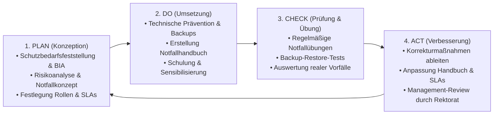

# Notfallkonzept (Richtlinie Notfallmanagement)

**Evangelische Hochschule Freiburg (EHF)**  
*im Rahmen des Informationssicherheitsmanagementsystems (ISMS)*  
**Klassifizierung:** Vertraulich | **Version:** 1.0 (Entwurf) | **Stand:** November 2026

---

## Inhaltsverzeichnis

1. [Dokumenteninformation](#1-dokumenteninformation)
   - [1.1 Dokumentendaten](#11-dokumentendaten)
   - [1.2 Dokumentenhistorie](#12-dokumentenhistorie)
   - [1.3 Beteiligte Personen](#13-beteiligte-personen)
   - [1.4 Mitgeltende Dokumente](#14-mitgeltende-dokumente)
   - [1.5 Rechtliche und normative Grundlagen](#15-rechtliche-und-normative-grundlagen)
2. [Einführung und Zweck](#2-einführung-und-zweck)
3. [Geltungsbereich und Verantwortungsabgrenzung (Scope)](#3-geltungsbereich-und-verantwortungsabgrenzung-scope)
   - [3.1 Räumlicher und organisatorischer Geltungsbereich](#31-räumlicher-und-organisatorischer-geltungsbereich)
   - [3.2 Drei-Säulen-Modell der IT- und Prozessverantwortung (EHF vs. EOK vs. Dienstleister)](#32-drei-säulen-modell-der-it--und-prozessverantwortung-ehf-vs-eok-vs-dienstleister)
4. [Definitionen und Kennzahlen](#4-definitionen-und-kennzahlen)
   - [4.1 Abgrenzung: Störung, Notfall, Krise, Katastrophe](#41-abgrenzung-störung-notfall-krise-katastrophe)
   - [4.2 Schutzbedarf, BIA-Kennzahlen (MTD, RTO, RPO) und Risikobewertung](#42-schutzbedarf-bia-kennzahlen-mtd-rto-rpo-und-risikobewertung)
   - [4.3 Betrachtete Bedrohungsszenarien](#43-betrachtete-bedrohungsszenarien)
5. [Zielsetzung und strategische Anforderungen](#5-zielsetzung-und-strategische-anforderungen)
6. [Vorgehensmodell im ISMS (PDCA-Zyklus)](#6-vorgehensmodell-im-isms-pdca-zyklus)
7. [Notfallorganisation der EHF](#7-notfallorganisation-der-ehf)
   - [7.1 Aufbauorganisation im Normal- und Notfallbetrieb](#71-aufbauorganisation-im-normal--und-notfallbetrieb)
   - [7.2 Organisation der Notfallvorsorge (Prävention & Planung)](#72-organisation-der-notfallvorsorge-prävention--planung)
   - [7.3 Organisation der Notfallbewältigung (Krisenstab EHF)](#73-organisation-der-notfallbewältigung-krisenstab-ehf)
   - [7.4 Krisenstabsraum und Kommunikationswege](#74-krisenstabsraum-und-kommunikationswege)
8. [Strategie für Notbetrieb und Wiederanlauf](#8-strategie-für-notbetrieb-und-wiederanlauf)
   - [8.1 Kategorisierung der Dienstleistungen für den Notbetrieb](#81-kategorisierung-der-dienstleistungen-für-den-notbetrieb)
   - [8.2 Priorisierung des Wiederanlaufs (Stufen 5 bis 3)](#82-priorisierung-des-wiederanlaufs-stufen-5-bis-3)
   - [8.3 Grundsätze der internen und externen Krisenkommunikation](#83-grundsätze-der-internen-und-externen-krisenkommunikation)
   - [8.4 Gesetzliche und vertragliche Meldepflichten](#84-gesetzliche-und-vertragliche-meldepflichten)
9. [Analyse, Dokumentation und Nachbereitung](#9-analyse-dokumentation-und-nachbereitung)
10. [Aufrechterhaltung, Übungen und Kontrolle](#10-aufrechterhaltung-übungen-und-kontrolle)
    - [10.1 Tests und Notfallübungen](#101-tests-und-notfallübungen)
    - [10.2 Kontinuierliche Verbesserung und Revision](#102-kontinuierliche-verbesserung-und-revision)
    - [10.3 Freigabe und Aufbewahrung](#103-freigabe-und-aufbewahrung)

---

## 1 Dokumenteninformation

### 1.1 Dokumentendaten

| Merkmal | Ausprägung |
| :--- | :--- |
| **Dokumententitel:** | Notfallkonzept (Richtlinie Notfallmanagement) der Evangelischen Hochschule Freiburg |
| **Dokumentenklasse:** | Richtlinie / Konzept im Rahmen des ISMS |
| **Klassifizierung:** | Vertraulich |
| **Dokumentenverantwortlicher:** | Informationssicherheitsbeauftragter (ISB) / Leitung IT |
| **Zielgruppe:** | Hochschulleitung (Rektorat), Krisenstab EHF, Abteilung IT, Bereichsverantwortliche |
| **Version:** | 1.0 |
| **Freigabe durch:** | Rektorat / Kanzler der Evangelischen Hochschule Freiburg |

### 1.2 Dokumentenhistorie

| Version | Status | Datum | Bearbeiter | Änderung / Bemerkung |
| :--- | :--- | :--- | :--- | :--- |
| **0.1** | Entwurf | 25.03.2026 | S. Spillmann, J. Eitenbichler-Hölzle | Initialer Entwurf (Zusammenführung EOK-Vorlage und interne Richtlinie) |
| **0.2** | Review | 26.03.2026 | J. Bauer (Secudor GmbH), J. Eitenbichler-Hölzle | Review und Beschluss zur Trennung in *Notfallkonzept* und *Notfallhandbuch* |
| **1.0** | Entwurf zur Freigabe | 09.11.2026 | J. Bauer (Secudor GmbH) | Ausarbeitung als eigenständiges Notfallkonzept der EHF inkl. Scope-Abgrenzung (EHF/EOK/Primus) und Schutzbedarfs-/Risikologik |

### 1.3 Beteiligte Personen

| Name | Rolle / Funktion | E-Mail-Adresse | Durchwahl / Mobil |
| :--- | :--- | :--- | :--- |
| **Dr. Rolf, Ulrich** | Kanzler (Krisenstabsleitung) | ulrich.rolf@eh-freiburg.de | -150 |
| **Prof. Dr. Kirchhoff, Renate** | Rektorin | renate.kirchhoff@eh-freiburg.ekiba.de | -100 |
| **Eitenbichler-Hölzle, Johannes** | Leitung IT | johannes.eitenbichler@eh-freiburg.de | -470 / 0162-4614919 |
| **Spillmann, Sophia** | Assistentin des Kanzlers (Personal/Organisation) | sophia.spillmann@eh-freiburg.de | -630 |
| **Hirth, Barbara** | Hochschulkommunikation / Pressestelle | barbara.hirt@eh-freiburg.de | -790 |
| **Trautmann, Peter** | Haustechnik / Gebäudemanagement | peter.trautmann@eh-freiburg.de | -210 |
| **Bauer, Jochen** | Informationssicherheitsbeauftragter (ISB, Secudor GmbH) | jochen.bauer@secudor.de | 0172-2776557 |
| **Kabir, Ziar** | Datenschutzbeauftragter (DSB) | *(siehe Kontaktliste im Notfallhandbuch)* | *(siehe Notfallhandbuch)* |

### 1.4 Mitgeltende Dokumente

Dieses Notfallkonzept bildet das strategische und organisatorische Rahmenwerk. Es steht in direkter Verbindung mit folgenden Dokumenten:

| Dokument | Zweck / Abgrenzung | Ablageort |
| :--- | :--- | :--- |
| **Notfallhandbuch der EHF (`notfallhandbuch.md`)** | Operatives Ernstfall-Dokument mit Rufnummern, Sofort-Checklisten, Alarmierungsplan und konkreten Szenarien-Runbooks | SharePoint ISMS EH-Freiburg, Notfall-Tresor (Papierform) & verschlüsselte Datenträger Krisenstab |
| **Schutzbedarfsfeststellung (`Schutzbedarfsfeststellung.xlsx`)** | Verzeichnis der Schutzobjekte, Anwendungen und IT-Systeme inkl. Bewertung von Verfügbarkeit, Integrität, Vertraulichkeit (0–3), Gewichtung (1–5), RTO und RPO | SharePoint `ISMS EH-Freiburg/02_Verzeichnisse/` |
| **Schutzbedarf & Risikoanalyse IT-Anwendungen (`Schutzbedarf-IT-Anwendungen.xlsx`)** | Technische Abhängigkeiten, Angriffserkennung (Detektion), technische Sofortmaßnahmen und abgeleitete Sicherheitsmaßnahmen | SharePoint `ISMS EH-Freiburg/02_Verzeichnisse/` |
| **SLA-Vereinbarungen (EOK Karlsruhe & Primus Erlangen)** | Leistungs- und Entstörungsvereinbarungen für extern betriebene bzw. unterstützte IT-Infrastruktur | Vertragsablage Kanzleramt / Leitung IT |
| **Vorlage Notfallprotokoll** | Formular zur lückenlosen Ereignis- und Entscheidungsdokumentation während eines Notfalls | SharePoint `ISMS/07_Dokumentationen/Vorlagen` sowie als Druckvorlage im Notfallhandbuch |

### 1.5 Rechtliche und normative Grundlagen

Die Vorgaben dieses Notfallkonzepts sowie des zugehörigen Notfallhandbuchs orientieren sich an:
- **ISO/IEC 27001:2022** (insb. Controls A.5.24 bis A.5.28 zum Incident Management sowie A.5.29 und A.5.30 zur Informationssicherheit während einer Betriebsunterbrechung / IKT-Bereitschaft für Business Continuity),
- **BSI-Standard 100-4 / 200-4** (Business Continuity Management / Notfallmanagement),
- **DSGVO / EKD-Datenschutzgesetz (EKD-DSG)** hinsichtlich der Meldepflichten bei Verletzungen des Schutzes personenbezogener Daten.

---

## 2 Einführung und Zweck

Ein wirksames Notfallmanagement (*Business Continuity Management*, BCM) umfasst das geplante und organisierte Vorgehen, um die Widerstandsfähigkeit der zeitkritischen Prozesse in Lehre, Forschung und Hochschulverwaltung der **Evangelischen Hochschule Freiburg (EHF)** nachhaltig zu sichern, auf Schadensereignisse zielgerichtet zu reagieren und den Hochschulbetrieb schnellstmöglich wieder aufzunehmen.

Grundsätzlich werden dabei zwei Handlungsfelder unterschieden, die sich auch in der **Zweiteilung der Dokumentation** widerspiegeln:

1. **Notfallvorsorge & Governance (dieses Dokument – *Notfallkonzept*):**
   - *Was muss präventiv und organisatorisch geregelt sein, um Notfälle zu verhindern, Zuständigkeiten vorab zu klären und Schadensauswirkungen zu begrenzen?*
   - Dieses Dokument definiert den Geltungsbereich, die Notfallorganisation (Krisenstab), die Bewertungsmaßstäbe (RTO/RPO, Eskalationsstufen) sowie den kontinuierlichen Verbesserungs- und Übungsprozess.
2. **Reaktive Notfallbewältigung (separates Dokument – *Notfallhandbuch*):**
   - *Wie wird im akuten Ernstfall unter Zeitdruck und Stress strukturiert gehandelt?*
   - Das separate **Notfallhandbuch** enthält bewusst keine theoretischen Abhandlungen, sondern ausschließlich direkt ausführbare Checklisten, Rufnummern, Meldewege und Wiederanlauf-Steckbriefe.

---

## 3 Geltungsbereich und Verantwortungsabgrenzung (Scope)

### 3.1 Räumlicher und organisatorischer Geltungsbereich

Dieses Notfallkonzept gilt verbindlich für alle Organisationseinheiten, Gebäude (Campus Bugginger Straße 38 inkl. Anbauten) und Mitarbeitenden der **Evangelischen Hochschule Freiburg (EHF)** sowie – soweit vertraglich vereinbart – für eingebundene externe Dienstleister.

### 3.2 Drei-Säulen-Modell der IT- und Prozessverantwortung (EHF vs. EOK vs. Dienstleister)

Da die Evangelische Hochschule Freiburg sowohl eigene lokale Infrastruktur betreibt als auch zentrale IT- und Cloud-Dienste über den **Evangelischen Oberkirchenrat Karlsruhe (EOK / EKIBA)** sowie externe IT-Systemhäuser (**Primus Service GmbH Erlangen**, **Leitwerk**) bezieht, ist für das Notfallmanagement eine **eindeutige Abgrenzung der operativen Hoheit** zwingend erforderlich:

| Infrastruktursäule | Umfasste Systeme & Ressourcen (Beispiele) | Betriebs- & Entstörungshoheit | Rolle der EHF im Notfall |
| :--- | :--- | :--- | :--- |
| **Säule 1: Lokale EHF-Infrastruktur & Gebäudetechnik** | • Lokale Active Directories (`eh-freiburg`, `eh-lehre`) • `OpenLDAP` • RemoteDesktop-Server (`RDS1`, `RDS2`, `Ncomputing4`) • Telefonserver (`3CX`) • Lernplattform (`ILIAS`) • Lokales LAN/WLAN, Switches, Drucker, Serverräume & Campus-Gebäude Freiburg | **EHF (Leitung IT & Haustechnik)** mit technischer Unterstützung über SLA **Primus Erlangen** (und ggf. **Leitwerk**) | **Volle operative Handlungs- und Wiederanlaufhoheit:** Eigene Störungsbehebung, Systemisolation, Backup-Restore und Koordination der Dienstleister vor Ort / per Fernwartung. |
| **Säule 2: Zentrale EOK-Dienste (Rechenzentrum TelemaxX)** | • Zentrale Kirchen-/Verwaltungsfachverfahren (`Phoenix`, `KFM`, `DaviP`, `DKB`, `SF Buchungsplan`, `Fundus`) • Zentrale EOK-Infrastruktur (`OTOBO`-Ticketsystem, `Citrix`, zentrale Domaincontroller, `Fortigate`/WAN-Übergang) | **Evangelischer Oberkirchenrat (EOK) Karlsruhe – Abteilung IT** (Betreiber im RZ TelemaxX) | **Steuerung über EOK-SLA & lokaler Notbetrieb:** Keine eigene technische Administration durch die EHF. Im Ausfall- oder Sicherheitsvorfall: Unverzügliche Meldung an EOK-IT, Einfordern von Statusberichten gemäß SLA und Aktivierung lokaler EHF-Workarounds (z. B. Papier-/Offline-Prozesse). |
| **Säule 3: Cloud-Services (Microsoft 365 / Azure)** | • `Entra ID` (Authentifizierung) • `Exchange Online` (E-Mail) • `Microsoft Teams` • `SharePoint Online` / `OneDrive` • `MS Intune` | **Microsoft / Bereitstellung über EOK-Tenant** | **Ausweichkommunikation & Arbeitsfähigkeit sichern:** Meldung über EOK-IT/Microsoft-Support; Umschalten der EHF-internen Kommunikation auf Out-of-Band-Kanäle (Mobilfunk, 3CX, lokale Server/Laufwerke). |

---

## 4 Definitionen und Kennzahlen

### 4.1 Abgrenzung: Störung, Notfall, Krise, Katastrophe

Um im Ereignisfall Fehleinschätzungen oder verzögerte Eskalationen zu vermeiden, gelten an der EHF folgende Begriffsdefinitionen (angelehnt an BSI-Standard 200-4):

- **Störung:** Kurzfristige, lokal begrenzte Abweichung vom geplanten Betrieb, die über die regulären Betriebs- und Supportprozesse (IT-Support / Haustechnik) innerhalb der definierten Wiederanlaufzeit (RTO) behoben werden kann.
- **Notfall:** Länger andauernder Ausfall essenzieller Geschäftsprozesse, Gebäude- oder IT-Ressourcen, dessen Behebung mit alltäglichen Verfahren nicht mehr möglich ist, bei dem die **definierte maximale Wiederherstellungszeit (RTO) überschritten** wird oder ein schwerwiegender Sicherheitsvorfall (z. B. Ransomware-Befall, Brand, flächendeckender Stromausfall) vorliegt. Ein Notfall führt zur Aktivierung des **Krisenstabs der EHF**.
- **Krise:** Ein verschärfter Notfall mit existenzbedrohendem Charakter, unklarer Informationslage, erheblichem Reputations- oder Personenschaden oder gleichzeitigem Ausfall beider primärer IT-Säulen.
- **Katastrophe:** Großschadensereignis (z. B. überregionaler Blackout, schwere Naturkatastrophe), bei dem die öffentliche Gefahrenabwehr (Behörden, Katastrophenschutz) die Gesamtleitung übernimmt.

### 4.2 Schutzbedarf, BIA-Kennzahlen (MTD, RTO, RPO) und Risikobewertung

Die Einstufung aller IT-Systeme und Anwendungen der EHF erfolgt in der **Schutzbedarfsfeststellung** nach einem einheitlichen numerischen Schema:

1. **Schutzbedarf je Grundwert (Skala 0 bis 3):**
   - **Verfügbarkeit ($A$):** `0` = keine Relevanz | `1` = eingeschränkt | `2` = während der Hochschul-/Bürozeiten | `3` = durchgehend (24/7)
   - **Integrität ($I$):** `0` = niedrig | `1` = moderat | `2` = regulär | `3` = hoch
   - **Vertraulichkeit ($C$):** `0` = öffentlich | `1` = intern | `2` = vertraulich | `3` = geheim / streng vertraulich
   - **Gesamt-Schutzbedarf:** Bestimmt sich nach dem Maximum-Prinzip aus $\max(C, I, A)$ als `niedrig` (0–1), `mittel` (2) oder `hoch` (3).
2. **Gewichtung für die Wiederanlauf-Priorisierung (Skala 1 bis 5):**
   - Jedes Schutzobjekt erhält eine **Gewichtung von 1 (geringste Priorität) bis 5 (höchste Priorität / absolut geschäftskritisch)**.
3. **Zeitliche Notfall-Kennzahlen (Business Impact Analysis – BIA):**
   - **MTD / MTPD (*Maximum Tolerable Downtime*):** Maximal tolerierbare Ausfallzeit, nach deren Überschreitung ein untragbarer Schaden für die Hochschule entsteht.
   - **RTO (*Recovery Time Objective* / Wiederanlaufzeit):** Zielzeitspanne vom Eintritt des Ausfalls bis zur Wiederbereitstellung des Systems im Notbetrieb. Es gilt zwingend: $\text{RTO} < \text{MTD}$.
   - **RPO (*Recovery Point Objective*):** Maximal tolerierbarer Datenverlust gemessen in Zeit (bestimmt das Mindestintervall der Datensicherung / Backups, z. B. `2h`, `4h`, `8h`).
4. **Ableitung und Priorisierung von Präventiv- und Detektionsmaßnahmen (Risikowert):**
   - Um technische und organisatorische Schutzmaßnahmen (z. B. Einführung automatischer Angriffserkennung/IDS, Backup-Härtung, Redundanzen) belastbar zu priorisieren, wird die **Gewichtung ($1\text{–}5$)** bzw. **Schadenshöhe ($1\text{–}3$)** mit der **Eintrittswahrscheinlichkeit / dem aktuellen Schwachstellengrad ($1\text{–}3$)** zum **Risikowert** multipliziert:
     $$\text{Risikowert} = \text{Schadenshöhe } S \times \text{Eintrittswahrscheinlichkeit } W$$
   - Systeme mit hohem Schutzbedarf ($S=3$) und fehlender automatischer Detektion ($W=3$) erreichen den höchsten Risikowert ($9$) und werden bei der Maßnahmenumsetzung vorrangig behandelt.

### 4.3 Betrachtete Bedrohungsszenarien

Das Notfallmanagement der EHF ist **wirkungsorientiert** aufgebaut (Ausfall von Gebäude, Personal, IT-Infrastruktur oder Dienstleistern) und berücksichtigt insbesondere folgende Szenarien, für die im **Notfallhandbuch** spezifische Handlungsanweisungen hinterlegt sind:
1. **Stromausfall** (Gebäude-/Teilausfall bis hin zum regionalen/überregionalen Blackout)
2. **Internet- und Telekommunikationsausfall** (Lokaler Leitungsschaden bis hin zum Provider-Ausfall)
3. **Brand, Rauch und Gebäudeevakuierung** am Campus Freiburg
4. **Naturkatastrophen und Elementarschäden** (Unwetter, Starkregen/Wasserschaden, Sturm, Erdbeben)
5. **Epidemie / Pandemie** bzw. massiver Personalausfall
6. **Unfälle in der Nachbarschaft / Unzugänglichkeit des Campus** (z. B. Großschadenslage, Bombenfund, Bedrohungslage/Vandalismus)
7. **Ausfall lokaler EHF-Primärsysteme** (Lokale ADs `eh-freiburg`/`eh-lehre`, `OpenLDAP`, `RDS`, `3CX`, `ILIAS`)
8. **Ausfall zentraler Cloud- oder EOK-Dienste** (`M365 Entra ID`, `Exchange Online`, `SharePoint`, `Teams`, `TelemaxX`-Fachverfahren)
9. **Cyber-Angriff und Schadsoftware (Ransomware, Phishing, Kompromittierung von Administratorkonten)**

---

## 5 Zielsetzung und strategische Anforderungen

Im Falle eines Notfalls gelten an der EHF folgende Ziele in absteigender Priorität:

1. **Personenschutz vor Sach- und Datenwerten:** Die Sicherheit sowie körperliche Unversehrtheit von Studierenden, Mitarbeitenden, Lehrenden und Gästen hat unter allen Umständen oberste Priorität (*Umgebung sichern $\rightarrow$ Ereignis melden $\rightarrow$ Personen versorgen*).
2. **Schadenseindämmung (Containment):** Verhinderung einer weiteren Ausbreitung des Schadens (z. B. Evakuierung bei Gefahr; sofortige Netzwerkisolation bei Cyberangriffen, um *Lateral Movement* zu unterbinden).
3. **Schnellstmöglicher Notbetrieb:** Wiederaufnahme der zeitkritischen Prozesse von Verwaltung und Lehre innerhalb der festgelegten **RTO** (ggf. über definierte Ausweichverfahren oder mobiles Arbeiten).
4. **Vollständige Wiederherstellung:** Geordnete Rückführung in den regulären Normalbetrieb unter Einhaltung der **RPO**-Vorgaben aus der Schutzbedarfsfeststellung sowie lückenlose Nachbereitung.

---

## 6 Vorgehensmodell im ISMS (PDCA-Zyklus)

Das Notfallmanagement ist integraler Bestandteil des Informationssicherheitsmanagementsystems (ISMS) und folgt dem kontinuierlichen Verbesserungsprozess nach dem **PDCA-Modell (Plan – Do – Check – Act)**:

---

## 7 Notfallorganisation der EHF

### 7.1 Aufbauorganisation im Normal- und Notfallbetrieb

An der Evangelischen Hochschule Freiburg wird bewusst **keine Trennung** zwischen einem allgemeinen Krisenstab und einem separaten „IT-Notfallteam“ vorgenommen. Stattdessen existiert **ein einheitlicher Krisenstab (Notfallteam) der EHF**, der je nach Art des Notfalls (Gebäude-, Personal- oder IT-/Cyber-Notfall) die relevanten Fachexperten und Dienstleister hinzuzieht.

### 7.2 Organisation der Notfallvorsorge (Prävention & Planung)

- **Hochschulleitung (Rektorat / Kanzler):** Trägt die Gesamtverantwortung für das Notfallmanagement, gibt das Notfallkonzept frei und stellt die erforderlichen personellen, technischen und finanziellen Ressourcen (inkl. Dienstleister-SLAs) bereit.
- **Leitung IT & Informationssicherheitsbeauftragter (ISB):** Koordinieren gemeinsam mit dem Kanzleramt die Erstellung, Pflege und jährliche Überprüfung des Notfallkonzepts, des Notfallhandbuchs sowie der Schutzbedarfsfeststellung. Sie planen Notfall- und Wiederanlaufübungen und werten diese aus.

### 7.3 Organisation der Notfallbewältigung (Krisenstab EHF)

Mit Ausrufung eines Notfalls tritt der **Krisenstab der EHF** als temporäre Aufbauorganisation zusammen, die für die Dauer der Notfallbewältigung abteilungsübergreifende Entscheidungs- und Steuerungskompetenzen bündelt:

| Rolle im Krisenstab | Funktionsträger (EHF / Extern) | Kernaufgaben im Notfall |
| :--- | :--- | :--- |
| **Krisenstabsleitung (Vorsitz)** | **Kanzler** (Dr. Ulrich Rolf) *Vertretung:* **Rektorin** (Prof. Dr. Renate Kirchhoff) | • Ausrufung und Beendigung des Notfalls • Taktisch-strategische Gesamtleitung und Ressourcenfreigabe • Entscheidung über Einstellung/Verlegung des Lehr- und Prüfungsbetriebs sowie mobiles Arbeiten • Freigabe externer Meldungen (Ministerium/MWK, Landeskirche/EOK, Behörden) |
| **Technische Einsatzleitung IT** | **Leitung IT** (Johannes Eitenbichler-Hölzle) | • Technische Lagebeurteilung und Koordination der IT-Sofortmaßnahmen • Steuerung der externen IT-Dienstleister (**Primus Erlangen**, **EOK-IT**, **Leitwerk**) • Leitung des technischen Wiederanlaufs und der Systemwiederherstellung |
| **Einsatzleitung Gebäude / Infrastruktur** | **Haustechnik** (Peter Trautmann) | • Sicherung der Gebäudeinfrastruktur (Strom, Wasser, Heizung, Schließanlage, Brandschutz) • Einweisung von Feuerwehr, Rettungskräften und technischen Entstördiensten vor Ort |
| **Organisation, Personal & Protokollführung** | **Assistentin des Kanzlers / Personal** (Sophia Spillmann) | • Führung des **Notfallprotokolls** (Entscheidungen, Zeitstempel, Maßnahmen) • Organisatorische Koordination (Personalplanung, Information interner Stellen) |
| **Krisenkommunikation & Pressearbeit** | **Hochschulkommunikation** (Barbara Hirth) | • Entwurf und Versand abgestimmter interner Statusmeldungen (Mitarbeitende, Lehrende, Studierende) • Koordination sämtlicher Presse- und Medienanfragen in Abstimmung mit dem Rektorat |
| **Informationssicherheit (ISB)** | **ISB** (Jochen Bauer, Secudor GmbH) | • Methodische und sicherheitstechnische Beratung des Krisenstabs • Unterstützung bei Cyber-Vorfällen, Forensik-Koordination und Behördenmeldungen |
| **Erweiterter Krisenstab (situativ hinzugezogen)** | • **DSB** (Ziar Kabir) • **EOK-Rechtsabteilung** (Thomas Koch) • **Vorsitz MAV** • **Primus Erlangen** / **Leitwerk** / **EOK-IT** | • **DSB:** Prüfung und Durchführung von Datenschutzmeldungen (EKD-Aufsichtsbehörde binnen 72 Std.) • **Recht / MAV:** Rechtliche und dienstvereinbarungsrelevante Abstimmung • **Dienstleister:** Operative Entstörung, Incident Response und Systemwiederaufbau |

### 7.4 Krisenstabsraum und Kommunikationswege

1. **Physischer Treffpunkt (Primär):** Konferenzraum **„Raum der Begegnung“** (ermöglicht bei intakter Infrastruktur auch hybride Zuschaltungen).
2. **Ausweichtreffpunkt:** Sollte das Hauptgebäude nicht betretbar sein (z. B. Brand, Evakuierung), trifft sich der Krisenstab am definierten Sammelplatz bzw. in einem nicht betroffenen Gebäudeteil und weicht anschließend auf eine mobile/virtuelle Konferenz aus.
3. **Kommunikationskanäle des Krisenstabs (Out-of-Band-Fähigkeit):**
   - **Primär (sofern verfügbar):** Persönliche Zusammenkunft, Microsoft Teams.
   - **Bei Ausfall von M365 / Netzwerk / 3CX (Out-of-Band):** Mobilfunk-Telefonie (Dienst- und hinterlegte Mobilnummern gemäß Notfallhandbuch), SMS/Signal-/Messenger-Gruppe auf Mobilgeräten sowie mobile LTE/5G-Hotspots.

---

## 8 Strategie für Notbetrieb und Wiederanlauf

### 8.1 Kategorisierung der Dienstleistungen für den Notbetrieb

Bei einem größeren IT-Ausfall oder einer Kompromittierung von Verzeichnisdiensten (Active Directory) werden alle Prozesse und Dienstleistungen der EHF zur schnellen Herstellung einer Teilarbeitsfähigkeit in vier Kategorien eingeteilt:

1. **„Nicht betroffen“:** Prozesse und Dienste, die keines der ausgefallenen Systeme benötigen und regulär weiterlaufen können.
2. **„Mit mobilem / autarkem Equipment eingeschränkt arbeitsfähig“:** Prozesse, die über nicht betroffene Endgeräte („saubere“ Laptops, Smartphones, mobile LTE-Hotspots) und direkt über das Internet erreichbare Cloud-/SaaS-Dienste (z. B. M365 bei lokalem EHF-Ausfall, oder umgekehrt lokale Systeme bei M365-Ausfall) weitergeführt werden können.
3. **„Auslagerungsfähig“:** Prozesse, die kurzfristig über Infrastruktur von Partnerorganisationen (z. B. EOK Karlsruhe oder Dienstleister) abgebildet werden können.
4. **„Ohne Neuaufbau / Wiederherstellung nicht arbeitsfähig“:** Prozesse, die zwingend auf die technische Wiederherstellung der betroffenen Primärsysteme angewiesen sind.

### 8.2 Priorisierung des Wiederanlaufs (Stufen 5 bis 3)

Der Wiederanlauf orientiert sich strikt an den in der **Schutzbedarfsfeststellung** festgelegten Gewichtungen (`5` bis `1`) und `RTO`-Vorgaben, getrennt nach **EHF-Eigenbetrieb** und **EOK-/Cloud-Bereitstellung**:

| Prioritätsstufe | A. Systeme in EHF-Verantwortung (inkl. SLA Primus Erlangen) | B. Systeme in EOK- / Cloud-Verantwortung (Steuerung über SLA) |
| :--- | :--- | :--- |
| **Priorität 5 – Absolut kritisch** *(Sofortiger Wiederanlauf, Ziel-RTO: 2–8 Std.)* | • **Netzwerk- & Firewall-Grundfunktionen** am Campus • **Lokale Active Directories (`eh-freiburg`, `eh-lehre`) & `OpenLDAP`** • **Backups / Datensicherungsinfrastruktur** • **Telefonserver (`3CX`)** | • **WAN-/TelemaxX-Anbindung & Fortigate** • **M365 Basisdienste** (`Entra ID`, `Exchange Online`, `Teams`, `SharePoint`) • **Ticketsystem (`OTOBO`)** • **Finanz-/Personal-Kernsysteme** (`KFM`, `Diamant`, `DaviP`) |
| **Priorität 4 – Sehr wichtig** *(Wiederanlauf nach Prio 5, Ziel-RTO: 8–24 Std.)* | • **RemoteDesktop-Server (`RDS1`, `RDS2`, `Ncomputing4`)** • **Lernplattform (`ILIAS`)** für den Lehrbetrieb • **Lokale Datei- und Verwaltungsserver** | • **Fachanwendungen Verwaltung/Personal** (`Phoenix`, `Loga HR`, `Kidicap`, `SF Buchungsplan`, `Fundus`) • **Citrix-Infrastruktur** • **Passwort- & Endpoint-Management** (`1Password`, `KeePass`, `MS Intune`) |
| **Priorität 3 – Wichtig** *(Nachgelagerter Wiederanlauf, Ziel-RTO: > 24 Std. – 1 Woche)* | • **Lokale Arbeitsplatzrechner & Hörsaal-Medientechnik** • **Sekundäre Dienste & Evaluationssysteme** (`Evasys`) • **Druckersysteme** | • **Weitere Fachanwendungen** (`Enaio`, `Concludis`, `BITE`, `ZGAST`, `i-doit`) |

### 8.3 Grundsätze der internen und externen Krisenkommunikation

- **Interne Kommunikation vor externer Kommunikation:** Mitarbeitende, Lehrende und Studierende werden frühzeitig und sachlich informiert, um Gerüchten und Spekulationen vorzubeugen.
- **Feste Kommunikationsintervalle im Notfall:** Während eines aktiven Notfalls findet im Krisenstab **mindestens alle 2 Stunden** eine kurze Lagebesprechung statt. Ein zusammengefasster Statusbericht für die Hochschulleitung und zur externen Sprachregelung wird mindestens **einmal täglich** erstellt.
- **Zentralisierte Außenkommunikation („One Voice Policy“):** Sämtliche Auskünfte gegenüber Medien, Öffentlichkeit, dem Ministerium (MWK) oder der Landeskirche erfolgen ausschließlich über die **Hochschulkommunikation (Pressestelle)** in direkter Abstimmung mit dem **Rektorat (Rektorin / Kanzler)**.
- **Ersatz-Kommunikationsinfrastruktur:** Für den Fall eines Ausfalls von E-Mail und VoIP-Telefonie hält die EHF alternative Kommunikationswege (Mobilfunk, LTE-Hotspots, Aushänge an zentralen Punkten am Campus sowie ggf. Statushinweise über die Website) vor.

### 8.4 Gesetzliche und vertragliche Meldepflichten

Im Rahmen jedes Sicherheits- oder Notfallereignisses prüft der Krisenstab unverzüglich folgende Meldepflichten:
1. **Datenschutz-Aufsichtsbehörde (EKD-Datenschutzaufsicht):** Bei Verletzungen des Schutzes personenbezogener Daten (z. B. Datenabfluss bei Cyberangriffen, Ransomware oder unbefugtem Zugriff) muss die Meldung durch den **Datenschutzbeauftragten (DSB)** grundsätzlich **innerhalb von 72 Stunden** erfolgen (inkl. Prüfung der Benachrichtigungspflicht gegenüber den betroffenen Personen).
2. **Strafverfolgungsbehörden (Polizei / ZAC Baden-Württemberg / LKA):** Bei kriminellen Handlungen (Cyber-Erpressung/Ransomware, Einbruch, Sabotage) erfolgt nach Entscheidung des Kanzlers / Rektorats die Einschaltung der Ermittlungsbehörden. **Grundsatz:** Auf Lösegeldforderungen bei Ransomware wird grundsätzlich nicht eingegangen.
3. **Aufsichtsgremien & Vertragspartner:** Information des Evangelischen Oberkirchenrats (EOK) sowie ggf. des Ministeriums für Wissenschaft, Forschung und Kunst Baden-Württemberg (MWK) und der Cyber-/Sachversicherung.

---

## 9 Analyse, Dokumentation und Nachbereitung

1. **Laufende Dokumentation im Notfall (Notfallprotokoll):**
   - Von Beginn des Notfalls an werden alle Meldungen, Lagebeurteilungen, getroffenen Entscheidungen und eingeleiteten Maßnahmen chronologisch im **Notfallprotokoll** festgehalten.
2. **Strukturierte Nachbereitung (Lessons Learned):**
   - Nach jedem bewältigten Notfall sowie nach jeder Notfallübung führt der Krisenstab eine verbindliche Nachbesprechung durch. Dabei werden ausgewertet:
     - **Ursachenanalyse (Root Cause):** Wie kam es zum Vorfall? Welche Präventiv- oder Detektionsmaßnahme hat gefehlt oder versagt? Wie schnell wurde der Vorfall erkannt?
     - **Prozessanalyse:** Wie wirksam waren Alarmierung, Krisenstabsarbeit, Dienstleister-Steuerung (SLA-Reaktionszeiten), interne/externe Kommunikation und die Checklisten des Notfallhandbuchs?
3. **Abschlussbericht und Maßnahmenplan:**
   - Die Ergebnisse und abgeleiteten Verbesserungsmaßnahmen werden in einem Abschlussbericht dokumentiert, im Krisenstab und mit dem Rektorat besprochen und im SharePoint unter `ISMS/07_Dokumentationen/Notfallprotokolle` abgelegt.

---

## 10 Aufrechterhaltung, Übungen und Kontrolle

### 10.1 Tests und Notfallübungen

Um sicherzustellen, dass die im Notfallhandbuch beschriebenen Abläufe im Ernstfall zuverlässig funktionieren, werden regelmäßige Tests durchgeführt:
- **Jährliche Planbesprechung / Tabletop-Übung:** Durchspielen eines konkreten Notfallszenarios (z. B. Ransomware-Ausfall oder Stromausfall) im Krisenstab zur Prüfung der Meldewege und Entscheidungsprozesse.
- **Regelmäßige technische Wiederherstellungstests (Backup-Restore-Tests):** Überprüfung der Integrität und Wiederherstellungsdauer (RTO/RPO) der Datensicherungen für die kritischen EHF-Systeme.

### 10.2 Kontinuierliche Verbesserung und Revision

Das Notfallkonzept und das Notfallhandbuch werden **mindestens einmal jährlich** sowie **anlassbezogen** (nach realen Notfällen, bei wesentlichen Infrastruktur- oder Organisationsänderungen oder neuen Dienstleisterverträgen) durch die Leitung IT und den ISB auf Aktualität geprüft und fortgeschrieben. Insbesondere die Kontakt- und Rufnummernlisten im Notfallhandbuch werden regelmäßig verifiziert.

### 10.3 Freigabe und Aufbewahrung

- Dieses Notfallkonzept tritt mit Freigabe durch das **Rektorat / den Kanzler der EHF** in Kraft.
- Es wird elektronisch im ISMS-SharePoint der EHF vorgehalten. Das zugehörige **Notfallhandbuch** wird zusätzlich an definierten, ausfallsicheren Orten (Papierform im Tresor sowie verschlüsselt auf Offline-Speichermedien der Krisenstabsmitglieder) aufbewahrt.
