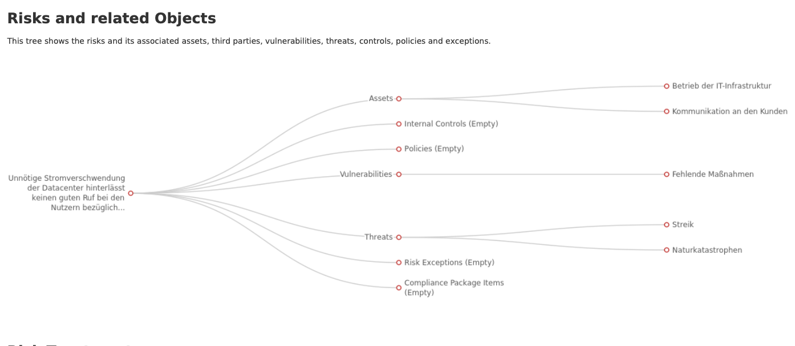
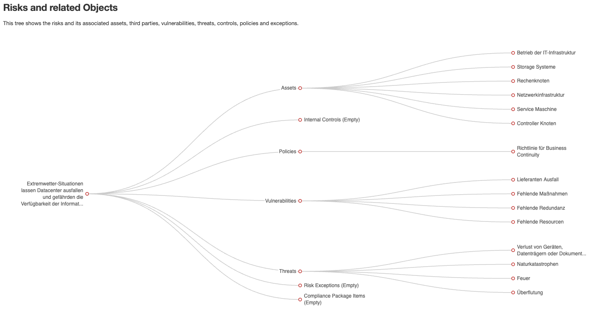
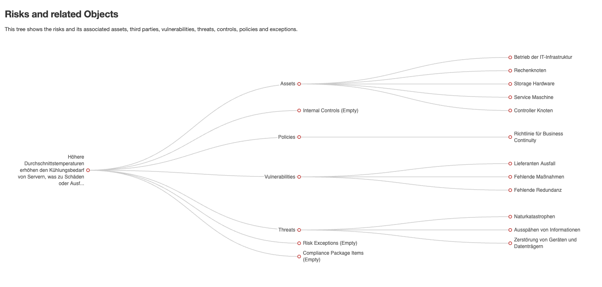
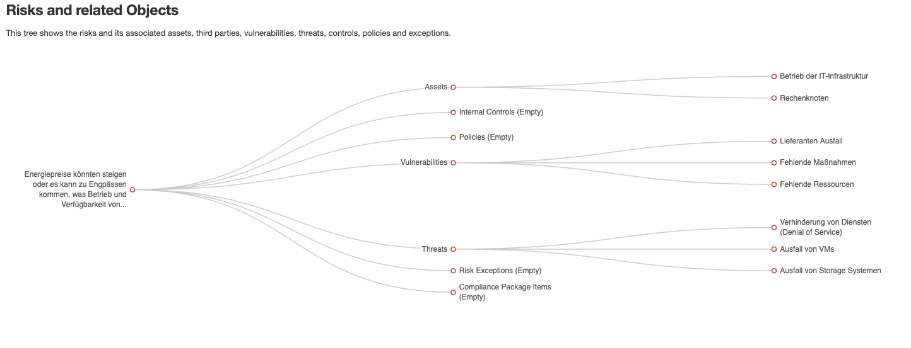

# Erklärung Klimabezogene Maßnahmen (2025)

Dies ist eine Stellungnahmen und Analyse zu der Ergänzung
"ISO/IEC 27001 AMD 1:2024-02 - Ergänzungen zu klimabezogenen Maßnahmen".

## Unser Impact (Reputation und Versorgungsrisiken)

Da die de.NBI Cloud eine IT-Infrastruktur betreibt, die auf rechenintensive Workloads spezialisiert ist,
sind Bedenken hinsichtlich des Klimawandels gegeben.
In den Medien lassen sich immer mehr Berichterstattungen hinsichtlich den Betrieb von Datacenter
 und Energie-Effizienz [finden](https://science.orf.at/stories/3221748/).

Der Hauptfaktor bezüglich dem Impact ist in diesem Fall der Energieverbrauch der Datacenter.

Dies wurde auch schon im Risikomanagement analysiert:

Unterfaktoren, welche den Energieverbrauch beeinflussen:

- Die Auswahl der Hardware-Komponenten.
  - Hinsichtlich von Grafikbeschleunigern gibt es drastische Unterschiede im Stromverbrauch. Beispielsweise ist hier die NVIDIA H100 zu
   nennen, welche im Leerlauf einen Stromverbrauch von teilweise 100W hat. Mittelklasse GPUs liegen hierbei bei ca. 30W und sind für die
   meisten Nutzer völlig ausreichend.
  - Die Workloads werden optimiert hinsichtlich ihrer Parallelität. Die Erhöhung der Kerne ist daher oftmals effizienter als der reine Basistakt.
- Die effiziente Auslastung der Infrastruktur.
  - Die Kapazitäten der de.NBI Cloud sind für die Nutzer kostenlos. Dies hat den Nachteil, dass Nutzer teilweise diese Ressourcen
   verschwenden. Gerade bei stromhungrigen Grafikbeschleunigern ist die Problematik gegeben. Diese können, anders als bei CPU-Kernen,
   nicht geteilt werden und laufen eine lange Zeit im Leerlauf. Um die Verschwendung entgegen zu wirken, wird ein Projekt entwickelt -> COM-474.
  - Für generelle Ressourcen wird, durch die de.NBI Cloud Governance, ein Credits-System entwickelt.
    Dies stellt eine "virtuelle Währung" dar. Sollten die Credits aufgebraucht sein,
    so muss der Nutzer den Erhalt weiterer Credits begründen müssen.
  - Die automatische "Leerräumung" von kaum genutzten Compute-Knoten kann anschließend eingeführt werden.
  Eine Technik dazu wurde in einer Bachelorarbeit evaluiert. Die Funktion der Live-Migration war damals jedoch sehr instabil.
  Die Implementierung der Bachelorarbeit sollte wieder aufgenommen werden und um eine Abschaltfunktion der Nodes erweitert werden.
- Konfiguration der Storage-Hardware
  - Für die Storage-Knoten besteht die allgemeine Empfehlung, die CPU-Energieoptionen auf `performance` zu setzen. Dies hat zufolge,
  dass der Basistakt der CPU immer auf dem Maximum steht. Dadurch wird die Input/-Output performance gesteigert.
  Eine dauerhafte Maximierung des Basistakts bedeutet aber auch ein erhöhter Energiebedarf von ca. 60% des Prozessors.
  Die Konfiguration wird daher auf `ondemand` gesetzt.
- Auswahl der Datacenter
  - Das Hauptgebäude der Universität wird saniert. Daher müssen die Datacenter in den kommenden Jahren geräumt werden.
  Dies bietet auch eine Chance bezüglich der Wahl eines neuen Datacenters hinsichtlich der Energieeffizienz.
  - In der näheren Auswahl stehen nachhaltige Datacenter, wie beispielsweise [Windcores](https://www.windcores.de/).
  Siehe COM-450.

## Impact gegenüber uns

### Physische Risiken

Der Klimawandel kann direkte Auswirkungen auf unsere Geschäftsprozesse haben. Hierbei zählen beispielsweise Extremwetter,
die zu Ausfällen in Datacenter und dadurch eine Verletzung der Verfügbarkeit darstellen. Stromausfälle haben wir betrachtet und
mitigieren diese durch USV und Dieselaggregate. Stürme, Überschwemmungen, Hitze- und Kältewellen jedoch noch nicht.

Um die Kühlleistung nicht zu überfordern, würde das automatische Abschalten von Compute-Nodes uns auch hier in die Karten spielen.
Eine Geo-Redundanz ist, mit den jetzigen Mitteln, nicht zu realisieren.

Erstelle Risiko:

Extremwetter-Situationen lassen Datacenter ausfallen und gefährden die Verfügbarkeit der Informationen.

Höhere Durchschnittstemperaturen erhöhen den Kühlungsbedarf von Servern, was zu Schäden oder Ausfällen der Infrastruktur führen kann.

### Versorgungsrisiken

Energieknappheit oder -preise werden durch unsere Projekte (siehe Unser Impact) mitigiert mithilfe von intelligenten Abschaltvorrichtungen
und Monitoring-Prozessen. Dennoch sollten solche Engpässe als Risiko mit aufgenommen werden:

Erstelle Risiko:

Energiepreise könnten steigen oder es kann zu Engpässen kommen, was Betrieb und Verfügbarkeit von Infrastruktur einschränkt.

Unterbrechungen von Lieferketten ist weniger ein Risiko für uns, da wir nicht auf spezialisierte Ersatzteile angewiesen sind und
unsere Auswahl keinen größeren Vendor-Lockin hat. Ein (Not-)Betrieb ist auch mit abgeschriebener bzw. alter Hardware gegeben.

Ein Ausfall externer Dienstleister, wie beispielsweise GitLab oder co. ist durch Redundanzen und Backups schon behandelt. Komplettausfälle
von Datacenter sind in der BCM-Richtlinie des ISMS geregelt.

### Compliance-Risiken

Es existieren rechtliche Anforderungen an Datacenter. Für einen Überblick siehe
[hier](https://www.germandatacenters.com/news/detail/ueberblick-enefg-fuer-rechenzentren/).
Wir haben zwar keine eigene Datacenter gebaut, aber Dienstleister welche für uns Räumlichkeiten bereitstellen, könnten bei nicht Beachtung
sanktioniert werden und im schlimmsten Fall den Betrieb einstellen müssen. Solch ein Totalausfall ist durch die BCM-Richtlinie behandelt.

Versicherungsrisiken, wie die Erhöhung von Prämien treffen auf uns nicht zu, da wir keine gesonderten Versicherungen
bezüglich unserer Infrastruktur abgeschlossen haben.
