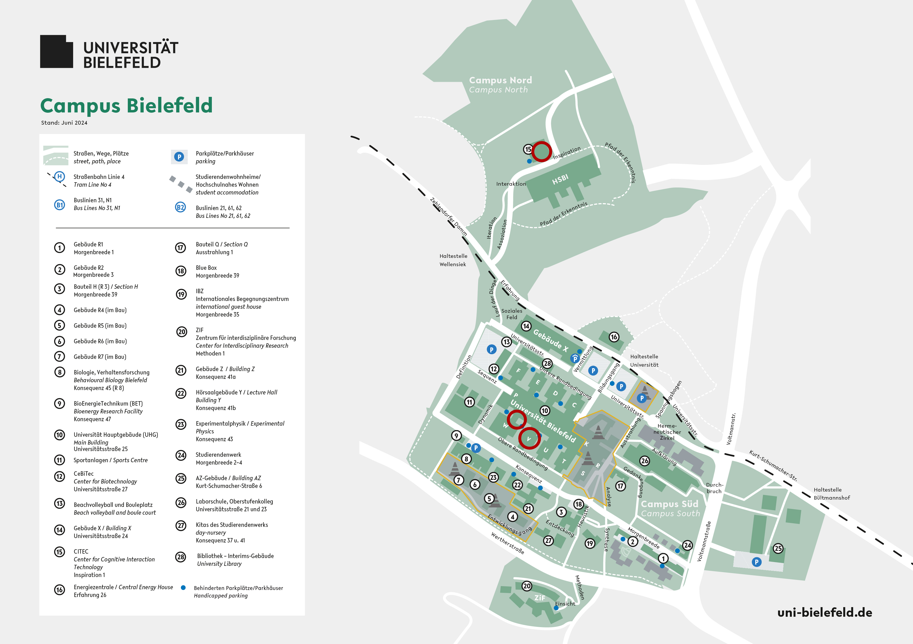
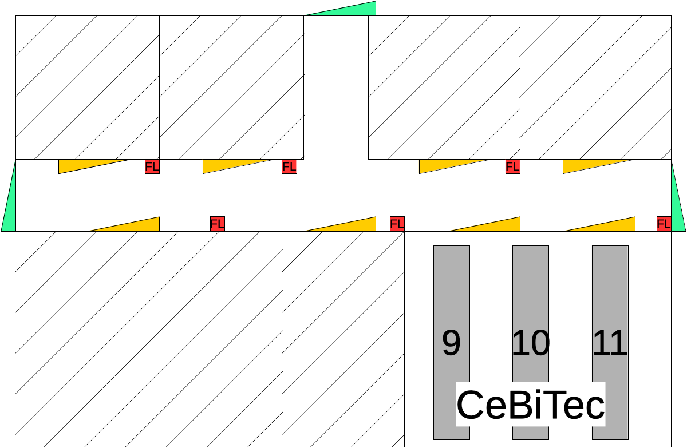
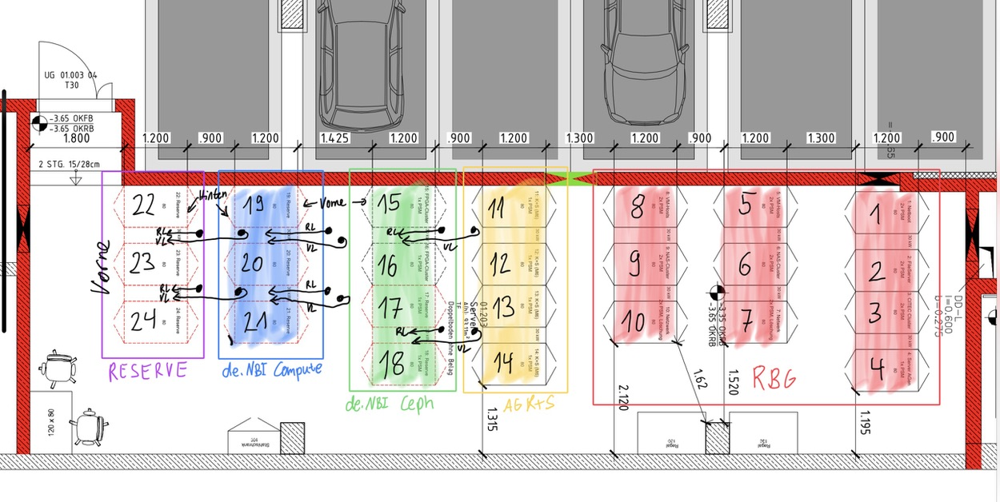
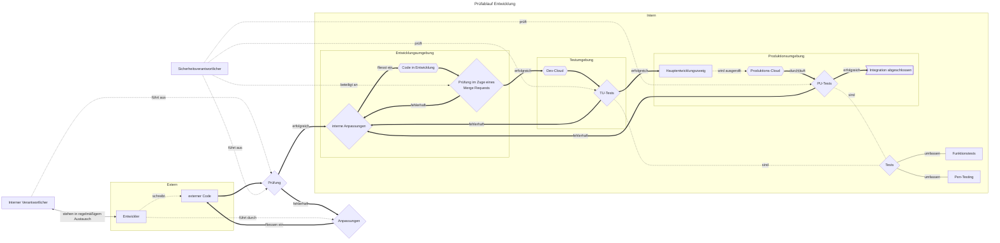

# Erklärung zur Anwendbarkeit

| Version | 2.0 vom 5.10.2023 |
|---------|-------------------|

Dieses Dokument befasst sich mit den Maßnahmen der ISO 27001 Anhang A.
Bzgl. einiger Begrifflichkeiten und Abkürzungen siehe [Glossar](glossar.md).
Dieses Dokument orientiert sich an der Struktur von ISO 27001:2022 Anhang A.

Die
[tabellarische Variante der Erklärung zur Anwendbarkeit](erklaerung-zur-anwendbarkeit-kompakt.md)
enthält den Status der Umsetzung, sowie den
**Grund zur Einbeziehung oder Ausschluss einer Maßnahme**.

[[_TOC_]]

## A5 Organisatorische Maßnahmen

### A5.1 Informationssicherheitsrichtlinien

Siehe [Liste der Richtlinien](index.md#richtlinien-leitfäden-arbeitsanweisungen-vereinbarungen) im Index-Dokument sowie
die [Dokumentenübersicht](dokumente.md).
Bezüglich der Überprüfung siehe [Index](index.md).

### A5.2 Informationssicherheitsrollen und -verantwortlichkeiten

Siehe [IT-Sicherheitsorganisation](organisation.md#it-sicherheitsorganisation)
und [Rollentrennung](organisation.md#rollentrennung).

Sind Werte einer Person mittels Eramba zugewiesen, so
ist diese für den Schutz dieser Werte verantwortlich.

### A5.3 Aufgabentrennung

Mit den in der [Gesamtverantwortlichkeit](organisation.md#gesamtverantwortlichkeit)
beschriebenen Arbeitsgruppen lässt sich aufgrund der Größe (Anzahl der Mitarbeiter)
keine Aufgabentrennung mit entsprechender Vertretung realisieren.
Tätigkeiten werden daher per 4-Augen-Prinzip überwacht,
siehe auch
[A7.8](#a78-platzierung-und-schutz-von-geräten-und-betriebsmitteln),
[A8.28](#a828-sichere-kodierung), [A8.32](#a832-änderungssteuerung).

### A5.4 Verantwortlichkeiten der Leitung

Die Bereichsleitung bestätigt, mit Administrationsaufgaben auf Netzwerk-
und Systemebene nur ausreichend qualifizierte, vertrauenswürdige und
motivierte Beschäftigte zu betreuen.

Im Bereich Administration und IT-Sicherheit ist eine angemessene
Personalausstattung vorhanden. Der kontinuierliche Betrieb ist
gewährleistet und bei Personalausfällen sind die unten genannten Vertretungsregelungen zu befolgen.

Es ist sichergestellt, dass immer ein Mitarbeiter der BRF oder ADM
während der üblichen Betriebszeiten (werktags, 8–16 Uhr) anwesend
ist (z.B. nicht alle gleichzeitig Urlaub haben). Aufgrund der
Anzahl der Mitarbeiter kann eine strikte Rollentrennung _nicht_ gewährleistet werden.
Alle notwendigen Tätigkeiten sind in den IT-Verfahren spezifiziert
und an darauf verweisenden Stellen dokumentiert (YouTrack,
GitHub/GitLab, Zabbix).

Das IT-Personal ist für die ihnen anvertrauten IT-Verfahren ausreichend
geschult und ihm wurden notwendige Sicherheitsmaßnahmen, rechtliche
Rahmenbedingungen sowie ggf. die Erfordernisse des Datenschutzes erläutert.
Die Verantwortlichen stellen sicher, dass eine angemessene
Fortbildung des IT-Personals in allen ihr Aufgabengebiet betreffenden
Belangen regelmäßig erfolgt.

Ergänzend werden folgende Verantwortlichkeiten
der Mitarbeiter in einem protokollierten Mitarbeitergespräch festgelegt.
Der Mitarbeiter ...

1. wird über seine Rollen und Verantwortlichkeiten in der
   Informationssicherheit informiert, bevor er Zugang zu vertraulicher
   Information und Informationssystemen erhält.
1. soll motiviert werden, den vorgegebenen Richtlinien und Arbeitsanweisungen für
   Informationssicherheit gerecht zu werden.
1. erreicht ein Informationssicherheitsbewusstsein, das seinen Rollen und
   Verantwortlichkeiten entspricht (siehe 7.2.2).
1. besitzt angemessene Fähigkeiten und Qualifikationen und wird
   regelmäßig weitergebildet.

### A5.5 Kontakt mit Behörden

Bei Informationssicherheitsvorfällen müssen die IT-Sicherheitsrichtlinien
eingehalten werden
([Sicherheitsrichtlinie zur Handhabung von Sicherheitsvorfällen](richtlinien/Richtlinie_Sicherheitsvorfaelle.md)).

Im Ernstfall sind sowohl der IT-Sicherheitsbeauftragte des Forschungszentrums
(Frank Rinkens), als auch das CERT-Team der Universität Bielefeld zu
informieren.

Der IT-Sicherheitsbeauftragte leitet weitere Schritte ein, auch unter Mitwirkung
weiterer Behörden. Diese reichen von Kontakten zum
Deutschen Forschungsnetz (DFN) bis hin zu Behörden bezüglich einer
potenziellen Strafverfolgung.

 >`jk` CER-546

### A5.6 Kontakt mit speziellen Interessensgruppen

Die de.NBI Cloud Bielefeld wird betrieben vom IBG-5 des Forschungszentrums Jülich sowie dem Centrum für
Biotechnologie (CeBiTec) der Uni Bielefeld, beide sind Mitglieder des Deutschen Forschungsnetzes.

Mit Tagungen und Workshops trägt das Deutsche Forschungsnetz zur Weiterbildung seiner
Mitglieder bei. Darüber hinaus stehen in mehreren Kompetenzzentren Ansprechpartner
bereit, um in wichtigen Fragen der Netznutzung mit Rat und Tat zur Seite zu stehen.

Die Tagungen liefern Informationen über relevante Sicherheitsproblematiken, sowie
Einblicke über neue Technologien, Bedrohungen oder Schwachstellen. Ebenso ist dies
ein Forum für den Austausch mit anderen DFN-Mitgliedern, die in einem ähnlichen
technischen Umfeld arbeiten und mit teilweise denselben (Sicherheits-)Problemen
umgehen müssen.

Relevante Veranstaltungen werden regelmäßig von Mitarbeitern der de.NBI
Cloud Bielefeld besucht.
Siehe [Aufstellung der Schulungen und Fortbildungen](aufstellungen/schulungen-und-fortbildungen.md).

Der Standort ist vollständig in die de.NBI-Welt integriert. Die de.NBI-Geschäftsstelle organisiert
die folgenden Austauschmöglichkeiten.

- **SIG Cloud:** 4-mal im Jahr findet ein Treffen auf der administrativen/politischen Ebene statt
  (davon 2-mal in Präsenz).
- **Assesment- bzw. AdminCalls:** Die monatlich stattfindene Calls dienen vor allem dem Austausch
  auf technischer Ebene. Alle de.NBI Cloud Standorte sind ähnlich organisiert und strukturiert,
  sodass sich Probleme und deren Lösungen in vielen Fällen übertragen lassen.
- **Chatkanäle:** Die Chats dienen dem schnellen unkomplizierten Austausch zwischen Partnern innerhalb
  von de.NBI, vor allem für Absprachen und bei techischen Problemen, sowie Notfällen.

| Dienst | Beschreibung | Kontakt | Kommentar |
| --- | --- | --- | --- |
| Matrix |  #CloudAdmins | via Cloud Governance | vor 12.2024 als RocketChat Kanal geführt |
| Matrix |  #Kubernetes  |  via Cloud Governance | Interessentsgruppe rund um K8S |
| Signal | #deNBI Cloud Emergency Channel | via Cloud Governance | Notfallkontakte |

Außerdem veranstaltet de.NBI regelmäßige Cloud User Meetings und gibt so auch dem Kreis der
Cloud-Nutzer Möglichkeiten zum Austausch mit den Administratoren der Cloud-Standorte.

### A5.7 Erkenntnisse über Bedrohungen

Die de.NBI Cloud Bielefeld weist allen Mitarbeitern dazu an,
eine [Threat-Intelligence](richtlinien/Arbeitsanweisung_ThreatIntelligence.md)
auszubilden. In der Arbeitsanweisung wird festgelegt, wie neue Erkenntnisse ermittelt werden
und wie mit diese umzugehen ist. Ebenso werden Mitarbeiter dazu aufgerufen, Kompetenzen
über neue Bedrohungslagen aufzubauen.

### A5.8 Informationssicherheit im Projektmanagement

Siehe Richtlinie zur [Informationssicherheit im
Projektmanagement](richtlinien/Informationssicherheit_im_Projektmanagement.md)

> `ch` Abschnitt d) des Leitfadens muss berücksichtigt werden: Fortschritte bei
> der Behandlung von Informationssicherheitsrisiken überprüfen und die Wirksamkeit der Behandlung
> bewerten und testen. Dies muss evtl. auch in der o.g. Richtlinie ausformuliert werden.
> `ch` ist der nachfolgende Abschnitt inkl. Tabellen hier sinnvoll untergebracht?

#### Informationssicherheitsanforderungen

##### Server-Hardware

| Anforderung                                                      | abgeleitet aus   |
|------------------------------------------------------------------|------------------|
| Datenträger-Ersatz ohne Rücksendung des defekten Datenträgers    | Risikomanagement |
| Hardwareunterstützung für Verschlüsselungsalgorithmen            | Risikomanagement |
| separates Netzwerkinterface für den Zugang zum Service-Prozessor | Zugangssteuerung |
| Gehäuse-Intrusion-Detection                                      | Zugangssteuerung |
| 5 Jahre Hardware-Support                                         | Vorerfahrung     |

##### Software auf Servern

| Anforderung                                                       | abgeleitet aus   |
|-------------------------------------------------------------------|------------------|
| Zeitnahe Verfügbarkeit von Sicherheitspatches                     | Risikomanagement |
| Regelmäßige Software-Updates                                      | Risikomanagement |
| Konfigurierbarkeit, nur auf `localhost` auf Anfragen zu lauschen  | Zugangssteuerung |
| Webanwendungen: Fähigkeit zur Funktion hinter einem Reverse-Proxy | Zugangssteuerung |

### A5.9 Inventar der Informationen und anderen damit verbundenen Werten

Bei der Inventarisierung der Werte wird zwischen _primären_ und _unterstützenden_ Werten
unterschieden. Die _primären Werte_ bilden hierbei allgemeine Geschäftsprozesse und stellen
wesentliche Funktionalitäten des Betriebs dar. Sie sind in der Governance-, Risikomanagement-
und Compliance-Software (kurz: GRC-Software) _Eramba_ katalogisiert
(siehe [Risikomanagement](risikomanagement.md)).

Die _unterstützenden Werte_ (auch: sekundäre Werte) umfassen die Server (abstrahiert nach
Funktionalität wie zum Beispiel Controller oder Storage-Knoten), Software (zum Beispiel
OpenStack) oder Services (zum Beispiel DNS) und sind ebenfalls in _Eramba_ erfasst.

Jedem katalogisierten Wert ist ein Verantwortlicher (Asset-Owner)
in Eramba zugeordnet. Die Zuordnung der Verantwortlichkeiten orientiert dabei sich an der
[RASCI Matrix](organisation.md#rasci-matrix-der-aufgabenverteilung-und-verantwortlichkeiten)).

Die erfassten Werte werden mindestens jährlich begutachtet (Review). Der zulässige
Gebrauch eines Wertes ist definiert und muss eingehalten werden. Änderungen bezüglich
des Gebrauchs (zum Beispiel Umwidmung eines Hypervisors zu einem Service-Knoten) muss
mit den Verantwortlichen (Asset-Owner) und der Leitung (Risk-Owner) abgeklärt und
in einem Ticket im Issue-Tracker dokumentiert werden.

Alle beschrieben Prozesse (Inventarisierung, Festlegung von Zuständigkeiten, Festlegung des
zulässigen Gebrauchs und Review) erfolgen in der GRC-Software Eramba.

Sämtliche Hardware der de.NBI Cloud Bielefeld ist zusätzlich detailliert in der Inventurdatenbank
der BRF und als deren Abbild im Zabbix erfasst
(siehe [IT-Systeme](it-systeme.md)).

Eine Aufstellung der darüber hinaus angeschafften IT-Geräte der Mitarbeiter des IBG-5, die in den Scope der de.NBI Cloud Bielefeld fallen,
(wie etwa Laptops, Monitore) [ist vorhanden](aufstellungen/it-geraete.md).
Diese umfasst gegenwärtig auch Geräte von Mitarbeitenden, dessen Arbeit mit der de.NBI Cloud Bielefeld eng verknüpft ist.
Analog sind die IT-Geräte der Mitarbeiter der BRF in der entsprechenden Inventurdatenbank der BRF erfasst.

### A5.10 Zulässiger Gebrauch von Informationen und anderen damit verbundenen Werten

Siehe

- [A5.9 Inventar der Informationen und anderen damit verbundenen Werten](#a59-inventar-der-informationen-und-anderen-damit-verbundenen-werten)
- [Richtlinie zum zulässigen Gebrauch von Werten](richtlinien/Gebrauch_von_Werten.md)
- [IT-12 Klassifikation und Kennzeichnung von Informationen](it-verfahren.md)
- [Richtlinie zur Klassifizierung von Informationen](richtlinien/Klassifizierung_Kennzeichnung_von_Informationen.md).

### A5.11 Rückgabe von Werten

Die Rückgabe von Werten bezieht sich in dem Kontext hauptsächlich auf das Ausscheiden
von Mitarbeitern. Diesbezüglich gibt es Anweisungen
(siehe [A6.5](#a65-verantwortlichkeiten-nach-beendigung-oder-änderung-der-beschäftigung)).

Andere Situationen und Aspekte welche die Rückgabe von Werten betreffen kann sind:

- **Veträge mit Dritten**: siehe [IT 15](it-verfahren.md#it-15-lieferantenbeziehungen)
- **Auslaufende Lizenzen**: siehe REDO-29
- **Austausch und Aktualisierung von Geräte**: siehe [IT 3.3](it-verfahren.md#it-33-de-installationde-inventarisierung)
- **veraltete und/oder ungenutzte Resourcen**: siehe [IT 3.3](it-verfahren.md#it-33-de-installationde-inventarisierung)

### A5.12 Klassifizierung von Information

Siehe [IT-12 Klassifikation und Kennzeichnung von Informationen](it-verfahren.md) und
[Richtlinie zur Klassifizierung von Informationen](richtlinien/Klassifizierung_Kennzeichnung_von_Informationen.md)

### A5.13 Kennzeichnung von Information

Siehe [IT-12 Klassifikation und Kennzeichnung von Informationen](it-verfahren.md) und
[Richtlinie zur Klassifizierung von Informationen](richtlinien/Klassifizierung_Kennzeichnung_von_Informationen.md)

### A5.14 Informationsübertragung

Der Austausch von schützenswerter Nachrichten erfolgt stets über die in
der [Richtlinie zur Informationsübertragung](richtlinien/Informationsuebertragung.md)
beschriebenen Verfahren.

Bei elektronischer Nachrichtenübermittlung sind die in der
[Richtlinie zur Klassifizierung und Kennzeichnung von Informationen](richtlinien/Klassifizierung_Kennzeichnung_von_Informationen.md)
beschriebenen Maßnahmen zum Schutz der Informationen jedem Fall anzuwenden.

Vor der Nutzung externer Dienste von Drittanbietern in der Rolle des Mitarbeiters der
de.NBI Cloud Bielefeld, die nicht explizit für die Informationsübertragung zugelassen sind,
ist eine schriftliche Genehmigung der Leitung der de.NBI Cloud Bielefeld einzuholen.
Beispielhafte Kategorien dieser Dienste von Drittanbietern sind:

- Instant Messaging und VoIP
- Dateiaustausch und Dokumentenablagen
- Soziale Netzwerke

_Hinweis:_
27002:2022 A5.14 c),d) und f) bei der generellen Übertragung von Informationen sind
im Fall einer elektronischen Übertragung, wie sie bei der de.NBI Cloud ausschließlich
genutzt werden, relativ einfach festzumachen.

Verantwortlich für die Übertragung ist immer der Versender, Informationen müssen je
nach Klassifikation verschlüsselt werden. Sicherheitsvorfälle durch Offenlegung
und Manipulation sind wie sonstige Sicherheitsvorfälle zu behandeln, da keine
dritte Partei bei der Übertragung involviert ist.
Der Empfänger ist im Fall von E-Mail eine explizite Adresse, sonst ein API-Endpunkt.
Es liegt also in der Hand des Versenders hier den richtigen Empfänger zu wählen.
Gegebenenfalls hilft hier zusätzlich das 4-Augen-Prinzip um Fehler zu vermeiden.

Das Trägermedium ist das _Internet_, welches bei der Verwendung von verschlüsselten
Protokollen als ziemlich zuverlässig betrachtet werden kann.

Die Regeln für die Übertragung von digitalen physischen Speichermedien und der Auswahl für
einen geeineten Kurier sind in der
[Richtlinie und den Verfahren zur Informationsübertragung](./richtlinien/Informationsuebertragung.md#digitale-physische-speichermedien)
spezifiziert.

> `jk`
> Durch die Aufgabe der DC auf dem Campus der Universität bedingt durch die fortschreitenden
> Renovierung des UHG und den damit verbundenen Umzug in ein neues DC, wird auch Hardware der
> de.NBI Cloud umziehen. Ob wir dann einen eigenen Spediteur beauftragen oder uns an die
> Universität hängen können, hängt mit der Wahl des DC zusammen.

### A5.15 Zugangssteuerung

Es gilt die [Zugangssteuerungsrichtlinie](richtlinien/Zugangssteuerung.md).

Alle Systeme der Cloud (reale und virtuelle) sind über das CeBiTec an das BITS angebunden
(→ [M 2.29#Netzwerk](#netzwerk)).

Jedes Projekt eines Cloud-Nutzers bekommt eine öffentliche IP-Adresse, die beliebig für virtuelle
Maschinen eingesetzt werden kann (auch z. B. für Gateways oder ReverseProxys).
Auf der Ebene von Nutzerprojekten ist eine strikte Trennung der Zugangssteuerungsfunktionen gegeben
(→ [IT-9.1](it-verfahren.md#it-91-identitäts--und-ressourcen-management).

Auf die Hardware bzw. die Betriebssysteme der Cloud kann nur über das
Management-Netzwerk via Jump Host
(→ [IT-6.1](it-verfahren.md#it-61-administrativer-zugang-zum-management-netzwerk))
zugegriffen werden.

Desweiteren sind zu beachten:

- [A8.20](#a820-netzwerksicherheit)
- [A8.22](#a822-trennung-von-netzwerken)

 >`jk` CER-547

### A5.16 Identitätsmanagement

Es gilt die [Richtlinie für das Identitätsmanagement](richtlinien/Richtlinie_Identitaetsmanagement.md).
In der de.NBI Cloud Bielefeld kommt an 3 unterschiedlichen Stellen das Identitätsmanagement zu tragen.

#### Nutzer der Cloud

Als Werkzeug zum Identitätsmanagement wird OpenStack Keystone genutzt. Keystone
ist ein für sich gekapseltes System und ist vollständig unabhängig vom restlichen
OpenStack.

Wir unterscheiden bei den Nutzern der Cloud zwischen den Administratoren einer Domäne
und den normalen Usern. Die (überschaubare) Liste der administrativen Nutzer wird im ISMS
ggf. mit Begründung und Laufzeit [gepflegt](aufstellungen/zugaenge.md).

Die Identitäten der _normalen_ Nutzern der de.NBI Domäne werden mit den  Projektinformationen
automatisiert vom de.NBI Portal übernommen.

Die Identitäten in anderen Domänen der Cloud (Default, CeBiTec, DSI) werden manuell von den
Administratoren der Cloud Infrastruktur angelegt, im ISMS [gepflegt](aufstellungen/zugaenge_domaenen.md)
und regelmässig geprüft..

##### Object-Storage

Der Zugang zum Object Storage ist in OpenStack immer an ein Projekt geknüpft. Wir testen
in einer Beta-hase seit November 2024 sogenannte Storage Projeke
([COM-231](https://yt.bi.denbi.de/issue/COM-231)), die eine Entkopplung von OpenStack
Projekte vom Zugang zum S3-Storage darstellen.

Die Zugänge zu ein Storage Project werden in dieser Phase manuell für einen ausgewählte Nutzerkreis
gesetzt und sind in [CEPH-116](https://yt.bi.denbi.de/issue/CEPH-116/) dokumentiert.

#### Cloud-Administratoren

Die personalisierten Identitiäten der Administratoren der de.NBI Cloud Infrastruktur
werden mittels Ansible konfiguriert und über die Commits im Git(Lab) Repository dokumentiert.

siehe [IT-4](it-verfahren.md#it-4--erst---installationkonfiguration-neuer-server)

#### CeBiTec

Die Cloud Infrastruktur ist ausschließlich über einen Jumphost aus dem CeBitec
zu erreichen. Daher benötigen alle Nutzer, die eine Identität auf der Cloud Infrastruktur haben auch
einen CeBiTec Account.

### A5.17 Informationen zur Authentifizierung

Es gilt die [Richtlinie zur Authentifizierung](richtlinien/Richtlinie_Authentifizierung.md). In der
de.NBI Cloud Bielefeld werden unterschiedliche Verfahren zur Authentifizierung eingesetzt.

#### Nutzer der Cloud

Der Zugang erfolgt über OpenStack Keystone. Wie in [A8.5](#a85-sichere-authentifizierung) beschrieben,
wird zur Nutzung von OpenStack ein SSO-Verfahren (LifeScience AAI) angewendet. Hierbei gelten die
Passwortrichtlinien des jeweiligen Authentifizierungsdienstes. Die meisten Nutzer verwenden den
SSO basierten Authentifizierungsdienst.

Passwörter kommen daher nur dann zum Einsatz, wenn das o.g. SSO-Verfahren nicht angewendet werden
kann, wie z.B. Nutzer in einer anderen Domäne oder Nutzung der API, wenn Application Credentials
nicht unterstützt werden.

Initial wird dafür ein Einmalpasswort generiert und via PGP-verschlüsselter E-Mail
an den jeweiligen Nutzer gesandt. Die Verifikation der Identität erfolgt persönlich
durch Vorlage eines gültigen Lichtbildausweises oder über das Portal durch die von
Elixir propagierte E-Mail-Adresse. Die Verantwortung der Verifikation wird in
diesem Fall an den jeweiligen Dienst abgegeben. Der Nutzer ist verpflichtet, das
Passwort umgehend zu ändern.

#### Cloud-Administratoren

Alle nach [IT-4](it-verfahren.md#it-4-erst-installationkonfiguration-neuer-server)
aufgesetzten Systeme werden automatisiert
konfiguriert. Der Zugang zur demilitarisierten Zone der Cloud erfolgt ausschließlich über einen
Jump Host durch SSH-Schlüssel-Authentisierung und ist zusätzlich durch eine
Zwei-Faktor-Authentisierung (TOTP) abgesichert. Der private Schlüssel ist durch eine
Passphrase zusätzlich vor Zugriff geschützt. Die öffentlichen Schlüssel der Mitarbeiter von
ADM und BRF sind in der Ansible-Konfiguration hinterlegt. Die entsprechenden IT-Verfahren
sind in
[IT-4](it-verfahren.md#it-4-erst-installationkonfiguration-neuer-server)
und
[IT-11.1](it-verfahren.md#it-111-administrative-accounts-der-denbi-cloud)
beschrieben.

#### CeBiTec

Der Zugang zum Jump Host über das CeBiTec ist durch das Identity-Management-System des CeBiTec
durch Gruppenzugehörigkeiten geregelt. Das entsprechende IT-Verfahren ist in
[IT-11.3](it-verfahren.md#it-113-cebitec-accounts) beschrieben.

### A5.18 Zugangsrechte

Es gilt die [Richtlinie zur Vergabe von Zugangsrechten](richtlinien/Richtlinie_Zugangsrechte.md)

Bedingt durch im Control zum [Identititätsmanagement](#a516-identitätsmanagement)
beschriebenen drei eingesetzten Systeme erfolgt auch die Erteilung von Zugangsrechten
je nach System unterschiedlich.

#### Nutzer der Cloud

Bis auf die Gruppe der Cloud-Administratoren gibt keine privilegierten Nutzer-Accounts.
Die privilegierten Nutzer-Accounts (Rolle Admin) werden in gesonderten, "leeren"
Projekten geführt, um der konzeptuellen Schwachstelle im Rollenmanagement von OpenStack
bzg. einiger OpenStack Services entgegenzuwirken.
Alle Nutzer eines Projekts verfügen grundsätzlich über die gleichen Rechte als normaler
Nutzer. Die Rechte des normalen Nutzers entsprechen im Wesentlichen den Standard Rechten
in OpenStack für die Nutzerrolle. Aus Informationssicherheits sinnvolle Anpassungen
werden in den wöchentlichen Besprechungen (Montagsmeeting) bzw. in den Managementreviews
diskutiert/protokolliert. Tatsächliche umgesetzte Änderungen bei den Zugangsrechten werden
bei In-Kraft-Treten unsere Kunden kommuniziert.

#### Cloud-Administratoren

Die Gruppe der Cloud-Administratoren ist überschaubar klein. Alle Mitarbeiter
von ADM und BRF haben die gleichen administrativen Rechte bezogen auf die
Cloud-Infrastruktur. Änderungen bei den Benutzerrechten ergeben sich
nur durch das Ausscheiden von Mitarbeitern aus den beiden oben genannten Gruppen.

Siehe
auch [A8.5](#a85-sichere-authentifizierung)
und
[A6.5](#a65-verantwortlichkeiten-nach-beendigung-oder-änderung-der-beschäftigung).

#### CeBiTec

Die Zugangsrechte im CeBiTec und damit auch der Zugang zum JumpHost ist über das Rechtesystem
(Nutzer und Gruppen) von Unix/Linux implementiert. Die Verantwortlichen für eine Gruppe
können weitere Nutzer der Gruppe hinzufügen bzw. diese auch entfernen. Gruppen und
Gruppen-Verantwortliche werden initial vom CeBiTec Support (BRF) eingerichtet.

### A5.19 Informationssicherheit in Lieferantenbeziehungen

Siehe
[Informationssicherheitsrichtlinie für den Umgang mit Lieferantenbeziehungen](richtlinien/Lieferantenbeziehungen.md).
Ausschreibungen im öffentlichen Dienst sind strikt geregelt. Jeder Ausschreibung liegt
ein EVB-IT-Vertrag zugrunde der je nach Ausrichtung (Kauf, Dienstleistung oder Wartung)
unterschiedlich gestaltet ist und durch eigene Forderungen ergänzt werden kann.

> `jk`
> In der Richtlinie wird die Lieferantenbeziehung zu einem Dienstleister der ein
> externes Rechenzentrum für uns betreibt nicht betrachtet. Ab Mai 2025, nächster
> Bauabschnitt, wird das allerdings evtl. wichtig werden. In dem Fall muss die Richtlinie
> ergänzt werden.

### A5.20 Behandlung von Informationssicherheit in Lieferantenvereinbarungen

Aus der
[Informationssicherheitsrichtlinie für den Umgang mit Lieferantenbeziehungen](richtlinien/Lieferantenbeziehungen.md)
resultiert je nach Art der Lieferantenbeziehung mindestens ein EVB-IT-Vertrag, sowie
bei Lieferanten für Services zusätzlich ein AV-Vertrag und weitere Vereinbarungen.  
Alle Lieferanten sind mit Namen, Laufzeit der Beziehung, Überwachungsverantwortlichen,
sowie einem Verweis auf die weitergehende Dokumentation (Ausschreibungstext,
EVB-IT Vertrag, sowie gegebenenfalls AV-Vertrag, Vertraulichkeits- und
Verpflichtungserklärung) in der [Aufstellung der Lieferanten](aufstellungen/lieferanten.md)
zu den Lieferantenbeziehungen der de.NBI Cloud Bielefeld gelistet.
Die Verschwiegenheitsverpflichtung gilt laut EVB-IT auch für Subunternehmer.

Siehe auch [IT-15](it-verfahren.md#it-15-lieferantenbeziehungen)

> `jk`
> In IT-15 wird die Lieferantenbeziehung zu einem Dienstleister, der ein
> externes Rechenzentrum für uns betreibt, nicht betrachtet. Ab vorraussichtlich Q4 2026
> (nächster Bauabschnitt) wird das allerdings für uns wichtig werden.

### A5.21 Umgang mit der Informationssicherheit in der Lieferkette der Informations- und Kommunikationstechnologie (IKT)

Die Lieferkette für Informations- und Kommunikationstechnologie wird durch den
Ausschreibungsprozess im öffentlichen Dienst festgelegt. In der Ausschreibung selbst kann
Einfluss darauf genommen werden, wie die Informationssicherheit in der Lieferkette
gehandhabt wird.

Siehe [Grundsätze für den IT-Einsatz](organisation.md#grundsätze-für-den-it-einsatz), sowie
das [IT Verfahren zur Beschaffung](it-verfahren.md#it-22-beschaffungen--ausschreibungen).

Aktuell reduzieren sich unsere Lieferantenbeziehungen auf die Beschaffung von IT-Infrastruktur
(Hardware und Software). Die Software der Cloud basiert aktuell ausschließlich auf
OpenSource-Komponenten.

IKT-Services wie sie in der Vergangenheit zur Unterstützung der Cloud schon einmal bezogen wurden,
kommen derzeit und auch mittelfristig nicht zum Einsatz.

### A5.22 Überwachung, Überprüfung und Änderungsmanagement von Lieferantendienstleistungen

Für jeden Lieferanten (ggf. mit mehreren Beziehungen) gibt es einen Überwachungsverantwortlichen
in der Aufstellung der Lieferanten, sowie ein passenden ReDo Ticket im Issue Tracker, sofern es
sich dabei nicht um einen IKT-Produktlieferanten handelt.

Der Inhalt des REDO-Tickets sollte für den jeweiligen IKT-Service/Support-Lieferanten zutreffende
Empfehlungen aus ISO 27002 Kapitel 5.22 aufgreifen.

Die Handhabung der Änderungen von Lieferantendienstleistungen ist durch den Ausschreibungsprozess im
öffentlichen Dienst geregelt.

- [Beispiel für ein REDO Ticket](https://yt.bi.denbi.de/issue/REDO-9) zur Überwachung und Überprüfung
  einer Lieferantenbeziehung.
- [IT-15 Lieferantenbeziehungen](it-verfahren.md#it-15-lieferantenbeziehungen)

### A5.23 Informationssicherheit für die Nutzung von Cloud-Diensten

Die [Richtlinie zur Bewertung von Cloud-Services](richtlinien/Richtlinie_Bewertung_CloudServices.md)
regelt die Nutzung der Services.

Die de.NBI Cloud Bielefeld nutzt für den Betrieb der Infrastruktur keine Cloud-Dienste.

Cloud-Dienste spielen beim alltäglichen Geschäft der Mitarbeiter dahingegen zunehmend eine Rolle.
Die [Aufstellung Cloud-Dienste](aufstellungen/cloud-services.md) enthält eine Übersicht der genehmigten
und hinsichtlich der Informationssicherheit bewerteten Services.

### A5.24 Planung und Vorbereitung der Handhabung von Informationssicherheitsvorfällen

Siehe [Sicherheitsrichtlinie zur Handhabung von Sicherheitsvorfällen](richtlinien/Richtlinie_Sicherheitsvorfaelle.md).

### A5.25 Beurteilung und Entscheidung über Informationssicherheitsereignisse

Siehe [Sicherheitsrichtlinie zur Handhabung von Sicherheitsvorfällen](richtlinien/Richtlinie_Sicherheitsvorfaelle.md).

### A5.26 Reaktion auf Informationssicherheitsvorfälle

Siehe [Sicherheitsrichtlinie zur Handhabung von Sicherheitsvorfällen](richtlinien/Richtlinie_Sicherheitsvorfaelle.md).

### A5.27 Erkenntnisse aus Informationssicherheitsvorfällen

Siehe [Sicherheitsrichtlinie zur Handhabung von Sicherheitsvorfällen](richtlinien/Richtlinie_Sicherheitsvorfaelle.md).

### A5.28 Sammeln von Beweismaterial

Nachfolgend wird die Vorgehensweise zur digitalen und analogen
Beweismittelsicherung beschrieben. Jeder Schritt muss mit Datum,
Uhrzeit und Person dokumentiert werden. Hierbei ist – sofern möglich –
das 4-Augen-Prinzip anzuwenden.

#### Digitale Beweismittelsicherung

##### Angriff auf ein physikalisches Gerät

Entscheidung, ob das abzuschaltende Gerät kritisch (Verfügbarkeit) ist, wenn ja:

1. Ersatzdienst zur Verfügung stellen oder auf Wartungsfenster warten, wenn
   ein Weiterbetrieb keine gravierenden Folgen hat (Außerhalb der bedienten
   Zeit - z.B. nach 18 Uhr oder am Wochenende).

Andernfalls:

- Gerät stromlos machen (Wichtig: Gerät nicht geordnet herunterfahren,
  da hierdurch Beweise vernichtet werden könnten).
- Wenn Zugriff auf Datenträger besteht, dann:
  - Datenträger kopieren, d.h. Festplatte ausbauen und „Image“ über ein
      sicheres System erstellen (Wichtig: read-only-Adapter verwenden!)
  - Datenzustand des Original-Image festhalten (Checksumme bilden) und
      den Datenträger versiegeln. Das Versiegeln dient als Nachweis, dass die
      Festplatte nicht verändert wurde. Es ist zu dokumentieren, wann es
      versiegelt wurde und die Festplatte ist mit einem Evidence-Tape zu versehen.
  - Imagekopien erstellen (Wichtig: Vorfall wird mit den Kopien analysiert.
      Das Original-Image muss unverändert bleiben und gesichert werden).
- Wenn kein Zugriff auf Datenträger besteht (z.B. Smartphone), dann
  - Gerät versiegeln (Dokumentation, wann versiegelt wurde und mit einem
      Evidence-Tape versehen)
  - Zur Beweismittelsicherung, Gerät an eine Fachfirma übergeben.

##### Angriff auf virtuellen Server

- Snapshot der betroffenen Maschine im laufenden Betrieb erstellen.
  (Wichtig: Erst Snapshot erstellen, damit Angreifer nicht vorzeitig gewarnt
  wird und Beweise vernichten kann)
- Virtuelle Maschine vom Netzwerk trennen
- Snapshot exportieren und Checksumme erstellen
- Snapshot-Kopien vom Original Snapshot erstellen
- Original-Snapshot im Tresor verschließen, Originalserver bereinigen und
  wieder in Betrieb nehmen, Analyse mit den Snapshot-Kopien durchführen

#### Analoge Beweismittelsicherung

- Geschäftsführer und ggf. Polizei informieren
- Tatort mit Absperrband sichern (z.B. Büro sperren und bewachen)
- Fotodokumentation des Tatorts und Auffälligkeiten notieren
- Wenn Polizei informiert wurde, dann
  - Auf Eintreffen der Polizei warten
  - Weitere Schritte nach Absprache mit der Polizei durchführen
- Andernfalls:
  - Beweise sichern und dokumentieren (Wichtig: Beweismittelkette
      aufrechterhalten, d.h. Beweise durchnummerieren, versiegeln und sichern)

### A5.29 Informationssicherheit bei Störungen

Siehe [Business Continuity Plan](richtlinien/Business_Continuity.md).

### A5.30 IKT-Bereitschaft für Business Continuity

Siehe [Business Continuity Plan](richtlinien/Business_Continuity.md).
Spezielle IT-Verfahren bezüglich dem Krisenmanagement und den Wiederanlaufplänen
existieren in [IT-17 Business COntinuity](it-verfahren.md#it-17-business-continuity).

Die Verfahren werden jährlich geprüft
in [REDO-22](https://yt.bi.denbi.de/issue/REDO-22/Ubungen-zu-Disaster-Recovery-und-Notfallabschaltung).

### A5.31 Rechtliche, gesetzliche, regulatorische und vertragliche Anforderungen

Die folgende Tabelle ist eine Übersicht der Gesetze und Verträge die für de.NBI Cloud Bielefeld Anwendung finden:

| Gesetz / Vertrag                                                                                    | Zuständigkeiten                        | ggf. relevante Richtlinien |
|-----------------------------------------------------------------------------------------------------|----------------------------------------|----------------------------|
| [Arbeitsschutzgesetz](gesetze/arbschg.pdf)                                                          | Arbeitsschutz                          | |
| Auftragsverarbeitungsverträge                                                                       | Management / Datenschutzbeauftragte    | |
| [Bestimmungen der Forschungszentrum Jülich GmbH](index.md#fzj)                                      | Arbeitgeber / Management               | |
| [Bestimmungen der Uni Bielefeld](index.md#uni-bielefeld)                                            | Management                             | |
| [Brandschutz](gesetze/fshg.pdf)                                                                     | Arbeitsschutz                          | |  
| [Bundes-](gesetze/bdsg.pdf), [Landes-](gesetze/dsg-nrw.pdf) und [EU-Datenschutz](gesetze/dsgvo.pdf) | Management / Datenschutzbeauftragte    | |
| [de.NBI-Cloud-Nutzungsbestimmungen](richtlinien/Nutzungsbestimmungen_de.NBI_Cloud_V1.2.pdf)         | Management                             | |
| [Kooperationsvertrag der de.NBI Cloud](vertraege/KoopV_de.NBI_Vertrag_Betrieb_Cloud_UBI_FZJ.pdf)    | Management                             | |
| [Strafgesetzbuch](gesetze/stgb.pdf)                                                                 | Arbeitgeber                            |[Informationssicherheitsleitlinie](./informationssicherheitsleitlinie.md),  |
| [Telemediengesetz](gesetze/tmg.pdf)                                                                 | Management                             | |
| [Vergabeverordnung](gesetze/vgv.pdf)                                                                | Beschaffungsabteilung                  | |
| Vertrag zur gemeinschaftlichen Verantwortung (§26)                                                  | Management                             | |

Die folgende Gesetze finden aktuell **keine** Anwendung in der de.NBI Cloud Bielefeld:

| Gesetz / Vertrag | Zuständigkeiten | ggf. relevante Richtlinien |
| --- | --- | --- |
| BSI-KritisV | Management |  [Informationssicherheitsleitlinie](./informationssicherheitsleitlinie.md), ISMS, Goverance, [Strombedarf](aufstellungen/strombedarf.md) |
| [SGB §393](https://www.gesetze-im-internet.de/sgb_5/__393.html) - Cloud-Einsatz im Gesundheitswesen | Management | [Informationssicherheitsleitlinie](./informationssicherheitsleitlinie.md), ISMS |
| [JArbSchG](https://www.gesetze-im-internet.de/jarbschg) | Management | - |

Eine detailiertere Erklärung zu den obigen Gesetzen/Verträgen ist in der
[Aufstellung Gesetze  und Verträge](aufstellungen/gesetze_und_vertrage.md) 
zu finden.

Die Liste der Gesetze bzw. Verträge, die für die de.NBI Cloud Bielefeld relevant sind werden durch 
ein
[wiederkehrendes Ticket](https://yt.bi.denbi.de/issue/REDO-6/Revision-der-Liste-der-anwendbaren-Gesetzgebung-und-der-vertraglichen-Anforderungen)
1/4 jährlich überprüft.

#### Anforderungen interessierter Parteien

##### Interessierte Parteien

Die Liste der Interessierten Parteien besteht aus:

- Arbeitsschutz Uni Bielefeld / FZJ Jülich
- Management
- Datenschutzbeauftragte Uni Bielefeld / FZJ Jülich
- IT Sicherheitsbeauftrager Uni Bielefeld / FZJ Jülich
- Arbeitgeber Uni Bielefeld / FZJ Jülich
- Beschaffungsabteilung
- Cloud Nutzer / Kunden
- Mitarbeiter

##### Wechselwirkung zwischen Gesetzen/Richtlinien und interessierten Parteien

| Gesetz / Richtlinie | Interessierte Partei | Wechselwirkung |
| --- | --- | --- |
| Arbeitsschutzgesetz | Arbeitssicherheit | Sicherstellung der Einhaltung der Arbeitsschutzvorschriften; Schutz der Mitarbeiter. |
| Auftragsverarbeitungsverträge | Management/Datenschutzbeauftragte/Kunde | Notwendigkeit, vertragliche Verpflichtungen zu erfüllen; potenzielle Haftung bei Nichteinhaltung. |
| Bundesdatenschutzgesetz / DSGVO | Management/Datenschutzbeauftragte | Erfüllung der Datenschutzanforderungen; Sicherstellung der Rechte der betroffenen Personen; Berücksichtigung bei Verträgen und Prozessen. |
| Telemediengesetz | Management | Einhaltung bei der Erfassung und Verarbeitung von Nutzerdaten; Notwendigkeit der Minimierung von Daten. |
| Vergabeverordnung | Beschaffungsabteilung | Einhaltung der Vergabekriterien bei Beschaffungsprozessen; Ziel der Transparenz und Fairness. |
| Strafgesetzbuch | Arbeitgeber | Sicherung gegen Datenmissbrauch; Sensibilisierung der Mitarbeiter für die rechtlichen Konsequenzen bei Missbrauch.|
| Kryptowarekriminalität | IT-Sicherheitsteam | Sicherung von Systemen gegen kryptobezogene Bedrohungen; Einhaltung von Exportkontrollen für Verschlüsselungstechnologien.|

**Erklärung:**

- **Arbeitsschutzgesetz:** Die Arbeitssicherheit ist verantwortlich für die Einhaltung
  von Sicherheitsanforderungen und den Schutz der Mitarbeiter. Es besteht eine direkte
  Wechselwirkung zur physischen und psychologischen Sicherheit der Arbeitsumgebung.
- **Auftragsverarbeitungsverträge:** Diese betreffen direkt das Management und den
  Datenschutzbeauftragten. Sie müssen sicherstellen, dass alle rechtlichen Verpflichtungen
  gegenüber Kunden eingehalten werden, um rechtliche Konsequenzen zu vermeiden.
- **Datenschutzgesetze:** Der Datenschutzbeauftragte spielt eine Schlüsselrolle bei der
  Sicherstellung, dass personenbezogene Daten gemäß der DSGVO und BDSG gehandhabt werden.
  Diese Regelungen beeinflussen alle Bereiche des Betriebs.
- **Telemediengesetz:** Dieses beeinflusst, wie die de.NBI Cloud Bielefeld Nutzerdaten
  verarbeitet und gespeichert werden. Änderungen in Teilbereichen müssen an die Nutzer
  kommuniziert werden.
- **Strafgesetzbuch:** Schulungen zur Sensibilisierung der Mitarbeiter sind wichtig, um
  die Einhaltung der Gesetze sicherzustellen und um die Unternehmen vor internen Bedrohungen
  zu schützen.

Aus der Wechselwirkungsmatrix lassen sich die folgenden Risiken ableiten:

- Nichteinhaltung von Arbeitsschutzvorschriften kann zu Arbeitsunfällen führen.
- Vertragsbrüche in Auftragsverarbeitungsverträgen führen zu Bußgeldern oder Imageverlust.
- Nichteinhaltung der DSGVO-Anforderungen führt zu Datenschutzverletzungen.
- Fehlende Einhaltung des Telemediengesetzes führt zu unrechtmäßiger Datenverarbeitung.
- Unregelmäßige Vergabeprozesse führen zu rechtlichen Problemen.
- Fehlverhalten von Mitarbeitern führt zu schweren Verstößen laut Strafgesetzbuch.
- Schwächen im Sicherheitsmanagement führen zu Zwischenfällen im Bereich Kryptokriminalität.
  
Die obige Risken stellen nur eine Auswahl da und sollen helfen die Umsetzung des Controls zu
dokumentieren (siehe [Risikomanagement](risikomanagement.md))

##### Kommunikation

Aus den Wechselwirkungen und daraus resultierenden Risiken resultiert der folgende
Kommunikationsplan. Dieser stellt sicher, das alle interessierten Parteien über gesetzliche Anforderungen
und ihre Verpflichtungen informiert sind. Die Zusammenarbeit und des Verständnisses zwischen
verschiedenen Interessengruppen wird gefördert und es wird eine kontinuierliche Verbesserung
der Einhaltung von Compliance-Anforderungen forciert.

Die Zielgruppen für den Kommunikationsplan kommen aus der Liste der interessierten Parteien und
lassen sich grob in die internen Stakeholder
(Management, Datenschutzbeauftragte, Arbeitssicherheit, IT-S, Beschaffungsabteilung, MA)
und externen Stakeholder (Nutzer, Behörden, Partner) unterteilen.

| Zielgruppe | Nachricht/Inhalt  | Frequenz/Kommunikationsmittel | Verantwortlich |
| --- | --- | --- | --- |
| Management der de.NBI Cloud Bielefeld  | Gesetzliche Updates, Compliance-Status, Risikoberichte | bei Bedarf Meetings bzw. 1/2 jährlich im Rahmen des Managementreview  | ISMS-Beauftragter |
| _Datenschutzbeauftragte_ | Änderungen in Datenschutzgesetzen, Maßnahmen zur Risikominderung |  _siehe Kommentar_ |  _siehe Kommentar_ |
| Arbeitssicherheit | Sicherheitsprotokolle, Risikominderungsstrategien | jährlich via Begehung | Management/Sicherheitsbeauftragter |
| IT-Sicherheitsteam (ADM/BRF) | Sicherheitsupdates, Schulung zu neuen Bedrohungen und Schutzmaßnahmen | Wöchentlich via Meeting,  Bei Bedarf via Chat, Workshops | ISMS-Beauftragter |
| Mitarbeiter | Sensibilisierung zu Compliance-Anforderungen, Sicherheitsbewusstsein | Bei Bedarf via Vorträge/Workshops/E-Learning | ISMS-Beauftragter, ITS UniBi/FZJ |
| Nutzer der de.NBI Cloud | Datenschutzpraktiken, Änderungen in Nutzungsbedingungen | Bei Bedarf via Newsletter/Website | ADM |
| Partnerorganisationen | Zusammenarbeit und Abstimmung bei Compliance-Fragen | 1/4 jährlich online Meeting + 1/2 jährlich Präsenzmeeting |  Management, ADM |
| Regulierungs- und Aufsichtsbehörden | Jahresbericht zur Compliance, spezifische Anfragen | Jährlich oder bei Anfrage via Reports/Meetings | Management/Compliance Officer |

_Kommentar: Die Datenschutzbeauftragten gehören den jeweiligen übergeordneten Organisationen (FZJ, Universität Bielefeld) an._

### A5.32 Geistige Eigentumsrechte

Siehe [Lizenzen](aufstellungen/lizenzen.md) und
[Arbeitsanweisung für den Einsatz von lizenzierter Software](richtlinien/Arbeitsanweisung_Lizenzen_und_neue_Software.md).

 >`jk` CER-549

### A5.33 Schutz von Aufzeichnungen

Wir haben keine Aufzeichnungen in Form von Papier bzw. Akten. Alle Aufzeichnungen liegen digital vor und sind
Informationen, welche
der [Richtlinie zur Klassifikation](richtlinien/Klassifizierung_Kennzeichnung_von_Informationen.md)
unterliegen.

Die folgende Liste gibt einen Überblick über die in der de.NBI Cloud
Bielefeld anfallenden Aufzeichnungen/Informationen, den Scope, die Aufbewahrungsfristen,
sowie ob eine zusätzliche Datensicherung genutzt wird.

| Daten               | Scope                  | Aufbewahrungsfristen                | Externer Service | Ceph | CeBiTec/Band |
|---------------------|------------------------|-------------------------------------|------------------|------|--------------|
| Access-Log-Daten    | Infrastruktur          | 1 bzw. 2 Jahre                      | Nein             | Nein | Nein         |
| CVE-Scanner         | Schwachstellen-Scanner | keine                               | Nein             | Nein | Nein         |
| Zabbix              | Logging                | keine, Datenreduktion nach 30 Tagen | Nein             | Ja   | Ja           |
| OpenStack-Datenbank | Nutzer, Projekte       | Laufzeit des Projekts               | Nein             | Ja   | Ja           |
| Cloud Storage       | Projekte               | Laufzeit des Projekts               | Nein             | Nein | Nein         |
| YouTrack            | Issue Tracker          | keine                               | Nein             | Ja   | Ja           |
| Docs                | Cloud Storage          | keine                               | Ja (CeBiTec)     | Nein | Ja           |
| GVM/OpenVAS         | Schwachstellen-Scanner | max. 7 Tage                         | Nein             | Nein | Nein         |
| Eramba              | Risikomanagement       | keine                               | Nein             | Ja   | Ja           |
| GitLab              | Projektmanagement      | keine                               | Ja (BITS)        | Nein | Ja           |

Für ein Backup auf Band werden die dafür vorgesehenen Daten über das
CeBiTec FS in eine virtuelle Tape-Library (Service des BITS) gesichert (siehe [A8.13](#a813-sicherung-von-information)).
Die Vorhaltezeit beträgt 3 Monate. Die Aufzeichnungen werden vor der Übertragung ins CeBiTec bzw. auf die Tape-Library
mit PGP verschlüsselt. Die dazugehörigen Prozesse (Sicherung und Wiederherstellung) sind in dem
[IT-Verfahren 18](it-verfahren.md#it-18-backup) beschrieben.

### A5.34 Privatsphäre und Schutz von personenbezogenen Daten (PbD)

Das aktuelle Verzeichnis der Verarbeitungstätigkeiten mitsamt der TOMs ist in der [Wissenschaftscloud
Sciebo](https://fz-juelich.sciebo.de/f/1324302843) (Login erforderlich) hinterlegt. Ein Kopie findet
sich auch im ISMS (Stand Februar 2024):

- [Deckblatt](vvt/02_VVT_de.NBI%20CloudStandort_Bielefeld_AV%20allgemeiner%20Teil_Deckblatt.pdf)
- [Verzeichnis von Verarbeitungstätigkeiten](vvt/02_VVT_de.NBI%20CloudStandort_Bielefeld_AV_besonderer%20Teil.pdf)
- [Technische und organisatorische Maßnahmen](vvt/TOMs-Cloud-Bielefeld.pdf)

### A5.35 Unabhängige Überprüfung der Informationssicherheit

Die de.NBI Cloud Bielefeld ist seit 2021 gemäß
ISO 27001 zertifiziert. Die Prüfung der Informationssicherheit erfolgt durch jährliche interne und externe Audits.
Für eine Übersicht siehe Zeitplan im Dokument [Audits](aufstellungen/audits.md).
Mittels Eramba werden Änderungen in den folgenden Bereichen überwacht und Überprüfungen angestoßen:

- Geltenden Gesetze und
  Vorschriften: [A5.31](#a531-rechtliche-gesetzliche-regulatorische-und-vertragliche-anforderungen)
- [IT-Verfahren](it-verfahren.md)
- Signifikante Vorfälle: [IT-16.2](it-verfahren.md#sicherheitsvorfälle-security-incidents)

### A5.36 Einhaltung von Richtlinien, Vorschriften und Normen für die Informationssicherheit

Die Einhaltung von Sicherheitsrichtlinien und -standards wird im Rahmen der
Verbesserung der ISMS in den regelmäßigen jährlichen de.NBI internen
Audits betrachtet (➝ 10.1 Verbesserung des ISMS).

Die Tickets im Issue-Tracker, insbesondere die REDO Tickets, decken mindestens die Einhaltung
von wiederkehrenden Aufgaben/Vorschriften ab (u.a. Backup, Schwachstellenscanner, CVE-Logs, ... ).

Eine Sensibilisierung für das Einhalten von Richtlinien, Vorschriften und Normen findet im
Rahmen der wöchentlichen Gruppenbesprechungen statt.

### A5.37 Dokumentierte Bedienabläufe

Alle IT-Verfahren bzw. IT-Arbeitsabläufe sind einem gesonderten
Dokument [IT-Verfahren](it-verfahren.md) beschrieben
und werden regelmäßig mittels
Eramba überprüft und bei Bedarf aktualisiert.

Einige IT-Verfahren sind auch wiederkehrender Art oder beschreiben
seltene Tätigkeiten.
Neue Einträge in diesem Dokument entstehen gewöhnlicherweise durch den Bedarf
der exakt korrekten Ausführung bestimmter Tätigkeiten.

Die jeweiligen Verantwortlichkeiten sind dem o.g. Dokument sowie der
RASCI-Matrix zu entnehmen und stellen auch die Ansprechpartner dar.

Details zur Datensicherung finden sich in
[IT-18](it-verfahren.md#it-18-backup) sowie den Unterkapiteln
der einzelnen Verfahren.

Anweisungen zur Behandlung von Fehlern sind ebenfalls Teil der
jeweiligen Verfahren, z. B. [IT-10.1](it-verfahren.md#it-101-troubleshooting).
[IT-17.4](it-verfahren.md#it-174-wiederherstellung-von-geschäftsprozessen)
geht auf die Wiederherstellung der Geschäftsprozesse nach einem
Systemausfall ein.

Überwachungsverfahren bzgl. Kapazität, Leistung und Sicherheit
sind durch [IT-16.2](it-verfahren.md#wiedervorlagen-redo)
in Form sogenannter ReDo-Tickets geregelt.

Akute Fehlerbeschreibungen, (Sicherheits-)Vorfälle oder Probleme und deren
Lösung sind nicht als IT-Verfahren beschrieben, sondern in einem
Ticket im Issue-Tracker (YouTrack) hinterlegt.

## A6 Personenbezogene Maßnahmen

### A6.1 Sicherheitsüberprüfung

Wie in der [Gesamtverantwortlichkeit](organisation.md#gesamtverantwortlichkeit)
beschrieben, wird die de.NBI Cloud Bielefeld von den Arbeitsgruppen
ADM und BRF betrieben. Alle Mitarbeiter der beiden Arbeitsgruppen sind
Angestellte im öffentlichen Dienst des Landes NRW bzw. des Bundes.

Den Verantwortlichen/Leitern von ADM und BRF obliegt es, ggf. neue Stellen
auszuschreiben und mögliche Bewerber bzgl. ihre Eignung für die ausgeschriebene
Stelle zu beurteilen.
Der [Leitfaden Personalgewinnung](leitfaeden/Leitfaden_Personalgewinnung_2014.pdf)
der Universität Bielefeld beschreibt den hierfür vorgesehenen Ablauf.
Für das Forschungszentrum Jülich ist das Dokument
[Verfahren zur Personalgewinnung](richtlinien/FZJ/Verfahren zur Personalgewinnung.publicationFile.pdf)
([Intranet](https://intranet.fz-juelich.de/de/organisation/gp/leistungen/personalbetreuung/personalthemenp-b/allgemeinesgleichbehandlungsgesetz/verfahren-zur-personalgewinnung))
zu befolgen.

In den Dokumenten

- [FZJ Unterlagen bei Einstellung](personal/Unterlagen_bei_Neueinstellung_FZJ.md)
- [UniBi Unterlagen bei Neueinstellung](personal/Unterlagen_bei_Neueinstellung3.pdf)

sind alle von neuen Mitarbeitern geforderten Dokumente aufgeführt.

>`jk` CER-572

### A6.2 Beschäftigungs- und Vertragsbedingungen

Die Informationssicherheitsleitlinien der de.NBI Cloud Bielefeld
beschreiben die grundlegenden Ziele und Rahmenvorgaben für die Informationssicherheit.
Die Leitlinien sind verbindlich für alle Beschäftigten, sowie für Personen,
Geschäfts- und Kooperationspartner, die im Rahmen ihrer Tätigkeiten Zugriff
auf Informationen der de.NBI Cloud Bielefeld haben.

Erfolgt eine Beschäftigung, dann ist der Aufgabenbereich im Arbeitsvertrag bzw. der
dazugehörigen Tätigkeitsbeschreibung festgelegt. Der Mitarbeiter muss den
[On-Boarding Prozess] für neue Mitarbeiter an der de.NBI Cloud Bielefeld
zu durchlaufen

Dokumente:

- [Verpflichtung zum Einhaltung des Datenschutzes UniBi](personal/Verpflichtung-zur-Einhaltung-des-Datenschutzes.pdf)
- [Verpflichtung zum Einhaltung des Datenschutzes FZJ](personal/Sensibilisierung_Schulung_Verarbeitung_persbezog_Daten_Verpflichtung_Datengeheimnis_RL_IR_391-1.publicationFile.pdf)
- [On-/Off-Boarding Prozess für neue Mitarbeiter](personal/on-off-boarding.md)

### A6.3 Informationssicherheitsbewusstsein, -ausbildung und -schulung

siehe [Aufstellung Schulungen, Fortbildungen und Sensibilisierungen](aufstellungen/schulungen-und-fortbildungen.md)

#### Sensibilisierung und Schulung von Nutzern

It-Sicherheitsschulungen im Cloud Umfeld richtet sich nicht nur an die Mitarbeiter,
sondern vor allem auch an die Nutzer der Cloud. Der Bedarf und das Programm
orientiert sich dabei entweder individuell an zuvor detektierten Schwachstellen,
oder an Nachfragen seitens Nutzer.

Die Nutzer der Cloud haben die Möglichkeit im Rahmen von Schulungen
tiefer in für die IT-Sicherheit relevante Themen einzusteigen.

#### Sensibilisierung und Schulungen von Mitarbeitern

In den wöchentlichen Gruppenbesprechungen von ADM / BRF und auch den monatlichen
Meetings der de.NBI Administratoren sind Themen rund um die Informationssicherheit
auf der Tagesordnung.

Sowohl das Forschungszentrum Jülich als auch die Universität Bielefeld bieten für die Beschäftigten
einen zentralen Anlaufpunkt für Informationen (Regelungen, Leitlinien und Meldungen) zur
Informationssicherheit.

- [FZJ - intern)](https://intranet.fz-juelich.de/de/organisation/it-portal/sicherheit-datenschutz/it-sicherheit)
- [UniBi - öffentlich](https://blogs.uni-bielefeld.de/blog/itsec/)
- [UniBi - intern](https://www.uni-bielefeld.de/verwaltung/informationssicherheit)

Die Mitarbeiter der de.NBI Cloud sind angehalten an Veranstaltungen zum Thema IT-Sicherheit
teilzunehmen. Dies wird explizit von der Leitung unterstützt.

Um die Wahrscheinlichkeit von Sicherheitsvorfällen durch menschliche Fehler der
Mitarbeitenden der de.NBI Cloud Bielefeld zu minimieren ist eine wiederholte
Sensibilisierung der Mitarbeitenden hilfreich 
(siehe [IT 23.1](./it-verfahren.md#it-201-regelmäßige-playbook-durchläufe)).  

### A6.4 Maßregelungsprozess

Der nachfolgende Maßregelungsprozess dient als Ergänzung bzw. Erweiterung bestehender
Regelungen im öffentlichen Dienst, die in den Begleitdokumenten bei Neueinstellung
von Personal geregelt sind (siehe [A7.1.2](#a712-beschäftigungs--und-vertragsbedingungen))
Verstöße gegen die DSGVO sind in dem
Dokument [Verpflichtung zur Einhaltung des Datenschutzes](personal/Verpflichtung-zur-Einhaltung-des-Datenschutzes.pdf)
festgelegt.

| Eskalationsstufe | Beispiel                                                                                                      | Maßnahme                                       | Ebene                                |
|------------------|---------------------------------------------------------------------------------------------------------------|------------------------------------------------|--------------------------------------|
| 0                | Ein Mitarbeiter äußert Unverständnis bezüglich der Maßnahme zur Informationssicherheit                        | Informelles Gespräch                           | Vorgesetzter                         |
| 1                | Der Mitarbeiter stellt die Maßnahme in Frage                                                                  | Formelles Gespräch                             | Vorgesetzter                         |
| 2                | Die Maßnahme wird vom Mitarbeiter ignoriert und er zeigt keine Einsicht.                                      | Klärendes Gespräch mit Protokoll               | Vorgesetzter & ISB                   |
| 3                | Der Mitarbeiter droht damit, wichtige Maßnahmen zu umgehen oder motiviert Kollegen dazu, Maßnahmen zu umgehen | Klärendes Gespräch mit Protokoll               | Vorgesetzter & ISB                   |
| 4                | Der Mitarbeiter provoziert einen geringen Vorfall                                                             | Klärendes Gespräch mit Protokoll und Abmahnung | Vorgesetzter, Geschäftsführung & ISB |

- Der Maßregelungsprozess soll den MA nicht zum Schweigen bringen.
- Konstruktive Kritik kann und sollte zur Verbesserung der Informationssicherheit beitragen.
- Die Maßnahmen müssen angemessen und die Informationssicherheit entsprechend unterstützen.
  Gegebenenfalls muss im Sinne der kontinuierlichen Verbesserung des ISMS der Prozess angepasst werden.

### A6.5 Verantwortlichkeiten nach Beendigung oder Änderung der Beschäftigung

#### Administration der Cloud

Alle nach [IT-4](it-verfahren.md#it-4-erst-installationkonfiguration-neuer-server)
aufgesetzten Systeme werden automatisiert konfiguriert.
Sofern ein Mitarbeiter der ADM oder BRF ausscheidet, genügt es die Konfiguration
entsprechend anzupassen, diese auszurollen und den Zugang zum Jump Host zu sperren.

Die entsprechenden IT-Verfahren sind in
[IT-4.1](it-verfahren.md#it-410-erstinstallation-openstack-server--service-server) und
[IT-11](it-verfahren.md#it-11-accounts)
beschrieben.

Die Rollen und Verantwortlichkeiten im Bereich der Informationssicherheit, die eine Person innehat, die ihren
Arbeitsplatz verlässt oder wechselt, sollten ermittelt und auf eine andere Person übertragen werden.

Siehe auch
[Richtlinie zur Dienstbeendigungsmeldung](richtlinien/FZJ/322-09_RL_Dienstbeendigungsmeldung_final%20V2.0_Intranet.pdf)
und
[On- und Offboarding von Mitarbeitern](personal/on-off-boarding.md).

#### Nutzer der Cloud

Wie beschrieben ([A8.5](#a85-sichere-authentifizierung)) werden die Nutzeraccounts durch ELIXIR AAI über das
de.NBI Portal verwaltet. Läuft ein Projekt aus, wird das an die jeweilige Einrichtung
propagiert und durch den Perun-Keystone-Adapter automatisiert umgesetzt
(→ [IT-9.1.2](it-verfahren.md#it-912-elixir-aai-und-perun)).

### A6.6 Vertraulichkeits- oder Geheimhaltungsvereinbarungen

Alle Mitarbeiter von ADM und BRF haben sich als Angestellte des öffentlichen Dienstes
an die DSGVO zu halten (Richtlinie FZJ, Verpflichtung bei Einstellung UniBi)
und unterliegen den gesetzlichen Bestimmungen. Die Mitarbeiter unterliegen 
gemäß dem Tarifvertrag [TVöd](richtlinien/FZJ/tvoed_2023.pdf) bzw. 
[TV-L](richtlinien/UniBi/TV-L_2023.pdf)) der Vertraulichkeitsverpflichtung (§3).

Externe Dienstleister unterzeichnen bei Vertragsabschluss einen EVB-IT-Vertrag.
Die Vertraulichkeits- oder Geheimhaltungsvereinbarungen sind hier
grundsätzlich in Abschnitt 19 der
[EVB-IT Dienstleistung AGB](dienstleister/Dienstleistungs-AGB_V2.1_pdf_download.pdf)
geregelt.
Zusätzlich wird der EVB-IT-Vertrag, **immer wenn personenbezogene Daten im Auftrag
verarbeitet werden**, durch einen Auftragsverarbeitungsvertrag (AV-Vertrag) und eine
[Vertraulichkeitsvereinbarung](dienstleister/vertraulichkeitsvereinbarung.pdf)
ergänzt.

### A6.7 Telearbeit

Als stationärer Telearbeitsplatz der Mitarbeiter von ADM und BRF kommt das Dienstnotebook
mit entsprechender zusätzlicher Hardware wie externem Monitor und weiteren
Eingabegeräten zum Einsatz.

Die
[Richtlinie und Verfahren zur Informationsübertragung in der de.NBI Cloud Bielefeld](richtlinien/Informationsuebertragung.md)
findet auch für die mobile Arbeit Anwendung.
Die [Richtlinie für mobiles Arbeiten](richtlinien/Richtlinie_Mobiles_Arbeiten.md) spezifiziert
die zu treffenden Maßnahmen im Kontext des mobilen Arbeitens.

Der Netzzugang ist in [A5.15](#a515-zugangssteuerung) geregelt und erfolgt zum
CeBiTec entweder über die Virtual Desktop Umgebung des CeBiTec (Cendio ThinLinc)
oder über den Jump Host des CeBiTec (porta.cebitec.uni-bielefeld.de) via SSH.
Unabhängig vom Ort der Tätigkeit ist eine Zwei-Faktor-Authentifizierung für den Zugriff Instanzen der Cloud notwendig.

Sensible Dokumente analoger Form mit Sicherheitsstufe K3 oder höher sind für die Mitnahme in die Telearbeit nicht
vorgesehen. Entsprechend sind abschliessbare Aufbewahrungsmöbel bei rein digitalen Daten, welche sich ausschliesslich
auf verschlüsselten Geräten befinden nicht notwendig.
Eine Geräteortung ist aus daten- und arbeitsschutzrechtlichen Gründen (Arbeitsüberwachung) nicht möglich,
da es sich bei den in der Telearbeit verwendeten Geräten um die Dienstgeräte der Mitarbeitenden handelt.
Eine Fernlöschfunktion für diese Geräte ist aufgrund der vorgeschriebenen Verschlüsselung der IT-Geräte
nicht vorgesehen, da das Sicherheitsrisiko durch Verlust der Geräte als minimiert betrachtet werden kann.

Die bei Anschaffung von IT-Geräten automatisch Serviceverträge für ebendiese abgeschlossen werden, ist
bei Ausfall dieser von schneller Reaktionszeit in Hinblick auf Ersatz oder Reparatur zu erwarten.
Diese Serviceverträge umfassen **immer** mindestens 3 Jahre. Eine Versicherung für die mobilen Geräte
besteht nicht. Schulungsmaßnahmen für die Telearbeit sind aufgrund der in den Richtlinien getroffenen
Einschränkungen nicht vorgesehen.

Da es sich bei den Geräten im Kontext der Telearbeit um Dienstgeräte handelt, sind ebenfalls die Richtlinien
nach [A5.11](#a511-rückgabe-von-werten) sowie die Vorgaben im Kontext der
[Verantwortlichkeiten nach Beendigung oder Änderung der Beschäftigung](#a65-verantwortlichkeiten-nach-beendigung-oder-änderung-der-beschäftigung)
zu beachten.

### A6.8 Meldung von Informationssicherheitsereignissen

Siehe [Sicherheitsrichtlinie zur Handhabung von Sicherheitsvorfällen](richtlinien/Richtlinie_Sicherheitsvorfaelle.md).

## A7 Physische Maßnahmen

### A7.1 Physische Sicherheitsperimeter

Als wichtigste Geräte und Betriebsmittel der de.NBI Cloud gilt die
Hardware, welche wie in [A7.8](#a78-platzierung-und-schutz-von-geräten-und-betriebsmitteln)
angegeben in verschiedenen Datacentern verortet ist.

Die Schließregelungen bzw. Regelungen für den physischen Zutritt
für die einzelnen Perimeter sind in [A7.2](#a72-physischer-zutritt) beschrieben.
Die Zonenkonzepte für die jeweiligen Räumlichkeiten sind in der [Zugangssteuerungsrichtlinie](richtlinien/Zugangssteuerung.md) aufgelistet.
Die Datacenter sind wie in A7.2 beschrieben in den Gebäuden der Universität Bielefeld untergebracht.
Auf vorhandene physische Gegebenheiten (Wandstärken, Gitter, Sicherheit und Funktion von Brandschutztüren, etc.)
hat die de.NBI Cloud Bielefeld keinen Einfluss.
Die nicht optimalen Zonenkategorien für die Betriebsmittel der de.NBI Cloud
in den Datacentern W01-178 und CITEC müssen aufgrund dessen als Risiko akzeptiert werden.
Dabei muss berücksichtigt werden, dass die Schrankschlösser der Serverschränke in diesen Datacentern
stets abgeschlossen sind und nur für Wartungsarbeiten geöffnet werden.

 >`jk` CER-547

### A7.2 Physischer Zutritt

### Zugang zu Gebäuden und Gelände

Da es sich bei allen Gebäude, in welchen sich die Datacenter befinden, um öffentliche Gebäude der Universität Bielefeld
handelt, ist der Zugang zum Gelände selbst und zu genannten Gebäuden nicht explizit beschränkt und es findet keine
gesonderte Zugangskontrolle und/oder eine Überprüfung der persönlichen Gegenstände von Besuchern statt.
Etwaige Hausrechte unterliegen dem Rektorat der Universität Bielefeld und werden ggf. unter Zuhilfenahme
des örtlichen Sicherheitsdienstes durchgesetzt.

### UHG / V0-200

Der Zugang zum Datacenter V0-200 ist zweistufig über ein uniweites,
in 2021 neu eingeführtes, schlüsselloses Schließsystem von SimonsVoss
geregelt:

1. Zugang zum Datacenter (gemeinschaftlicher Gang) durch die
   Aussenschließung (grün)
1. Zugang zum abgeschlossenen Bereich der jeweiligen Einrichtung (orange)
   (doppelte elektronische Schließung)

Der technische Zugang wird durch die Verwaltung des Bielefelder
IT-Servicezentrums (BITS) und der
organisatorische Zugang durch die jeweilige Einrichtung geregelt, d.h.
die jeweilige Einrichtung bestimmt, wer Zugang zum Serverraum bzw. dem
ihr zugeordneten abgeschlossenen Bereich erhält. Die Ausgabe und Verwaltung
der Schließtoken erfolgt durch die Verwaltung des BITS
(Andrea Falz, Tel. 4958, UHG V0-217, Stand Februar 2024).

Der Zugang zum Datacenter und den abgeschlossenen Bereichen wird protokolliert
und kann gegebenenfalls über die Verwaltung des BITS nach dem 4-Augen-Prinzip
eingesehen werden. Es existiert keine 2-Faktor-Authentifizierung und
aktuell noch keine Videoüberwachung.

#### UHG / W01-178

Der Raum W01-178 ist ebenfalls an dem uniweiten Schließsystem SimonsVoss
angeschlossen. Die Vergabe der Zugangsberechtigung liegt beim Geschäftsführer des
CeBiTec (Lutz Wobbe, Tel. 8760, UHG G2-105, Stand Februar 2024).
Die Tür zum Raum verfügt über einen Sensor, welcher das Öffnen und Schließen protokolliert.
Bei verdächtigen Zugängen kann anhand des Schließsystems nachvollzogen werden,
welches Token die Öffnung der Tür ausgelöst hat.

#### CITEC

Der Raum 01.203 ist nicht an das uniweite Schließsystem angeschlossen. Das Datacenter
wird von der Rechnerbetriebsgruppe der Technischen Fakultät und dem CeBiTec genutzt.
Der Zugang wird nicht protokolliert und der Raum ist nicht per Video überwacht.

Die Vergabe der Zugangsberechtigung liegt beim Leiter der Rechnerbetriebsgruppe der
Technischen Fakultät (Michael Götting, Tel. 8760, UHG G2-105, Stand Februar 2024).

### Anlieferungen und Anlieferungsbereiche

Die genannten Datacenter verfügen über keine gesonderten Ladebereiche, über die unbefugter Zutritt
zu den jeweiligen Räumlichkeiten erlauben.
Der Umgang mit angelieferter Ware ist in den [IT-Verfahren](./it-verfahren.md#it-32-installation--inventarisierung)
angegeben.
Ausgehende Lieferungen finden nicht statt.

### Allgemeines

Neben den berechtigten Personen der universitären Einrichtungen haben
sowohl das Dezernat FM als auch der Wachdienst Zugang den Datacenter in
V0-200 / W01-178 / 01.203. Der Zugang für externe Personen erfolgt gemäß
der IT Sicherheitsrichtlinie für Datacenter ausschließlich in Begleitung einer berechtigten Person.
Die Zugangsberechtigungen für die jeweiligen Räume
werden [einmal jährlich geprüft](https://yt.bi.denbi.de/issue/REDO-23/Uberprufung-der-Schliessberechtigung-DataCenter).

Für weitere Details siehe [IT-Sicherheitsrichtlinie für Datacenter](richtlinien/Richtlinie_Datacenter.md)

> `jk` Die IT-Sicherheitsrichtlinie für Datacenter erfüllt
> einige Anforderungen der ISO27K an eine solche Richtlinie nicht.
>
> - Der Zugang zum Datacenter erfolgt über ein elektronisches Schließsystem, es findet jedoch keine
> Zwei-Faktor-Authentisierung statt.
> - Besucher/Lieferanten dürfen nur in Begleitung einer berechtigten Person das Datacenter
> betreten. Es wird jedoch keine Liste geführt, wer wann das DataCenter betreten hat.
> -> CER-558 

### A7.3 Sichern von Büros, Räumen und Einrichtungen

Da es sich bei dem Standort an der Universität Bielefeld um eine öffentliche Einrichtung handelt, kann der Zugang zu den
entsprechenden Gebäuden nicht grundsätzlich ausgeschlossen werden.

Die Wahl des Standorts hängt von den jeweiligen Organisationen ab und kann daher nicht völlig frei getroffen werden.
Darüber hinaus ist die Nähe zu den zu verwaltenden IT-Systemen im Hinblick auf Wartung und Support unerlässlich.
Da sich die Räumlichkeiten alle auf dem Gelände der Universität Bielefeld befinden, liegt die Gestaltung aller Gebäude
in der Verantwortung der Universität selbst.

In öffentlich zugänglichen Personenverzeichnissen sind mitunter die Arbeitsorte der beteiligten Beschäftigten angegeben.
Diese Informationen umfassen jedoch keine Informationen über die Räumlichkeiten, in denen die Informationsverarbeitung,
z.B. durch IT-Systeme, stattfindet.
Räume dieser Art sind von außen nicht als solche erkennbar und nicht auf öffentlich zugänglichen Karten als solche
vermerkt.
Diese sowie die Räume aller betroffenen Mitarbeiter sind verschließbar und von außen nicht einsehbar.

### A7.4 Physische Sicherheitsüberwachung

siehe auch [A7.2](#a72-physischer-zutritt)

#### Zutrittsüberwachung zu den Serverräumen

Eine Videoüberwachung des Eingangsbereichs des Datacenter auf V0-200 war nach der Empfehlung aus dem Erstaudit zu
ISO 27001 vom Juni 2021 in dem Budget des BITS für das Jahr 2022 vorgesehen, wurde allerdings aufgrund der Suche
nach einer uni-weiten Lösung durch FM bisher nicht umgesetzt. Da in absehbarer Zeit das Datacenter in V0-200 bzw.
der Serverraum in W01-178 aufgrund der Modernisierungsmassnahmen der Universität geräumt werden müssen, wird die
Maßnahme wohl auch nicht mehr umgesetzt.

Die elektronischen Türschlösser bieten prinzipiell die Möglichkeit, einzusehen, wer (bzw. wessen Token) die Tür
geöffnet hat. Auf Anfrage kann die Information bei den jeweiligen Verantwortlichen im 4-Augen-Prinzip
abgefragt werden.

Um einen unberechtigten Zutritt auch ohne Videoüberwachung mitzubekommen, hat sich für W01-178 ein Türsensor
bewährt, der bei Öffnung der Tür eine Meldung an den Betreiber (BRF) weitergibt. Diese einfache und kostengünstige
Technologie soll auch in V0-200 zum Einsatz kommen.

### A7.5 Schutz vor physischen und umweltbedingten Bedrohungen

Das Datacenter (V0-200) und der Serverraum (W01-178) sind auf dem Campus Süd im
Unihauptgebäude (UHG) jeweils in einem eigenen Brandabschnitt verortet.
An beide Standorten sind eine Rauchmeldeanlage und Feuerlöscher vorhanden,
aber keine dedizierte Feuerlöschanlage.

Das Datacenter im CITEC (01.203) ist auf dem Campus Nord verortet. Sowohl der Raum, als
auch die einzelnen Schränke sind mit Rauchmeldeanlagen ausgestattet, die Schränke darüber
hinaus mit einer Feuerlöschanlage.

Die
[IT Sicherheitsleitlinie zum Datacenter](richtlinien/UniBi/IT-Sicherheitsrichtlinie_Datacenter.pdf)
regelt in Punkt 3 und 7 den Umgang mit brennbaren Materialen
(u.a. Verpackungsmaterial, Kartonagen, Reinigungsmittel).

Naturkatastrophen wie z.B. Flächenbrände, Überschwemmungen oder Erdbeben sind
aufgrund der Verortung des Serverraums entfernt von Flüssen und innerhalb
der günstigen klimatischen Bedingungen Deutschlands extrem unwahrscheinlich.

Der Standort Bielefeld verfügt durch die politische Stabilität der Bundesrepublik Deutschland ein minimales Risiko für
Unruhen.
Dies ist weiter minimiert, da die Stadt nicht als Zentrum politischer Prozesse anzusehen ist.
Die Stadt ist nicht für ein hohes Maß an Kriminalität bekannt.

Die Systeme sind nicht in direkter Nähe oder unter wasserführenden Leitungen aufgestellt.
Unterhalb der Systeme im Datacenter in UHG V0-200 befindet sich zudem ein Leerraum der als
Belüftungsraum dient und bis zu zwei Meter Tiefe aufweist.

Bei einem Einsatz von Geräten mit redundant
ausgelegter Stromversorgung wird stets darauf geachtet, dass die einzelnen
Netzteile über getrennte Phasen versorgt werden, sodass der Wegfall einer
einzelnen Phase ohne Folgen für den Betrieb bleibt.

Da es sich bei allen Gebäuden, in denen die Datacenter untergebracht sind, um öffentliche Gebäude handelt ist eine
Durchführung von Stichprobenkontrollen bezüglich Waffen und Sprengstoff nicht umsetzbar.
Die Universität verfügt jedoch über einen Sicherheitsdienst, welcher für das gesamte Gelände der Universität zuständig
ist.

Zu Punkt _A7.5_ sind Risiken verzeichnet.

#### UHG V0-200

Das Datacenter in V0-200 bietet eine Netzersatzstromanlage (NEA) und 2 unabhängige
USV Anlagen. Die USV kann im optimalen Fall die Anschlussleistung für
ca. 15 Minuten bereitstellen. Die NEA (Dieselstromgeneratoren) können
innerhalb einer Minute die Netzversorgung übernehmen. Es finden
jährliche NEA-Tests statt.

Die USV stellt nicht ausreichend Leistung zur Verfügung um alle Server
der de.NBI Cloud zu versorgen. Aus diesem Grund werden nur die zentralen
Komponenten mit USV-Strom versorgt (Switch, Controller, Service Server,
⅔ der Ceph-Knoten und wenige Compute Hosts, vgl. [IT-Systeme](it-systeme.md))

#### UHG W01-178

Der Raum W01-178 verfügt über denselben grundlegenden Ausfallschutz wie
V0-200, mit dem Unterschied, das alle Server mit USV Strom versorgt werden
können.

#### CITEC 01.203

Das Datacenter im CITEC verfügt über denselben grundlegenden Ausfallschutz
(USV + NEA) wie die anderen DataCenter. Alle Server können mit USV Strom
versorgt werden.

### A7.6 Arbeiten in Sicherheitsbereichen

Siehe
[IT-Sicherheitsrichtlinie für Datacenter](richtlinien/UniBi/IT-Sicherheitsrichtlinie_Datacenter.pdf)
2.3 "Zutrittsberechtigungen".

### A7.7 Aufgeräumte Arbeitsumgebung und Bildschirmsperren

Siehe [Richtlinie für eine aufgeräumte Arbeitsumgebung und Bildschirmsperren](richtlinien/Arbeitsumgebung_und_Bildschirmsperren.md).

### A7.8 Platzierung und Schutz von Geräten und Betriebsmitteln

Die Geräte und Betriebsmittel der de.NBI Cloud Bielefeld sind die
Server- und Netzwerkhardware und die dazugehörige Infrastruktur sowie
die darauf laufenden Services. Sämtliche Hardware ist in den
CeBiTec-Bereichen der Datacenter verortet und auf drei
Standorte verteilt (UHG V0-200, UHG W01-178 und CITEC 01.203).

Die genauen Standorte der IT-Systeme der de.NBI Cloud sind der
Inventur-Datenbank des CeBiTec/BRF oder dem Monitorwerkzeug (Zabbix) zu
entnehmen. Es gibt eine
[IT-Sicherheitsrichtlinie](richtlinien/UniBi/IT-Sicherheitsrichtlinie_Datacenter.pdf)
für Datacenter.

 >`jk` CER-540
 >`jk` CER-586

#### Datacenter UHG V0-200

Das Datacenter V0-200 wird gemeinschaftlich von unterschiedlichen Einrichtungen
der Universität Bielefeld genutzt. Die abgeschlossenen Bereiche der
Einrichtungen sind durch Gitterwände voneinander getrennt. In dem Bereich des
CeBiTec sind ⅓ der Storage Server (Ceph-Knoten) und ca. 60 % der Rechenkapazitäten
(Hypervisor) untergebracht.

Die Serverschränke des CeBiTec stehen in 3 Reihen (Reihe 9, 10 und 11), die
Schränke selbst sind fortlaufend nummeriert (beginnend mit 1 vom Zugang
aus).

#### Datacenter UHG W01-178

Der Serverraum W01-178 besteht aus einem einzelnen Raum und wird exklusiv
vom CeBiTec/BRF genutzt und beherbergt ⅓ der Storage Server (Ceph-Knoten)
der de.NBI Cloud.

#### Datacenter CITEC 01.203

Das Datacenter 01.203 besteht aus einem Raum im Keller des CITEC und wird
von der Technischen Fakultät/RBG und dem CeBiTec/BRF genutzt. Der Raum
beherbergt ein ⅓ der Storage Server (Ceph-Knoten) und ca. 40 % der
Rechenkapazitäten (Hypervisor).

Die Serverschränke der de.NBI Cloud sind grün (Storage/CEPH) bzw. blau
(Compute) markiert.

### A7.9 Sicherheit von Werten außerhalb der Räumlichkeiten

Siehe [Richtlinie für mobile Geräte](richtlinien/Mobile_Geräte.md).

Eine Standortverfolgung bzw. die Möglichkeit der Fernlöschung von Geräten ist in unserem
Umfeld nicht gegeben.

- Arbeitsüberwachung
- unterschiedliche Betriebssysteme
- eigenverantwortliche Verwaltung

### A7.10 Speichermedien

Siehe [Richtlinie zur Handhabung von Speichermedien](richtlinien/Richtlinie_Handhabung_Speichermedien.md).

Als Ergänzung zur Richtlinie und aus den Empfehlungen aus 27002:2023 ergibt sich Folgendes:

#### Dokumentation

Die Erfassung jeglicher Hardware geschieht entweder über die Inventurdatenbank des
CeBiTec (Cloud-Hardware, sonstige IT-Geräte des CeBiTec) oder eine Aufstellung im
ISMS (sonstige IT-Geräte des IBG-5).

Nachträgliche Änderungen, welche die Verantwortlichkeit, den Standort, den Austausch
oder die Deinventarisierung von Speichermedien betreffen müssen dokumentiert werden.

Siehe IT-Verfahren [IT-3.2](it-verfahren.md#it-32-installation--inventarisierung).

#### Versand physikalischer Speichermedien

Datenträger bzw. Speichermedien werden i.d.R. nicht über einen Postdienstleister
verschickt. Denkbare Ausnahmen wären der Import von großen Datenmengen in die
Cloud, wo die Übertragung über das Internet zu langsam ist oder im Falle des
Ausfalls eines Standorts die Übertragung von Projekten (Snapshots von Instanzen,
Volumes). In jedem Fall bedarf es dann der Genehmigung des Vorgesetzten und
einer Risikoabschätzung.

#### Deinventarisierung

Der Prozess zur DeInventarisierung ist in
[IT-3.3](it-verfahren.md#it-3-3-de-installationde-inventarisierung) beschrieben.

#### Wiederverwendung

Das Verfahren zur Wiederverwendung ist in
[IT-3.3](it-verfahren.md#it-34-nutzung-von-ausgemusterter-hardware) dargestellt.

#### Entsorgung

Der Prozess zur Entsorgung ist in
[IT-3.5](it-verfahren.md#it-3-5-entsorgung) dokumentiert.

### A7.11 Versorgungseinrichtungen

Zur Sicherstellung der Funktionsbereitschaft der Netzersatzstromanlage
wird in regelmäßigen Abständen (jährlich) eine Netzausfallsimulation bzw.
ein Probelauf der Notstromaggregate unter Last durchgeführt.
In diesem Zusammenhang erfolgt auch eine Funktionsprüfung aller Umschalteinrichtungen
der Notstromversorgungsnetze. Die Tests werden vom Dezernat _Facility Management_
etwa acht Wochen vorher angekündigt.
Grobe Schätzungen zum Bedarf finden sich in der
[Aufstellung zum Strombedarf](aufstellungen/strombedarf.md).

Die Feuermeldeanlagen bzw. Feuerlöscher im Datacenter werden in regelmäßigem
Turnus auf ihre Funktionalität geprüft und ggf. ersetzt.

Die Klimatisierung im Datacenter wird in regelmäßigen Abständen (jährlich) inklusive
Filtertausch gewartet. Ansprechpartner bei Dezernat FM ist der für Klimatechnik
zuständige Meister (Herr Jöhren - <karlheinz.joehren@uni-bielefeld.de>, Stand März 2024).

Die Klimatisierung des Datacenters in UHG V0-200 erfolgt sowohl durch
Außenluft als auch durch ein dreifach redundantes Kältewerk durch zwei
redundante Lüftungsanlagen.

_Anmerkung: Das Kältewerk stellt eine maximale Kühlleistung von 400 KW
für UHG V0-200 zur Verfügung, die Stand heute (März 2024) nahezu ausgeschöpft
ist._

Der Raum UHG W01-178 verfügt über eine redundante lokale Klimaanlage.
Das Datacenter im CITEC 01.203 verfügt über eine redundante Kaltwasserkühlung für die Schränke.

#### Meldeketten

Bei Ereignissen, welche die Versorgungseinrichtungen betreffen, werden die folgenden
Meldeketten eingehalten.

| Ereignis         | Beispiel                     | Meldekette          |
|------------------|------------------------------|---------------------|
| geplante Wartung | NEA / Diesellast Tests       | FM -> BRF -> ADM    |
| Notfälle         | eingeschränkte Klimafunktion | FM -> BRF -> ADM    |
| Vorfälle         | Wasserschaden                | (ADM ->) BRF -> ADM |

### A7.12 Sicherheit der Verkabelung

Alle Strom- und Netzwerkkabel sind fortlaufend eindeutig nummeriert und entsprechend
in der InventurDB der BRF hinterlegt. Aktuelle Anschlussstellen der Kabelenden werden
ebenfalls dokumentiert und fortlaufend gepflegt.
Der Kabelweg vom Switch (ggf. über ein
Patchpanel) zum Server ist ebenfalls
hinterlegt.

Bei der Verlegung der Kabel muss
darauf geachtet werden, dass Unbefugte keine Möglichkeit des Zugriffs
haben. Offen zugänglich verlegte Kabel sollten in Zusammenarbeit mit der
für Baumaßnahmen zuständigen Stelle in geeigneter Weise geschützt
werden.

### A7.13 Instandhalten von Geräten und Betriebsmitteln

Alle zum Einsatz innerhalb der Cloud neu angeschafften
IT-Systeme (Server, Switch) werden mit mindestens 5 Jahren Wartung
ausgeschrieben und beschafft. Hardwarevorfälle sind in der Inventurdatenbank der BRF und
dem Cloud-Monitor-System Zabbix erfasst und dokumentiert
(siehe [IT-Systeme](it-systeme.md) - Inventurdatenbank).

Die Wartungs- bzw. Reparaturarbeiten an der Hardware werden von den Mitarbeitern der BRF
vor Ort gegebenenfalls in Zusammenarbeit mit einem externen Techniker durchgeführt.

Muss Hardware zum Lieferanten zu Wartungszwecken zurückgeschickt werden, so werden zuvor sämtliche
enthaltenen unverschlüsselten Datenträger aus den Geräten (siehe
[Richtlinie für die Handhabung von Speichermedien](richtlinien/Richtlinie_Handhabung_Speichermedien.md))
entnommen. Die Entfernung bzw. Rückkehr der Hardware wird durch die BRF jeweils in der
Inventurdatenbank vermerkt.

Vor Wiederinbetriebnahme durchlaufen die IT-Systeme einen Hardwaretest
(beispielsweise einen Speichertest bei vormals defektem Speichermodul).

### A7.14 Sichere Entsorgung oder Wiederverwendung von Geräten und Betriebsmitteln

IT-Geräte aller Art (z.B. Server, Notebooks, Switche, usw.) enthalten Speichermedien
die vor der Entsorgung gelöscht oder, falls dies nicht möglich, ist physikalisch zerstört werden
müssen. Grundsätzlich gelten daher die Vorgaben in [A7.10](#a710-speichermedien) auch für dieses
Control.

Die de.NBI-Cloud entsorgt ITK Komponenten über die Universität Bielefeld. Die Universität Bielefeld
hat einen Rahmenvertrag mit der [Firma Documentus Ostwestfalen-Lippe](https://www.documentus.de/). 
Das Unternehmen ist nach  ISO 9001, ISO/IEC 21964-[1-3]und EfbV zertifiziert.
Durch ISO/IEC 21964-1, -2 und -3 weisst ein Unternehmen nach, das Datenträger entsprechend
definierter Schutzklassen und Sicherheitsstufen fachgerecht, revisionssicher und
datenschutzkonform vernichtet werden.

## A8 Technologische Maßnahmen

### A8.1 Endpunktgeräte des Benutzers

Siehe [Richtlinie für mobile Geräte](richtlinien/Mobile_Geräte.md).

Die Nutzung externer Netze ist geregelt in der
[Richtlinie für Mobiles Arbeiten](richtlinien/Richtlinie_Mobiles_Arbeiten.md#sicherheitsmaßnahmen-hinsichtlich-dienstlicher-daten)
Abschnitt "Sicherheitsmaßnahmen hinsichtlich dienstlicher Daten".

Diensthandys sind nicht existent.

#### Verwendung privater Geräte

Die Verwendung privater Geräte für geschäftliche Zwecke ist bis auf die nachfolgend genannten
Ausnahmen unzulässig.

- Sofern das private Handy mittels
  [Speichergrundverschlüsselung](https://www.bsi.bund.de/DE/Themen/Verbraucherinnen-und-Verbraucher/Informationen-und-Empfehlungen/Cyber-Sicherheitsempfehlungen/Daten-sichern-verschluesseln-und-loeschen/Datenverschluesselung/Verschluesselung-auf-mobilen-Geraeten/verschluesselung-auf-mobilen-geraeten_node.html)
  geschützt ist,
  - ist es erlaubt, auf dem privaten Handy geschäftliche Anwendungen zur Nutzung von
      2-Faktor-Authentisierung zu verwenden.
  - ist es erlaubt, auf dem privaten Handy Ende-Zu-Ende-verschlüsselte
      Chat-Clients zur geschäftlichen Kommunikation verwenden.

### A8.2 Privilegierte Zugangsrechte

siehe auch [Zugangssteuerungsrichtlinie](richtlinien/Zugangssteuerung.md)

#### Dokumentation

Privilegierte Zugangsrechte werden in einer [separaten Aufstellung](aufstellungen/zugaenge.md) für
die unterschiedlichen Teilbereiche (Infrastruktur, API, Services, ...) der Organisation geführt.
Die Aufstellung wird in regelmäßigen Abständen überprüft (REDO-12) um z.B. für einen bestimmten
Zeitraum gewährte Zugänge wieder zu entziehen.

#### Autorisierungsprozess

Der Autorisierungsprozess ist bedingt durch die kleine Gruppengröße sehr flach gehalten.
Priviliegerte Zugangsrechte werden ausschließlich durch die Leitung für die
unterschiedlichen Teilbereiche der Organisation gewährt.

Die Zugangsrechte ergeben sich aus der Gruppenzugehörigkeit (z.B. IBG5/Cloud Adminstratoren bzw. BRF/Support)
oder durch Anfragen für z.B. privilegierte API-Leserechte. Anfragen werden an die Leitung weitergereicht,
durch diese entschieden und entsprechend angeordnet.

#### Privilegierte Zugänge

##### Infrastruktur

Alle Mitarbeiter, die Zugang auf die Cloud-Infrastruktur haben, haben auch privilegierte Zugangsrechte auf dieser
(mittels `sudo`). Jeder Mitarbeiter hat einen personalisierten Account. Der Zugang erfolgt ausschließlich über
einen JumpHost und wird protokolliert (Kolla-Logs).

##### Cloud Dashboard/API

Nutzer der de.NBI Cloud haben nur Nutzerrechte (Nutzer-Rolle). Die Administratoren der Cloud bekommen zusätzlich
administrative Rechte (Admin-Rolle) in einem Admin-Projekt innerhalb von OpenStack.

##### ISMS

Alle Mitarbeiter von ADM und BRF inkl. der Leitung haben privilegierten Zugriff auf das ISMS. Externe Personen
bekommen maximal Lese-/Schreibrechte.

##### Repositories

Die jeweils verantwortlichen Mitarbeiter haben privilegierten Zugang zu den Cloud Repositories
(OpenStack, Ceph, ...). Unterstützende Mitarbeiter und evtl. externe Personen bekommen Lese-/Schreibrechte.

### A8.3 Informationszugangsbeschränkung

siehe auch [Zugangssteuerungsrichtlinie](richtlinien/Zugangssteuerung.md)

#### Logische Informationszugangsbeschränkung

Es gibt keinen anonymen Zugriff auf Informationen. Alle Accounts (Cloud-Nutzer,
administrative Accounts) sind personengebunden bzw. einer Person zuordenbar (
[IT-9.1](it-verfahren.md#it-91-identitäts--und-ressourcen-management),
[IT-11](it-verfahren.md#it-11-accounts))

Die Umgebungen sind vollständig voneinander getrennt.

- Die Arbeitsumgebung ist physikalisch und logisch voneinander getrennt.
- Die Cloud (Dashboard, API, VMs) ist logisch durch Virtualisierung
  bzw. Containerisierung von der Cloud-Infrastruktur separiert.

#### Physikalische Zugangsbeschränkung

Das Zonenkonzept sieht für den Bereich der Racks/Server im Data-Center
die Zonenkategorie Z3 "besonders schützenswert" vor. Bedingt durch einen
fehlenden Vorraum kann das in W01-178 und CITEC 01.203 nicht umgesetzt
werden (-> akzeptiertes Risiko in Eramba). Die Schrankschlösser der
Racks sind abgeschlossen.

### A8.4 Zugriff auf den Quellcode

Der Quellcodeaustausch der de.NBI Cloud Bielefeld im Rahmen der Softwareentwicklung
läuft entweder über das universitätsinterne GitLab mittels Gruppen oder über GitHub
mittels Organisationen. Der Zugang erfolgt in jedem Fall mittels 2-Faktor-Authentisierung.

Die folgende Liste umfaßt die wichtigsten Repositories mit ihrer Klassifizierung.

| Service    | Gruppe/Organisation                   |  Beschreibung               | Klassifizierung           |
| ---------- | ------------------------------------- | --------------------------- | ------------------------- |
| UBI GitLab | de.NBI Cloud Bielefeld Infrastructure | OpenStack / OpenStack Kolla | K2 - intern/eingeschränkt |
| UBI GitLab | de.NBI Cloud Bielefeld Infrastructure | Ceph                        | K2 - intern/eingeschränkt |
| UBI GitLab | de.NBI Cloud Bielefeld Infrastructure | Services                    | K2 - intern/eingeschränkt |
| GitHub     | de.NBI (private Repositories)         | Portal / SimpleVM           | K2 - intern/eingeschränkt |
| GitHub     | de.NBI (public Repositories)          | de.NBI Services             | K1 - öffentlich           |
| GitHub     | SimpleVM (private Repositories)       | SimpleVM                    | K2 - intern/eingeschränkt | 

- Die entsprechenden Zugänge regelt die [Zugangssteuerung](richtlinien/Zugangssteuerung.md).
- Quellcodeänderungen folgen der Änderungssteuerung in [A8.32](#a832-änderungssteuerung).

Die Versionsverwaltung mittels signierter Git-Commits in Kombination mit der
Nutzung von GitLab/GitHub stellen eine umfangreiche Audit-Protokollierung der Änderungen
am Quellcode dar.

Siehe auch
[Richtlinie für sichere Softwareentwicklung](richtlinien/Sichere_Softwareentwicklung.md#versionsverwaltung-des-quellcodes)
Abschnitt "Versionsverwaltung des Quellcodes".

### A8.5 Sichere Authentifizierung

Bei der Authentifizierung muss zwischen der Administration der Cloud (OpenStack, Ceph, Netzwerk),
Zugriff auf (interne) Services, und den Nutzern der Cloud unterschieden werden.

Ergänzend zu [A5.17](#a517-informationen-zur-authentifizierung) und der
[Richtlinie zur Authentifizierung](richtlinien/Richtlinie_Authentifizierung.md) finden
folgende Prozesse zur sicheren Authentifizierung Anwendung.

| Vorgang                                                 | Administration der Cloud | Services | Cloud-Nutzer |
|---------------------------------------------------------|:------------------------:|:--------:|:------------:|
| MOTD mit Disclaimer beim Login auf den JUMPHOST         |            X             |          |              |
| Zugang nur über JUMPHOST und nur mit SSH-Keys und 2FA   |            X             |          |              |
| Zugang via SSO (Dashboard) bzw. Applikation Token (API) |                          |          |      X       |
| Protokollierung der Anmeldung                           |            X             |    X     |      X       |
| Zugang nur via VPN                                      |            X             |    X     |              |

### A8.6 Kapazitätssteuerung

#### Ziel und Zweck

Das Ziel der Kapazitätssteuerung ist es eine Maximierung der Auslastung der Ressourcen, ohne
eine Überlastung derselben zu erreichen.

- optimale Ressourcennutzung
- hohe Kundenzufriedenheit

Der Zweck ist die Bereitstellung skalierbarer und zuverlässiger Cloud-Ressourcen für
Wissenschaftler der Lebenswissenschaften, um den Bedarf an Rechenleistung, Speicher
und Netzwerkressourcen zu erfüllen (-> [Prozesse](index.md#prozesslandkarte)).

#### Analyse, Planung und Steuerung

Alle zur Verfügung stehenden Ressourcen (vCPUs, RAM und Speicher) werden dem de.NBI
Cloud Portal über das Portal selbst gemeldet
(siehe [IT-9.1](it-verfahren.md#it-91-identitäts--und-ressourcen-management)).

Neue Projekte werden in Absprache nur propagiert, wenn ausreichend Ressourcen für diese
zur Verfügung stehen. Die Cloud-Administration hat im Vorfeld und bei der
final Genehmigung ein Veto-Recht, falls die Anforderungen eines Projekts an
die Ressourcen der de.NBI Cloud Bielefeld zu hoch sind, bzw. andere Nutzer beeinträchtigen
könnte.

Eine Abschätzung einer für den Cloud-Nutzer vertretbaren Überbelegung von Ressourcen
(nur vCPUs) erfolgt durch die Erfassung der tatsächlichen Auslastung aller
Hardwarekomponenten (Controller, Hypervisor, Netzwerk) durch Zabbix
(siehe [IT-5](it-verfahren.md#it-5-zabbix)).

#### Freigabe von Ressourcen

Es existiert ein
[regelmäßig durchgeführter Prozess](https://yt.bi.denbi.de/issue/REDO-17/Housekeeping-OpenStack),
der nicht mehr benutzte Ressourcen der Cloud-Infrastruktur freigibt und so Kapazitäten für
neue Projekte schafft bzw. die Nutzererfahrung (Geschwindigkeit von Dashboard und API) verbessert.

#### Leistungskennzahlen

##### Metriken

| Messobjekt                | Beschreibung                           | Grenzwert | Quelle                                                                         |
|---------------------------|----------------------------------------|----------:|--------------------------------------------------------------------------------|
| Wartungsaufwand           | Nicht-Verfügbarkeit der Hypervisor     |      1,0% | Zabbix Availability report (vergangene 12 Monate): 100% abzüglich availability |
| Belegung vCPUs            | Verhältnis belegter vCPUs zu Real-CPUs |         4 | OpenStack Dashboard / Hypervisor Summary (Hyperthreading ist rauszurechnen)    |
| Belegung RAM              | Prozent RAM belegt                     |       85% | OpenStack Dashboard / Hypervisor Summary                                       |
| Belegung Disk             | Prozent lokale Disks belegt            |       80% | OpenStack Dashboard / Hypervisor Summary                                       |
| Auslastung Compute        | CPU-Last der Hypervisor                |       80% | Zabbix "Compute Processor AVG Load" (vergangene 12 Monate)                     |
| Belegung Storage          | Prozent Speicher belegt                |       75% | Ceph-Statusanzeige (Raw Capacity)                                              |
| Belegung IP               | Prozent Floating IP (extern) belegt    |       90% | `openstack ip availability list --project admin`                               |
| Aufwand Endnutzer-Support | Anzahl der Tickets                     |       500 | RT Ticketsystem, Queue "openstack" (vergangene 12 Monate)                      |

##### Messpunkte

Siehe [Kapazitäten](aufstellungen/kapazitaeten.md) für konkrete Messergebnisse.

Die Messungen werden monatlich durchgeführt und die Daten werden jeweils als Durchschnittswerte
über den Zeitraum der vergangenen 12 Monate erhoben.
Für die eindimensionalen Ressourcen _Belegung Storage_ und _Belegung IP_ wird lediglich
jeweils der aktuelle Wert notiert.
Bei etwaigen Grenzwertüberschreitungen wird
im darauffolgenden wöchentlichen Administratormeeting (ggf. unter Einbeziehung der Leitung)
eine Lösung angestrebt.

Mit der Einhaltung der Grenzwerte der o. g. Metriken geht die Erfüllung
der Hauptanforderungen der Kunden in den Bereichen Verfügbarkeit und Ausstattung einher.

#### Überwachung, Bewertungen und Verantwortlichkeiten

Die zur Verfügung stehenden Kapazitäten bzw. eventuelle Überlastungen werden im Rahmen der
wöchentlichen Teambesprechung diskutiert (dauerhafter TOP im Protokoll) und bei Bedarf mit
der Leitung besprochen.

In den mehrmals im Jahr stattfindenden Managementreviews wird eine mittel- bis langfristige
Strategie auf der Basis der Kennzahlen zur Planung der Kapazitäten festgelegt. Die letztendliche
Verantwortung für die Kapazitätssteuerung liegt bei der Leitung.

### A8.7 Schutz gegen Schadsoftware

An dieser Stelle muss zwischen der Infrastruktur und den virtuellen Maschinen der
Cloud-Nutzer unterschieden werden.

#### Virtuelle Maschinen

Der Cloud-Nutzer trägt als Betreiber der in seinen virtuellen Maschinen
installierten Software die Verantwortung für deren sicheren Einsatz.
Nicht zuletzt aus Datenschutzgründen besteht für Administratoren **kein** Zugang
zum Inhalt der virtuellen Maschinen der Nutzer.
Von der de.NBI Cloud Bielefeld bereitgestellte Betriebssystem-Images sind zum Zeitpunkt
der Übergabe an den Nutzer nach bestem Wissen der Administratoren
frei von Schadsoftware und gegen bekannte Schwachstellen gehärtet.
Der Nutzer ist verpflichtet, dieses Sicherheitsniveau durch regelmäßige
Sicherheitsupdates des Betriebssystems aufrechtzuerhalten.
Alle virtuellen Maschinen mit öffentlicher IP-Adresse werden
täglich von außen mittels OpenVAS auf mögliche netzwerkbasierte Schwachstellen überprüft
(siehe [IT-Systeme](it-systeme.md) - OpenVAS).
Ebenso ist in den Betriebssystem-Images [fail2ban](https://github.com/fail2ban/fail2ban)
standardmäßig installiert und konfiguriert. Die Software unterbindet
dubiose bzw. hochfrequentierte
Loginversuche und sperrt dadurch potentiell bösartige IP-Adressen.

#### Infrastruktur

Es existieren mehrere technische Maßnahmen um Schadsoftware abwehren zu können.
Die Infrastruktur wird mittels eines CVE-Scanners überwacht
(siehe [IT-8](it-verfahren.md#it-8-cve-scans)).
Eine regelmäßige Virenprüfung findet statt
(siehe
[A8.8](#a88-handhabung-von-technischen-schwachstellen)).
Die Schwachstellen- und Viren-Definitionen werden automatisiert auf
aktuellem Stand gehalten. Die Aktualisierung der Datenbanken erfolgt
täglich.

Durch die regelmäßige Ausführung der Ansible-Playbooks
(siehe [IT-20](it-verfahren.md#it-20-patchen-der-systeme)) wird sichergestellt,
dass nur authorisierte Software installiert wird.
Die Playbooks beinhalten einen "Soll"-Zustand bezüglich
Konfiguration und Deployment der gesamten IT-Infrastruktur.
Ebenso werden dadurch fortlaufend mögliche Schwachstellen
in den installierten Anwendungen behoben. Die Playbooks beziehen hierbei
Software auschließlich von vertrauenswürdigen [Quellen](aufstellungen/softwarequellen.md).

#### Schutzmaßnahmen beim Empfang von Dateien

Unverlangte Dateien aus E-Mail-Anhängen oder sonstigen anderen Quellen sind unter keinen
Umständen zu öffnen. Auch dann nicht, wenn sie von einem Absender stammen, der dem Empfänger
bekannt ist, da die Absenderadresse gefälscht sein kann. Rückfragen an den Absender können
hier Klarheit schaffen.
Tatsächlich zu öffnende Dateien sind zuvor stets einem Virenscan zu unterziehen.
E-Mail-Programme sind so zu konfigurieren, dass externe Inhalte nicht nachgeladen werden.
Aktuelle Informationen bezüglich E-Mail-Sicherheit und Phishing sind beschrieben in:

1. [FZJ-Intranet: E-Mail & Phishing](https://intranet.fz-juelich.de/de/organisation/it-portal/sicherheit-datenschutz/it-sicherheit/anwender/e-mailundphishing)
1. [BITS Uni Bielefeld: Betrügerische E-Mails erkennen leicht gemacht!](https://www.uni-bielefeld.de/verwaltung/informationssicherheit/beschaeftigte/emails/)

#### Umgang mit mutmaßlich erfolgreichen Schadsoftware-Angriffen

1. Sofortige Trennung des Systems vom Netzwerk.
1. Ggf. Unterrichtung weiterer zuständiger Admins.
1. Unterrichtung etwaiger Nutzer des Systems (Passwörter im Zusammenhang mit der Nutzung
   und dem Betrieb des Systems sind als kompromittiert zu betrachten und unverzüglich zu ändern).
1. Ggf. sind forensische Schritte einzuleiten.
1. Ein Virenscan sowie eine anschließende Sicherung aller
   erhaltenswerten Daten ist vorzunehmen.
1. Eine Neuinstallation des Systems ist bei schwerwiegender Infektion dringend angeraten.

Je nach Umfang des Angriffs sind die Verfahren der
[Business Continuity](richtlinien/Business_Continuity.md) zu beachten.

#### Weiterbildung und Informationsbeschaffung bezüglich Schadsoftware

Siehe Anweisungen zu [Threat-Intelligence](richtlinien/Arbeitsanweisung_ThreatIntelligence.md).

#### Weiterführende Maßnahmen

Es existiert aktuell ein
[Projekt](https://yt.bi.denbi.de/issue/COM-382/Prj-Einfuhrung-eines-Network-Monitoring-IDS-System-Masterarbeit),
das ein System zur Abwehr und Detektion von IT-Angriffen entwickelt,
welches speziell auf unsere Infrastruktur
zugeschnitten ist.

### A8.8 Handhabung von technischen Schwachstellen

Alle Systeme der de.NBI Cloud werden durch die regelmäßige
(wöchentliche) Ausführung von Ansible (→ Einspielen der offiziellen
Security Patches) auf dem aktuellen Stand gehalten.
Hierbei werden die Aktualisierungen zuerst auf den Hosts der Entwicklungscloud vorgenommen.
Gibt es dort keine Auffälligkeiten, folgt die Installation im Produktivsystem.
Installierte Softwarepaketversionen
werden kontinuierlich und automatisch mit Listen bekannter Schwachstellen abgeglichen, um
den Bedarf an weiteren Security Patches zu überwachen. Die Mitarbeiter der
BRF und ADM informieren sich zudem in den einschlägigen Quellen über bekannte
Schwachstellen und tauschen sich mindestens bei dem wöchentlichen
Treffen über diese aus (→ Protokoll-Issue im Issue Tracker). Kritische
Lücken bekommen ein separates Ticket in der entsprechenden Kategorie.

Die Cloud-Nutzer sind laut den Nutzungsbedingungen der de.NBI Cloud Bielefeld
nach § 8 verpflichtet, sicherheitsrelevante Patches unverzüglich einzuspielen.

#### Identifizierung von technischen Schwachstellen

Die Systeme der de.NBI Cloud werden zweimal täglich einer voll umfassenden,
automatisierten Virenprüfung mittels ClamAV unterzogen.
Mögliche Positivbefunde werden durch Zabbix aggregiert und gemeldet.
Der externe Service-Server spiegelt die aktuellste ClamAV-Signaturdatenbank
regelmäßig an alle Systeme weiter.

Die Einhaltung der technischen Vorgaben erfolgt weitestgehend automatisiert
mit der Hilfe eines _Monitoring Systems_
(Zabbix ➝ [IT-5](it-verfahren.md#it-5-zabbix)) zur Überwachung
der IT-Infrastruktur, einem
_CVE-Scanner_
(CVE-Scans ➝ [IT-8](it-verfahren.md#it-8-cve-scans)) zur
internen Analyse von Schwachstellen und einem _Vulnerability Scanner_
(GVM/OpenVAS ➝ [IT-7](it-verfahren.md#it-7-openvasgsm))
zur externen Analyse des öffentlich zugänglichen Netzwerkbereichs der Infrastruktur
und der virtuellen Maschinen der Cloud auf bekannte Schwachstellen.

Neben der automatisierten Überprüfung ist zwischen den de.NBI Cloud-Standorten
vereinbart worden, regelmäßig gegenseitig angekündigte Penetration-Tests
durchzuführen. Die dafür notwendigen Grundlagen wurden im
Dezember 2020 im Rahmen eines Workshops erworben.

Die Rollen und Zuständigkeiten im Zusammenhang mit dem technischen
Schwachstellenmanagement leiten sich von der
[RASCI-Matrix](organisation.md#rasci-matrix-der-aufgabenverteilung-und-verantwortlichkeiten)
ab und das Mapping lautet wie folgt:

- für Überwachung zuständig: Responsible
- für Risikobeurteilung zuständig: Responsible und Supporting gemeinsam
- für Aktualisierung zuständig: Responsible
- für Koordination zuständig: Responsible

Die Zuständigkeiten zur Aktualisierung und Nachverfolgung von Werten sind im Eramba dokumentiert.

Bzgl. der Verpflichtung von Lieferanten
siehe [A5.20](#a520-behandlung-von-informationssicherheit-in-lieferantenvereinbarungen).

#### Evaluierung von technischen Schwachstellen

Die regelmäßige Analyse und Verifizierung von Berichten festgestellter technischer Schwachstellen
findet durch das regelmäßig wiederkehrend bearbeitete Ticket REDO-18 statt.

#### Maßnahmen zur Beseitigung technischer Schwachstellen

Eine Aufstellung legitimer Quellen für den Bezug von Softwareaktualisierungen befindet sich im Dokument
[Softwarequellen](aufstellungen/softwarequellen.md).

Die Prüfung und Evaluation von Softwareaktualisierungen wird vor der Produktivinstallation auf der
Entwicklungscloud durchgeführt.

Die generelle Abhilfemaßnahme zur Beseitigung technischer Schwachstellen sind Playbookruns
mit aktivierter Softwareaktualisierung,
siehe [IT-4.11](it-verfahren.md#it-411-aktualisierung-openstack-server--service-server).

Die Patchreihenfolge orientiert sich an den Komponenten mit dem größten Risiko und ist gemäß
der in der [Aufstellung der Werte](aufstellungen/werte.md#hardware) spezifizierten Priorität
vorzunehmen.

Die Wirksamkeit der Abhilfemaßnahmen wird mittels [IT-8](it-verfahren.md#it-8-cve-scans)
geprüft.

Workarounds bei Nichtverfügbarkeit rechtzeitiger Patches orientieren sich an der Art der
jeweiligen Schwachstelle und reichen von der Deaktivierung eines Hardwarefeatures
(z.B. Hyperthreading) bis hin zur Netztrennung. Eine entsprechende Dokumentation findet
ggf. als INC-Ticket im YouTrack statt.

### A8.9 Konfigurationsmanagement

#### Standardvorlagen

Mittels auf CIS-Benchmarks-Leitfäden basierender
Security-Configuration-Assessment-Regeln
werden alle Systeme der de.NBI Cloud Bielefeld
dauerhaft ab Erstinstallation gehärtet.
Die Regeln umfassen u. a. die Deaktivierung nicht benötigter Funktionen
und Dienste sowie die Durchsetzung sicherheitstechnisch sinnvoller
Standardwerte.

Siehe auch [IT-4](it-verfahren.md#it-4-erst-installationkonfiguration-neuer-server)
und [IT-11](it-verfahren.md#it-11-accounts).

#### Verwaltung von Konfigurationen

Die Konfigurationsvorlagen der de.NBI Cloud Bielefeld verwenden eine
Beschreibungssprache auf Basis von Ansible (Infrastructure as Code).
Durch die konsequente
Verwaltung der Vorlagen mittels Git auf einem zentral verfügbaren
Git-Server ([IT-11.4](it-verfahren.md#it-114-gitlab-accounts))
sind Urheber bestimmter Konfigurationsbereiche, Änderungsdaten,
Änderungsgründe, Versionen und auch Abhängigkeiten zwischen
verschiedenen Konfigurationsbereichen jederzeit klar ersichtlich.
Mittels einer Überwachungskomponente ([IT 4.10.3.7](it-verfahren.md#it-41037-ara))
lassen sich zudem jegliche
Anwendungsläufe (playbook runs) der Konfiguration sowie deren detaillierte
Auswirkungen nachvollziehen.

#### Überwachung von Konfigurationen

Regelmäßige Konfigurationsanwendungsläufe (playbook runs) passen
den Ist-Zustand fortlaufend an den Soll-Zustand an.
Grobe Abweichungen mit höherer Kritikalität werden mittels
separater Monitoring-Software (Zabbix) überwacht.

### A8.10 Löschung von Informationen

Nicht mehr benötigte Informationen auf Geräten und anderen Speichermedien
werden gemäß der Verfahren in
[IT-3.3](it-verfahren.md#it-33-de-installationde-inventarisierung-)
dokumentiert gelöscht unter Verwendung zugelassener, sicherer Löschsoftware.
Dienstleister werden zur Löschung nicht eingesetzt.

Bzgl. der Aufbewahrungsfristen siehe [A5.33](#a533-schutz-von-aufzeichnungen).
Nach Möglichkeit sind die Systeme so konfiguriert, dass Aufbewahrungsfristen
automatisiert eingehalten werden.

Mittels REDO-17 ist ein wiederkehrender Aufräumvorgang für veraltete Daten
innerhalb der zentralenen Cloud-Komponente OpenStack etabliert.

### A8.11 Datenmaskierung

Außerhalb der virtuellen Maschinen der Nutzer speichert die de.NBI Cloud Bielefeld
keine personenbezogenen Daten.
Innerhalb der virtuellen Maschinen der Nutzer ist die Verarbeitung
personenbezogener Daten nur in Abstimmung mit der de.NBI Cloud Bielefeld und nach
Schließung eines Auftragsverarbeitungsvertrages erlaubt.

Siehe auch die [Arbeitsanweisung zu IT-Monitoring](richtlinien/Arbeitsanweisung_Monitoring.md),
insbesondere die Tabellenspalte mit dem Titel "Beinhaltet Personenbezogene Daten".

### A8.12 Verhinderung von Datenlecks

Folgende Arten von Informationen, die von Mitarbeitern der de.NBI Cloud Bielefeld
preisgegeben werden könnten, wurden identifiziert:

- Zugangsdaten, Sicherheitsprotokolle und -maßnahmen, Systemvulnerabilitäten
- Interne E-Mails, Sitzungsprotokolle, Chatkommunikationsverläufe

Der Schutz der o. g. Arten von Informationen ist geregelt durch die Richtlinie zur
[Richtlinie zur Klassifizierung und Kennzeichnung von Informationen](richtlinien/Klassifizierung_Kennzeichnung_von_Informationen.md)
und die
[Richtlinie und Verfahren zur Informationsübertragung](richtlinien/Informationsuebertragung.md).

Indirekt könnten zudem Daten abfließen, wenn Datenträger (insbesondere Festplatten
und SSDs aus Storage Servern) ausgemustert werden, auf denen sich noch auslesbare
Kundendaten befinden. Dies wird verhindert, indem alle Datenträger verschlüsselt
betrieben und bei Außerbetriebnahme fachgerecht entsorgt werden (→ [IT-3.3](it-verfahren.md#it-33-de-installationde-inventarisierung), [IT-3.5](it-verfahren.md#it-35-entsorgung)),
sodass eine später Wiederherstellung von Kundendaten de facto unmöglich gemacht
wird.

Im Hinblick auf die Geringfügigkeit der zu behandelnden Risiken wäre eine
zur absoluten Verhinderung von Datenlecks nötige Totalüberwachung nicht
verhältnismäßig und möglicherweise nicht einmal legal.

### A8.13 Sicherung von Information

#### Organisation und Durchführung von Datensicherungen

Das grundsätzliche Vorgehen ist in der
[Richtlinie zur Datensicherung](richtlinien/Datensicherung.md) beschrieben.

##### Nutzer der Cloud

Die de.NBI Cloud bietet für die Nutzer keine gesonderte Datensicherung (Backup) an.
Nicht flüchtiger verfügbare Speicher (Volumes, Object Storage) wird durch Ceph
zur Verfügung gestellt. Ceph ist durch seine Strukturierung (3-fach Redundanz, Topologie
über 2 Standorte) verhältnismäßig sicher, ist jedoch **kein** Backup. Die Nutzer
der Cloud sind für jegliche Backups ihrer Daten selbst verantwortlich.

##### Services der Cloud

Die Daten bzw. Datenbanken der Services der Cloud werden regelmäßig von den lokalen
Festplatten ins CephFS gesichert und zusätzlich über das CeBiTec auf Band im BITS
gespeichert. Den Betriebsanforderungen entsprechend und unter Berücksichtung der
Datenkritikalität werden folgende Sicherungsintervalle festgelegt:

|                      | Dump      | CephFS    | Backup  |
|----------------------|-----------|-----------|---------|
| OpenStack DB         | stündlich | stündlich | täglich |
| Zabbix DB            | stündlich | stündlich | täglich |
| YouTrack             | stündlich | stündlich | täglich |
| GitLab Uni Bielefeld | täglich   |           | täglich |
| Eramba               | täglich   |           | täglich |
| Services-Galera      | täglich   |           | täglich |
| Bifrost              | täglich   |           | täglich |
| OCI                  | täglich   |           | täglich |

#### Verifizierung der Datensicherung

Die korrekte Durchführung der Datensicherung sowie eine Wiederherstellung aus dem Backup
wird regelmäßig überprüft bzw. durchgeführt.

Das grundsätzliche Vorgehen ist in der
[Richtlinie zur Datensicherung](richtlinien/Datensicherung.md) beschrieben.

### A8.14 Redundanz von informationsverarbeitenden Einrichtungen

Alle relevanten Komponenten der de.NBI Cloud Bielefeld sind redundant ausgelegt.

Die zentrale Cloud-Infrastruktur bestehend aus Controllern und Netzwerk-Controllern 
sind jeweils dreifach redundant ausgelegt und über die drei Standorte verteilt.

Das Storagesystems der de.NBI Cloud Bielefeld ist ebenfalls dreifach redundant ausgelegt.
Eine komplette Kopie der Daten befindet sich hierbei an einem anderen Standort (
siehe [A7.8](#a78-platzierung-und-schutz-von-geräten-und-betriebsmitteln)).
Fällt ein Standort aus, so ist die Verfügbarkeit des Storage-Systems
weiterhin und ohne Eingreifen eines Administrators gegeben.

Die Service Server sind zweifach redundant über zwei Standorte verteilt.

Die Nutzer der Cloud werden darauf hingewiesen, dass deren VMs flüchtig sind. Das bedeutet,
dass sie jederzeit damit mit rechnen müssen, das eine VM ausfallen könnte und daher 
persistente Daten im Storage-System gelagert werden sollten.
Ebenfalls können VMs durch die Snapshot-Funktionalität von OpenStack
ins Storage-System sicher abgelegt werden und jederzeit für eine neue VM als Abbild genutzt werden.
Dadurch können Nutzer diese Snapshots auch ohne größere technische Hürden bei anderen de.NBI Cloud
Standorten verwenden.
Sollten im Falle einer Krise akut Compute-Ressourcen nicht mehr verfügbar sein, so können Nutzer
zuverlässig, dank redundantem Storage-System, ihre abgelegten Daten weiterhin verarbeiten
und zugreifen.

### A8.15 Protokollierung

Siehe [Arbeitsanweisung IT-Monitoring](richtlinien/Arbeitsanweisung_Monitoring.md).

**Weiterführende Erläuterung zur Maßnahme:**

Je nach Art der zu loggenden Daten, wird die Nutzerkennung/IP-Addresse, die Systemaktivitäten,
ein Zeitstempel, die Geräte-/Systemkennung protokolliert. Ereignisse wie Systemzugriffsversuche,
Änderung der Systemkonfiguration, Verwendung von Privilegien, werden von Systemd Journald
berücksichtigt. OpenStack Kolla bietet ein zentrales Protokollierungssystem. Dieses umfasst standardmäßig
die Logdaten der OpenStack-Komponenten. Mittels einer Erweiterung erfasst das System
in unserem Fall zusätzlich auch die o.g. Systemd-Journald-Logdaten. Der Schwachstellenscanner
(Greenbone Vulnerability Scanner) speichert die erkannten Schwachstellen der über öffentliche
IP-Adressen erreichbaren Instanzen. ARA protokolliert die Log-Daten des Change Managements.

Zugriff auf die Protokolldaten haben _alle_ Mitarbeiter von ADM und BRF.

Das Prinzip der Zweckbindung und der Datensparsamkeit gemäss DSG-NRW wird beim Logging beachtet.

#### Schutz von Protokollen

Als Logging-System kommt seit Ubuntu 18.04 Systemd-Journal (Journald) zum Einsatz.
Journald führt einen kryptografischen Hash aller Messages sowie einen Hash des jeweils
vorangehenden Eintrags mit. Das ergibt eine Kette, in der der letzte Eintrag alle
vorausgehenden authentifiziert. Eine Manipulation der Log-Daten wird so erschwert.

Zabbix überwacht den verfügbaren Speicherplatz und meldet, wenn ein definierter Grenzwert
unterschritten wird.

#### Protokollanalyse

Alle grundlegenden Ereignisse werden vom Monitoring / Zabbix automatisiert überwacht.
Dazu gehören u.a. auch die Ergebnisse des Schadsoftware-Scanners. Überschreitung bzw.
Unterschreitung eines vorher definierten Schwellwerts triggern eine Benachrichtigung
der Administratoren.

Die Kolla-Logs werden in regelmäßigen Abständen (wöchentlich) durch ein wiederkehrendes
Ticket (REDO-19) mit vorbereiteten Filtern auf Auffälligkeiten überprüft.

Änderungen im Ergebnisprotokoll des täglichen Schwachstellenscans führen ebenfalls zu einer
Benachrichtung der Administratoren.

### A8.16 Überwachung von Aktivitäten

Siehe [Arbeitsanweisung IT-Monitoring](richtlinien/Arbeitsanweisung_Monitoring.md).

Die zum Einsatz kommenden Cisco Switches N7K bzw. N9K bieten rudimentäre Funktionen,
die Auslastung des Netzwerks zu überwachen.

>`jk` Das snmp Protokoll erlaubt es, die Switche ebenfalls
> durch Zabbix zu überwachen.  
>
>`jk` CER-552

### A8.17 Uhrensynchronisation

Die Uhren aller Host-Systeme laufen synchron.
Ein kontinuierlicher Zeitabgleich über einen lokalen Zeitserver
findet mittels der Software _chrony_ statt.

### A8.18 Gebrauch von Hilfsprogrammen mit privilegierten Rechten

Für eine Aufstellung siehe [Zugänge](aufstellungen/zugaenge.md).

#### Nutzer der Cloud

Aus Cloud-Nutzersicht nicht anwendbar, siehe A8.3.

#### Administratoren

Die Nutzung von Dienstprogrammen ist mit der Gruppe der Administratoren (ADM und BRF) auf
die geringste Anzahl vertrauenswürdiger Personen beschränkt.
Die Auswahl und Genehmigung der installierten und damit verfügbaren Dienstprogramme wird
mittels Ansible kontrolliert. Die Verwendung inkl. Nutzeridentifikation wird in den Kolla-Logs
protokolliert.

#### Analyse-APIs

Die Cloud-Infrastruktur bietet für die Analyse und Ressourcenplanung APIs mit teilweise
administrativen Lesenrechten für eine eingeschränkte Nutzergruppe.
Diese Leserechte beschränken sich auf Informationen innerhalb von OpenStack.

#### Monitoring mittels Zabbix

Aus administrativer Sicht benötigen die Agenten der Monitoringlösung
Zabbix privilegierte Rechte für die Analyse einiger Systemmerkmale auf allen überwachten Servern.
Zu den Merkmalen zählen u.a.:

- Allgemeine Hardwareinformationen
- Zustandsüberwachung installierter Festplatten
- Auflistung installierter Programmpakete
- Monitoring der aktiven virtuellen Maschinen und Docker Container

Diese privilegierten Rechte werden über den sog. sudoers-Mechanismus verwaltet.
Der Mechanismus erlaubt eine exakt eingeschränkte Spezifizierung der privilegiert
ausführbaren Programmaufrufe inklusive Programmparametervorgabe und Nutzerbeschränkung.

### A8.19 Installation von Software auf Systemen im Betrieb

Bei der Installation von Software muss zwischen den Administratoren
und den Nutzern der Cloud unterschieden werden.

#### Administratoren der Cloud

Siehe [A8.32](#a832-änderungssteuerung), insbesondere Abschnitt
"Verfahren zur Verwaltung von Systemänderungen", sowie die entsprechenden IT-Verfahren (
[IT-4.11](it-verfahren.md#it-411-aktualisierung-openstack-server--service-server),
[IT-4.12](it-verfahren.md#it-412-versionsaktualisierung-von-openstack),
[IT-4.13](it-verfahren.md#it-413-versionsaktualisierungen-des-betriebssystems) sowie
[IT-4.41](it-verfahren.md#it-441-aktualisierung-von-ceph-knoten)).

Als Konfigurationskontrollsystem kommt demnach Ansible zum Einsatz.

Open-Source-Software, die auf den Systemen im Betrieb verwendet wird, wird auf dem neusten
Stand gehalten. Im Laufe der Zeit nicht mehr gepflegte Open-Source-Software bzw.
veraltete Versionen werden rechtzeitig deinstalliert bzw. auf aktuellere, gepflegte Versionen
aktualisiert.

Sollten aus unbekannten Gründen Probleme mit der vorab für einen Änderungsprozess definierten
Rollbackstrategie auftreten, so gilt als Fallback die folgende Rollbackstrategie:

Die Systeme sind mittels der Ansible Playbooks auf die aktuellste der bereits in der Vergangenheit
erfolgreich auf Funktion geprüften Versionen zurückzurollen.

#### Cloud Nutzer

Cloud-Nutzer unterliegen keinerlei Beschränkung bzw. Überwachung bzgl. der
Installation von Software auf ihrer virtuellen Maschine. Es gelten die
[de.NBI-Cloud-Nutzungsbestimmungen Version 1.2 vom 03.04.2019](richtlinien/Nutzungsbestimmungen_de.NBI_Cloud_V1.2.pdf).

### A8.20 Netzwerksicherheit

Die Verantwortlichkeiten und Verfahren für die Verwaltung der Netzwerktechnik
liegen bei den Mitarbeitern der BRF (siehe
[Rollentrennung](organisation.md#rollentrennung)).

Alle Mitarbeiter der BRF haben durch personalisierte Accounts Zugriff auf die
Management-Konsolen der Netzwerkgeräte. Der Zugang erfolgt über einen gesonderten
Jump Host. Alle Änderungen an der Konfiguration sowie die Dokumentation
sind offline auf dem Jump Host verfügbar und RCS-gepflegt.

Die Netze
sind nach Funktionalität (Managementnetz, Storagenetz,... ) logisch durch VLANs
voneinander separiert
(siehe [IT-Systeme](it-systeme.md)).

### A8.21 Sicherheit von Netzwerkdiensten

Die Norm unterscheidet strikt zwischen Netzwerkdiensten und Anwendungsdiensten. Wir allerdings
verstehen oftmals das gleiche darunter.  Die folgende Tabelle verdeutlicht dies und
versucht eine Trennung zu dokumentieren.

| TCP/IP Schicht | Dokumentation | Verweis |
| --- | --- | --- |
| 2   | VLAN zur Separierung der grundlegenden Netze (Management, Storage, Tunnel, ...) |  [IT-Systeme](it-systeme.md/#netzwerk) |
| 2   | VXLAN zur Separierung der Projektnetze innerhalb des Tunnelnetz | [IT-System](it-systeme.md/#virtuelle-netzwerkarchitektur-innerhalb-von-openstack) |
| 3   | OpenStack Security Groups Regeln für ein Projekt-Netz | [IT-6.2](it-verfahren.md#it-62-zugang-zur-denbi-cloud-vm) |
| 3   | Firewallregeln zum Zugang zur Infrastruktur via Management Netz (IP-Table) | [IT-6.1](it-verfahren.md/#it-61-administrativer-zugang-zum-management-netzwerk) |
| 3   | Firewallregeln zum Zugang zu internen Diensten | [IT-4.10.3](it-verfahren.md/#service) |
| 4   | SSH Konfiguration zur Einschränkung der zugelassenen Accounts/Nutzer (Infrastruktur/Management) |[IT-6.1](it-verfahren.md#it-61-administrativer-zugang-zum-management-netzwerk) |
| 4   | Grundlegender SSH-Zugang zu den Instanzen (Openstack/Cloud-Init) | [IT-6.2](it-verfahren.md#it-62-zugang-zur-denbi-cloud-vm) |
| 4   | Zugang zum Openstack Dashboard via SSO | [A8.5](#a85-sichere-authentifizierung) |
| 4   | Zugang zu internen Services via SSO/BasicAuth| diverse [IT-Verfahren](it-verfahren.md) |

Der Zeit, Ort und andere Attribute zum Zeitpunkt des Zugriff auf ein Netzwerkdienst wird auf
Layer 2/3 Ebene (TCP/IP Modell) **nicht** überwacht bzw. protokolliert.
Auf Layer 4 Ebene (Netzwerkanwendung) wird dies protokolliert und teilweise überwacht
(z.B. fail2ban, KollaLog, usw. ).

### A8.22 Trennung von Netzwerken

Die Netze sind nach Funktionalität logisch durch VLANs getrennt.
Der Zugang zum Managementnetz erfolgt ausschließlich über einen Jump Host. Über
das Storagenetz sind sowohl die Speicher-Knoten (Ceph) als auch alle OpenStack
Server, sowie die Service-VMs angebunden. Das Tunnel-Netz der Hypervisor
ist ausschließlich Cloud-intern verfügbar, das externe Netz nur von aussen
(siehe [IT-Systeme](it-systeme.md)).

Der Zugang zu den Service-Prozessoren der Server und den Supervisor-Engines der
Switches erfolgt mittels einer zusätzlichen physikalischen Verbindung über einen
gesonderten Jump Host (siehe
[A8.20](#a820-netzwerksicherheit)).

Das interne-externe Netzwerk (`172.21.40.0/21`) mit dem virtuelle Maschinen mit dem CeBiTec
kommunizieren ist ausschließlich aus dem Flächen-LAN der Uni Bielefeld erreichbar.

Der Zugang zu den Netzwerken der Cloud-Nutzer ist standardmäßig durch eine Security-Gruppe
(d.h. Firewallregeln innerhalb von OpenStack) auf Port 22 (SSH) reduziert.
Die Security-Gruppe kann durch die Nutzer eigenständig und
ohne Absprache verändert werden (Prinzip einer Cloud).
Die Netzzugänge werden täglich von OpenVAS auf offene Ports und bekannte Schwachstellen überprüft
(→ [IT 7](it-verfahren.md#it-7-openvasgsm)).

### A8.23 Webfilterung

Um sich vor bösartigen Applikation und Webseiten schützen zu können,
ist es notwendig, dass der Zugriff zu solchen Inhalten blockiert
oder effektiv erschwert wird. Bezüglich dem Internetzugriff wird hierbei
zwischen der IT-Infrastruktur und den Dienstlaptops der Mitarbeiter unterschieden.

Sämtliche Hardware der IT-Infrastruktur bezieht Software ausschließlich aus
seriösen Paketquellen bzw IP-Adressen. Siehe [Softwarequellen](aufstellungen/software-quellen.md).
Die Auswahl der Softwarequellen stellen dadurch eine "Whitelist" dar. Eine Abweichung
der Liste darf nur durch eine vorherige Sicherheitsüberprüfung der Quelle im 4-Augen-Prinzip
erfolgen. Eine zusätzliche technische Filterlösung erübrigt sich durch diese Anweisung.

Bezüglich Dienstlaptops sind technische Maßnahmen bezüglich der Webfilterung
vorgesehen. Siehe [Richtlinie für Mobile Geräte](richtlinien/Mobile_Geräte.md).
Ebenso sind alle Mitarbeiter dazu angewiesen, einen aktuellen Virenscanner einzusetzen.
Die ThinLinc-Systeme der BRF verwenden hierfür einen geeigneten Browser mit Webfilterung.

FÜr einen erweiterten Schutz existiert
ein [Projekt](https://yt.bi.denbi.de/issue/COM-382/Prj-Einfuhrung-eines-Network-Monitoring-IDS-System-Masterarbeit).

### A8.24 Verwendung von Kryptographie

Siehe [Richtlinie zum Gebrauch von kryptographischen Massnahmen](richtlinien/Gebrauch_von_kryptographischen_Maßnahmen.md)

- Das OpenStack Dashboard, die OpenStack-API-Endpunkte sowie sonstige externe
  API-Endpunkte sind durch aktuell als sicher geltende Verfahren verschlüsselt. Die
  Serverzertifikate sind über Let's Encrypt
  verifiziert. Die verwendeten Verschlüsselungsverfahren unterliegen einem regelmäßigen
  Überwachungsprozess und werden bei Bedarf entsprechend angepasst.
- Der Zugriff auf die Cloud-Infrastruktur durch Administratoren erfolgt
  ausschließlich über einen Jump Host via SSH-Schlüssel-Authentisierung
  und einen zusätzlichen zweiten Faktor
  ([IT-6.1](it-verfahren.md#it-61-administrativer-zugang-zum-management-netzwerk)).
  Die Schlüsselpaare
  müssen gemäß als sicher geltenden Verfahren erzeugt worden sein (RSA min. 3072 Bit,
  ECDSA oder ED25519).
- Der Zugriff auf die virtuellen Maschinen der Cloud-Nutzer erfolgt bei der
  Initialisierung ebenfalls durch eine SSH-Schlüssel-Authentisierung.
  Bei den offiziellen Cloud-Images der de.NBI Cloud kommen hier die
  Algorithmen RSA (min. 3072 Bit), ECDSA und ED25519 zum Einsatz.

#### Verschlüsselung bei der Speicherung

Der Speicher (virtuelles RAID-Device), der den virtuellen Maschinen als Festspeicher
zur Verfügung gestellt wird, ist nach dem aktuellen Stand der Technik verschlüsselt.
Eine Sicherung der verwendeten Schlüssel erfolgt regelmäßig im Zuge von REDO-3.

Die Speichermedien des Cloud Storage (Ceph OSDs) sind nach dem aktuellen Stand der Technik
verschlüsselt.

Siehe [Richtlinie für die Handhabung von Speichermedien](richtlinien/Richtlinie_Handhabung_Speichermedien.md).

Entsprechende Vorgaben für Mobilgeräte finden sich in der Richtlinie [Mobile Geräte](richtlinien/Mobile_Geräte.md).

### A8.25 Lebenszyklus einer sicheren Entwicklung

Die Entwicklung eigener Software im Rahmen der de.NBI Cloud erfolgt
strukturiert. Die
[Richtlinie zur sicheren Softwareentwicklung](richtlinien/Sichere_Softwareentwicklung.md)
definiert den verbindlichen Rahmen zur Softwareentwicklung.

### A8.26 Anforderungen an die Anwendungssicherheit

Bei der Entwicklung oder Beschaffung von Anwendungen ist grundsätzlich die
[Richtlinie für Informationssicherheit im Projektmanagement](richtlinien/Informationssicherheit_im_Projektmanagement.md)
zu befolgen. Entsprechende Vorgänge werden in Begleitung von
Projekt-Tickets durchgeführt.

#### Prinzipien des Einsatzes frei verfügbarer Softwareprodukte

##### Analyse

Die Installation von neuer Software bzw. neuen Softwarewareversionen
(Updates/Upgrades) wird bei den gemeinsamen wöchentlichen
Gruppensitzungen von ADM und BRF besprochen.

Nach Feststellung der Notwendigkeit des Einsatzes des jeweiligen Softwareprodukts
folgt eine Prüfung auf Existenz einer offiziellen, verifizierbaren Bezugsquelle
sowie einer angemessen umfangreichen Installationsanleitung.

Die Software sollte zum Zeitpunkt des ersten Einsatzes bereits stabile Releases und eine
aktive Entwicklergemeinschaft aufweisen und es sollten im Falle eines
Softwarefehlers zeitnah Sicherheitsupdates verfügbar sein.
Eine in der Vergangenheit wenig auffällige CVE-Historie bei zugleich großer Verbreitung
ist ebenfalls ein Bewertungskriterium.

Um den sicheren Einsatz der Software zu ermöglichen, müssen die folgenden Kriterien erfüllt sein:

- Kommunikation transportverschlüsselbar (ggf. durch Proxy)
- Datenbank backupfähig
- Zugriff beschränkbar (ggf. durch Proxy)
- systemrechtesparsam einsetzbar (ggf. durch Docker)

Die entsprechende Risikobeurteilung ist im Ticket zu dokumentieren.

##### Erstinstallation in der Testumgebung

Bei Erstinstallation ist der komplette Installationsvorgang ausführlich zu protokollieren und
dokumentieren. Hierbei darf das Protokoll aufgrund nachträglicher Erkenntnisse angepasst werden
um so eine reibungslose, auf die internen Verhältnisse abgestimmte Installationsanleitung
zu erhalten.
Während der Installation ist darauf zu achten, eventuell vorhandene Standardpasswörter zu ändern und
nicht benötigte Debug-Parameter zu entfernen.
Ist die Software in der Testumgebung lauffähig und sicher, so kann die Installationsanleitung
in entsprechende Ansible-Playbook-Tasks überführt werden, welche dann bei Bedarf durch
Playbook-Runs auf Test- und Produktionsumgebung angewendet werden können.

#### Überprüfung von Softwarequellen

Die de.NBI Cloud Bielefeld greift auf unterschiedliche Quellen zur Installation
(OS Repositories) und für den Betrieb (CVE und Virensignatur DB) zurück.

Quellen, die nur für das Herunterladen von Informationen notwendig sind und deren
Information öffentlich sind, müssen nur gegen Manipulation geschützt werden. Dies
geschieht durch die Signatur der Informationen. Der Vorteil gegenüber einer zusätzlichen
verschlüsselten Übertragung resultiert in einer möglichen Verwendung eines Proxies zum
Cachen von Anfragen.

Bei Quellen, die nicht öffentliche Informationen zur Verfügung stellen, muss die
Transaktion TLS-verschlüsselt sein.

Siehe [Softwarequellen](aufstellungen/softwarequellen.md).

Während diese Informationen gut geschützt sind gegenüber Manipulationen
beim Transfer, besteht jedoch ein gewisses Risiko, dass Informationen vor dem Transfer
manipuliert worden sein könnten. Da die de.NBI Cloud Bielefeld überwiegend auf
öffentliche und renommierte OpenSource-Software setzt, ist das Risiko
eines Schadens relativ gering. Dennoch werden diese Fälle als Risiko im Risikomanagementprozess
identifiziert und behandelt(siehe [Risikomanagement](risikomanagement.md)).
Risiken sind hier mit der Schwachstelle _manipulierte öffentliche Informationen_ markiert.

Siehe dazugehörige Risiken in Eramba:

- [Malware in Container und Paketen können Rechenleistung kapern und die Verfügbarkeit der Ressourcen gefährden](https://risks.bi.denbi.de/risks?advanced_filter=1&id=29)
- [Manipulierte öffentliche Pakete von Canonical sind im Vorfeld böswillig modifiziert worden und gefährden den Geschäftsprozess](https://risks.bi.denbi.de/risks?advanced_filter=1&id=26)

### A8.27 Sichere Systemarchitektur und technische Grundsätze

Siehe [Richtlinie zur sicheren Softwareentwicklung](richtlinien/Sichere_Softwareentwicklung.md).

Die [Richtlinie zur sicheren Softwareentwicklung](richtlinien/Sichere_Softwareentwicklung.md)
beschreibt den Prozess des Release-Managements nicht explizit, es werden jedoch alle
relevanten Punkte eines Release-Management abgedeckt.

- Festlegung des funktionellen Umfangs (→ [Dokumentation](#dokumentation))
- Festlegung des genauen Zeitplans einer Releasefreigabe  (→ [Dokumentation](#dokumentation))
- Qualitätskontrolle zur Überwachung der Einhaltung der Kriterien, die
  im Rahmen des Change- bzw. Produktmanagements für eine Releaseerstellung
  festgelegt wurden
  (→ [Einhalten einer Sicheren Vorgehensweise](#einhaltung-einer-sicheren-vorgehensweise),
  [Sicheres Systemdesign](#sicheres-systemdesign)
- Dokumentation des Umfangs und der Änderungen, dabei insbesondere Beschreibung
  der für die Rückwärtskompatibilität relevanten Eigenschaften (→ [Dokumentation](#dokumentation))
- Verwaltung der Versionshistorie (Versionierung), damit Sicherstellung der
  Reproduzierbarkeit (→ [Versionsverwaltung des Quellcodes](#versionsverwaltung-des-quellcodes)).

### A8.28 Sichere Kodierung

Die [Richtlinie zur sicheren Softwarentwicklung](richtlinien/Sichere_Softwareentwicklung.md)
regelt die Planung und Implementierung in der Softwareentwicklung.

Durch die Richtlinie ergibt sich, das das Packaging von Software immer über das Git-Repository
und das Deployment durch Ansible erfolgt. Das Festlegen des Commit-Hash im entsprechenden
Ansible Task fixiert die zu installierende Version.

Bekannte oder gemeldete Schwachstellen/Fehler müssen erfasst, behoben und ausgerollt werden.
In Abhängigkeit der Kritikalität wird immer ein (**Inc**ident) Ticket im Issue Tracker
erstellt und Verantwortlichkeiten, sowie eine Priorisierung festgelegt.

Sofern bei der Entwicklung externe Bibliotheken verwendet werden, erfolgt die Auswahl dokumentiert
in einem dazugehörigen Ticket mindestens nach dem 4-Augen-Prinzip.

Manchmal ist es notwendig, dass Software bzw. Bibliotheken angepasst werden müssen. Das
trifft z.B. für einige Container Images des verwendeten OpenStack Kolla Frameworks zu.
Da Anpassungen (=Patches) Einfluss auf andere Komponenten haben können, erfolgen Änderungen
in einem Ticket dokumentiert ebenfalls mindestens nach dem 4-Augen Prinzip.

-> [Übersicht über entwickelte Software](aufstellungen/software-entwicklung.md)

### A8.29 Sicherheitsprüfung in Entwicklung und Abnahme

#### Entwicklung

Während der Entwicklung neuer Programme, Bibliotheken oder Plugins wird der
Fortschritt in einem wöchentlichen Treffen diskutiert und protokolliert
(vor allem bei größeren sowie studentischen Projekten). Das beschriebene Vorgehen
dient vor allem dazu, Schwachstellen schon in der Entwicklung zu entdecken und zu vermeiden.
Das Vorgehen ist in der [Richtlinie für sichere Softwareentwicklung](./richtlinien/Sichere_Softwareentwicklung.md) beschrieben.

Vor der Integration in die Produktionsumgebung erfolgt **immer** ein
Systemabnahmetest durch mindestens eine weitere, nicht an der Entwicklung
beteiligte Person.

Testdaten werden **unter keinen Umständen**
aus der Produktionsumgebung in die Entwicklungsumgebung überführt.

Die Installation neuer Software (bzw. deren Upgrade) ist **nur** durch die Ausführung
der internen Ansible-Playbooks gestattet, unter anderem zur Gewährleistung einer homogenen
Serverlandschaft.
Sollten bei der Ausführung des Playbooks Probleme entstehen, so wird die Ausführung abgebrochen.
Werden durch die Playbooks lediglich Teilkomponenten installiert oder aktualisiert, so muss
nach Abschluss die Komponente auf ihre Funktion hin überprüft werden.
Das Verfahren zur Überprüfung einzelner (Teil-)Komponenten ist in den dazugehörigen Kapiteln
der IT-Verfahren beschrieben.
Siehe [Richtlinie für sichere Softwareentwicklung](./richtlinien/Sichere_Softwareentwicklung.md).
Eine Umsetzung der [Code-Scans](./richtlinien/Sichere_Softwareentwicklung.md#versionsverwaltung-des-quellcodes) ist
Vorgesehen (siehe [Ticket COM-396](https://yt.bi.denbi.de/issue/COM-396/Automatisierte-Code-Scans-fur-Code-Sicherheit)).
Die Einhaltung sicherer Konfigurationen wird wie in Abschnitten [A8.9](#a89-konfigurationsmanagement),
[A8.20](#a820-netzwerksicherheit) und  [A8.22](#a822-trennung-von-netzwerken) beschrieben für interne und externe Entwicklungen geprüft.

Die Netzwerkinfrastruktur, wie im Abschnitt [Netzwerk](./it-systeme.md#netzwerk) der IT-Systeme angegeben,
reduziert das Risiko für Sicherheitsprobleme erheblich.

#### Abnahme

Änderungen an der Systemkonfiguration werden ausschließlich über Ansible Playbooks
eingespielt und in der Entwicklungsumgebung getestet. Die Anwendung von
Pull-Requests für Änderungen an den Ansible Playbooks ([A8.32](#a832-änderungssteuerung))
und der
damit verbundenen Kontrolle durch mindestens eine weitere Person garantiert
höheren Schutz vor absichtlicher oder auch unabsichtlicher Fehlkonfiguration.

Große Änderungen, wie zum Beispiel ein OpenStack-Upgrade, werden gemeinschaftlich
von allen Mitarbeitern von ADM durchgeführt.

> `vr` Chart benötigt möglicherweise Anpassung bezüglich Risikoabschätzung

### A8.30 Ausgegliederte Entwicklung

Durch ausgegliederte Entwicklung sollen Vertraulichkeit, Verfügbarkeit
und Integrität des Gesamtsystems nicht gefährdet werden. Für
die ausgegliederte Entwicklung gelten daher die gleichen Vorgaben wie
für eine _interne_ Entwicklung (
siehe [Richtlinie für sichere Softwareentwicklung](./richtlinien/Sichere_Softwareentwicklung.md#externe-entwicklungen)).
Eine ausgegliederte Entwicklung bedeutet im Zusammenhang mit der de.NBI Cloud sowohl die Entwicklung
von Erweiterungen (Plugins), Bibliotheken oder Hilfsprogrammen für Openstack/Ceph
durch einen externen Dienstleister, als auch von den Mitarbeitern betreute Bachelor- und Masterarbeiten.

Ein vertragliches Recht auf die Überprüfung von Entwicklungsprozessen und -maßnahmen ist nicht umsetzbar.
Durch die kontinuierliche Betreuung von studentischen Arbeiten ist diese Überprüfung
für diese Art von Enwicklungen gegeben.

Die Sicherheitsanforderungen an die Entwicklungsumgebung gelten für ausgegliederte Entwicklungen
im selben Umfang wie für interne Entwicklungen.
Siehe [A8.31](#a831-trennung-von-entwicklungs--prüf--und-produktionsumgebungen)

Bei der Einigung auf ein Projekt mit externen Parteien werden die Partner für die Einhaltung geltender
Rechtsvorschriften,
sowie den Schutz personenbezogener Daten unter Berücksichtigung der bestehenden DSGVO-Vorschriften sensibilisiert.

Die de.NBI Cloud Bielefeld basiert ausschließlich auf Open-Source-Software,
welche für den Betrieb gegebenenfalls angepasst und nicht von Grund auf neu
geschrieben wurde (Stand Februar 2024).

### A8.31 Trennung von Entwicklungs-, Prüf- und Produktionsumgebungen

Als Entwicklungsumgebung kommt entweder eine minimalistische Cloud-Infrastruktur
auf der Basis einer virtuellen Maschine zum Einsatz (DevStack, siehe
[IT-4.14](it-verfahren.md#it-414-virtualisierte-entwicklungscloud)) oder
die zur Produktions-Cloud softwaretechnisch identische Test-Cloud
(siehe [IT-4.15](it-verfahren.md#it-415-entwicklungscloud)).

Produktions-, Entwicklungs- und Testcloud sind entweder physisch oder virtuell voneinander getrennt.

Der funktionelle Test von Ceph erfolgt ebenfalls auf mehreren (mind. 3) virtuellen
Maschinen.

Entwicklungs- und Prüfumgebungen werden angemessen geschützt, da sie Aktualisierungen
und Kontrollen analog zur Produktionsumgebung erfahren und zudem identisch installiert werden.

Eine Umgebungskennzeichnung findet sowohl im Frontend (OpenStack-Dashboard) mittels
Seitentitel "(Development)" als auch bei automatisierten Installationsvorgängen
(Ansible) mittels Wrapper mit zwingender Prüfung inkl. Bestätigung der verwendeten
Umgebung statt.

Ist die Prüfung von Änderungen ausnahmsweise direkt in der Produktionsumgebung durchzuführen,
so ist dies im jeweiligen Ticket ausführlich zu dokumentieren und vor Durchführung
dem 4-Augen-Prinzip zu unterziehen.

Siehe auch [A8.29](#a829-sicherheitsprüfung-in-entwicklung-und-abnahme) und [A8.32](#a832-änderungssteuerung).

#### DevStack

DevStack als sichere Entwicklungsumgebung ist vor allem dann sinnvoll, wenn der Entwickler ...

- nicht zur Gruppe von ADM und BRF gehört, also keine Zugangsberechtigungen zur Testcloud hat.
  Der Entwickler ist typischerweise Hilfskraft oder Student im Rahmen eines Projekts oder
  einer Bachelor-/Masterarbeit.
- Programme, Bibliotheken oder Plugins entwickelt, die weniger von der tatsächlichen
  Cloud-Infrastruktur abhängen als vielmehr von der allgemeinen OpenStack API.
  Dies trifft beispielsweise auf den Perun-Keystone-Adapter (siehe IT-9.1.2) zu.

#### Testcloud

Die mit der Produktions-Cloud technisch identische Test-Cloud wird zur Prüfung der Ansible Playbooks
bei Erweiterung (z.B. neue Features) oder Upgrade genutzt (siehe
[IT-4.15 Entwicklungscloud](it-verfahren.md#it-415-entwicklungscloud)).

### A8.32 Änderungssteuerung

Eine Änderung orientiert sich an folgendem Ablauf:

1. Ticketerstellung im Issue-Tracker und Beschreibung der geplanten Änderungen.
   Das Ticket kann durch jeden der folgenden Schritte ergänzt oder geändert
   werden. Die Protokollierung aller Vorgänge findet ebenfalls dort statt.
2. Kommunikation in der gemeinsamen wöchentlichen Besprechung
3. Diskussion und Feststellung bzgl. der Auswirkungen auf den Betrieb der Cloud
   und die Informationssicherheit. Erörterung einer Rollback- bzw.
   Rollforwardstrategie.
4. Testdurchlauf der Änderungen auf der Entwicklungsumgebung.
5. Definition eines Zeitrahmens zur finalen Umsetzung der Änderungen.
6. Ggf. Kommunikation der geplanten Änderungen und den möglichen Auswirkungen
   an alle Cloud-Nutzer.
7. Ggf. Anpassung der Verantwortlichkeiten und der betroffenen IT-Verfahren bzw.
   Arbeitsabläufe in der
   [Dokumentation der IT-Verfahren](organisation.md#dokumentation-von-it-verfahren),
   sofern durch diese Änderungen betroffen.
8. Ggf. Einholung der Genehmigung der Leitung bzgl. der Änderung des Produktivsystems.
9. Durchführung der Änderungen auf den Produktivsystemen.
10. Überwachung und abschließende Bewertung
11. Regelmäßige Prüfung der Überwachungs- und Bewertungsmaßnahmen und der Bedienabläufe, siehe
   [A5.30 - IKT Bereitschaft für Business Continuity](#a530-ikt-bereitschaft-für-business-continuity)
   sowie [A5.37_- Dokumentierte Bedienabläufe](#a537-dokumentierte-bedienabläufe).

#### Genehmigungspflichtige Änderungen

Änderungen am Produktivsystem sind dann durch die Leitung genehmigungspflichtig,
wenn diese voraussichtlich den Betriebsablauf bzgl. Verfügbarkeit, Vertraulichkeit und
Integrität beeinflussen werden.

- Aktualisierung des Cloud-Frameworks, z.B.
  - OpenStack Rocky ➝ OpenStack Stein
  - Ceph Luminous ➝ Ceph Nautilus
  - Containerisierung der OpenStack Services ➝ OpenStack Kolla
  - Portal 1.0 ➝ Portal 2.0
- Änderung an der Hardware / Netzwerkinfrastruktur
  - Umzug einer oder mehrerer Server an einen neuen Standort
  - Spine-Leaf-Architektur anstatt monolithischer Switche
- Änderungen beim Zugang zum Management-Netzwerk
  - zusätzlicher Jumphost für externe Mitarbeiter eines Service-Dienstleisters

#### Sonderfall/Ausnahmen

Eine Notfalländerung, wie z.B. der Austausch einer defekten Netzwerkkomponente
(zentraler Switch), bedarf keiner vorherigen Änderungssteuerung wie oben beschrieben.
Die Protokollierung der Änderung und die Risikobewertung erfolgt im Nachgang wie
bei einer _geplanten_ Änderungssteuerung über ein Ticket im Issue-Tracker.
Die Wiederherstellung des Betriebs hat in diesem Fall Vorrang.

#### Verfahren zur Verwaltung von Systemänderungen

Software (sowohl fertige Pakete, als auch selbst geschriebene Software)
wird ausschließlich mittels Ansible auf der Infrastruktur installiert (siehe IT-13)
Die Ansible Playbooks sind Git-versioniert und von den Entwicklern
PGP-signiert. Der Umfang der erlaubten Softwarepaketinstallationen
ist durch die Playbooks vorgeschrieben. Die Installation
von Software außerhalb dieses Umfangs ist nicht erlaubt.
Die Anwendung der Ansible Playbooks wird automatisch mittels ARA
protokolliert. Dies erlaubt eine lückenlose Überwachung der erfolgten
Änderungen am Zielsystem.

Änderungen an den Playbooks durchlaufen grundsätzlich eine Prüfphase
bevor sie in den für den Produktionsbetrieb bestimmten Bereich
übernommen werden. Während dieser Prüfphase werden entweder überwachte
Testläufe auf der im Vergleich zur Produktionsinstallation nahezu identischen
Entwicklungsinstallation durchgeführt, oder die Produktionsinstallation
wird zum selben Zweck innerhalb von VMs simuliert. Bereits beschriebene
Softwareentwicklungsprozesse finden auch hier Anwendung (z.B.
4-Augen-Prinzip, vgl. M 2.23-2).

Für die Komponenten der de.NBI Cloud Bielefeld (Betriebssystem,
OpenStack, Ceph sowie Services) gelten die [IT-Verfahren](it-verfahren.md).

| IT-Verfahren                                                                   | Beschreibung                |
|--------------------------------------------------------------------------------|-----------------------------|
| [IT-4.12](it-verfahren.md#it-412-versionsaktualisierung-von-openstack)         | Upgrade von OpenStack       |
| [IT-4.13](it-verfahren.md#it-413-versionsaktualisierungen-des-betriebssystems) | Upgrade des Betriebssystems |
| [IT-4.41](it-verfahren.md#it-441-aktualisierung-von-ceph-knoten)               | Upgrade von Ceph            |
| [IT-5.5](it-verfahren.md#it-55-upgrade-server-und-agents)                      | Upgrade von Zabbix          |
| [IT-7](it-verfahren.md#it-7-openvasgsm)                                        | GSM(OpenVAS)                |
| [IT-8](it-verfahren.md#it-8-cve-scans)                                         | CVE-Scans                   |
| [SVM-IT-1](./it-verfahren-svm.md#svm-it-1-deployment)                          | Portal, SimpleVM, BasicStack|

Die Systeminstallation und alle nachfolgenden Systemänderungen erfolgen
ausschließlich über Ansible Playbooks (
[IT-4.1 (Erst-)Installation/Konfiguration neuer Server](it-verfahren.md#it-4-erst-installationkonfiguration-neuer-server).
Die Entwicklung der Playbooks folgt
[A8.32](#a832-änderungssteuerung).

#### Nachfolgende technische Überprüfung

Alle Änderungen werden auf virtuellen Maschinen oder der Entwicklungsumgebung
auf ihre Funktionalität getestet (siehe
[A8.32](#a832-änderungssteuerung)).
Die Cloud-Nutzer betreffende
Änderungen werden mindestens 4 Wochen im Voraus angekündigt
(siehe
[IT-4.12](it-verfahren.md#it-412-versionsaktualisierung-von-openstack)
und
[IT-4.13](it-verfahren.md#it-413-versionsaktualisierungen-des-betriebssystems)
).

#### Beschränkung von Änderungen

Änderung an installierten Softwarepaketen sind auf das notwendigste Minimum
beschränkt und unterliegen einer strikten Steuerung.

##### Beispiel 1

Die de.NBI Cloud Bielefeld Infrastruktur nutzt Ubuntu Linux als Betriebssystem. 
Die von Canonical zur Installation zur Verfügung gestellten Pakete werden in der#
Regel ohne Änderungen installiert, um die Integrität des Gesamtsystems nicht negativ
zu beeinflussen und die von
Canonical zur Verfügung gestellten Sicherheitsaktualisierungen installieren zu
können. Muss dennoch ein Paket angepasst werden, so passiert dies auf den Grundlagen
der Quellen des zu ändernden Pakets, um die Kompatibilität mit der installierten Software
zu gewährleisten. Für die Änderung eines Pakets gelten die
[Richtlinien für eine sichere Entwicklung](#a1421-richtlinien-fr-eine-sichere-entwicklung).
Mit der Änderung eines Pakets geht **immer** auch ein Ansible-Task einher, der
ein automatisiertes Anwenden der Änderungen auf eine Sicherheitsaktualisierung
des (Source-) Pakets im Rahmen der wöchentlichen Playbook-Runs ermöglicht.

Ein Beispiel für eine Änderung eines Softwarepakets nach dem obigen Muster ist das
Anpassen von QEMU um virtuelle Instanzen mit mehr als 1 TB Hauptspeicher starten
zu können (→ [OS-41](https://yt.bi.denbi.de/issue/OS-41))

##### Beispiel 2

Der Virtualisierungsstack basiert auf OpenStack Kolla, einer Containerbasierten Lösung.
Um zeitnah auf Sicherheitslücken reagieren und Patches einspielen zu können, werden die
auf Ubuntu basierenden Container regelmässig neu gebaut. Funktionale Änderungen folgen
der Richtlinie für eine sichere Entwicklung und beschränken sich auf ein Minimum 
(z.B. Anpassen beim OpenStack Dashboard).

### A8.33 Informationen zur Prüfung

Dank vollständiger Trennung von Produktions- und Entwicklungsumgebung ist
die Verwendung von Produktivdaten zu Testzwecken überflüssig.

- Separates User-Management
- Unterschiedliche Außennetzanbindung
- Logisch getrennte Speicherinfrastruktur

In [A8.29](#a829-sicherheitsprüfung-in-entwicklung-und-abnahme) wird die Verwendung
von Daten aus der Produktionsumgebung in der Entwicklungsumgebung ausgeschlossen.

### A8.34 Schutz der Informationssysteme während der Überwachungsprüfung

Siehe [Richtlinie](richtlinien/Maßnahmen_für_Audits_von_Informationssystemen.md).

Die in der Richtlinie festgelegten Maßnahmen für Audits von Informationssystemen
werden in der de.NBI Cloud aktuell durch GVM – Greenbone Vulnerability Manager –
abgedeckt.
