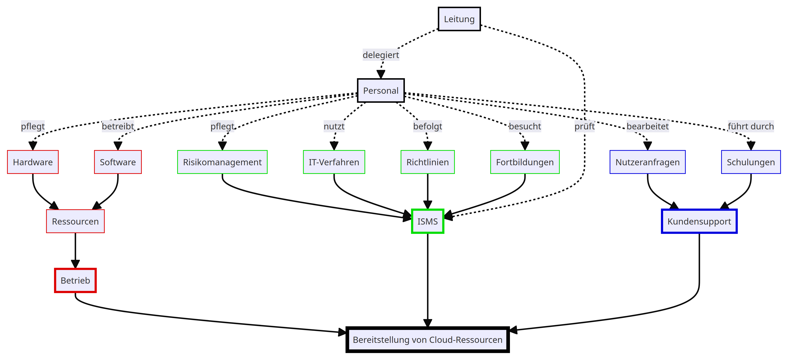

# Information Security Management System der de.NBI Cloud Bielefeld

[[_TOC_]]

Dieses Informationssicherheitsmanagementsystem (ISMS) der de.NBI Cloud Bielefeld 
fußt auf den folgenden Dokumenten:

- [Informationssicherheitsleitlinie der de.NBI Cloud Bielefeld](informationssicherheitsleitlinie.md)
- [ISO 27001](iso27001.md) (Managementteil)
- [Erklärung zur Anwendbarkeit](erklaerung-zur-anwendbarkeit.md) (Controls)
  ([kompakt](erklaerung-zur-anwendbarkeit-kompakt.md))
- [IT-Verfahren](it-verfahren.md)

## Geltungsbereich

Der Geltungsbereich des ISMS ist wie folgt festgelegt:

|  |
|---|
|**Das ISMS umfasst den Betrieb und die Bereitstellung von Cloud-Ressourcen im Rahmen des deutschen Netzwerks für Bioinformatik-Infrastruktur (de.NBI) durch die de.NBI Cloud am Standort Bielefeld.**|
| |

## Logo


[[PNG]](assets/denbi_cloud_bielefeld_logo.png) [[SVG]](assets/denbi_cloud_bielefeld_logo.svg)

## Verantwortung des Managements

Die Leitung hat die Gesamtverantwortung für die Informationssicherheit
in der de.NBI Cloud Bielefeld. Sie legt die Informationssicherheitsleitlinie
fest und sorgt dafür, dass Informationssicherheit in alle Geschäftsprozesse 
und Projekte der de.NBI Cloud Bielefeld integriert wird. Sie stellt sicher, dass die 
Geschäftsprozesse entsprechend den Anforderungen des ISMS ablaufen.

### Entwicklung

Die weitere Entwicklung als auch der aktuelle Status des ISMS wird durch 
regelmäßige (in der Regel monatliche) Besprechungen der Leitung mit der Gruppe ADM
überwacht. Inhalt einer solchen Besprechung können unter anderem folgende Aspekte 
sein:

- Status der Kennzahlen
- Ergebnisse der internen Audits
- Identifizierte Maßnahmen und deren aktueller Status
- Ergebnisse der Behandlung von Security Incidents
- Bearbeitung von Eskalationen
- Priorisierung von Ressourcen
- Status der definierten Ziele

Durch die regelmäßige Darstellung des aktuellen Zustandes des ISMS erhält 
die oberste Leitung einen guten Überblick und kann dadurch der Verpflichtung, 
das ISMS stetig weiterzuentwickeln, gerecht werden.
Aufgrund der sich stetig ändernden externen Bedrohungen, gerade im IT-Sicherheitsumfeld,
ist diese Weiterentwicklung des ISMS unabdingbar. Ein Stillstand bei den 
Sicherheitsmaßnahmen würde mittelfristig zu einer leichteren Verwundbarkeit und 
damit zwangsläufig zu einer Verletzung der Vertraulichkeit, Integrität oder 
Verfügbarkeit führen, da sich das Umfeld stetig weiterentwickelt.

### Überprüfung

Das ISMS wird in regelmäßigen Abständen in einem internen Audit dahingehend
geprüft, ob alle Anforderungen des ISMS eingehalten werden. Die Überprüfung
erfolgt von einem oder mehreren Mitarbeitern einer anderen Gruppe die **nicht**
für den jeweiligen Prozess verantwortlich (Responsible ➝ RASCI Matrix M 2.5)
ist. _Beispiel: Der Gruppe ADM zugeordnete Prozesse dürfen nicht
von einem  Mitarbeiter derselben Gruppe überprüft werden._

Tritt dabei eine Nichterfüllung einer Anforderung des ISMS ein, so muss der
Verantwortliche dies prüfen und - sofern zutreffend - angemessen durch
Korrekturmaßnahmen reagieren.

Regelmäßige Überprüfungen des ISMS, Abweichungen von der geforderten Norm,
erfolgte Korrekturmaßnahmen sowie die Wirksamkeit der Korrekturmaßnahmen müssen
dokumentiert werden.

### Verbesserung

Das ISMS wird durch regelmäßige de.NBI-interne Audits fortlaufend
verbessert und hinsichtlich der Einhaltung von Sicherheitsrichtlinien
und -standards überprüft. Jeder Cloud-Standort stellt hierfür einen
Mitarbeiter einem der anderen Standorte einmal jährlich zur Verfügung,
und zwar für *ein* Audit inklusive einer GAP-Analyse. Alle hierfür
abgestellten Mitarbeiter sind nach ISO 27001 ISMS-Auditor geschult.

## Organisation

An höchster Stelle der ISMS-Organisation steht die oberste Leitung der de.NBI Cloud Bielefeld,
die die übergreifende Verantwortung für das ISMS trägt.

Sie wird operativ durch die Gruppe ADM unterstützt, welche im Auftrag der Leitung die
Umsetzung und Einhaltung aller notwendigen ISMS Aspekte wie u.a. die IT-Richtlinien,
die Risikobetrachtung inkl. der Maßnahmen und auch die Realisierung strategischer
Projekte sicherstellt.

## Prozesslandkarte

Die Prozesslandkarte dient der übersichtlichen und strukturierten
Darstellung der wichtigsten Geschäftsprozesse unserer Organisation.



Der zentrale Hauptprozess unserer Organisation ist die Bereitstellung von 
Cloud-Ressourcen (IaaS, SaaS) für Wissenschaftler im Bereich der Lebenswissenschaften. 
Dieser Prozess ist in 3 miteinander verbundene Prozessstränge zu unterteilen. 
Es handelt sich um den **Betrieb**, das **ISMS** und den **Kundensupport** 

_Diesen Prozessen sind die jeweiligen Betriebsprozesse untergeordnet bzw. zugehörig.
Teile dieser Betriebsprozesse betreffen mehrere oder alle Prozessstränge.
Da das ISMS die jeweiligen Betriebsprozesse im Rahmen der Normen nach ISO-27001 
ausrichtet, ist jeder Prozess auch dem ISMS untergeordnet._

### Betrieb

Der Betrieb benötigt für die Bereitstellung von Cloud-Ressourcen
wiederum Resourcen in Form von Hardware (Server, Netzwerk) und
Software (OpenStack, Ceph, etc.). 

- [Governance und Compliance](prozesse.md#governance-und-compliance-management)
- [Risikomanagement](prozesse.md#risikomanagement)
- [Schwachstellenmanagement](prozesse.md#schwachstellenmanagement)
- [Sensibilisierung und Kompetenzaufbau](prozesse.md#sensibilisierung-und-kompetenzaufbau)
- [Incident-Management](prozesse.md#incident-management)
- [Business-Continuity-Management](prozesse.md#business-continuity-management)
- [Change-Management](prozesse.md#change-management)
- [Technischer Betrieb](prozesse.md#technischer-betrieb)
- [Wiederkehrende Aufgaben](prozesse.md#wiederkehrende-aufgaben)

### ISMS

Dem ISMS Prozess sind weitere unterstützende Unterprozesse (Risikomanagement,
IT-Verfahren, Richtlinie und Fortbildungen der Mitarbeiter) zugeordnet. 

- [Alle Prozesse](prozesse.md)

### Kundensupport

Der dritte Unterprozess ist der Kundensupport, der durch die Prozesse
Nutzeranfragen und Schulungen unterstützt wird.

- [Governance und Compliance](prozesse.md#governance-und-compliance-management)
- [Schwachstellenmanagement](prozesse.md#schwachstellenmanagement)
- [Incident-Management](prozesse.md#incident-management)
- [Nutzerinteraktion](prozesse.md#nutzerinteraktion)

## Dokumentation

Das ISMS ist vollständig in diesem Repository dokumentiert. Die nachfolgende
Grafik gibt eine Übersicht über die vorhandenen Dokumente und Aufzeichnungen, die
für das ISMS benötigt werden.


Die Informationssicherheitsleitlinie wird von der obersten Leitung erstellt und 
freigegeben.

Alle übergreifenden (uni-weiten) Vorgaben werden durch den ISB erstellt und durch 
die oberste Leitung freigegeben. Die Ablage aller übergreifenden Dokumente und 
Aufzeichnungen erfolgt in Kopie in diesem Repository.

Vorgaben wie Richtlinien, Arbeitsanweisungen, Prozessbeschreibungen und IT-Verfahren
der de.NBI Cloud Bielefeld werden durch diese selbst erstellt und durch
den bzw. die Leiter der beteiligten Arbeitsgruppen freigegeben. Die Ablage und 
Bearbeitung aller Dokumente und Aufzeichnungen erfolgt in diesem Repository.

**Die Wortwahl innerhalb des ISMS soll als geschlechtsneutral angesehen werden.
Aus Gründen der Vereinfachung wird im Text durchweg die maskuline Form verwendet.**

### Dokumente

Nachfolgend sind alle für das ISMS relevanten Unterlagen verlinkt.

- [Informationssicherheitsleitlinie](informationssicherheitsleitlinie.md)
- [Regelungen zur Dokumentation](regelungen-zur-dokumentation.md)
- [Organisation](organisation.md)
- [IT-Verfahren](it-verfahren.md)
- [Ergänzung des IT-Basisschutzes um ISO-27001](ergaenzung-des-it-basisschutzes-um-iso27001-2017.md)
- [Risikomanagement](risikomanagement.md)
- [Werte](aufstellungen/werte.md)
- [Kooperationsvertrag](vertraege/KoopV_de.NBI_Vertrag_Betrieb_Cloud_UBI_FZJ.pdf)
- [Verzeichnis von Verarbeitungstätigkeiten](vvt/02_VVT_de.NBI%20CloudStandort_Bielefeld_AV_besonderer%20Teil.pdf)
- [Technische und organisatorische Maßnahmen](vvt/TOMs-Cloud-Bielefeld.pdf)
- [de.NBI Cloud Bielefeld Infrastruktur für externe Berater](sonstiges/HowTo_Openstack_Consultant.md)
- [Verpflichtung zur Informationssicherheit für Auftragnehmer](dienstvereinbarungen/Verpflichtungserklärung_Informationssicherheit_Auftragnehmer.md)
- [de.NBI Cloud User Wiki - Bielefeld-spezifische Informationen](https://cloud.denbi.de/wiki/Compute_Center/Bielefeld/)

## Richtlinien, Leitfäden, Arbeitsanweisungen, Vereinbarungen

### de.NBI

[Link zur Webseite](https://cloud.denbi.de/policies/)

- Richtlinien und Arbeitsanweisungen: siehe [Dokumente](dokumente.md).
- Datenschutzerklärung für die Webseite cloud.denbi.de
  - [https://cloud.denbi.de/policies/](https://cloud.denbi.de/policies/)
- de.NBI-Cloud-Nutzungsbestimmungen
  - [Version 1.2 vom 03.04.2019](richtlinien/Nutzungsbestimmungen_de.NBI_Cloud_V1.2.pdf)
    (lokale Kopie)

### FZJ

Für eine vollständige Liste siehe Intranet des FZJ:
[Interne Regelungen](https://intranet.fz-juelich.de/de/tools/interneregelungen).

#### Regelungen zur Informationssicherheit

- [IT-Sicherheitsrichtlinie des Forschungszentrums Jülich](https://intranet.fz-juelich.de/de/tools/interneregelungen/it-sicherheitsrichtlinie_des_forschungszentrums_juelich_rl_ir_119-1)
  - [von 2017](richtlinien/FZJ/IT-Sicherheitsrichtlinie_des_Forschungszentrums_RL_2_2012_IR_119-1%202023_05_Gültigkeitsverlängerung%20bis%202024_05.pdf)
    (lokale Kopie)
- [IT-Sicherheitsregeln für den Grundschutz](https://intranet.fz-juelich.de/de/organisation/it-portal/sicherheit-datenschutz/it-sicherheit/pdf-dokumente/it-sicherheitsregeln_fuer_den_grundschutz_ir_119-1-pdf)
  - [von 2003](richtlinien/FZJ/IT-Sicherheitsregeln_fuer_den_Grundschutz_IR_119-1.pdf)
    (lokale Kopie)
- [GBV Informations- und Kommunikationssysteme (IuK)](https://intranet.fz-juelich.de/de/organisation/br/standorte-gbr/gesamtbetriebsvereinbarungen/gbv-iuk_systeme.pdf)
  - [von 2009](richtlinien/FZJ/GBV%20IuK_Systeme.pdf)
    (lokale Kopie)
- [Merkblatt zur sicheren Datenträgerentsorgung](https://intranet.fz-juelich.de/de/organisation/it-portal/sicherheit-datenschutz/datenschutz/datentraegerentsorgung-merkblatt)
  - [von 2018](richtlinien/FZJ/Datentraegerentsorgung-Merkblatt.pdf)
    (lokale Kopie)
- [Datenschutzerklärung Mitarbeiter 2018](https://intranet.fz-juelich.de/en/organization/it-portal/security-privacy/privacy/datenschutzerklaerungmitarbeiter2018.pdf)
  - [von 2018](richtlinien/FZJ/DatenschutzerklaerungMitarbeiter2018.pdf)
    (lokale Kopie)

#### Informationen/Regelungen für Mitarbeiter*innen

- [Gesamtbetriebsvereinbarung über das flexible Arbeiten einschließlich Telearbeit](https://intranet.fz-juelich.de/de/organisation/gr/leistungen/weitere_informationen/betriebsvereinbarungen/gesamtbetriebsvereinbarung-ueber-das-flexible-arbeiten-einschliesslich-telearbeit-im-fzj.pdf)
  - [von 2023](richtlinien/FZJ/Gesamtbetriebsvereinbarung%20über%20das%20flexible%20Arbeiten%20einschließlich%20Telearbeit%20im%20FZJ.pdf)
    (lokale Kopie)

#### Personal

- [Verfahren zur Personalgewinnung](https://intranet.fz-juelich.de/de/organisation/gp/leistungen/personalbetreuung/personalthemenp-b/allgemeinesgleichbehandlungsgesetz/verfahren-zur-personalgewinnung)
  - [von 2014](richtlinien/FZJ/Verfahren%20zur%20Personalgewinnung.publicationFile.pdf)
    (lokale Kopie)
- [Dienstbeendigungsmeldung](https://intranet.fz-juelich.de/de/tools/interneregelungen/dienstbeendigungsmeldung_rl_ir_322_9)
  - [von 2021](richtlinien/FZJ/322-09_RL_Dienstbeendigungsmeldung_final%20V2.0_Intranet.pdf)
    (lokale Kopie)

#### Vordrucke

- [Technisch Organisatorische Maßnahmen (TOM)](https://intranet.fz-juelich.de/en/organization/it-portal/security-privacy/privacy/copy_of_tom-publicationfile-vnd-2eopenxmlformats-officedocument-2ewordprocessingml-2edocument)
  - [von 2020](richtlinien/FZJ/TOM.docx)
    (docx) (lokale Kopie)
  - Erläuterungen dazu: [Technischer Datenschutz](https://intranet.fz-juelich.de/de/organisation/it-portal/sicherheit-datenschutz/datenschutz/technischer_datenschutz.pdf)
    - [von 2020](richtlinien/FZJ/Technischer_Datenschutz.pdf)
      (lokale Kopie)

### Uni Bielefeld

#### Informationen (für Mitarbeiter) zur Informationssicherheit

[Link zur Webseite](https://www.uni-bielefeld.de/verwaltung/informationssicherheit)

- Flyer zum Tag der Informationssicherheit 2018

#### Regelungen zur Informationssicherheit

[Link zur Webseite](https://www.uni-bielefeld.de/verwaltung/informationssicherheit/regelungen/)

- IT-Basisschutz für IT-Personal
  - [Version 1.0 vom 15.11.2011](richtlinien/UniBi/Regelungen_IT-Basisschutz_IT-Personal_2011-11-15.pdf)
    (lokale Kopie)
- IT-Sicherheitsrichtlinie zur Handhabung von IT-Sicherheitsvorfällen
  - [Version 1.0 vom 13.05.2015](richtlinien/UniBi/IT-Sicherheitsrichtlinie_Handhabung_IT-Sicherheitsvorfaelle_final.pdf)
    (lokale Kopie)
- Informationssicherheitsleitlinie der Universität Bielefeld
  - [vom 14.06.2019](richtlinien/UniBi/2019-06-14_Informationssicherheitsleitlinie_Universitat_Bielefeld.pdf)
    (lokale Kopie)
- IT-Sicherheitsrichtlinie für Datacenter
  - [Version 1.1 vom 11.07.2008](richtlinien/UniBi/IT-Sicherheitsrichtlinie_Datacenter.pdf)
    (lokale Kopie)

#### Informationen/Regelungen für Mitarbeiter*innen

[Link zur Webseite "zentrale Organisation"](https://www.uni-bielefeld.de/uni/einrichtungen-organisation/zentrale-organisation/vertretungen-beauftragte/pr-mtv/informationen/)
[Link zur Webseite "Informationssicherheit"](https://www.uni-bielefeld.de/verwaltung/informationssicherheit/)

- Dienstvereinbarung zur Telearbeit
  - [von 2012](dienstvereinbarungen/DV-Telearbeit-2012.pdf)
    (lokale Kopie)
- Flyer zum Tag der Informationssicherheit 2018
  - [vom 14.05.2018](sonstiges/Infosicherheit_Flyer.pdf) (lokale Kopie)
- Regelungen zum sicheren Arbeiten im Home-Office
  - [vom 24.03.2020](richtlinien/UniBi/2020-03-24_Home-Office_sicheres_Arbeiten.pdf)
    (lokale Kopie)
- Regelungen zum Nutzen von Videokonferenzen
  - [vom 27.04.2020](sonstiges/2020-04-27_Datenklassifizierung_Videokonferenzen.pdf)
- [Verpflichtung zur Informationssicherheit für Beschäftigte](dienstvereinbarungen/Verpflichtungserklärung_Informationssicherheit_Beschaeftigte.md)

#### Personal

[Link zur Webseite](https://www.uni-bielefeld.de/verwaltung/dezernat-p-o/dokumente/tarifbeschaeftigte/)

- Leitfaden Personalgewinnung
  - [von April 2014](leitfaeden/Leitfaden_Personalgewinnung_2014.pdf)
    (lokale Kopie)
- Unterlagen bei Neueinstellung
  - [von 2015](personal/Unterlagen_bei_Neueinstellung3.pdf)
    (lokale Kopie)
- Niederschrift über förmliche Verpflichtung
  - [(lokale Kopie)](personal/verpflichtung.pdf)
- Verpflichtung zur Einhaltung des Datenschutz
  - [von April 2020](personal/Verpflichtung-zur-Einhaltung-des-Datenschutzes.pdf)
    (lokale Kopie)
- Belehrung
  - [von 2012](personal/Belehrung2012.pdf)
    (lokale Kopie)
- Angaben zu den übertragenen Aufgaben und der angestrebten wissenschaftlichen Qualifikation
  - [von Dezember 2019](personal/Angaben_zu_Aufgaben_und_Qualifizierung_wiss_Mitarb.pdf)
    (lokale Kopie)

### BSI

[Link zur Webseite](https://www.bsi.bund.de/DE/Themen/DigitaleGesellschaft/CloudComputing/Kriterienkatalog/Kriterienkatalog_node.html)

- C5 2020
  - [von Januar 2020](richtlinien/BSI/C5_2020.pdf) (lokale Kopie)

### ISO

| Nr.       | Version                                                      | Sprache          |
|-----------|--------------------------------------------------------------|------------------|
| 27000     | [2019](richtlinien/ISO/ISO_27000_2019_german.pdf)            | Deutsch          |
| 27001     | [2017](richtlinien/ISO/ISO_27001_2017_german.pdf)            | Deutsch          |
| **27001** | [2022](richtlinien/ISO/ISO_27001_2023-04_german_english.pdf) | Deutsch/Englisch |
| 27002     | [2017](richtlinien/ISO/ISO_27002_2017_german.pdf)            | Deutsch          |
| **27002** | [2022](richtlinien/ISO/ISO_27002_2022-08_german_english.pdf) | Deutsch/Englisch |
| 27005     | [2018](richtlinien/ISO/ISO_27005_2018_english.pdf)           | Englisch         |
| 27017     | [2015](richtlinien/ISO/ISO_27017_2015_english.pdf)           | Englisch         |
| 27018     | [2020](richtlinien/ISO/ISO_27018_2020_german.pdf)            | Deutsch          |

(lokale Kopien)

## Bearbeitungshinweise

1. Kurzlebige Merge Requests auf den Development-Branch minimieren
   Editierungskonflikte.
1. Unser Ersatz für eine in Markdown von Haus aus nicht vorhandene
   Kommentarfunktion sieht folgendermaßen aus:

   ```markdown
   >`jk` Finde ich gut!
   ```

   Ergebnis:
   >`jk` Finde ich gut!
1. Eine maximale Zeilenlänge von ungefähr 80 Zeichen bei Fließtext
   erleichtert die Bearbeitung und auch die Diffs.
