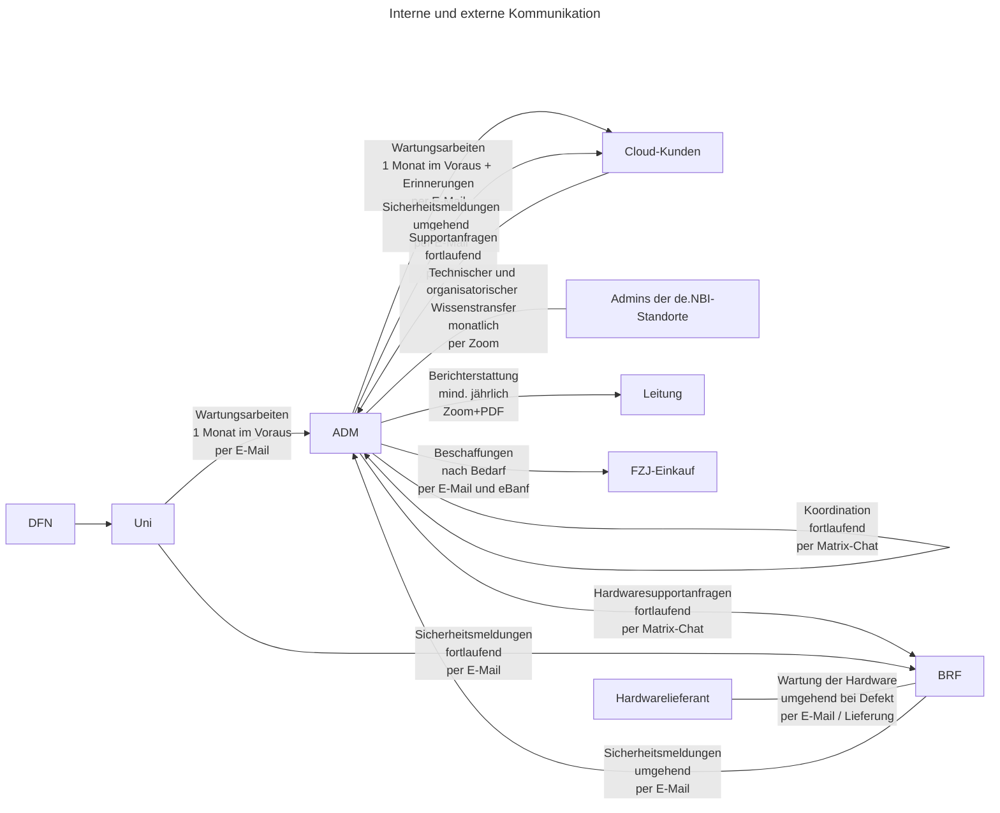

# ISO 27001:2022 <-> ISMS de.NBI Cloud Bielefeld

[[_TOC_]]

Das vorliegende Dokument orientiert sich an der Struktur der ISO 27001:2022 und
schlägt die Brücke von der Norm auf die im ISMS hinterlegten Dokumente. 
Bzgl. einiger Begrifflichkeiten und Abkürzungen siehe [Glossar](glossar.md).

## 4. Kontext der Organisation

### 4.1 Verstehen der Organisation und ihres Kontextes

- [ISMS#Systembeschreibung](organisation.md#systembeschreibung)
- [de.NBI Nutzervereinbarung](richtlinien/Nutzungsbestimmungen_de.NBI_Cloud_V1.2.pdf)
- [ISMS#Gesamtverantwortlichkeit](organisation.md#gesamtverantwortlichkeit)

### 4.2 Verstehen der Erfordernisse und Erwartungen interessierter Parteien

- [ISMS#Erwartungen der Kunden](organisation.md#erwartungen-der-kunden--hauptanforderungen-an-die-cloud)
- [SOA#Gesetzesrahmen](erklaerung-zur-anwendbarkeit.md#a531-rechtliche-gesetzliche-regulatorische-und-vertragliche-anforderungen)

### 4.3 Festlegen des Anwendungsbereich des Informationssicherheitsmanagementsystems

- [ISMS#Geltungsbereich](index.md#geltungsbereich)

### 4.4 Informationssicherheitsmanagementsystem

- [ISMS](index.md)

## 5. Führung

## 5.1 Führung und Verpflichtung

- [ISMS#Gesamtverantwortlichkeit](organisation.md#gesamtverantwortlichkeit)

## 5.2 Politik

- [Informationssicherheitsleitlinie](informationssicherheitsleitlinie.md)
- [ISMS#Veranwortung des Management](index.md#verantwortung-des-managements)

## 5.3 Rollen, Verantwortlichkeiten und Befugnisse in der Organisation

- [ISMS#Rollentrennung](organisation.md#rollentrennung)

# 6. Planung

## 6.1 Maßnahmen zum Umgang mit Risiken und Chancen

- [Risikomanagement](risikomanagement.md)
- [Erklärung zur Anwendbarkeit](erklaerung-zur-anwendbarkeit.md)
  ([tabellarisch](erklaerung-zur-anwendbarkeit-kompakt.md))

## 6.2 Informationssicherheitsziele und Planung zu deren Erreichung

- [Informationssicherheitsleitlinie](informationssicherheitsleitlinie.md)
- [Messungen zur Informationssicherheitsleistung und ISMS-Wirksamkeit](./aufstellungen/messungen-leistung-isms-wirksamkeit.md)

## 6.3 Planen von Änderungen

Änderungen am ISMS werden geplant durchgeführt. Die Planung größerer
Änderungen findet überwiegend auf Basis von GAP-Analysen statt
(bspw. so geschehen bei der Umstellung auf die Normversion 2022).
Kleinere Änderungen werden mittels YouTrack-Tickets (mit Kürzel CER)
geplant, die u. a. im Rahmen von Brainstorming-Sitzungen erstehen.

Änderungen am ISMS interliegen außerdem weiteren Regelungen, siehe
[Regelungen zur Dokumentation](regelungen-zur-dokumentation.md).

# 7. Unterstützung

## 7.1 Ressourcen

- [ISMS#Finanzierung](organisation.md#finanzierung)

## 7.2 Kompetenz und 7.3 Bewusstsein

- [Informationssicherheitsleitlinie](informationssicherheitsleitlinie.md)
- [Erklärung zur Anwendbarkeit#A5.4](erklaerung-zur-anwendbarkeit.md#a54-verantwortlichkeiten-der-leitung)
- [Aufstellungen der Schulungen und Fortbildungen](aufstellungen/schulungen-und-fortbildungen.md)

## 7.4 Kommunikation

Siehe auch:

- [Tickets, Wiedervorlagen, Sicherheitsvorfälle via YouTrack](it-verfahren.md#it-16-tickets)
- [ISMS-Dokumentation (Changes) via GitLab](regelungen-zur-dokumentation.md)
- [Richtlinie zur Handhabung von Sicherheitsvorfällen](richtlinien/Richtlinie_Sicherheitsvorfaelle.md)
- [Dokumentation von IT-Systemen](it-systeme.md)
- [Regelung zur Dokumentation](regelungen-zur-dokumentation.md)

## 7.5 Dokumentierte Information

- [Regelung zur Dokumentation](regelungen-zur-dokumentation.md)
- [Prüfung der Abläufe(IT-1)](it-verfahren.md)

# 8. Betrieb

## 8.1 Betriebliche Planung und Steuerung

unter anderem:

- [Regelung zur Dokumentation](regelungen-zur-dokumentation.md)
- [Richtlinie zur Informationsicherheit im Projektmanagement](richtlinien/Informationssicherheit_im_Projektmanagement.md)
- [IT-Verfahren](it-verfahren.md)
- [A5.2.2](erklaerung-zur-anwendbarkeit.md#a522-überwachung-überprüfung-und-änderungsmanagement-von-lieferantendienstleistungen)
  Überwachung und Überprüfung von Lieferantendienstleistungen

## 8.2/8.3 Informationssicherheitsrisikobeurteilung und -behandlung

- [Risikomanagement](risikomanagement.md)

# 9. Bewertung der Leistung

## 9.1 Überwachung, Messung, Analyse und Bewertung

Siehe [Messungen zur Informationssicherheitsleistung und ISMS-Wirksamkeit](aufstellungen/messungen-leistung-isms-wirksamkeit.md)

## 9.2 interne Audits

- [ISMS#Verantwortung des Management](index.md#überprüfung)
- [Audits](aufstellungen/audits.md)

## 9.3 Managementbewertung

- [ISMS#Verantwortung des Management](index.md#verantwortung-des-managements)
- [Regelung zur Dokumentation##Bewertung](regelungen-zur-dokumentation.md#bewertung-des-informationssicherheitsmanagementsystems)

# 10. Verbesserung

## 10.1 Nichtkonformität und Korrekturmaßnahmen

- [ISMS#Verantwortung des Management](index.md#überprüfung)
- [ISMS#Verantwortung des Management](index.md#verbesserung)

## 10.2 Fortlaufende Verbesserung

- [ISMS#Verantwortung des Management](index.md#verbesserung)

# Amd 1:2024

## Amendment 1: Climate action changes

- [Erklärung Klimabezogene Maßnahmen 2025](aufstellungen/klimawandel.md)
