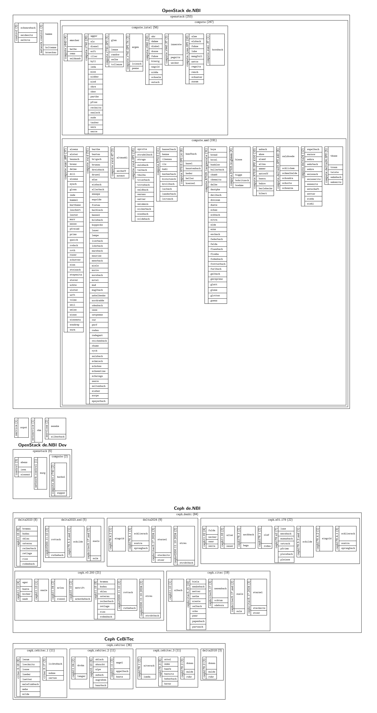
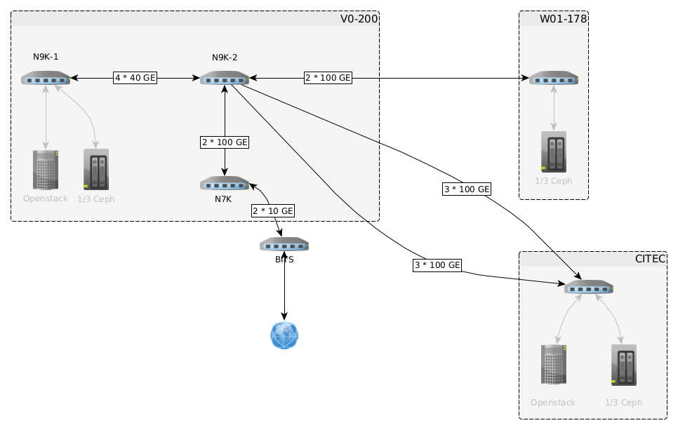
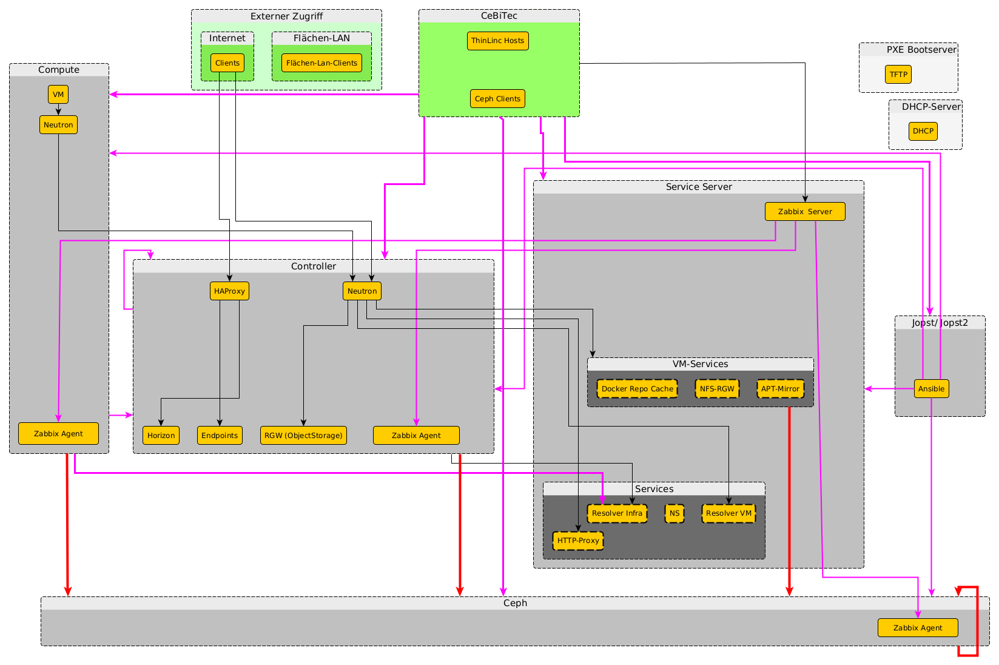
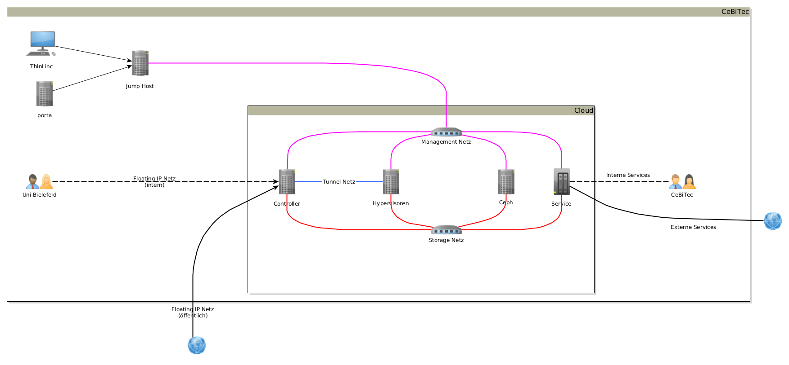
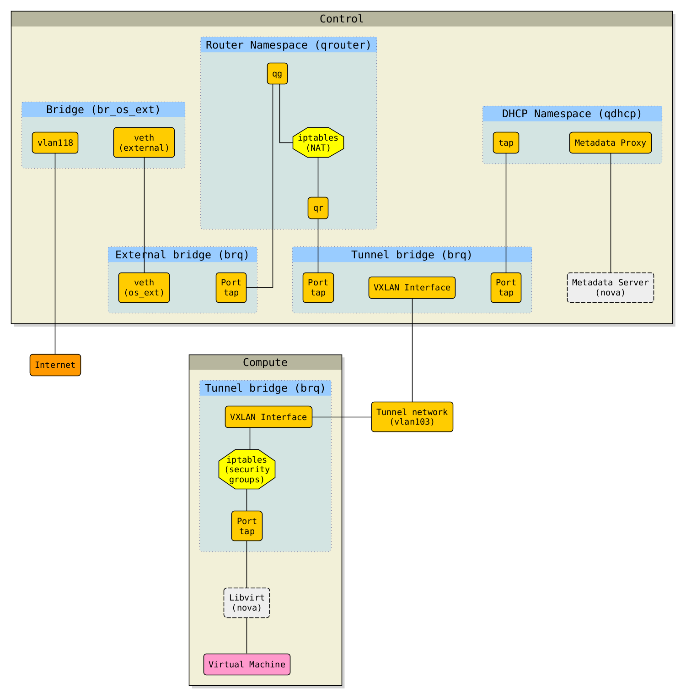

# IT-Systeme

Alle in der de.NBI Cloud integrierten IT-Systeme (Netzwerk, Server,
Speichersysteme, Kabel, …) sind in der Hardwaredatenbank der BRF mit
Informationen zu Standort, Spezifikation, Verkabelung, Hersteller,
Vorfälle, usw. erfasst. Darüber hinaus hält das zentrale
Monitoringsystem Zabbix (→ [IT-5](it-verfahren.md#it-5-zabbix)) der
de.NBI Cloud alle Informationen der
Hardwareinventurdatenbank sowie tiefergehende Informationen
(Softwareinstallation + Version, Funktion, Ausfälle, aufgetretene Probleme, usw.)
zu einzelnen Hosts vor.

Der Abgleich zwischen Hardware-Inventurdatenbank und Zabbix erfolgt über
einen mit Leserechten versehenen Serviceaccount jeweils bei
Hardwarezuwachs bzw. regelmäßig einmal monatlich (Abgleich der Daten).

Die Suche nach Schwachstellen in öffentlich zugänglichen Systemen erfolgt durch
GVM/OpenVAS (→ [IT-7](it-verfahren.md#it-7-openvasgsm)).

Die IT-Systeme (Assets) der de.NBI Cloud lassen sich in folgende Gruppen
einteilen:

- Netzwerk
    - Netzwerkinfrastruktur Übersicht
    - Switch
- Jump Host
- Controller / Netzwerk-Controller
- Compute
    - General Purpose
    - Service
    - High Memory
    - GPU
- externe Services
    - DNS (→ User)
    - APT Mirror (→ User)
    - Docker Registry Cache (→ User)
- interne Services
    - Zabbix (→ Admin)
    - OpenVAS (→ Admin)
    - YouTrack (→ Admin)
- Ceph

Übersicht der Host-Gruppen auf Basis der Ansible-Inventare:

## Netzwerk

Die Netzwerkinfrastruktur der de.NBI Cloud ist mit der des CeBiTec verknüpft.

Seit Oktober 2022 sind die Ressourcen der de.NBI Cloud über 3 Datacenter
auf dem Campus der Universität Bielefeld verteilt.

- Unihauptgebäude (UHG): Datacenter in V0-200
- Unihauptgebäude (UHG): Datacenter in W01-178
- CITEC: Datacenter in 01.203

In V0-200 sind alle dort verortetet Ressourcen (Openstack und 1/3 Ceph) über
die Cisco N9K-1 angebunden (mit 10 GE Kupfer und/oder 40 GE Kupfer/Glas). Die N9K-1
ist derzeit mit einem 4 · 40 GE Trunk mit einem weiteren Cisco Switch N9K-2 verbunden und
über diesen mit 2 · 100 GE Trunk mit einem Cisco N7K Switch verbunden.
Die Cisco N7K übernimmt das Routing und ist mit einem 2 · 10 GE Trunk mit dem
Rechenzentrum der Universität (BITS) verbunden.

Das DataCenter (V0-200) ist von der N9K-2 über einen 2 · 100 GE Trunk mit einem
weiteren Cisco-Switch am zweiten Standort in W01-178 verbunden. Am zweiten Standort
sind 1/3 aller Ceph Hosts verortet.

Die Resourcen (Openstack und 1/3 Ceph) am dritten Standort im CITEC 0.1.203 sind über zwei
separat verlaufende Strecken mit jeweils 3 · 100 GE angebunden.

### Netzwerkbeziehungen der de.NBI Services

Es gibt drei Arten von Verbindungen die verschiedenfarbig gekennzeichnet
sind.

- **schwarz** : externe Netzwerkbeziehungen
- **violett** : interne Netzwerkbeziehungen
- **rot** : Netzwerkbeziehungen zur Speicherinfrastruktur

### Übersichtsplan der Netzwerkinfrastruktur

Der Übersichtsplan über die Netzwerkinfrastruktur stellt die
schematische Verknüpfung der einzelnen Komponenten der
de.NBI Cloud mit ihren Netzwerken (VLANs) dar. In der Übersicht
ist das Netz der Service-Prozessoren (SPs) nicht dargestellt. Die
SPs sind über ein eigenes physikalisches Netz über einen dedizierten
Jump Host erreichbar.

### Zuordnung Netzwerk Funktionalität <-> VLANs

| VLAN ID | Beschreibung                            |   CIDR            | Klassifikation |
|---------|-----------------------------------------|-------------------|----------------|
| 101     | SP/Supervisor-Netzwerk                  | -                 | K3             |
| 102     | Management-Netzwerk                     | 172.21.48.0/21    | K3             |
| 103     | Tunnel-Netzwerk                         | 172.21.56.0/21    | K4             |
| 104     | Storage-Netzwerk                        | 172.21.32.0/21    | K4             |
| 109     | Floating IP Netzwerk (Intranet)         | 172.21.40.0/21    | K2             |
| 111     | Floating IP Netzwerk (Intranet/CeBiTec) | 129.70.163.128/26 | K2             |
| 118     | Floating IP Netzwerk (Extern/de.NBI)    | 129.70.51.0/24    | K1             |
| 120     | Floating IP Netzwerk (Extern/DSI)       | 129.70.138.128/26 | K1             |

Erläuterung zur Klassifikation:

Bei den Netzwwerken wird grundsätzlich zwischen Netzen der Infrastruktur (VLAN 101 - 104) sowie den
Floating IP Netzwerken unterschieden.

Die Floating IP Netzwerke liegen entweder vor der Firewall der Universität und damit aus dem Internet
nahezu uneingeschränkt erreichbar oder hinter der Firewall der Universität und damit aus dem Intranet
der Universität erreichbar. Das CeBiTec Netz nutzt einen routbaren Addressraum, d.h. Adressen können
für das Internet komplett oder für einzelne Dienste freigeschaltet werden. Die Nutzer haben die Möglichkeit
und sind selbst in der Verantwortung den Zugriff auf ihr Netz über eine öffentliche Adresse zu sichern.

Alle Netze der Infrastruktur können vertrauliche Informationen enthalten oder den Zugriff darauf ermöglichen.
Über das Tunnelnetz laufen die Netze der Kunden (mittels VXLAN separiert). D.h. die Klassifikation gilt
streng genommen für die VXLANs und nicht für das Tunnelnetz selbst und hängt von der Art des Projekt ab.

Die Storage Knoten interagieren über das Storage Netz aus Performancegründen mit unverschlüsselten Verbindungen.
Die Klassifikation hängt auch hier von der Art des Projekt ab.

### Virtuelle Netzwerkarchitektur innerhalb von OpenStack

Innerhalb von OpenStack ist die virtuelle Netzwerkarchitektur basierend auf Neutron
folgendermaßen aufgebaut:

## Jump Host

Die Jump Hosts `jopst`, `jopst2` sowie `jopstcon` bieten die einzigen Zugänge zum
Managementnetz der de.NBI Cloud-Infrastruktur. Der Zugang auf den
Jump Host erfolgt ausschließlich mittels SSH-Schlüssel-Authentisierung
und TOTP (2FA) aus dem CeBiTec-Netz. Bis auf das Heimatverzeichnis der
berechtigten Personen gibt es
zwischen dem CeBiTec und dem Jump Host keine gemeinsamen Verzeichnisse.
(→ [IT-6.1](it-verfahren.md#it-61-administrativer-zugang-zum-management-netzwerk))

## Controller

Die drei Controller sind die zentralen Elemente der auf OpenStack
basierenden de.NBI Cloud. Auf allen Controllern läuft als Software für
Services ein HA-Proxy, der je nach Service als Load Balancer (LB) oder
High Availability (HA) Proxy fungiert. Auf den Controllern werden die
folgenden Dienste zur Verfügung gestellt:

- Identity (Keystone) → LB
- Compute (Nova) → LB
- Netzwerk (Neutron) → LB
- Images (Glance) mit Ceph als Speicherbackend → LB
- Volumes (Cinder) mit Ceph als Speicherbackend → LB

Zusätzlich sind folgende zentralen und für den Betrieb der de.NBI Cloud
essenziellen internen Dienste auf den Controllern verortet:

- Datenbankbackend (MariaDB bzw. GaleraDB) → HA
- Messageservice (RabbitMQ) → LB
- Proxy (HaProxy) → HA

Einer der drei Controller wird durch ein Quorum als Master gewählt und
ist via openstack.cebitec.uni-bielefeld.de (extern) bzw. Controller
(intern) erreichbar. Bei Ausfall eines Controllers wird ein neuer Master
gewählt, solange eine Mehrheit besteht (Prinzip eines Quorums).

Die Hardwareausstattung aller Controller ist identisch:

- Einsockelsystem mit 384 GB RAM und 48 Kernen
- Redundante Stromversorgung (USV)
- 2 x 10 GE (Kupfer) + 100 GE (Glas)

## Netzwerk Controller

Drei Netzwerk-Controller stellen zusätzliche Netzwerkkapazitäten
für die Openstack Projekte / Kundennetze zur Verfügung.

Die Hardwareaustattung aller Netzwerk Controller ist identisch:

- Einsockelsystem mit 512 GB RAM und 32 Kernen
- Redundante Stromversorgung (USV)
- 2 * 10 GE (Kupfer) + 100 GE (Glas)

## Compute

Die Compute Server sind Hypervisor für die VMs der Nutzer der de.NBI
Cloud. Die Hardwareausstattung der Server (Stand Januar 2025)
unterscheidet sich je nach Klasse. Die Klassen als auch die Ausstattung
derselben hat sich über die Jahre den aktuellen Anforderungen angepasst.

Die _legacy_ Klassen werden nicht durch aktuelle Hardware modernisiert und
fallen irgendwann durch den normalen Alterungsprozess raus.

Alle Compute Server werden durch das
gleiche Ansible Playbook installiert und aktualisiert und haben demnach
denselben Softwarestand. Die Unterscheidung nach Klassen bei der
Installation bzw. Aktualisierung erfolgt technisch über Ansible-Hostgroups (und
deren Variablen).

### General Purpose (leagcy)

- Ein- oder Zweisockelsysteme mit 384 – 512 GB RAM und 28 bis 32 Kernen
- mindestens 2  Festplatten (HDD oder SSD) im RAID 10 als lokaler VM Speicher
- Redundante Stromversorgung (teilweise USV)
- 10 GE (Kupfer)

### Service (legacy)

- Viersockelsysteme mit 768 GB RAM und 56 Kernen
- mindestens 8 Festplatten (HDD) im RAID 10 als lokaler VM Speicher
- Redundante Stromversorgung (USV)
- 10 GE (Kupfer)

### GPU (legacy)

- wie General Purpose (legacy)
- zusätzlich bis zu 2 Nvidia P100/V100/T4/A100/L4 GPU Karten

### LargeScale

- Zweisockelsystem mit 2048 GB RAM und 128 Kernen
- mindestens 2 Festplatten (NVME) im RAID 10 als lokaler VM Speicher
- Redundante Stromversorgung (USV)
- 10 GE (Kupfer) oder 40/100 GE (Glas)

### HighMemory

- Zwei- oder Viersockelsysteme mit 3072 - 4096 GB RAM und 56 - 128 Kernen
- mindestens 10 Festplatten (HDD) im RAID 10 als lokaler VM Speicher **oder**
- mindestens 2 Festplatten (NVME) im RAID 10 als lokaler VM Speicher
- Redundante Stromversorgung (USV)
- 10 GE (Kupfer) oder 40/100 GE (Glas)

### General Purpose

- Einsockelsystem mit 1152 GB RAM und 96 Kernen
- 2 Nvidia L4 GPU Karten
- 2 NVME SSDs im RAID 10 als lokaler VM Speicher
- Redundante Stromversorgung (USV)
- 10 GE (Kupfer)

### GPU

- Zweisockelsystem mit 2304 GB RAM und 196 Kernen
- 8 Nvidia L4 GPU Karten
- 2 NVME SSDs im RAID 10 als lokaler VM Speicher
- Redundante Stromversorgung (USV)
- 10 GE (Kupfer) und 100 GE (Glas)

### HighGPU

- Zweisockelsystem mit 2048 - 2304 GB RAM und 128 bis 196 Kernen
- 4 Nvidia A40/H100 GPU Karten
- 2 NVME SSDs im RAID 10 als lokaler VM Speicher
- Redundante Stromversorgung (USV)
- 10 GE (Kupfer) und 100 GE (Glas)

## Externe Services

Die extern angebotenen Services laufen auf einem dedizierten
Service Server (wie General Purpose, Anbindung ans CephFS und
Stromversorgung via USV).
Die Zielgruppe des Services sind die Nutzer der de.NBI Cloud Bielefeld.

### DNS

Für die Zonen `bi.denbi.de` bzw. `gi.denbi.de` wird ein DNS-Server
betrieben (→ [IT-4.10.3.5](it-verfahren.md#it-41035-dns)).

### Ubuntu Repository Mirror

Zu der unterstützten Linux Distribution _Ubuntu_ wird in der de.NBI Cloud Bielefeld
ein APT Mirror der gepflegten LTS Repositories (20.04, 22.04
und 24.04 - Stand Januar 2025) angeboten um Bandbreite zu sparen und den
Installationsprozess zu beschleunigen. Die vom Standort Bielefeld gepflegten Cloud
Images sind auf die Nutzung dieses Mirrors vorbereitet
(→ [IT 4.10.3.2](it-verfahren.md#it-41032-apt-mirror)).
Der Mirror ist nicht öffentlich und ausschließlich der Nutzung innerhalb
der de.NBI Cloud Bielefeld vorbehalten.

### Docker Registry Cache

Um Bandbreite zu sparen und den Zugriff auf Docker Images zu beschleunigen,
betreibt die de.NBI Cloud Bielefeld einen Docker Registry Cache
(→ [IT-4.10.3.3](it-verfahren.md#it-41033-docker-cache)). Die vom Standort 
Bielefeld gepflegten Cloud Images sind auf die Nutzung dieses Mirrors vorbereitet

## Interne Services

Ebenso wie die externen Services laufen die internen Services auf einem dedizierten Host
(Einsockelsystem mit 128 GB RAM und 32 Kernen, Stromversorgung via USV, Anbindung ans CephFS).
Interne Services sind ausschließlich den Mitarbeitern der BRF und ADM vorbehalten. Sofern nicht
anders vermerkt, sind die internen Services ausschließlich aus dem Managementnetzwerk
(→ [Netzwerk](#netzwerk)) erreichbar.

### Zabbix

Zum Hard- und Softwaremonitoring und zur Inventarisierung wird Zabbix
(→ [IT-5](it-verfahren.md#it-5-zabbix))eingesetzt. Der Zugang zur Zabbix-Weboberfläche ist
durch personalisierte Accounts (Benutzername + Passwort) abgesichert.

### Issue Tracker

Zur Dokumentation von Ereignissen jeglicher Art kommt der Issue Tracker _YouTrack_
(→ [IT-2](it-verfahren.md#it-2-issue-tracker)) zum Einsatz. Der Zugang zur
YouTrack-Weboberfläche erfolgt durch  personalisierte Accounts (Nutzername + Passwort).

### OpenVAS

Zur Überprüfung der externen Services sowie der Cloud-API-Endpunkte und aller Cloud VMs mit
einer öffentlichen IP wird OpenVAS (bzw. dessen Nachfolger) eingesetzt
(→ [IT 4.10.3.1](it-verfahren.md#it-7-openvasgsm)).
OpenVAS selbst läuft **nicht** auf einem dedizierten Server, sondern
auf einer VM in der Cloud. Der Zugriff auf diese VM ist durch eine Security-Gruppe auf
den IP-Bereich der Uni Bielefeld beschränkt. Der Zugang auf die Weboberfläche erfolgt durch
personalisierte Accounts (Nutzername + Passwort).

## Ceph

Ceph wird als Speicherbackend (Block Storage, Object Storage und File Storage) für die Cloud
eingesetzt. Die Ceph-Knoten sind über drei Standorte verteilt (je  ⅓ in UHG V0-200, UHG W01-178
und CITES 01.203 - unterschiedliche Brandabschnitte bzw. Gebäude auf dem Campus).
Die Aufteilung ist in der Topologie der CrushMap als Dreifachredundanz abgebildet.

Alle Ceph Knoten haben eine vergleichbare Hardwareausstattung:

- Ein- oder Zweisockelsysteme mit 384GB bis 512GB RAM und 28 bis 32 Kernen
- 24 lokale Festplatten mit 10TB und NVME/SSD als Metadaten DB (BlueStore)
- Redundante Stromversorgung (⅔ mit USV)
- 2x 1GE bzw. 10GE (Kupfer) und 40/100GE (Glasfaser)

Es gibt keine dedizierten Server für Ceph Services (Monitor, Manager, RGW, Metadatenserver). Diese
laufen auf den Ceph OSD-Knoten mit. Bei der Verteilung der Services auf die Knoten ist die Topologie
berücksichtigt, die aktuelle Aufteilung ist dem Ceph-Repository zu entnehmen
(→ [IT-4.40](it-verfahren.md#it-440-erstinstallation-von-ceph-knoten)).
