# IT-Verfahren &ndash; de.NBI Cloud Bielefeld

[[_TOC_]]

_IT-Verfahren sind im Rahmen der IT-Sicherheit in folgenden
Punkten zu dokumentieren:_

- _Zweck des IT-Verfahrens, Zielsetzung,_
- _Beschreibung der Arbeitsabläufe_
- _Schutzbedarfsfeststellung mit einer Bewertung auf Grundlage der in
  der Vorlage dargestellten Bewertungstabelle_
- _Durchführung einer Risikoanalyse in Abhängigkeit vom Ergebnis der
  Schutzbedarfsanalyse Beschreibung der Rollen; ggf. in Form eines
  Berechtigungskonzepts_
- _Festlegung von Vertretungsregelungen, insbesondere im
  Administrationsbereich Zugriffsrechte_
- _Organisation, Verantwortlichkeit und Durchführung der Datensicherung
  Notfallregelungen_
- _Ggf. Wartungsvereinbarungen_

_Für den Fall, dass personenbezogene Daten verarbeitet werden, ist in
Abstimmung mit der oder dem Datenschutzbeauftragten eine Vorabkontrolle
nach dem Datenschutzgesetz des Landes Nordrhein- Westfalen (DSG NRW)
durchzuführen.
Ferner ist zu klären, inwieweit bei der Einführung eines IT-Verfahrens
personalvertretungsrechtliche Regelungen zu berücksichtigen sind.
Es dürfen ausschließlich dokumentierte Verfahren in einen
Produktivbetrieb/Regelbetrieb überführt werden. Das Verfahren ist
produktiv, wenn die Gruppe der Nutzenden uneingeschränkten Zugriff auf
das Verfahren hat. Die IT-Beauftragten sind verantwortlich für die
Initiierung der Erstellung und Pflege der Dokumentation der IT-Verfahren
ihrer Organisationseinheit. Die IT-Verfahrensverantwortlichen sind
verantwortlich für die Umsetzung. Die Zuständigen für
Systemadministration und Applikationsbetreuung sind zur Mitarbeit
verpflichtet. Fragen zur Art und Umfang der Dokumentation sowie zu den
IT-Verfahren sind an den oder die IT-Sicherheitsbeauftrage/n zu richten._

Übersicht der IT-Arbeitsabläufe der de.NBI Cloud Bielefeld

| Verfahren | Verantwortlich | Beschreibung                 | einmalig                   | jährlich | monatlich      | wöchentlich  | täglich         |
|-----------|----------------|------------------------------|----------------------------|----------|----------------|--------------|-----------------|
| IT-1      | ADM            | Prozesse                     |                            | Prüfung  |                |              |                 |
| IT-2      | ch             | YouTrack                     |                            | Prüfung  | sprints        | meeting      | Lösung          |
| IT-3      | jk             | Hardware                     | Beschaffung, Aufbau, Abbau |          |                |              |                 |
| IT-4      | ADM            | Server                       | Setup                      | Prüfung  | Aktualisierung |              |                 |
| IT-5      | aw             | Zabbix                       | Setup                      | Prüfung  |                |              | Sichtung        |
| IT-6      | jk             | Netzwerk                     | Setup                      | Prüfung  |                |              | Zugang          |
| IT-7      | aw             | OpenVAS                      | Setup                      | Prüfung  | Sichtung       |              | Sichtung (Score > 7) |
| IT-8      | ch             | CVE-Scans                    | Setup                      | Prüfung  | Aktualisierung | Sichtung     |                 |
| IT-9      | jk             | OpenStack                    |                            | Prüfung  |                |              |                 |
| IT-10     | aw             | Ceph                         |                            | Prüfung  |                |              |                 |
| IT-11     | jk             | Accounts                     | Anlegen/Löschen            | Prüfung  |                |              | Anlegen/Löschen |
| IT-12     | jk             | Klassifikation               | Prüfung, Erfassung         | Prüfung  |                |              |                 |
| IT-13     | aw             | Ausrollen von neuer Software | bei Bedarf (Ticke          |          |                |              |                 |
| IT-14     | aw             | Eramba                       | Setup                      | Prüfung  |                |              | Sichtung        |
| IT-15     | jk             | Lieferantenbeziehungen       | Anlegen                    |          | Prüfung        |              |                 |
| IT-16     | ch             | Tickets                      | Setup                      |          |                | Prüfung      | Sichtung        |
| IT-17     | aw             | Business Continuity          |                            | Prüfung  |                |              |                 |
| IT-18     | jk             | Backup                       | Setup                      | Prüfung  |                |              |                 |
| IT-19     | ADM            | DSGVO Auskunft               |                            | Prüfung  |                |              |                 |
| IT-20     | ADM            | Patchen der Systeme          |                            | Prüfung  |                | PB-RUN       |                 |
| IT-21     | ch             | Kolla-Images                 |                            | Prüfung  |                | PB-RUN       |                 |
| IT-22     | jk             | Beschaffung/Auschreibung     |                            | Prüfung  |                |              |                 |
| IT-23     | vr             | Sensibilisierungstraining    |                            | Prüfung  |                |              |                 | 
| IT-24     | jk             | AVV (Prozess)                | bei Bedarf                 | Prüfung  |                |              |                 |      

Die in der Tabelle verwendeten Personenkürzel und Rollen
sind in [Organisation](organisation.md#gesamtverantwortlichkeit)
beschrieben.

# IT-1 Prüfung der Abläufe

IT-1 umfasst die Überprüfung der Dokumentation nach Ablauf der festgelegten
Gültigkeit. Der dazugehörige Management-Prozess ist in den
[Regelungen zur Dokumentation](regelungen-zur-dokumentation.md) beschrieben.

# IT-2 Issue Tracker

IT-2 beschreibt den eingesetzten Issue Tracker (YouTrack) und die damit
verbundenen Verfahren zur Installation und Upgrade. Der Issue Tracker
ist öffentlich unter der Adresse
[https://yt.bi.denbi.de](https://yt.bi.denbi.de)
erreichbar, Der Zugang ist durch Benutzername + Passwort abgesichert
und auf die Mitarbeiter des IBG-5, die Forschungsgruppe CMG sowie die BRF
beschränkt. Die Administration findet über den mittels 2FA abgesicherten
root-Account statt, zu dem nur ADM Zugang besitzt.
Das folgende Schaubild illustriert das Verfahren.

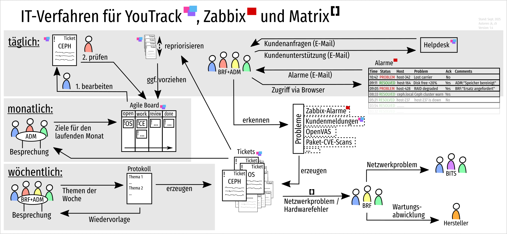

Es wird derzeit eine lizenzierte Version von YouTrack (inkl.
Support) genutzt (siehe [Lizenzen](aufstellungen/lizenzen.md)).
Die Verwendung des Issue Tracker und dessen Integration in
das ISMS ist in einem eigenen Verfahren beschrieben (➝ IT-16).

## IT-2.1 Installation & Upgrade

Die Installation bzw. das Upgrade von YouTrack erfolgt über das OpenStack-Playbook
für den internen Service Host.  Der Playbook-Task basiert auf dem offiziellen
[JetBrains YouTrack Docker-Image](https://hub.docker.com/r/jetbrains/youtrack). JetBrains
unterstützt mit dem Docker-Image einen definierten und unkomplizierten Upgradepfad
(Aktualisierung des Containers).

Anschließend muss auch bei Upgrades einmal der Installationsassistent durchlaufen werden.
Hier sollten die voreingestellten Werte beibehalten werden.
Anschließend ist sicherzustellen, dass in den "Server Settings"
im Bereich "Database Backup" die Backupdateien der vergangenen Tage
sichtbar sind.

### Prüfung der Funktionalität

Insbesondere nach einem Upgrade muss die Funktionalität der Anwendung überprüft werden.
Für diese Anwendung existieren keine gesonderte Testskripte, daher muss die Funktionalität
manuell geprüft werden.

Zu Beginn muss geprüft werden, ob die `docker-compose`-Container akkurat hochfahren
und sich nicht in einer Schleife neu starten. Überprüft wird dies durch `docker ps`.
Sollte letzteres der Fall sein, so wird mit `docker logs -f youtrack` die genaue
Ursache für das Fehlverhalten identifiziert und behoben.

Arbeiten die Container korrekt, so wird die Weboberfläche geöffnet und es
werden grundlegende Funktionen überprüft:

- Öffnen vorhandener Tickets
- Editieren vorhandener Tickets
- Erstellen neuer Tickets

Sollte die grundlegende Funktionalität nicht mehr gegeben sein, so muss die Container-Version
zurückgesetzt und ggf. ein Backup eingespielt werden.

## IT-2.2 Datenbank-Backup

Die Datenbank wird über eine interne Funktion von YouTrack stündlich
in das CephFS (`/mnt/cephfs/opstadm/youtrack/backup`) gesichert und
über das CeBiTec zusätzlich täglich auf Band gesichert (siehe [IT-18](#IT18)).

## IT-2.3 Fehlerbehebungen

### Recovery-Prozess bei korrupter interner Datenbank

Es kann u.a. aufgrund schneller VIP-Wechsel dazu kommen, dass die interne YouTrack-Datenbank Inkonsistenzen aufweist.
Dies äußert sich meist darin, dass der Service nicht mehr startet und Fehler in den Logs verzeichnet sind.
Zur Behebung muss der Datenbank-Inhalt aus einem Backup wiederhergestellt werden. Das Vorgehen ist wie folgt:

1. Auf allen Service-Hosts den Ordner `/mnt/service_data/youtrack/` beiseite schieben.
2. Den Ansible-Task `service_youtrack` ausrollen.
3. Den Wizard-Token aus den YouTrack-Container-Logs extrahieren.
4. Den Token unter <https://yt.bi.denbi.de> eingeben, auf "Upgrade" klicken und das entsprechende Backup zur Wiederherstellung auswählen.
5. Die restlichen Schritte des Installationsassistenten ohne weitere Anpassungen bestätigen.
6. Als root im YouTrack UI sicherstellen, dass die "Base URL" unter "Global Settings"→"Server Configuration"
   dem Wert `https://yt.bi.denbi.de` entspricht.

## IT-2.4 Administration

### Erstellung neuer Team-Projekte

Die folgenden Schritte sind zur Erstellung und Konfiguration eines neuen Team-Projekts im Scope IBG-5/CMG vorgegeben.

1. Vorbereitung
   - Für jedes Projekt muss ein Besitzer benannt werden
   - Für jedes Projekt muss eine Kurzbeschreibung vorgelegt werden (1 Satz genügt)
1. Als `root` einloggen
1. <https://yt.bi.denbi.de/projects/create> öffnen
1. Als Projekttyp `Team project` auswählen
   - -> `Use this template`
1. Projektnamen eingeben
1. Projekt-ID nach folgenden Regeln anpassen (dies muss sein, da der Namensraum sehr begrenzt ist)
   - die ID sollte bereits im Erstellungsformular gut gewählt sein. Alle einmal gesetzten IDs sind
     auch nach Änderung weiterhin für immer dem Projekt zugeordnet.
     - Beispiel zur Abschreckung: Setze ich für das CEPH-Projekt die ID kurz auf `ROFL` und anschließend
       wieder auf `CEPH` zurück, so werden alle Suchen im YouTrack nach `ROFL` für immer die CEPH-Tickets anzeigen.
       Neue Projekte könnten diese ID dann nicht mehr verwenden.
   - die ID sollte möglichst kurz aber eindeutig sein
   - Erlaubte Zeichen: A-Z (nur Großbuchstaben)
   - Länge: 3-4 Zeichen - in Ausnahmefällen 2 Zeichen
   - Beispiele:
     - `CMG - Microbify` -> `MFY`
     - `CMG - Darwinibacteriales` -> `DWB`
     - `EOSC - ENTRUST` -> `EEN`
1. `More settings` ausklappen
   - Beschreibungssatz (aus 1.) einfügen
   - Als Organisation `IBG-5/CMG` auswählen
1. `Create project`
1. `Skip setup and go to project`
1. Links im Menü `People` auswählen
   - oben rechts den `Owner` von `root` zum eigentlichen Projektbesitzer ändern
   - `Confirm`
   - Anschließend `root` auch aus dem Projektteam entfernen
   - ggf. per `Add people...` weitere Projektmitglieder hinzufügen
1. Links im Menü `Custom Fields` auswählen (hier haben neue Projekte manchmal seltsame defaults)
   - Das Feld `Assignees` aufräumen/leeren
     - Falls dort steht `Set is used in XX projects`
       - **WICHTIG**: klicke `Make independent copy`
     - jetzt muss man leider einmal alle Werte händisch entfernen
   - Im Feld `Assignees` mittels `Add new value` das Team des neuen Projekts als Wertebasis auswählen
     - für `TestProject` wäre das z. B. das `TestProject Team`

# IT-3 IKT-Produkte (Hardware)

IT-3 beschreibt die Inbetriebnahme neuer IKT Produkte
(Netzwerk/Switch, Server, GPU‘s, Notebooks) für die de.NBI Cloud in Bielefeld.
Die Beschaffung bzw. Ausschreibung von IKT Produkten und Services ist in
[IT-22](#it-22-beschaffungen--ausschreibungen) beschrieben.

## IT-3.1

siehe [IT-22](#it-22-beschaffungen--ausschreibungen)

## IT-3.2 Installation / Inventarisierung

### Anlieferung

Bei Anlieferung von Hardware wird die eingegangene Ware auf Vollständig
und Unversehrtheit sowie auf etwaige Manipulationen geprüft und mit den Angaben auf den
Lieferscheinen sowie den Bestelllisten abgeglichen.
Die Vollständigkeit, sowie das Fehlen von Waren sowie Beschädigungen oder andere Auffälligkeiten werden protokolliert
und an die Verantwortlichen Personen der Verwaltung im Bereich Beschaffung gemeldet.
Der Bestand wird in den jeweiligen Listen des Inventars angepasst.

### Server

Die initiale Installation obliegt der BRF.
Hier wird zuerst eine Zweckbestimmung nach Vorgabe von ADM vorgenommen
(OpenStack, Ceph, Service) und die physikalische Integration des Servers,
d.h. die Position im Datacenter,
die Stromversorgung (Normalstrom, USV) und die Netzwerkverkabelung
(Server ↔ Patchpanel ↔ Switch) bestimmt.
Den Abschluss der Hardwareinstallation bildet die Erfassung der
gesamten Hardware in der Inventurdatenbank (Server, Strom- und
Netzwerkverkabelung).

Die softwareseitig initiale Einrichtung eines Servers umfasst zum einen
die Konfiguration der Netzwerkanbindung. Dazu gehört die Vergabe eines
Namens und der entsprechende Eintrag in den DNS-Server des CeBiTec, ein
Eintrag in den DHCP Server und das Patchen des Netzwerkinterfaces
(z.B. OpenStack-Konfiguration für einen Hypervisor). Danach erfolgt die
Installation eines minimalen Ubuntu-Basissystems mittels PXE/Preseed.
Der automatisierte Netzwerkinstaller (Preseed) partitioniert die
Rootdisk und erstellt einen initialen „ansible“-Nutzer damit die weitere
Installation mittels Ansible erfolgen kann (→ IT-4)

### Notebooks

Die Notebooks der MA werden von diesen nach Vorgaben der Richtlinie
für [Mobile Geräte](richtlinien/Mobile_Geräte.md) selbst verwaltet. Sofern
Windows als Betriebssystem genutzt wird, wird ein angepasstes System
durch den ITB (IT-Beauftragten) der Organisation vorinstalliert.

## IT-3.3 De-Installation/De-Inventarisierung

Die Deinstallation bzw. De-Inventarisierung von Hardware sollte immer nach dem
folgenden Schema erfolgen:

### Server

1. Identifizierung der zu deinstallierenden Hardware (Einsatzzweck, Standort). Je nach
   ursprünglichem Einsatzzweck unterscheidet sich das folgende Vorgehen.
   1. Openstack Hypervisor
      - Hypervisor (= Compute Service) deaktivieren:
        `openstack compute service set --disable [--disable-reason <reason> <service-UUID>`
      - Vorhandene Instanzen migrieren, sofern das nicht ohne Unterbrechung möglich ist, müssen
      die Besitzer der Instanzen informiert werden: Migration via Dashboard _"Evacuate Hypervisor"_
      oder CLI
      - Openstack spezifische Dienste stoppen und deaktivieren.
          - Compute Service löschen: `openstack compute service delete <service-UUID>`
          - Container stoppen & löschen: `docker ps --all -q  | xargs docker stop | xargs docker rm`
          - Netzwerk Service löschen: `openstack network agent delete <service-UUID>`
          - Container Volumes löschen: `docker volume ls -q | xargs docker volume rm`
   2. Openstack Controller:
      - Prüfen, ob die redundanten Controller aktiv sind.
      - Gegebenenfalls den Wechsel der VIP forcieren.
      - Openstack spezifische Dienste stoppen und deaktivieren.
   3. Service/ExtService
      - Prüfen ob Cloud Dienste ggf. umgezogen werden müssen
      - Cloud Dienste stoppen und deaktivieren
   4. Ceph
      - OSDs abmelden und Dienste deaktivieren.
      - Gegebenenfalls weiter vorhandene Ceph Dienste (z.B. Manager) abmeldung und deaktivieren.
2. CephFS (sofern eingebunden) aushängen :
   1. Openstack Hypervisor:
      - `umount /var/lib/nova/instances/instances/snapshots`
   2. Alle anderen:
      - `umount /mnt/cephfs`
3. Löschen der Schlüssel (LUKS), sofern die lokalen Disks verschlüsselt sind ([K3] LUKS):
   1. Openstack Hypervisor:
      - `umount /var/lib/nova/instances`
      - `cryptsetup luksClose md_var_lib_nova_instances`
      - `/root/disk-utils/mdm-cleanup.sh /dev/md127 --force`
      - `shred /root/disk-utils/luks.key`
   2. Openstack Controller:
      - `umount /mnt/service-data`
      - `cryptsetup luksClose md_mnt_service_data`
      - `/root/disk-utils/mdm-cleanup.sh /dev/md127 --force`
      - `shred /root/disk-utils/luks.key`
   3. andere Server: siehe 4. (Löschen der Datenträger)
4. Löschen der Datenträger:
   1. Die Datenträger für den lokalen Speicher der VM's, sowie die CEPH OSDs sind verschlüsselt
      und brauchen nicht gesondert gelöscht zu werden.
   2. Die Systemplatten der Server (OpenStack und Ceph) sind nicht verschlüsselt. Mindestens die
      sensiblen Daten (z.B. Log Daten) sind zu löschen ([K3] SYSTEM).
       - `srm -r /root/disk-utils /etc/kolla /etc/ceph`
       - `srm -r /var/log/*`
5. Stoppen und Deaktivierern des Zabbix-Agenten:
   - `systemctl  stop zabbix-agent2.service`
   - `systemctl  disable zabbix-agent2.service`
6. Runterfahren des Servers.
   - `poweroff` 
7. NS, DHCP, Netzzugang für den Server zurücksetzen.
8. Port auf dem Switch deaktivieren.
9. InventurDB/Zabbix anpassen: Je nachdem ob die Hardware im Cloud-Kontext weiterverwendet wird
   oder nicht ist das Vorgehen an dieser Stelle unterschiedlich.
   - Löschen des Host Eintrags -> Host bekommt eine neue Aufgabe im Cloud-Umfeld
   - Deaktivieren (Grund angeben) -> Host wird im Cloud Umfeld nicht weiter verwendet.
10. de-inventarisieren
11. Zurücksetzen des Service-Prozessors.
12. Abbau/Ausbau der Hardware und der Verwertung zuführen (siehe IT-3.5)

### Notebooks/Workstation/mobile Datenträger

Da die Datenträger in Notebooks und Workstations gemäß der Richtlinie zur Handhabung
von Speichermedien sicher zu verschlüsseln sind, ist keine zusätzliche Löschung erforderlich.
Defekte/veraltete Geräte können somit direkt dokumentiert deinventarisiert und sicher
entsorgt (siehe IT-3.5) werden.

- Inventur DB (Geräte der Universität Bielefeld/CeBiTec, Geräte vom FZJ in Serverräumen)
- Snipe-IT (Geräte des FZJ, die **nicht** in den Serverräumen verortet sind.)
- Aufstellung IT-Geräte

### Aufzeichnung der Ergebnisse der Löschung als Beweismittel

Einige der in IT-3.3 genannten Schritte beinhalten die Löschung sensibler Informationen
und sind daher mit "[K3] …" markiert. An diesen Stellen ist die erfolgreiche
Löschung mit Datum zu dokumentieren. Dokumentationsort ist die "Description"
des jeweiligen Hosts im Zabbix Inventory.

## IT-3.4 Nutzung von ausgemusterter Hardware

Um die Verfügbarkeit unserer Services zu gewährleisten, ist es wichtig,
Hardware bei diversen Defekten durch einen Wartungsvertrag auszutauschen.
Teilweise können sich neue Anschaffungen zeitlich so sehr hinziehen, so dass
abgeschriebene Hardware noch teilweise weiterbetrieben werden muss.
Dies ist insbesondere bei Storage-Systemen der Fall.

Fallen Komponenten aus, die nicht mehr ersetzt werden können, so sollte
die Hardware abgeschaltet werden. Die noch intakten Komponenten können
dann hierbei als Ersatz für andere Ausfälle dienen.

Werden ausgemusterte Bauteile verwendet, so müssen diese entsprechend dokumentiert
werden ([COM-322](https://yt.bi.denbi.de/issue/COM-322/Auflistung-defekter-Hardware)).
Ebenfalls werden dort komplett ausgefallene Maschinen festgehalten.
Letztendlich sollte ausgemusterte Hardware bei der nächsten Beschaffung ausgetauscht
werden.

## IT-3.5 Entsorgung

Datenträger und vertrauliche Dokumente werden gemäß der Bestimmungen des
Forschungszentrums Jülich bzw. der Universität Bielefeld entsorgt.
Bei unsachgemäßer Entsorgung können vertrauliche Daten in falsche Hände
gelangen. Das kann erhebliche negative Folgen für die de.NBI Cloud Bielefeld und ihre
Beschäftigten nach sich ziehen. Bei der Entsorgung von personenbezogenen
Informationen sind die Regelungen des Datenschutzgesetzes NRW (DSG NRW)
zu beachten. Bei der Entsorgung sind folgende Hinweise zu beachten:

- **Entsorgung von Festplatten, Laptops und IT-Kleingeräten mit Datenträgern**
  Einzelne Festplatten, Laptops und IT-Geräte wie Handys, PDAs, USB-Sticks etc.
  können während der Dienststunden im Dispatching des BITS (V0-215) über
  Sicherheitsbehälter entsorgt werden. Die Vernichtung wird unter Beachtung
  des Datenschutzgesetzes NRW durchgeführt. Grössere Mengen sind mit der
  Sachbearbeitung Abfallwirtschaft (<abfallwirtschaft@uni-bielefeld.de>) abzustimmen.
  Geräte, die aufgrund ihrer Größe nicht auf diesem Weg entsorgt werden können,
  sind über den im nächsten Punkt beschriebenen Entsorgungsweg einer geregelten
  Vernichtung zuzuführen.
- **Entsorgung von Arbeitsplatzrechnern/Servern**
  Sollte es nicht möglich sein, die Festplatten auszubauen, können Arbeitsplatzrechner/Server
  auch komplett einer Vernichtung zugeführt werden. Die Anmeldung erfolgt über ein Webformular.
  Die Rechner werden nach einer Terminvereinbarung abgeholt und einer sicheren Entsorgung zugeführt.
- **Entsorgung von CDs, DVDs und Disketten**
  CDs, DVDs, Disketten etc. können während der Dienststunden beim Dispatching des BITS (V0-215)
  über Sicherheitsbehälter geregelt entsorgt werden. Magnet- oder Videobänder müssen
  gesondert entsorgt werden. Bei Bedarf nehmen Sie bitte Kontakt mit der Sachbearbeitung
  Abfallwirtschaft (<abfallwirtschaft@uni-bielefeld.de>) auf.
- **Akten- und Papiervernichtung**
  Ausdrucke und Akten können ebenso wie Datenträger vertrauliche Daten enthalten. Diese
  sind so zu vernichten, dass die ursprünglichen Informationen nicht wiederhergestellt
  werden können.
  Für grössere Mengen wird mehrfach jährlich nach Bedarf eine Aktenvernichtung durch die
  Sachbearbeitung Abfallwirtschaft (<abfallwirtschaft@uni-bielefeld.de>) organisiert. Für
  kleine Aktenmengen steht in den Dienstzeiten in der Zentralverwaltung ein Aktenvernichter
  zur Verfügung, der eine ausreichend hohe Sicherheitsstufe besitzt. Nähere Hinweise zur
  Aktenvernichtung finden sich auf den Internetseiten der Abfallwirtschaft.

# IT-4 (Erst-)Installation/Konfiguration neuer Server

IT-4 beschreibt die IT-Vorgänge zur (Erst-)Installation bzw.
Konfiguration von Servern mittels Ansible. Je nach Einsatzzweck kommen
unterschiedliche Playbooks für OpenStack und Ceph mit unterschiedlichen
Rollen zum Einsatz. Die Playbooks sind Git-versioniert und im GitLab
der Universität Bielefeld abgelegt. Die Log-Daten von Ansible werden
mittels ARA (→ [IT 4.10.3.7](#it-41037-ara)) aufgezeichnet.
Sensitive Daten (z.B. Passwörter, Keys,…) sind im Dateisystem des CeBiTec
hinterlegt und werden zur Laufzeit eingelesen.

Installationen erfolgen ausschließlich über den Jump Host
(→ [IT-6.1](#it-61-administrativer-zugang-zum-management-netzwerk)).

Unabhängig von der eigentlichen Funktion des neuen Servers (OpenStack,
Ceph oder Service), besteht der erste Prozess nach dem initialen
Bereitstellen des Server
(→ [IT-3](#it-3-beschaffung-und-inbetriebnahme-neuer-hardware))
darin, die administrativen UNIX-Accounts
auf der neuen Maschine einzurichten, sowie den nun
überflüssigen Account „ansible“ zu entfernen. Spätere Ausführungen
der Ansible Playbooks finden dann über die administrativen Accounts statt.

Im Rahmen der initialien Installation wird **Auditd** auf jedem Server
installiert und konfiguriert. Auditd ist ein Linux Auditing-Dämon, der
Teil des Linux-Audit-Subsystems ist. Er wird verwendet, um sicherheitsrelevante
Ereignisse im Betriebssystem zu protokollieren. Mit auditd können Administratoren
überwachen, welche Aktionen Benutzer auf dem System durchführen und auf welche
Dateien und Ressourcen zugegriffen wird. Sämtliche Veränderungen des Systems
können so nachweislich einem bestimmten (Administrator-)Account zugeordnet
werden. Die Protokolldateien von auditd werden in einer zentralen Log-Instanz
gespeichert.

Weiterhin wird die SSH-Daemon-Konfiguration so angepasst, dass
zukünftige SSH-Verbindungen unabhängig von Firewallregeln von außen
ausschließlich über den Jump Host möglich sind.

Das dazugehörige Repository trägt den Namen „init-user-setup“ und
enthält eine Ansible-Rolle um Benutzeraccounts zu managen. Weitere
Details sind der Repository-Dokumentation zu entnehmen.
Das Repository enthält zudem eine README-Datei mit den genauen
Anweisungen.

## IT-4.10 Erstinstallation OpenStack Server / Service Server

Seit September 2021 wird OpenStack Kolla bzw. Kolla-Ansible zur Installation
der OpenStack-Komponenten eingesetzt. Die Installation ist seitdem zweigeteilt
und besteht aus dem **OpenStack**-Playbook und einer **Ansible-Kolla**-Konfiguration.
Es werden 2 Repositories (Openstack 2024.1, Stand Juli 2025)
benötigt.

- [OpenStack](https://gitlab.ub.uni-bielefeld.de/opst/openstack): Das Playbook in
  dem Repository enthält die Rollen **common**, **controller**, **network_control**,
  **compute** und **services**.
  Das Inventar und die site.yml sind in zweifacher Ausfertigung
  jeweils für die Entwicklungsumgebung und die Produktionsumgebung vorhanden.
- [Openstack-Kolla](https://gitlab.ub.uni-bielefeld.de/opst/openstack-kolla). Das
  Repository ist ein Fork des offiziellen OpenStack-Kolla-Repository mit ein paar
  Anpassungen/Bugfixes.

Um eine gemeinsame Basis für die Installation zu haben, sollten zum Ausführen von
`ansible` bzw. `ansible-kolla` ausschließlich die folgenden Skripte aus dem
OpenStack-Repository genutzt werden.

- `run-ansible` ersetzt `ansible`
- `run-ansible-playbook` ersetzt `ansible-playbook`
- `run-kolla-ansible-dev` rollt `kolla` in der Enwicklungsumgebung aus.
- `run-kolla-ansible` rollt `kolla` in der Produktionsumgebung aus.

Alle Skripte erzeugen, sofern noch nicht vorhanden, eine virtuelle Umgebung.
Sie prüfen bei jedem Aufruf, ob die virtuelle Umgebung sowie die Repositories
auf dem aktuellen Stand sind und dasselbe OpenStack-Release verwenden.

Nach dem initialen Setup geschieht die Konfiguration eines Servers für OpenStack
durch die Anwendung der Ansible Playbooks aus dem **openstack**-Repository. Der erste Schritt
unabhängig von der Verwendung ist die Aktualisierung der von Ansible verwendeten
speziellen „hosts“-Dateien. Darin wird je nach Verwendungszweck jeder Server der
entsprechende Hostgruppe zugeordnet.

| Datei | Gruppenbezeichnung |
| --- | --- |
| hosts.dev.kolla | Entwicklungscloud (alle) |
| hosts.prod.kolla | Produktionscloud (alle) |

Die `common`-Rolle wird zur initialen Installation auf alle Servern
angewendet. Die Rolle beinhaltet z.B. die Netzwerkkonfiguration,
zentrale Softwarekomponenten und die Festplattenkonfiguration.

### IT-4.10.1 (Netzwerk-)Controller

#### Openstack

Das OpenStack-Playbook ist für die Basisinstallation zuständig
und bereitet den Controller auf das Ausrollen von Ansible-Kolla vor. Die
Rolle **controller** bzw. **network_control** ergänzen hierbei die Rolle **common**.

```
run-ansible-playbook -i hosts -l control \
--extra-vars "apt_allow_installs_and_upgrades=True" site_prod.yml
```
bzw.
```
run-ansible-playbook -i hosts -l network_control \
--extra-vars "apt_allow_installs_and_upgrades=True" site_prod.yml
```

Anschließend sollten die Controller einmal rebootet werden, um etwaige Kernel Updates
zu triggern.

##### Ansible-Kolla

Ansible-Kolla kann im Anschluss an die erfolgreiche Ausführung des OpenStack-Playbooks ausgerollt
werden:

```
run-kolla-ansible-prod deploy --limit control 
```

bzw.

```
run-kolla-ansible-prod deploy --limit network_control 
```

### IT-4.10.2 Hypervisor

#### Openstack

Die Rolle `compute` ergänzt die `common`-Rolle um die
Eigenschaften eines OpenStack Hypervisors.

```
run-ansible-playbook -i hosts -l compute \
--extra-vars "apt_allow_installs_and_upgrades=True" site_prod.yml
```

Anschließend sollte der Hypervisor einmal gebootet werden, um etwaige Kernel Updates
zu triggern.

##### Ansible-Kolla

Ansible-Kolla kann im Anschluss an die erfolgreiche Ausführung des OpenStack-Playbooks ausgerollt
werden:

```shell
run-kolla-ansible-prod deploy --limit <HOST>
```

### IT-4.10.3 Service

Die Rolle `services` ergänzt die `common`-Rolle um interne und externe Services.

```shell
run-ansible-playbook -i hosts.prod.kolla site_services.yml \
-e '{ apt_allow_installs_and_upgrades: True }' -l services
```

Die für den Betrieb essenziellen internen Services sind in
einzelnen IT-Verfahren beschrieben:

- YouTrack (→ IT-2)
- Zabbix (→ IT-5)
- OpenVAS (→ IT-7)
- CVE-Scans (→ IT-8)

#### IT-4.10.3.2 APT-Mirror

Der Task service_apt_mirror` konfiguriert einen APT-Mirror für
die aktuell von Canonical unterstützten Ubuntu LTS Versionen um die
externe Netzwerkverbindung zu entlasten und die Installation von
Paketen zu beschleunigen. Das Repository nutzt die lokalen Festplatten als
Speicherbackend und wird einmal täglich (mittels Cronjob) abgeglichen.
Der APT-Mirror ist ausschließlich für virtuelle Maschinen innerhalb der
de.NBI Cloud Bielefeld erreichbar, es handelt sich also nicht um einen
öffentlichen Mirror.

#### IT-4.10.3.3 Docker-Cache

Der Task `service_docker-cache` konfiguriert einen Cache für häufig angeforderte
Docker-Images. Dies ist notwendig für einige unserer Nutzer, da die Firma hinter
Docker ein [Limit](https://docs.docker.com/docker-hub/download-rate-limit/)
für das Herunterladen von Images eingeführt hat. Da im wissenschaftlichem
Umfeld häufig mit vielen horizontal skalierenden Instanzen gearbeitet wird,
werden auch häufig in einem Cluster dieselben Docker-Images benötigt.
Der hier eingerichtete Cache behält für einige Tage eine Kopie des angeforderten
Image, sodass das Limit bei größeren Workloads nicht erreicht wird.
Die Images werden im Hauptspeicher zwischengelagert, sodass die Transferrate
im Netzwerk so hoch wie möglich ist.
Der Cache ist nicht öffentlich und nur durch die Netze der Instanzen
erreichbar.

#### IT-4.10.3.5 DNS

Der Task `service_bind9` konfiguriert einen DNS (bind) auf beiden Service Server
in einem Container.

Die Konfiguration (`db.bi.denbi.de`) der bi.denbi.de Zone wird bei Änderungen automatisch
von `/mnt/cephfs/opstadm/bind9` in die Container kopiert und der Dienst neu gestartet.

Änderungen dürfen auschliesslich in dieser Datei und nicht im Container vorgenommen werden.
Es gibt _keinen_ Secondary DNS.

Das Hinzufügen, Ändern oder Löschen von Records einer Zone folgt immer
dem Schema

1. Die Konfigurationsdatei `/mnt/cephfs/opstadm/bind9/db.bi.denbi.de` zum Schreiben öffnen
2. Record hinzufügen
3. Fortlaufende Seriennummer hochzählen: `<JJJJMMTTCC>`

    ```text
    JJJJ : Jahr(vierstellig)
    MM   : Monat (zweistellig)
    TT   : Tag (zweistellig)
    CC   : Fortlaufende Zahl für Änderungen am selben Tag
    ```

4. Ca. 30 Sekunden warten. Die Änderungen werden in die Container auf den Service Hosts kopiert und neu geladen.

Das Root-Verzeichnis des Bind9 wird stündlich durch einen auf dem Host
eingerichteten Cronjob in das lokal gemountete CephFS
unter `opstadm/bind9/backup/` gesichert.

#### IT-4.10.3.6 Rally

Um den ordnungsgemäßen Betrieb der Cloud sicherzustellen, muss die
Funktionalität regelmässig getestet werden. Hierfür kommt das
Benchmark Werkzeug Rally mit dem OpenStack-Plugin zum Einsatz.
Die Grundlage für die Rally Tasks bildet der
[Playbook Rally Task](https://gitlab.ub.uni-bielefeld.de/opst/openstack/-/blob/2024.1_Kolla/playbook/roles/services/tasks/201-rally.yml).
Die Tests werden in einem separaten, resourcenbeschränkten
Projekt (`rally`) in der `default` Domäne mit einem nicht
administrativen Account (`rally`) durchgeführt.

##### Tasks

Es stehen vier unterschiedliche Tasks zum Testen der Produktions- und
Entwicklungsumgebung zur Verfügung.

- **API** Testet die APIs von Keystone, Nova, Neutron, Glance und Cinder
  auf ihre Erreichbarkeit und Verfügbarkeit bei massiv parallelen Anfragen.
- **BASIC** Testet die Nova Basis-Funktionalitäten, wie z.B.
  Starten & Stoppen, Pausieren, ...
- **Network** Testet die Basis Netzwerk-Funktionalität wie z.B. Erstellen
  von Routern, (Sub-) Netzwerken, ...
- **VM** Startet eine VM auf der Basis von Ubuntu 18.04 und testet die
  Erreichbarkeit (Netzwerkkonnektivität) durch einen SSH-Login und die Ausführung
  eines cURL-Kommandos gegen eine externe Adresse.

##### Initialisierung

`/opt/rally/bin/rally_initialize.sh` initialisiert die Datenbank und erzeugt die
Deployment Umgebungen (_production_ und _development_) für Rally.
Das Skript ist idempotent.

##### Rally

`/opt/rally/bin/rally_run.sh` ermöglicht das einfache Aufrufen der vordefinierten
Tasks auf den beiden Rally Deployments (_production_ und _development_).

```text
root@seseke:/opt/rally/bin# ./rally_run.sh
usage: ./rally_run.sh (production|development) [task]
       where task is one of api,basic,network or vm if set, all otherwise
```

Es wird empfohlen, `rally` auf der Service-Maschine durchzuführen
(`seseke` oder `silberbach`) welche aktuell die externe IP-Addresse trägt.
Andernfalls ist `rally` nicht in der Lage sich auf Test-Instanzen per SSH
verbinden zu können.
Die externe IP ist identifizierbar durch:

```bash
root@seseke:~# ip a | grep 129
    inet 129.70.51.2/24 scope global vlan118
```

Beispielaufruf von rally:

```text
root@seseke:/opt/rally/bin# ./rally_run.sh development vm
```

führt den VM Task in der Entwicklungsumgebung aus.

##### Systemd Service & Timer

Aufgrund der schlechten automatischen Verarbeitbarkeit der Rally-Logs,
ist das automatische scannen derzeit deaktiviert, da es so keinen Mehrwert bringt.

>`dl` Im Projekt #COM-615 wird momentan eine neue Lösung dazu entwickelt.

#### IT-4.10.3.7 ARA

ARA loggt Ansible-Playbook-Durchläufe in einer Datenbank, bereitet diese
in einer Weboberfläche auf und stellt somit eine übersichtliche Historie
ggf. auch komplexer und umfangreicher Playbook-Durchläufe zur Verfügung.

##### WebUI / API

Der ARA-Server läuft als interner Service in einem Container auf `sopst`. Die
WebUI und API von ARA sind unter `https://service.bi.denbi.de:8000` ausschließlich
aus dem CeBiTec-Main-LAN (129.70.160.0/24) sowie dem OpenStack-Management-Netz
(VLAN 102) erreichbar.

##### User Management

Ein Account kann derzeit nur direkt im ARA-Container von einem berechtigten
Account (Administrator) auf `sopst` eingerichtet bzw. modifiziert werden.

1. Wechsel in den Container:

  ```shell
  > docker-compose -f /opt/ara-server/docker-compose.yml exec api bash
  ```

1. Kontoerstellung:

  ```shell
  > ara-manage createsuperuser --username=alice --email=alice@example.com
  Password:
  Password (again):
  Superuser created successfully.
  ```

1. Passwortänderung:

  ```shell
  > ara-manage changepassword alice
  Changing password for user 'alice'
  Password:
  Password (again):
  Password changed successfully for user 'alice'
  ```

Weitergehende Informationen zum User-Management befinden sich in der offiziellen
[Dokumentation](https://ara.readthedocs.io/en/latest/api-security.html#user-management)
zu ARA.

##### Installation / Ansible konfigurieren

Zur Nutzung des _ARA_-Servers durch Ansible auf dem Jump Host (siehe IT-6.1)
ist folgende Konfiguration erforderlich:

1. Installation des aktuellen _ARA_-Plugins via `pip` in eine virtuelle
   Python-Umgebung (empfohlen), oder in das Benutzerverzeichnis der
   globalen Python-Installation : `pip3 install [--user] --upgrade ara[cli]`
1. Anpassung der Ansible-Konfiguration am Beispiel des Nutzers _alice_.
   Nutzerspezifisch projektübergreifend in `~/.ansible/ansible.conf`,
   projektbezogen in `<Playbook>/ansible.conf`:

   ```yaml
   [ara]
   api_client = http
   api_server = https://service.bi.denbi.de:8000
   api_username = alice
   api_password = XXX
   ignored_arguments =
   default_labels = ALICE
   argument_labels = tags,subset
   ```

1. Definition der Shell-Variable `ANSIBLE_CALLBACK_PLUGINS`,
   sodass beim Aufruf von `Ansible` das _ara_-Plugin geladen wird.

   ```shell
   export ANSIBLE_CALLBACK_PLUGINS="$(python3 -m ara.setup.callback_plugins)"
   ```

Alle nachfolgenden Aufrufe von Ansible in diesem Terminal führen nun dazu, dass die Ausgaben
der Ausführung eines Playbooks _zusätzlich_ im _ARA_-Server geloggt werden.

#### IT-4.10.3.8 Git-Mirror

Für die de.NBI Cloud Bielefeld relevante Git-Repositories werden aus Gründen der
Redundanz und zur Sicherstellung der ständigen Verfügbarkeit von einem
zusätzlichen Git-Server gespiegelt.
Der Task `service_git_mirror` konfiguriert einen Gitea-Server für diesen Zweck.
Die Konfiguration des Mirrors wird über die Weboberfläche durchgeführt.
Speicherort für die Daten ist `/mnt/service_data/git-mirror/data/`.

##### Aktualisierung des GitLab-Access-Token

Access-Token im GitLab sind leider maximal ein Jahr gültig und müssen danach erneuert werden.
Leider kann auf der Gegenseite, unserem Gitea, das als Mirror fungiert, ein einmal
konfiguriertes Access-Token nicht per Weboberfläche aktualisiert werden.
Daher hier die Vorgehensweise (REDO-25) per `sed` direkt im System.

1. Unter <https://gitlab.ub.uni-bielefeld.de/groups/opst/-/settings/access_tokens> neues
   Token für 11 Monate und 29 Tage erstellen.
2. Altes Token auf Services Hosts identifizieren:

    ```bash
    sudo su -
    cd /mnt/service_data/git-mirror/data/gitea-repositories/
    find -name "config" -exec grep "oauth2:" {} +
    ```

3. Tokens in den Repos auf den Service Hosts aktualisieren:
  
    ```bash
    sudo su -
    cd /mnt/service_data/git-mirror/data/gitea-repositories/
    find -name "config" -exec sed -i 's/oauth2:S8jwXXXXXXXXX/oauth2:bMzkXXXXXXXXX/g' {} +
    ```

    wobei beispielhaft `S8jwXXXXXXXXX` das alte Token und `bMzkXXXXXXXXX` das neue Token darstellen.

#### IT-4.10.3.9 Ressource-Monitoring

Zur Überwachung der Auslastung der Compute-Ressourcen werden von allen virtuellen Maschinen Nutzungsdaten
erhoben und in einer zentralen InfluxDB-Datenbank abgelegt.

##### Client-Konfiguration

Die Datensammlung erfolgt per [Telegraf](https://docs.influxdata.com/telegraf/) innerhalb der VMs.
Die entsprechende Konfiguration wird als Debian-Paket ([Quellcode](https://gitlab.ub.uni-bielefeld.de/opst/denbi-guest-monitoring))
über den internen [APT-Mirror](#it-41032-apt-mirror) bereitgestellt. So können noch im Betrieb Aktualisierungen vorgenommen werden.
Das Konfigurationspaket (de-)installiert Telegraf als Abhänigkeit direkt mit, welches ebenfalls auf dem APT-Mirror lokal verfügbar
gemacht wird, um die direkte Einbingung von Fremdquellen zu vermeiden.

Der genaue Konfigurationsprozess ist im [Repository des Pakets](https://gitlab.ub.uni-bielefeld.de/opst/denbi-guest-monitoring)
beschrieben. Im Kern wird eine Standort-spezifische Telegraf-Konfigurationsdatei nach `/etc/telegraf/telegraf.conf` ausgerollt
und per Systemd-Service + Systemd-Timer mit Host-spezifischen Variablen ergänzt. Diese Variablen, insb. URL des InfluxDB-Servers
und OpenStack Host-ID werden über die OpenStack `meta_data.json` (Host-spezifisch) und `vendor_data.json` (Standort-spezifisch) bereitgestellt.

##### Server-Konfiguration

Es werden mehrere InluxDB-Instanzen betrieben: Eine zentrale Instanz, die aggregierte Durchschnittswerte
langfristig speichert, und eine weitere Instanz pro Cloud-Standort (momentan nur Bielefeld),
an die die Metriken in Echtzeit übermittelt und nach 7 Tagen gelöscht werden.
Das schafft sowohl die Möglichkeit, datensparsam langfristige Nutzungstrends in der zentralen Instanz zu erkennen,
als auch zur Fehlerbehebung auf die Echtzeitdaten der Standort-Instanzen zuzugreifen. Durch die föderierte
Architektur lassen sich außerdem Standort-spezifische Einstellungen treffen.

Die zentrale Instanz wird im Task `service_mon_influxdb_central` konfiguriert, die Bielefelder Instanz
in `service_mon_influxdb_bielefeld`. Domain, Organisation und Log-Bucket der Bielefelder Instanz werden
zudem über die `vendor_data.json` bereitgestellt. Im HAProxy wird ein Authorisierungs-Token gesetzt für
alle Schreibzugriffe auf die Bielefelder Instanz, damit die Clients ohne zusätzliche Authentifizierung
Daten übermitteln können (da InfluxDB unauthentifizierte Writes nicht vorsieht).

Das Downsampling der Daten erfolgt über den InfluxDB-Task `denbi-cloud-monitoring-bielefeld-downsample`,
der auch direkt im Ansible-Task `service_mon_influxdb_bielefeld` eingerichtet wird; ebenso wie
die Übertragung der Daten als InfluxDB-Replication an den zentralen Server.

#### IT-4.10.3.10 Keepalived

Der Keepalived bietet Ausfallsicherheit hinter den internen und externen Service-VIPs.
Die Instanz überwacht ein benutzerdefiniertes Quorum-Prüf-Skript (`check_quorum.sh`), das Peer-Knoten anpingt,
um sicherzustellen, dass ein Knoten nur dann die MASTER-Rolle übernimmt, wenn er mindestens zwei Peers erreichen kann.
Aktuell werden hierzu der jeweils andere Service-Host und `selbitz` kontaktiert.
Das Flag `preempt_delay` verzögert den VIP-Wechsel und verschafft den dahinterliegenden Services so jeweils
etwas Zeit zur Reaktion.
Bei Zustandsänderungen regelt ein Skript (`notify.sh`) den sanften
Failover für den YouTrack-Service: Der neue Master synchronisiert die verbleibenden Daten per rsync und startet den
Docker-Container, während der alte Master den Container stoppt, eine letzte Synchronisation sendet und in den
Empfangsmodus wechselt.

#### IT-4.10.3.11 Anti-Virus-DB

Der Anti-Virus-DB-Service stellt einen nginx-Container bereit, der die ClamAV-Virendefinitionsdatenbanken
(z. B. `main.cvd`, `daily.cvd`) auf Port 8060 des Management-Interfaces eines der Service-Hosts
für alle anderen Hosts lokal bereitstellt.
Die Datenbanken werden mittels des `freshclam`-Services in der `common`-Rolle aktuell gehalten. Dort sorgt eine
Weiche in der `freshclam.conf` dafür, dass nur die Service-Hosts diese Dateien von extern herunterladen.
Alle anderen Hosts werden an diesen Anti-Virus-DB-Service verwiesen.

#### IT-4.10.3.12 Galera

Galera ist ein Multi-Master-Replikations-Plugin für MariaDB.

##### Erstinitialisierung

Die Erstinitialisierung der leeren Datenbank wird durch die Ansible-Variable
`services_galera_bootstrap=true` aktiviert.

Der Galera-Cluster wird dann durch den ersten Knoten (Master) initialisiert, der mit der Umgebungsvariable
`MARIADB_GALERA_CLUSTER_BOOTSTRAP=yes` gestartet wird.
Alle weiteren Knoten starten ohne diese Variable und verbinden sich über die konfigurierte
`MARIADB_GALERA_CLUSTER_ADDRESS` mit dem Cluster.

##### Backup

Ein nächtlicher Cronjob führt das Script `backup_local_galera.sh` aus, um den lokalen
Cluster-Stand als komprimierten SQL-Dump ins CephFS unter `/mnt/cephfs/opstadm/services_galera/` zu sichern.

Ein weiteres Script `backup_services_galera.sh` verschlüsselt den neusten Dump mittels GPG und speichert ihn
in `/mnt/cephfs/backup/`, von wo aus er vom
[Tape-Backup-Mechanismus](erklaerung-zur-anwendbarkeit.md#a813-sicherung-von-information) gesichert wird.

#### IT-4.10.3.13 HAProxy

Der HAProxy fungiert als zentraler Reverse-Proxy und SSL-Terminator für alle internen und externen Service-VIPs.
Er steuert den Traffic basierend auf Host-Headern und IP-ACLs zu den
entsprechenden Backends.
Änderungen an der `haproxy.cfg`-Datei werden vor Aktivierung durch einen separaten Container-Start validiert
um Downtimes zu verhindern. Das Ansible-Playbook stoppt dann bei Konfigurationsfehlern den Run.
Zertifikatserneuerungen des Wildcard-Zertifikats landen durch Certbot im CephFS und werden per
HUP-Signal in den HAProxy geladen.

#### IT-4.10.3.14 Squid

Der Squid fungiert als zentraler Forward-Proxy für alle Maschinen ohne eigene Außenanbindung.
Er lauscht auf der internen Service-VIP (Port 3128).

#### IT-4.10.3.15 OpenStack Flavor Exporter

Siehe <https://gitlab.ub.uni-bielefeld.de/denbi/OpenStackFlavorExporter>

#### IT-4.10.3.16 Neutron HA Routers

Der Service überwacht den Master/Standby-Status der virtuellen Router.
Ein systemd-Timer auf den Controllern startet regelmäßig ein Skript, das die Router per `ip netns` prüft
und die Ergebnisse in einer yaml-Datei im CephFS speichert.
Die zugehörige Webapp visualisiert die Router-Verteilung im Browser.
Außerdem existiert ein Healthcheck-Script, das die yaml-Dateien zwecks Alarmierung für Zabbix analysiert.

#### IT-4.10.3.17 Resource Overview

Der Resource-Overview-Service visualisiert OpenStack-Ressourcen als interaktive Treemap.
Ein Docker-Container führt regelmäßig ein Skript aus, das Daten zu Hypervisoren, Servern und
Flavors sowie Stromverbrauch abruft. Die Webanwendung (D3.js) stellt diese Informationen
übersichtlich dar und ermöglicht die Navigation durch die Host-Struktur.

#### IT-4.10.3.18 IBG-5 Inventory

Als Inventarisierungssystem des IBG-5 kommt SnipeIT zum Einsatz.

##### Backup

Die Daten befinden sich in der MariaDB/Galera-Datenbank und folgen dem dortigen Backupprozess.

#### IT-4.10.3.19 SSO

Der SSO-Service (Keycloak) zentralisiert den Login in de.NBI-weite Client-Applikationen.
Ein angepasstes Docker-Image lädt Provider-JARs und ein Custom-Login-Theme.
Der Zugriff auf Client-Applikationen wird über Gruppenzugehörigkeiten im Keycloak verwaltet.
Ein zusätzlich lauschender Event-Listener verarbeitet im Keycloak gemeldete Zugriffsfehler,
automatisiert die Genehmigung ausgewählter Domains und informiert Admins ggf. per E-Mail.

##### Backup

Die Daten befinden sich in der MariaDB/Galera-Datenbank und folgen dem dortigen Backupprozess.

#### IT-4.10.3.20 LLM-Service

Der LLM-Service besteht aus zwei Docker-Containern: LLM-Gateway (Bifrost) und Token-Self-Service (Eigenentwicklung).
Beide Services werden durch HAProxy unter derselben Domain verfügbar gemacht.

##### Backup

Bifrost speichert alle Daten in einer SQLite-Datenbank. Diese wird im laufenden Betrieb mithilfe eines separaten
SQLite-Containers gespiegelt und in `/mnt/cephfs/opstadm/bifrost/` abgelegt.

Ein weiteres Script `backup_bifrost.sh` verschlüsselt den neusten Dump mittels GPG und speichert ihn
in `/mnt/cephfs/backup/`, von wo aus er vom
[Tape-Backup-Mechanismus](erklaerung-zur-anwendbarkeit.md#a813-sicherung-von-information) gesichert wird.

Der Token-Self-Service speichert selbst keine Daten.

## IT-4.11 Aktualisierung OpenStack Server / Service Server

Die Aktualisierung eines OpenStack Servers bzw. Service Servers erfolgt
ebenso wie die initiale Installation durch die Anwendung des`openstack`-Playbooks
(Idempotenz der Rollen).
Zur Sicherstellung der korrekten Ausführung des Playbooks wird dieses zuerst
auf das Development-System angewendet und im Produktivsystem wird dann
zunächst mit einem Compute-Host in der Maintenance-Zone begonnen.

Im Anschluss an jede Art von Aktualisierung folgt ein Funktionstest der Cloud
mittels Rally (siehe IT-4.10.3.6).

Anpassungen an den Systemen werden grundsätzlich nur mittels der Playbooks
durchgeführt. Es erfolgt wöchentlich eine vollständige Anwendung aller
systemrelevanten Playbooks wodurch ggf. noch ausstehende Anpassungen
übernommen und etwaige zwischenzeitlich entstandene Divergenzen zwischen
Systemschablone (Playbook) und Systemrealität aufgelöst werden.

### Controller / Netzwerk-Controller

Um einen kurzzeitigen Ausfall einzelner Services (API) zu vermeiden und die
Netzwerkkonnektivität zu den VMs nicht zu unterbrechen müssen die Controller
nacheinander aktualisiert werden und dem `linuxbridge-agent` ist genügend
Zeit zur Reinitialisierung zu geben.

```
run-ansible-playbook -i hosts -l <HOST> \
--extra-vars "apt_allow_installs_and_upgrades=True" site_prod.yml
```

### Hypervisor

Die Aktualisierung kann parallel auf allen Compute-Hosts erfolgen.

```
run-ansible-playbook -i hosts -l compute  \
--extra-vars "apt_allow_installs_and_upgrades=True" site_prod.yml
```

### Services

Die Aktualisierung kann parallel auf allen Service-Hosts erfolgen.

```
run-ansible-playbook -i hosts -l services  \
--extra-vars "apt_allow_installs_and_upgrades=True" site_services.yml
```

## IT-4.12 Versionsaktualisierung von OpenStack

Seit September 2021 wird Openstack Kolla (die Container basierende Distribution
von Openstack) eingesetzt und mittels ansible-kolla auf die Infrastruktur
ausgerollt. Der containerbasierte Ansatz verspricht eine vereinfachte
Aktualisierung im laufenden Betrieb.

OpenStack bzw. Openstack Kolla haben derzeit einen halbjährlichen Releasezyklus.
Sofern nicht zwingende Gründe dagegen sprechen, wird eine Versionsaktualisierung
frühestens durchgeführt, wenn das nächste Release verfügbar ist.

Eine Aktualisierung muss auf der dafür vorgesehenen Development Cloud getestet werden.
Der Prozess wird dabei in einem eigenen Ansible Playbook hinterlegt und das Vorgehen im
Issue Tracker dokumentiert. Bisherige Aktualisierungen waren:

- **05.2018 - Offline Upgrade** (Kilo -> Queens):
  - keine Dokumentation mehr vorhanden
- **05.2019 - Live Upgrade** (Queens -> Rocky):
  - `upgrade_Queens_Rocky.yml`
  - `Upgrade_Rocky18.04.txt`
- **12.2019 - Live Upgrade** (Rocky -> Stein):
  - `upgrade_Rocky_Stein.yml`
  - [OS-195](https://yt.bi.denbi.de/issue/OS-195)
- **09.2021 - Offline Upgrade** (Stein -> Kolla Stein)
  - Das Upgrade wurde vom Service Dienstleister teuto.net vorbereitet und durchgeführt.
  - Die Entscheidung die containerisierte Version von Openstack einzusetzen wurde im Vorfeld
     evaluiert [COM-143](https://yt.bi.denbi.de/issue/COM-143).
  - [Protokoll](https://yt.bi.denbi.de/issue/P-87)
- **10.2021 - Live Upgrade** (Kolla Stein -> Kolla Train)
  - Das Upgrade wurde vom Service Dienstleister teuto.net vorbereitet und durchgeführt.
  - [COM-203](https://yt.bi.denbi.de/issue/COM-203)
- **09.2022 - Offline Upgrade** (Train -> Ussuri -> Wallaby)
  - Mehrstufiges Upgrade welches das erste mal ohne teuto.net durchgeführt wurde.
  - [OS-433](https://yt.bi.denbi.de/issue/OS-433/Update-Openstack-Train-to-Openstack-Ussuri)
- **02.2023 - Live Upgrade** (Wallaby -> Xena -> Yoga)
  - Wieder mehrstufig, dafür diesmal Live durchgeführt.
  - [OS-507](https://yt.bi.denbi.de/issue/OS-507/Update-Openstack-Wallaby-to-Xena)
- **01.2024 - Live Upgrade** (Yoga -> Zed)
  - [OS-526](https://yt.bi.denbi.de/issue/OS-526/Upgrade-OpenStack-Yoga-to-Zed)
- **09.2024 - Live Upgrade** (Zed -> 2023.1 Antelope)
  - [OS-593](https://yt.bi.denbi.de/issue/OS-593/Upgrade-OpenStack-Zed-to-2023.1-Antelope)
- **07.2025 - Live Upgrade** (2023.1 Antelope -> 2024.1 Caracal)
  - [OS-662](https://yt.bi.denbi.de/issue/OS-662/Upgrade-OpenStack-2023.1-Antelope-to-2024.1-Caracal)

Auch bei einem Live-Upgrade ist während des Upgradeprozesses mit kleineren Beeinträchtigungen
der Services für den Nutzer zu rechnen, dies können im Einzelnen sein:

- kurzzeitige Ausfälle einzelner Netzwerkverbindungen zu den virtuellen Maschinen
- kurzzeitige Ausfälle einzelner OpenStack Services (APIs)
- Beeinträchtigung beim allgemeinen Umgang mit virtuellen Maschinen,
  wie z.B. dem Starten und Stoppen von virtuellen Maschinen

Eine Aktualisierung wird ca. 4 Wochen vorher angekündigt. Den Nutzer betreffende Änderungen
während der Aktualisierung sind &ndash; sofern bekannt &ndash; Teil der
Aktualisierungsankündigung.

Laufende virtuelle Maschinen sind bis auf eventuelle kurzzeitige Ausfälle des Netzwerks von einem
OpenStack-Update nicht betroffen.

Bei der Verwendung (veralteter) OpenStack-Kommandozeilentools bzw.
-Programmierschnittstellen hat der Nutzer zu berücksichtigen, dass als
_deprecated_ gekennzeichnete API-Elemente bei der nächsten Versionsaktualisierung
möglicherweise wegfallen.

## IT-4.13 Versionsaktualisierungen des Betriebssystems

Mit der Umstellung auf die containerisierte Version von Openstack (Openstack Kolla)
gestaltet sich die Aktualisierung des Betriebssystems der Controllers und Hypervisor
weniger problematisch.  Die Version von Openstack ist nicht mehr so strikt an das
Betriebssystem gekoppelt.

Eine Versionsaktualisierung des Betriebssystems ist deutlich aufwändiger als die
Aktualisierung von OpenStack. Unabhängig von der Art der Aktualisierung
(mit oder ohne Downtime) gilt folgendes:

- Eine Aktualisierung wird mindestens 4 Wochen vorher angekündigt.
- Eine mögliche  Aktualisierung wird auf der Entwicklungscloud getestet.
- Der Aktualisierungsprozess ist in einem Ticket (Projekt) dokumentiert.

### Aktualisierung mit Downtime

Die Aktualisierung mit Downtime entspricht einer vollständigen Neuinstallation aller Komponenten
inkl. anschließendem Einspielen des vorher angefertigten OpenStack Datenbank Backups. Die Nutzer
können gegebenenfalls Snapshots von virtuellen Maschinen anfertigen.
Nicht wiederherstellbare Daten sollten in Volumes abgelegt werden.
Diese Art der Aktualisierung wurde beim ersten Upgrade im Jahr 2018 umgesetzt.

### Aktualisierung ohne Downtime

Eine Aktualisierung des Betriebssystems ohne Downtime (Live Upgrade) erfolgt in Häppchen
durch das Leerräumen einzelner Hypervisor (Live-Migration) mit anschließendem Upgrade
(oder Neuinstallation). Bisherige Aktualisierungen waren:

- **09.2022** Upgrade von Ubuntu 18.04 LTS nach Ubuntu 20.04 LTS
  - [OS-419](https://yt.bi.denbi.de/issue/OS-419/Update-Hypervisor-OS-to-Ubuntu-20.04)  
- **09-11.2024** Upgrade von Ubuntu 20.04 LTS nach Ubuntu 22.04 LTS
  - [COM-444](https://yt.bi.denbi.de/issue/COM-444/Dist-Upgrade-auf-Ubuntu-22.04)

## IT-4.14 Virtualisierte Entwicklungscloud

Zur Entwicklung von Programmen bzw. Bibliotheken, die gegen die OpenStack API getestet werden müssen,
bietet sich eine virtualisierte Entwicklungscloud auf der Basis von
[DevStack](https://docs.openstack.org/devstack/latest/) an. Voraussetzung für DevStack ist eine
ausreichend große virtuelle Maschine (min. 16 GB RAM, ca. 100 GB lokaler Speicherplatz)
und etwa 30 Minuten Zeit.
Die Schnellstart-Anleitung bietet einen guten Einstieg in die Installation von OpenStack
ab Version Queens.

## IT-4.15 Entwicklungscloud

Parallel zur Produktionscloud existiert eine identische Entwicklungscloud,
die mittels der Verfahren IT-4.10 und IT-4.11 initialisiert und aktualisiert wird. Der Zugriff auf
das Entwicklungssystem ist daher ebenfalls auf die Mitarbeiter von ADM und BRF eingeschränkt.

Die Entwicklungscloud besteht aus drei Controllern im HA-Setup, sowie zwei Hypervisoren.
Die Netzwerkstrukturierung entspricht der Produktionscloud allerdings ohne echtes
externes Netz. Der Login via Elixir-AAI (siehe IT-9.1) erfolgt über eine eigens eingerichtete
Test-Virtual-Organisation sowie einen zugehörigen Endpunkt.

## IT-4.40 Erstinstallation von Ceph-Knoten

Der erste Schritt zur Installation eines Ceph-Knotens ist die Anwendung
des Ceph-Playbooks. Das Repository beinhaltet hier zwei wesentliche
Ansible-Rollen: Die `common`- und die `ceph`-Rolle. Bevor jedoch eine
Rolle auf den neuen Knoten angewendet werden kann, muss eine
Rollenzuweisung stattfinden.

1. Die Maschine wird entsprechend ihrer Topologie in der
   „ceph.hosts“-Datei der entsprechenden Rolle eingetragen. Die
   Topologie ist insbesondere wichtig, da der Ceph-Cluster darauf
   basierend die Redundanz der OSDs (sowie der Daten) herstellt.
1. Definiert der neue Knoten weitere OSDs, so müssen diese entsprechend
   in den `host_vars` der Ansible-Rolle definiert werden. Eine OSD
   kann hierbei entweder nur durch ein „block device“ definiert werden
   oder zusätzlich mit einer NVME-Partition kombiniert werden. Letztere
   legt die Metadaten der OSD auf einen schnelleren Speicher und erhöht
   somit die Gesamtperformance der OSD.
   Die Rolle benötigt zwingend gänzlich unpartitionierte Festplatten.
   Sie kümmert sich um die Partitionierung und überspringt ggf. die
   Festplatte, wenn diese schon mit Daten beschrieben ist.
   Beispiele für einen „OSD Disk Plan“ zur Festlegung des Partitionslayouts
   lassen sich in den schon existierenden `group_vars` einsehen.
1. Implementiert der Knoten einen weiteren Monitor, Manager oder
   Metadata-Server, so muss der Hostname in der Datei
   `roles/ceph/vars/main.yml` unter der entsprechenden Zweckbestimmung
   eingetragen werden.

Ist der neue Knoten entsprechend den drei Punkten eingetragen, so kann
zunächst die `common`-Rolle darauf ausgeführt werden. Diese aktualisiert
zunächst die Pakete des Betriebssystems. Anschließend werden die
Paketlisten für die ausgewählte Ceph-Version eingetragen. Abschließend
wird die Netzwerkkonfiguration (Netplan) propagiert und übernommen. Für
das Monitoring wird ein Zabbix-Agent installiert. Der Agent registriert
sich danach vollautomatisch beim Monitoring-System als ein
Ceph-Storage-Knoten. Abschließend ist es zwingend erforderlich den
Knoten neu zu starten. Erst dann werden die Netzwerkkonfigurationen voll
eingetragen und das System läuft unter dem neusten Linux-Kernel.

Nach dem Neustart des Systems wird auf diesem die `ceph`-Rolle
ausgeführt. Sofern die notwendigen Eintragungen korrekt sind, wird die
Rolle vollautomatisch ausgeführt und bedarf keiner weiteren Interaktion.
Die Anwendung der Rolle sorgt für:

1. Die Installation der nötigen Ceph-Pakete.
1. Die Übertragung des „Ceph Admin Keys“, um weitere Komponenten dem
   Ceph-Cluster hinzuzufügen.
1. Je nach Rolle des neuen Knotens, wird entsprechend ein neuer
   Monitor, Manager oder Metadataserver installiert und dem Ceph-Cluster
   bekanntgemacht.
1. Dem „OSD Disk Plan“ entsprechend werden die zukünftigen Festplatten für
   die neuen OSDs partitioniert, als LVM formatiert, und als neue
   Speichereinheiten im Ceph-Cluster eingetragen.

Während die Ansible-Rolle ausgeführt wird, sollte der Administrator
parallel dazu den Zustand des Ceph-Clusters (bspw. mittels `watch ceph -s`)
kontrollieren.

## IT-4.41 Aktualisierung von Ceph-Knoten

Anders als bei der Versionsaktualisierung von OpenStack (siehe IT 4.11)
reicht es hier nicht aus, die Ansible-Rolle lediglich noch einmal mit
aktualisierten Paketlisten auszuführen. Damit aktuelle Pakete im
Ceph-Cluster aktiv werden, müssen erst sämtliche Ceph-Komponenten auf
Service-Ebene neugestartet werden. Ebenso ist eine gewisse Reihenfolge
der Aktualisierung einzelner Ceph-Komponenten einzuhalten. Die
Reihenfolge ist üblicherweise wie folgt:

1. Ceph Monitore
1. Ceph Manager
1. Ceph Metadataserver
1. Sämtliche OSDs
1. Radosgateways auf allen OpenStack-Controllern

Die zur Aktualisierung des eigenen Ceph-Clusters nötigen Prozesse
lauten konkret:

1. Vergewisserung, dass das aktuelle Ceph-Release keine Fehler
   beinhaltet, die destruktiv für den Cluster sein könnten. Hilfreich
   ist hierbei der offizielle Issue-Tracker des Entwicklerteams, sowie
   die spezifischen „Release-Notes“:

   <https://tracker.ceph.com/issues>

   <https://docs.ceph.com/docs/CEPH-VERSION/releases/>

   Hierbei ist "CEPH_VERSION" mit der jetzigen, oder bei einem
   Wechsel der Hauptversion, die nächste Ceph-Version einzutragen.

1. Die Aktualisierung der Ceph-Paketquellen auf allen Knoten erfolgt
   mithilfe von Ansible. Durch die
   Ausführung des Ansible Tags `ceph_initialize` auf allen Knoten, werden
   die aktuellen Pakete für Ceph installiert. Optional können hier
   zusätzlich alle System-Pakete mit dem Tag `common_apt`
   aktualisiert werden.

   Damit (Ceph)-Pakete überhaupt aktualisiert werden, muss bei den
   entsprechenden Ansible-Aufruf die Flags `-e '{ upgrade_ceph: True }`
   und `-e '{ apt_allow_installs_and_upgrades: True }'` gesetzt werden.

   Falls Ceph auf eine neue Hauptversion aktualisiert werden soll, muss der
   entsprechende Release vorher in der Ansible Rolle eingetragen
   werden. Dies erfolgt in der Rolle unter der Variable `ceph.release`
   in der Datei `roles/ceph/vars/main.yml`.

1. Nachdem die Pakete auf jedem Knoten aktualisiert worden sind, müssen
   die entsprechenden Ceph-Komponenten der Reihenfolge nach neu
   gestartet werden. Hierbei ist zwingend ein serieller Neustart einzuhalten.
   Praktisch bedeutet dies, dass nicht alle
   Ceph-Monitore gleichzeitig neugestartet werden sollten. Sämtliche
   Neustarts der Services dürfen nur unter ständiger Beobachtung des
   allgemeinen „Ceph Health“-Status geschehen.
   (bspw. mittels `watch ceph -s` in einem separaten Terminal.)
   Über diesen Weg sollten alle Komponenten mit Ausnahme der OSDs
   neugestartet werden.

1. Die OSDs stellen einen Sonderfall dar. Es dürfen keineswegs alle
   OSDs gleichzeitig neugestartet werden. Erfahrungsgemäß
   sollten höchstens 4 Knoten gleichzeitig die Services ihrer OSDs
   neu starten. Auch hierbei sollte der Status des Ceph-Clusters
   kontinuierlich überwacht werden. Ebenfalls sollte _temporär_ die
   globalen Flags `noout` und `norebalance` gesetzt werden, welche
   ein unnötiges und ständiges neu-balancieren der Daten verhindert
   während sich die neugestarteten OSDs re-initialisieren.

   Zur Vereinfachung dieser Teilaufgabe beinhaltet jeder Knoten ein
   Script, das sämtliche OSDs des Knotens neu startet:
   `/etc/ceph/systemctl_osds_action.py restart`

   Vorzugsweise lässt der Administrator, mittels Ansible, 4 Hosts
   gleichzeitig dieses Script ausführen. Die Knoten müssen hierbei von
   identischer Topologie-Klasse sein. Sind die OSDs der 4 Knoten
   aktualisiert, so können die nächsten 4 Knoten ihre OSDs neu starten.
   Dies wird solange wiederholt, bis alle OSDs des Clusters neugestartet
   worden sind.

1. Die RADOS Gateways befinden sich hierbei auf den
   OpenStack-Controllern und der externen
   Service-Maschine „ohm“. Auch hier müssen die Pakete (siehe Unterpunkt
   1) aktualisiert und die Services neugestartet werden.

## IT-4.42 Austausch defekter OSDs

Sollte eine OSD beschädigt sein oder es ist zu erwarten, dass diese bald
einen Hardwareausfall erleiden könnte, so sollte die OSD als logische
Einheit ausgetauscht werden. Meldungen aus dem Monitoring können hierbei erste
Hinweise geben. Zabbix meldet hierbei SMART-Fehler.
OSDs existieren im Cluster als ein _Logical-Volume-Management_-Objekt und
bestehen in unserem Setup aus zwei Komponenten:

- Eine rotierende Festplatte für die Daten (vollständiger Datenträger)
- Eine Partition auf einer NVMe/SSD für die Metadaten-DB

Die Zusammengehörigkeit beider Komponenten sind über Partitionslabel festgelegt.
Beispielsweise könnte eine fiktive OSD aus solchen distinkten
Partitionen bestehen:

- Data device: `/dev/disk/by-partlabel/OSD_BLOCK_ID_12`
- DB device: `/dev/disk/by-partlabel/OSD_DB_ID_12`

Die übereinzustimmende Eigenschaft ist hierbei die ID an der letzten
Stelle.

Sollte eine rotierende Festplatte defekt sein, so setzt der Cluster
diese Disk automatisch als „out“. Entsprechende Meldungen in Zabbix
legen präzise dar, welche OSD problembehaftet ist. Bei einer defekten OSD
ist es zunächst wichtig, die beiden Komponenten identifizieren zu
können. Ist die OSD-ID bekannt, so lassen sich diese Komponenten
beispielsweise für `osd.<ID>` ermitteln durch:

```text
$ sudo ceph osd metadata osd.<ID> | grep devices

"devices": "[nvme…],<DEVICE>",
[…]
```

Dies liefert den „Devicenamen“ dem Namensschema von Linux „udev“ folgend.

Anschließend gilt es, die Partitionslabel-ID dieses „Devices“ in
Erfahrung zu bringen. Diese lässt sich beispielsweise für den Devicenamen
`sdp` ermitteln durch:

```text
$ blkid | grep "/dev/<DEVICE>"

[…] PARTLABEL="OSD_BLOCK_ID_<ID>" […]
```

Sind alle notwendigen Daten ermittelt, so kann mit dem Austausch der OSD
begonnen werden.

1. Falls noch nicht geschehen, sollte der entsprechende OSD-Service
   abgeschaltet werden mit `sudo systemctl stop ceph-osd@<ID>`.

1. Die `crypt`-Partitionen schließen mit `cryptsetup close <mapper>`.
   Die ID der Partitionen lassen sich hierbei mit `lsblk` finden.
   Dies geschieht jeweils für die Daten und die DB-Partitionen.

1. Danach wird sichergestellt, dass die OSD zerstört werden kann
   mit `ceph osd destroy {id}`. Dieser Befehl funktioniert nur, wenn alle
   placementGroups `active+clean` sind (ausgenommen scrubbing). Im zweifel warten
   bis der Ausfall der OSD rebalanced wurde.

1. Es werden die Partitionen gelöscht via `ceph-volume lvm zap /dev/<DEV>`.
   Gegebenenfalls muss vorher das LVM der Datendisk gelöscht werden. Dies erfolgt
   durch `lvremove`, `vgremove`, `pvremove` (in dieser Reihenfolge).
   Die entsprechenden IDs lassen sich wieder
   mit `lsblk` bzw. durch TAB-Completion innerhalb der gennanten LVM-Befehle ermitteln.

1. Es wird das `tmpfs` der OSD ausgehangen. Dies beinhalted unteranderem die LUKS-Keys.
   Dies erfolgt durch `umount /var/lib/ceph/osd/ceph-<ID>`.

1. Die defekte Festplatte wird physisch ausgetauscht.

1. Die neue Festplatte wird mit `parted` vorbereitet. Wichtig ist
   hierbei, dass die Festplatte eine `gpt+ext4`-Partition trägt, die
   entsprechend mit der vorherigen ID gelabeled wurde
   (`OSD_BLOCK_ID_<ID>`).

1. Die OSD wird neu initialisiert mit `ceph-volume lvm create`.

   Der volle Aufruf lautet hier:

   ```text
   ceph-volume lvm create --bluestore \
     --data /dev/disk/by-partlabel/OSD_BLOCK_ID_<ID> \
     --block.db /dev/disk/by-partlabel/OSD_DB_ID_<ID> \
     --dmcrypt \
     --osd-id <alte_osd_id>
   ```

   Wichtig hierbei ist es, die ID der Partitionen mit der osd.id **nicht**
   miteinander zu verwechseln.

Die OSD wird dem Cluster hinzugefügt und automatisch gefüllt, um die
komplette Redundanz der Daten wiederherzustellen.

Eine beispielhafte Anleitung für Administratoren dazu lässt sich im
internen Issue Tracker wiederfinden:

<https://yt.bi.denbi.de/issue/OS-142>

## IT-4.43 Hinzufügen/Entfernen eines Monitors

Bevor die Anzahl der Monitore des Ceph-Clusters geändert wird, sollte
sichergestellt werden, dass nach Abschluss ein funktionierender
Monitor-Quorum gebildet werden kann. Die Summe der Monitore sollte
optimalerweise eine ungerade Zahl darstellen. Mehr dazu in:

<https://docs.ceph.com/en/quincy/rados/operations/add-or-rm-mons/#removing-monitors>

### Hinzufügen eines Monitors

Soll ein weiterer Monitor-Knoten hinzugefügt werden, so reicht es aus,
diesen in der Ansible-Rolle an den entsprechenden Stellen einzutragen
und anschließend die Rolle auf allen Knoten auszuführen:

1. Bei der OpenStack-Rolle in `playbook/vars/common.yml` im Feld `ceph.mon`.
1. Bei der Ceph-Rolle in `roles/ceph/vars/main.yml` im Feld `ceph.mon`.
1. In `/vol/opstadm/secrets/kolla_prod/ceph/ceph.conf` im Feld `mon_host`.
1. In `/vol/opstconsult/secrets/kolla_dev/ceph/ceph.conf` im Feld `mon_host`.

Die Ceph-Konfiguration muss dann anschließend auf alle Ceph-Knoten, sowie
sämtlichen Clients, neu angewendet werden.
Auch dies erfolgt über Ansible und die entsprechende
Rolle. Hierbei ist es angebracht, einen vollständigen Playbook-Durchlauf (siehe IT-20.1)
durchzuführen. Ansible generiert hierbei eine neue Konfiguration auf Basis der
eingetragenen IP-Adressen in den vorher beschriebenen Variabel-Feldern.

Zusätzlich müssen sämtliche Ceph-Dienste in einer spezifischen
Reihenfolge neu-gestartet werden:

1. Alle OSDs, nacheinander bei maximal 3 Hosts in einem Rack.
1. Nacheinander alle Metadata-Dienste. Dies muss in Absprache mit der BRF geschehen.
1. Nacheinander alle Manager.
1. Nacheinander alle Monitor.

### Entfernen eines Monitors

Dieser Prozess ist beschrieben in:

<https://docs.ceph.com/docs/pacific/rados/operations/add-or-rm-mons/#removing-a-monitor-manual>

Auch hier ist es wichtig, ähnlich zu dem Hinzufügen eines Monitors, dass
die entsprechenden Variablen in der Ansible Rolle angepasst werden.
Abschließend sollte dann auch hier eine neue Konfiguration mittels
„Ansible Templating“ angewendet werden. Es werden dieselben Schritte
ausgeführt, parallel zu dem Hinzufügen eines Monitors.

Sollte ein Monitor dadurch ersetzt werden, so sollte in Betracht gezogen werden,
dass der neue Monitor die selben IP-Adressen verwendet wie der alte Monitor.
Die Instanzen, welche Cinder-Volumes benutzen, bekommen von den Änderungen
des Monitor-Sets nichts mit wenn diese keinen Hard-Reboot erfahren.

# IT-5 Zabbix

IT-5 beschreibt das Hard-/Software Monitoring der de.NBI Cloud. Neben
reinen Monitoring-Aufgaben übernimmt Zabbix zudem auch die
Inventarisierung der Hosts. Informationen wie Typ, Hersteller, Standort,
Stromanschluss, etc. werden aus der InventurDB der BRF übernommen
(Abgleich bei Installation bzw. monatlich).

## IT-5.1 Installation

Die Installation der Zabbix Agents erfolgt über das OpenStack-Playbook
für alle OpenStack bzw. Service Hosts und über das Ceph-Playbook für
alle Ceph-Knoten.

### IT-5.1.1 Zabbix Server

Der Zabbix Server läuft in einer Container-Umgebung auf einem der beiden
Service Host (derzeit `seseke`). Das Datenaufkommen einer Infrastruktur
dieser Größe ist derart hoch, dass ein partitionsbasiertes Datenbanklayout
für die Zabbix-interne MariaDB-Datenbank gewählt wurde, um auch bei
Lastspitzen (z. B. durch den Housekeeper-Prozess von Zabbix) einen
reibungslosen Betrieb zu gewährleisten.

### IT-5.1.2 Zabbix Agents

Die Zabbix Agents laufen direkt auf den Hosts, die Anmeldung am
Zabbix Server und die Einordnung in eine Host-Klasse (z.B. OpenStack)
erfolgt einmalig bei Erstkontakt auf Basis des Hostnamens.

## IT-5.2 Webinterface

Das Zabbix-Webinterface ist aus dem CeBiTec-Netz erreichbar unter:
<https://zabbix.bi.denbi.de>

### IT-5.2.1 Dashboard

Die Hauptseite des Zabbix-Webinterfaces
(am Beispiel der Dashboardansicht _awalende-dashboard_)
bietet einen Überblick über den Status aller mittels Zabbix überwachten
Systeme. Neben einer chronologisch sortierten Liste aller aktuell gemeldeten
und noch nicht behobenen Probleme sind dort außerdem verschiedene Graphen
dargestellt:

- Mittlere CPU-Last der Hypervisor in den vergangenen Tagen
- Netzwerklast von Ceph in der vergangenen Stunde
- CPU- und Netzwerklast der OpenStack Controller
- Last der Prozesse innerhalb des Zabbix-Servers selbst

### IT-5.2.2 Problemliste

Aktuelle bzw. in der Vergangenheit aufgetretene Probleme sind in der
Problemliste chronologisch sortiert aufgeführt. Die verfügbaren
Filterfunktionen ermöglichen eine Eingrenzung auf z. B. die Probleme
eines spezifischen Hosts.
Problemmeldungen entstehen durch die Aktivierung
von Triggern. So ein Trigger kann z. B. ein Grenzwert auf einer
von einem Host erhobenen Metrik sein (bspw.: Die mittlere CPU-Last
des Host in den vergangenen 5 Minuten überschreitet 80%).
Je nach Schweregrad des jeweiligen Problems erfolgt anschließend
ggf. eine Benachrichtigung der Administratoren per E-Mail
(siehe IT-5.3).
Die Administratoren können aktuelle Probleme direkt im Zabbix
kommentieren und deren Kenntnisnahme anzeigen wodurch eine
koordinierte Lösung möglich wird.

## IT-5.3 E-Mail-Benachrichtigung

Falls durch Zabbix Probleme erkannt werden, leitet es diese via E-Mail
an die administrative Mailadresse von OpenStack
(`openstack-support@cebitec.uni-bielefeld.de`) bzw. Ceph
(`ceph-support@cebitec.uni-bielefeld.de`) weiter. Bei geplanten
Ereignissen (wie z.B. Wartungen) sollte die Benachrichtigung für
einen gesetzten Zeitraum unterbrochen werden (Wartungsmodus) um die
Menge an falsch-positiven Nachrichten einzuschränken.

## IT-5.4 Host-Inventar

Das Host-Inventar (_Host inventory_) in Zabbix bietet detaillierte
Inventar-Informationen zu den überwachten Hosts:

- Hostname
- Zweckbestimmung
- Systeminformationen
- Seriennummer
- MAC-Adressen
- Hardwareinformationen
- Relevante Softwareinformationen
- Aufstellungsort
- Einbauposition und Größe
- Notizen bzgl. der Hardwarewartung
- Kauf- und Installationsdatum

Ursprung der Zabbix-Inventardaten sind die Datensätze der Inventurdatenbank der BRF.
Diese umfangreiche Datenbank beinhaltet sämtliche Assets des gesamten CeBiTecs.
Inbegriffen sind hierbei auch die Assets der de.NBI Cloud Bielefeld.

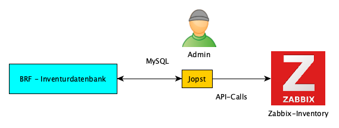

Relevante Informationen werden aus der BRF-Datenbank entnommen, gefiltert und dem
Zabbix-Inventar via API-Aufruf übermittelt.
Dies wird durch ein internes Skript vollzogen welches [hier](https://gitlab.ub.uni-bielefeld.de/opst/openstack-scripts/-/tree/master/zabbix/zabbix_inventory)
zu finden ist. Alle weiteren Informationen finden sich im dort beigefügten `README.md`

Aktuell (Stand Juni 2020) wird dieses Skript von `awalende` regelmäßig per Cronjob ausgeführt.
Dies geschieht jeden Montag (Wöchentlicher Zyklus).

## IT-5.5 Upgrade Server und Agents

Das Zabbix-Team bietet regelmäßige Updates zur Zabbix-Produktpalette.
Um eine solide Stabilität des Monitorings zu gewährleisten, sollte die laufende
Zabbix-Version ein LTS-Release sein. Der Lebenszyklus einer Version lässt sich
sich unter folgendem Link überprüfen:

<https://www.zabbix.com/life_cycle_and_release_policy>

In jedem Fall sollte zuerst der Zabbix-Server (und das Dashboard) aktualisiert werden.
Anschließend werden die Agents auf jeder beteiligten Maschine aktualisiert.
Der Zabbix-Server ist in der Regel kompatibel zu älteren Zabbix-Agents.

Der Upgrade-Prozess ist mit anderen Administratoren abzusprechen, da während
des Prozesses das gesamte Monitoring nicht in Betrieb ist. Ebenfalls sollten parallel dazu
keine anderen Wartungsarbeiten stattfinden.

Die Zabbix-Server-Infrastruktur wird auf der internen Service-Maschine `sopst` betrieben.
Realisiert ist die Infrastruktur mithilfe von Docker-Containern in einem `docker-compose`-Verbund.
Die wichtigen Verzeichnisse sind hierbei:

- `/opt/zabbix/` (compose.yml und Konfigurationsdateien)
- `/opt/service_data/zabbix/db-data/` (SQL Datenbank)

Als Vorbereitung muss der Zabbix-Server heruntergefahren werden.
Die Container-Komposition ist hierbei durch `systemd` gesteuert:

`systemctl stop zabbix_server`

Danach werden die Versionsnummern ersetzt in `/opt/zabbix/docker-compose.yml`.
Hierbei müssen die beiden Docker-Images für `zserver` und `zweb` angepasst werden.
Die verfügbaren Docker-Images lassen sich hier finden:

<https://www.zabbix.com/container_images>

Anschließend kann das System wieder hochgefahren werden mit `systemctl start zabbix_server`.
Die neue Version wird umgehend auf Fehler oder Kompatibilitätsprobleme kontrolliert (siehe Funktionalitätsprüfung).
Abschließend (falls nicht schon geschehen), wird die Versionsänderung in die Ansible-Rolle eingepflegt:

`OpenStack/playbook/roles/service/tasks/templates/zabbix/docker-compose.yml.j2`

Bei Problemen kann der Prozess rückgängig gemacht werden, indem wieder die alten Versionsnummern
eingetragen werden. Falls notwendig muss ein SQL-Backup der Datenbank ebenfalls eingespielt werden.

Läuft die neue Server-Version ohne Probleme, so können die Agents von allen Infrastruktur-Maschinen
aktualisiert werden.

Dies geschieht ausschließlich durch die Anwendung von zwei Ansible-Rollen.
In den Rollen müssen jeweils die Paketquellen für Zabbix angepasst werden:

- Ceph-Rolle (`ceph/tasks/105-zabbix.yml`)
- OpenStack-Rolle (`common/tasks/060-zabbix.yml`)

Die Paketquellen lassen sich hier finden:

<https://www.zabbix.com/documentation/current/manual/installation/install_from_packages/debian_ubuntu>

Anschließend werden die Zabbix-Tags der jeweiligen Rollen auf alle Maschinen angewandt.

### Funktionalitätsprüfung

Bei einer Versionsänderung oder der Installation des `Zabbix-Agents` auf einen weiteren Server,
muss die Funktionalität der einzelnen Komponenten überprüft werden.

Da der Zabbix-Server aus Containern besteht, muss überprüft werden, ob die
einzelnen Container hochfahren und sich nicht in einer Schleife neu starten.
Dies kann mit `docker ps` überprüft werden. Hierbei müssen alle Container online sein.

Sollten einzelne Komponente nicht verfügbar sein, so ist das Fehlverhalten mittels `docker logs`
zu überprüfen und zu beheben.

Anschließend wird die Web-Oberfläche von Zabbix aufgerufen und der Status intern
überprüft:

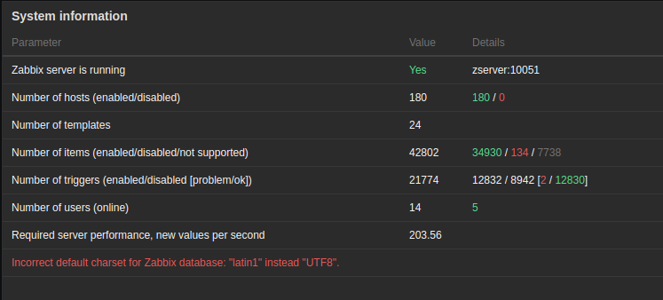

Hierbei ist sicherzustellen, dass die Weboberfläche mit dem Zabbix-Server kommuniziert und
neue Einträge (values) registriert werden.

Die Funktionalität von Zabbix-Agents wird indirekt vom Zabbix-Server selber geprüft.
Existieren Probleme mit dem Zabbix-Agent, so meldet dies der Zabbix-Server autonom
den Administratoren als einen "ausgefallenen" Host.

## IT-5.6 Datenbank Backup

Die Datenbank wird mittel mariadb-dump einmal täglich
in das CephFS (`/mnt/cephfs/obstadm/zabbix/backup-db`) gespeichert und
über das CeBiTec zusätzlich auf Band gesichert (siehe [IT-18](#IT18)).

# IT-6 Rund ums Netzwerk

IT-6 beschreibt mit der Netzwerkinfrastruktur zusammenhängende
IT-Verfahren.

## IT-6.1 Administrativer Zugang zum Management-Netzwerk

Das Management-Netzwerk ist ausschließlich über einen Jump Host (`jopst`,
`jopst2` bzw. `jopstcon`) zugänglich. Sämtliche Installationen/Konfiguration der
Cloud-Infrastruktur (Controller, Hypervisor, Service und Ceph Server)
sind damit ausschließlich über den Jump Host auszuführen. Der Jump Host
ist nur aus dem CeBiTec Netz erreichbar, der Login erfolgt über eine
SSH-Schlüssel-Authentisierung und einen zusätzlichen zweiten Faktor (TOTP).

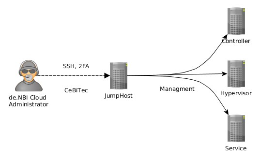

Der Jump Host `jopstcon` ist der Zugang für externe Berater und unterliegt
zusätzlichen Einschränkungen:

- Der Login auf die Entwicklungsumgebung ist uneingeschränkt möglich.
- Der Zugang auf die Produktionsumgebung wird gezielt für einzelne Hosts bei Bedarf
  freigeschaltet und wird über lokale Firewallregeln per `iptables` gesteuert.
  
Die Anpassung von Firewallregeln wird durch Ansible umgesetzt und unterliegt der
folgenden Vorgehensweise:

1. Clonen bzw. Aktualisieren des
    [CongateKeeper](https://gitlab.ub.uni-bielefeld.de/opst/congatekeeper)
    (master branch)
1. Anpassen der `allowed_hosts`-Liste in der `site.yml`. Hier sollten immer
    alle Hosts (Controller + Hypervisor) der Entwicklungsumgebung eingetragen
    sein. Zusätzliche Hosts sollten nach dem Kommentar immer mit einer Begründung
    eingepflegt werden.
1. Aktivieren der Änderungen mittels `ansible-playbook -i hosts site.yml` auf
    **jopstcon**.
1. Einpflegen der Änderungen zusammen mit einer Begründung in den Master-Branch.
1. **Nicht mehr benötigte Zugänge für externe Berater über jopstcon zur
    Produktionsumgebung sind so bald wie möglich wieder zu entfernen.**

## IT-6.2 Zugang zur de.NBI Cloud VM

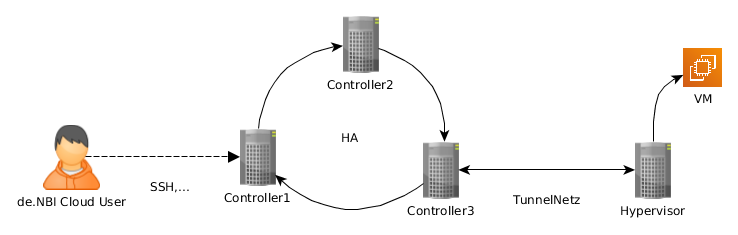
Der Zugang zu den Nutzer-VMs erfolgt über die Controller über das Tunnelnetz
über den Hypervisor an eine VM. Der vorgegebene Standardweg auf eine
virtuelle Maschine ist die SSH-Schlüssel-Authentisierung.

# IT-7 OpenVAS/GSM

IT-7 beschreibt die IT-Verfahren unter Verwendung des Frameworks
_Greenbone Security Manager_ (GSM vormals OpenVAS) zur Überprüfung
der öffentlich erreichbaren Kunden-VMs de.NBI Cloud auf Schwachstellen
von aussen.

_Hinweis: Das IT-Verfahren IT-7 wird trotz Umbenennung der Software zu
"Greenbone Security Manager" weiterhin als "OpenVAS/GSM" betitelt._

## IT-7.1 Installation und technischer Hintergrund

Der Greenbone Security Manager (GSM) liegt in der Community-Edition
ausschließlich als Quellcode vor und muss daher manuell gebaut
und installiert werden.
In der de.NBI Cloud Bielefeld wird eine GSM-Installation auf Basis
des Betriebssystems Ubuntu.

### IT-7.1.1 OpenVAS/GSM Instanz in der Cloud

Die GSM-Installation befindet sich innerhalb der de.NBI Cloud Bielefeld:

```
Cloud:      https://openstack.cebitec.uni-bielefeld.de
Project:    Bielefeld-Services
Instance:   gvm2022mar
fIP:        129.70.51.16
DNS:        openvas.bi.denbi.de
```

### IT-7.1.2 Zugriff

Die Instanz ist mit einem eigenen SSH-Keypair abgesichert.
Der entsprechende Schlüssel befindet sich im vertraulichen Schlüssel-Verzeichnis
(`/vol/opstadm/secrets/...`).

Zugang zur Instanz über SSH erfolgt mittels:
`ssh -i <keyfile> ubuntu@openvas.bi.denbi.de`

Die Weboberfläche des GSM ist ausschließlich innerhalb des CeBiTec-Intranets erreichbar.
Jeder Administrator verfügt über einen eigenen Nutzeraccount im GSM.
Die Verwendung des `admin`-Users ist nur zur Account-Erstellung erlaubt.

### IT-7.1.3 Backup

Die OpenVAS-Installation verwendet die Datenbankanwendung `postgres` zur Speicherung von Resultaten
und Berichten. Um bei einem Verlust der Instanz diese Informationen zu erhalten, werden diese
wöchentlich automatisiert in einem verschlüsselten Volume abgelegt. Die Aufbewahrungszeit der Backups
beträgt ein Jahr.

Der LUKS-Schlüssel zur Entschlüsselung des Volumes befindet sich im selben Verzeichnis, in dem auch
der SSH-Schlüssel gelagert ist.

Anschließend werden die Backups zusätzlich auf Band gesichert (siehe IT-18).

### IT-7.1.4 Funktionsprüfung

Damit die Funktionsweise von GSM gegeben ist, müssen einige Bedingungen erfüllt werden.
Auf der Instanz müssen folgende Services aktiv sein:

- `gvmd`
- `gsad`
- `nginx`

Ebenso muss die Weboberfläche verfügbar sein, welche im internen Netz unter der
URL `https://openvas.bi.denbi.de` zugänglich ist.

GSM ist so konfiguriert, dass täglich ein voller
Scan der externen IP-Addressen (`vlan118`) erfolgt. Bei Ausbleiben der täglichen
Scan-Berichte ist dieser Prozess zu überprüfen.

Damit GSM die neusten Sicherheitsdefinitionen in seine Scans mit einbezieht, müssen diese
aktuell sein. GSM aktualisiert hierbei jeden Tag die Datenbank dieser Definitionen über
einen `cron`-Service. Die Aktualität der Definitionen wird innerhalb des Dashboards
geprüft:

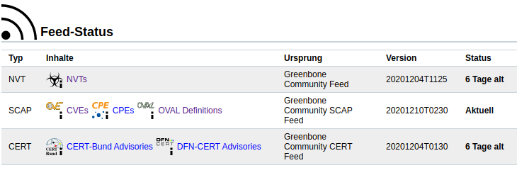

Sollten die dortigen Versionen älter als einen Monat sein, so müssen die Update-Scripte
in den `cron-jobs` überprüft werden.

## IT-7.2 Scans

Der de.NBI Cloud Bielefeld ist der Floating-IP-Bereich `129.70.51.0/24` zugeteilt.
Dieser wird täglich in der Nacht um 1 Uhr
auf Schwachstellen überprüft. Auswirkungen auf den Normalbetrieb der Cloud sind
nicht zu erwarten, da mögliche Schwachstellen lediglich identifiziert werden.
Der Scan Task ist wie folgt konfiguriert:

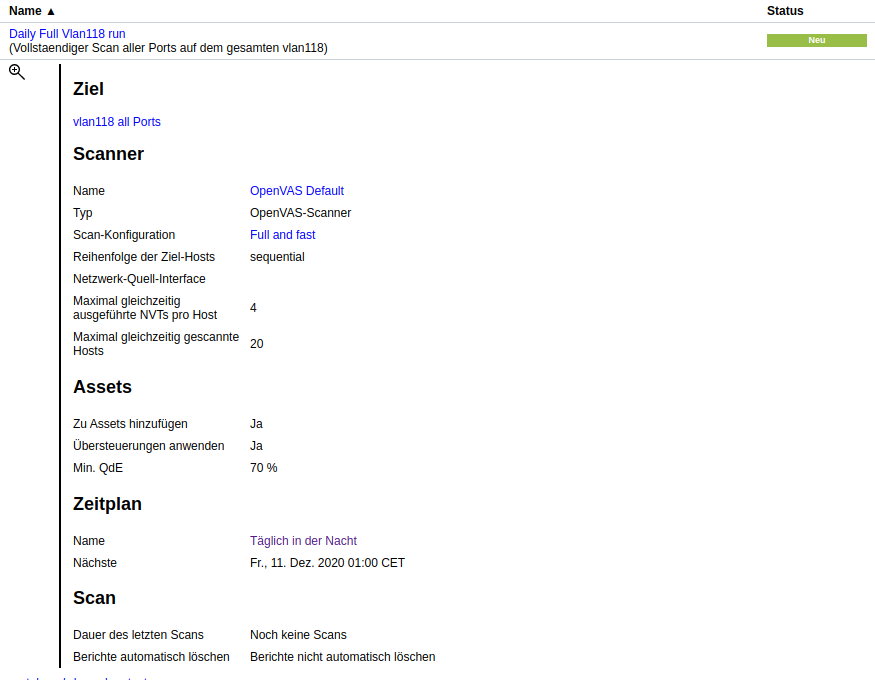

Der Scan erfolgt über den kompletten Port-Bereich (0-65535).

Der Scan Target hat diese Eigenschaften:

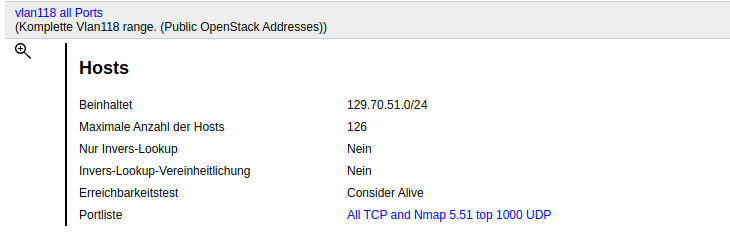

## IT-7.3 Scan results

Gefundene Schwachstellen werden von OpenVAS nach Schweregrad
sortiert aufgelistet:

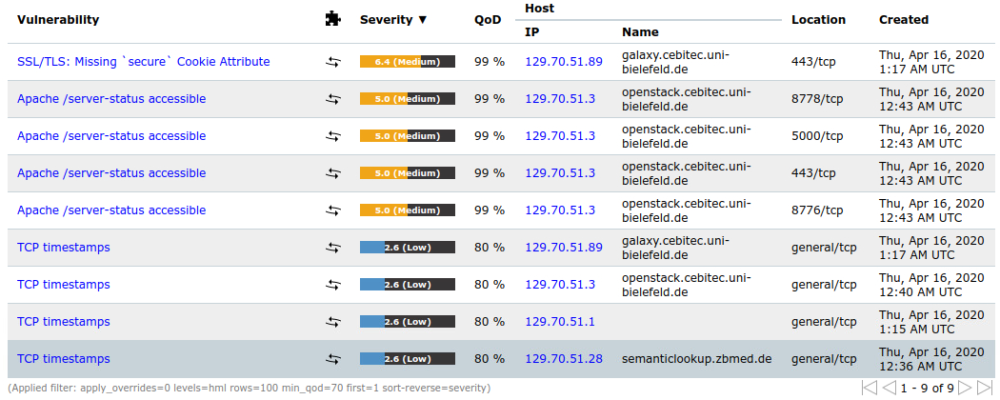

GVM kategorisiert die gefundenen Schwachstellen mit:

- Niedrig
- Mittel
- Hoch

Die Kategorisierung erfolgt durch die regelmäßig aktualisierten Schwachpunkt-Datenbanken (NVT, CVE, DFN-CERT).

Die Resultate nach einem Durchlauf werden in der internen Datenbank gespeichert und
lassen sich über die Weboberfläche näher begutachten. GVM speichert die
Ergebnisse intern als "Assets" ab, um Trends für darauffolgende Scans für die einzelnen
Hosts zu erstellen.

Die Berichte können als PDF exportiert werden.

## IT-7.4 Benachrichtigung

Die Administratoren erhalten Änderungen der Bedrohungslage von GVM per E-Mail.

Werden neue Schwachstellen erkannt die mindestens der Schwere-Kategorie "Mittel" angehören,
so werden für die betroffenen Hosts einzelne PDF-Berichte
[gefiltert](https://docs.greenbone.net/GSM-Manual/gos-5/de/reports.html) generiert, die
Cloud-Nutzer hinter der gescannten IP-Addresse ermittelt und über die gefundenen Schwachstellen
unterrichtet, mit dem Ziel, beim Nutzer mehr Bewusstsein für IT-Sicherheit zu schaffen.
Anders als bei "Hoch" klassifizierte Schwachstellen, besteht kein direkter Handlungsbedarf
seitens der Administratoren.

Diesbezüglich existiert im YouTrack ein [REDO-Ticket](https://yt.bi.denbi.de/issue/REDO-13).
Dort werden die Projekt-Zugehörigkeiten zu den IP-Addressen festgehalten.
Bevor dieses Ticket für den nächsten Monat zurückgestellt wird, müssen die vorhandenen Einträge
mit den neuen Scan-Resultaten abgeglichen und ggf. ergänzt werden. Die Einträge, dessen Nutzer noch nicht
benachrichtigt worden sind, müssen entsprechend abgearbeitet werden. Dazu werden die Projektinhaber
mittels PDF-Report benachrichtigt.

Sollten Schwachstellen gefunden werden, die als "Hoch" klassifiziert worden sind und nach Ansicht
der Administratoren ein signifikantes Risiko darstellen, so ist die
Netzwerkverbindung der betroffenen Instanzen umgehend zu trennen.
Dies ist als Sicherheitsvorfall zu werten und entsprechend weiter zu behandeln
[Sicherheitsrichtlinie zur Handhabung von Sicherheitsvorfällen](richtlinien/Richtlinie_Sicherheitsvorfaelle.md).

# IT-8 CVE-Scans

IT-8 beschreibt die IT-Verfahren des CVE-Scanners.

## IT-8.1 Installation

Der CVE-Scanner-Server wird mittels eines eigens entwickelten
Ansible Playbooks auf den Service-Hosts als Docker-Container
installiert.

## IT-8.2 Analyse

### IT-8.2.1 Softwarepakete der Hosts

Der CVE-Scanner-Server hält seine CVE-Datenbanken regelmäßig aktuell.
Die überwachten Hosts melden ihre System- und Softwareversionen
regelmäßig per einfachem cURL-Aufruf an den CVE-Scanner-Server.
Die Zeitintervalle werden jeweils durch Systemd-Timer geregelt.

Die Scanergebnisse befinden sich auf den Service-Hosts im
Verzeichnis `/mnt/service_data/cve-scan/results/` in einem Unterordner
pro täglichem Scan.

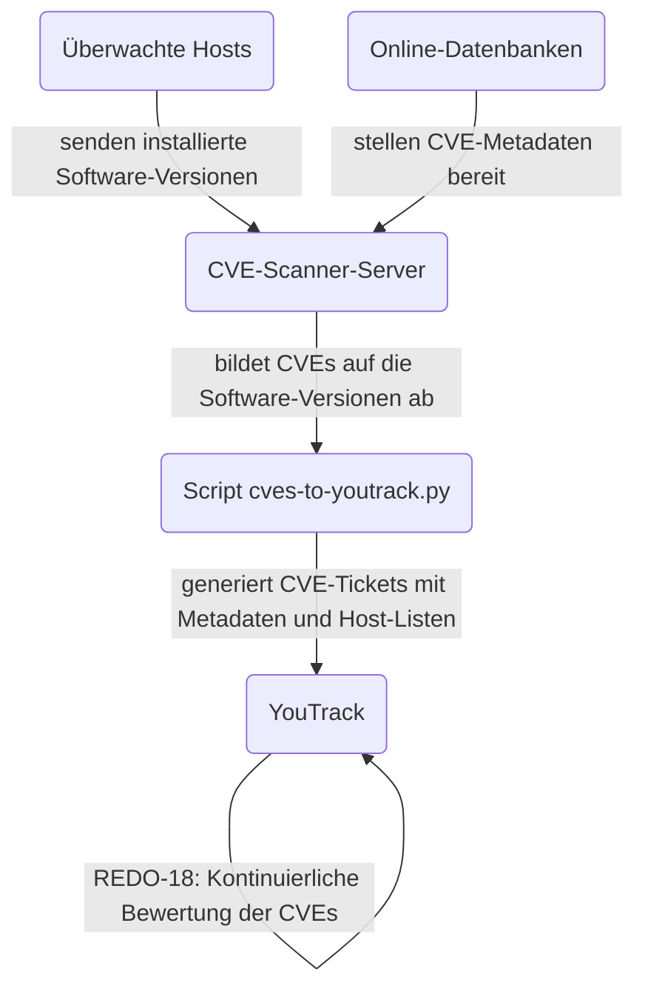

### IT-8.2.2 Softwarepakete der Container

Die auf den Hosts per Docker bzw. Podman betriebenen Container
enthalten eigene, vom Host-System unabhängige Software-Pakete.
Alle Images der zum Scanzeitpunkt laufenden Container werden mittels des
Trivy Container-Scanners auf bekannte CVEs gescannt.
Hierbei werden zusätzlich zu den Systempaketen auch die installierten
Bibliotheken vieler gängiger Programmiersprachen (z.B. Python und Java) überprüft.

Die aktuellsten Scanergebnisse befinden sich auf den Service-Hosts im
Verzeichnis `/mnt/service_data/cve-scan/container-results/`.
Ein erneuter Scan überschreibt den vorherigen Scan.
Die Scanergebnis-Dateien dekommissionierter Hosts oder Container müssen manuell entfernt werden.

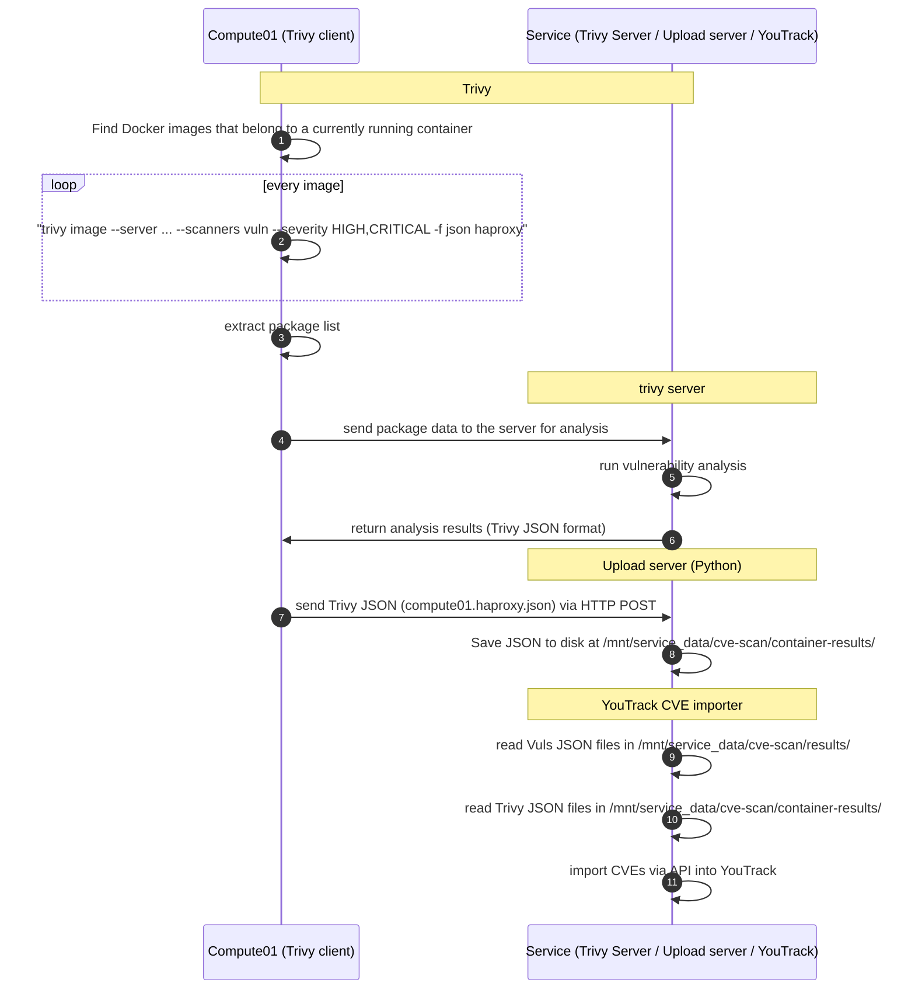

## IT-8.3 Überwachung

Die im YouTrack generierten CVE-Tickets werden gemäß des Entscheidungsbaums in REDO-18
regelmäßig bewertet.

# IT-9 OpenStack

IT-9 beschreibt nicht-triviale IT-Verfahren für den Betrieb von
OpenStack.

## IT-9.1 Identitäts- und Ressourcen-Management

### IT-9.1.1 OpenStack-interne Verwaltung

#### Domänen

OpenStack unterstützt unterschiedliche Domänen.
Die de.NBI Cloud Bielefeld betreibt derzeit vier Domänen.

##### default

Die `default`-Domäne wird ausschließlich für Cloud-eigene Projekte benutzt (Cloud Portal,
Services, Entwicklungsprojekte). Der Zugriff auf die `default`-Domäne erfolgt ausschließlich
über das Identitätsmanagement von OpenStack.

##### elixir

Die `elixir`-Domäne wird ausschließlich für über das de.NBI Portal erstellte Projekte benutzt.
Der Zugriff auf Projekte in der `elixir`-Domäne erfolgt ausschließlich über _LifeScience AAI_
(siehe OS-1.2).

##### cebitec

Die `cebitec`-Domäne wird ausschließlich für langfristige CeBiTec-Projekte verwendet. Die Vergabe der
Ressourcen
in der Domäne erfolgt nicht über das de.NBI Portal. Der Zugriff auf die `cebitec`-Domäne erfolgt
ausschließlich über das Identitätsmanagement von OpenStack durch die MA der BRF.

##### dsi

Die `dsi`-Domäne ist ein für ca. 3 Jahre angelegter Prototyp (ab Juli 2023) für eine mögliche
Cloud-Infrastruktur der Universität Bielefeld. Der Zugriff auf die Projekte erfolgt zunächst über das
Identitätsmanagement von OpenStack und später dann über den Web-Authentifizierungsdienst der
Universität Bielefeld (Shibboleth). Als Compute-Resourcen für den Prototypen kommt
ausgemusterte Hardware der de.NBI Cloud zum Einsatz.

#### Projekte

Im de.NBI Portal beantragte, genehmigte und dem Cloud-Standort Bielefeld zugeteilte Projekte,
deren Mitglieder und Ressourcen werden via Elixir/PERUN an die OpenStack-Installation propagiert.
Für jedes de.NBI-Projekt bzw. jeden Nutzer wird ein äquivalentes Projekt bzw. Nutzer in OpenStack
angelegt.
Am Cloud-Standort werden dabei Informationen über das Projekt (Name und Beschreibung) und
die Nutzer (Name, E-Mail, LifeScience Id, Perun Id und Elixir Name) gespeichert.
Zur Kommunikation mit einem Nutzer bzw. mit allen Nutzern eines Projektes wird i.d.R. das
de.NBI Portal genutzt (siehe IT 9.1.3). Die Kommunikation erfolgt im Notfall (z.B. bei
Nicht-Verfügbarkeit des Portals) auch direkt über die hinterlegte E-Mail.

Projekte die in der  `cebitec`  bzw.  `dsi`-Domäne angesiedelt sind, werden von jeweiligen
Domänen-Administratoren angelegt. Hierbei werden Information über das Projekt (Name und Beschreibung)
und den Benutzer (Name, Email) gespeichert.

#### Ressourcen-Management

OpenStack verwaltet Ressourcen über Quotas. Würde ein Nutzer durch
eine Ressourcenanfrage (z.B. den Start einer virtuellen Maschine (VM))
die dem jeweiligen Projekt eingeräumte Quota überschreiten
(z.B. jene für CPU-Kerne), so würde die Anfrage abgelehnt und
der Nutzer über den Grund informiert.

Für eine Übersicht der über Quotas limitierbaren Ressourcentypen,
siehe _Perun-Keystone-Adapter_.

### IT-9.1.2 LifeScience AAI und Perun

Die de.NBI Cloud nutzt zur Authentifizierung
ihrer Nutzer die von ELIXIR Europe bereitgestellte
"Authentication and Authorisation Infrastructure" (LifeScience AAI).
Bei dieser Art der verteilten Authentifizierung muss sich der
Nutzer lediglich einmal bei seiner Heimateinrichtung authentisieren,
um ortsunabhängig auf die de.NBI Cloud zugreifen zu können.

Als zweite Komponente kommt das "Identity and Access Management System"
Perun zum Einsatz, welches folgende Bereiche verwaltet:

- Virtuelle Organisationen
- Benutzer
- Gruppen
- Ressourcen
- Zugriffskontrolle

Die virtuellen Organisationen (VOs) werden in der de.NBI Cloud zur
generellen Zugriffskontrolle verwendet. So ist die Zugehörigkeit zur
allgemeinen de.NBI VO notwendig um als Nutzer innerhalb der de.NBI Cloud
agieren zu können. Projektzugehörigkeiten in der Cloud werden in
Perun durch Gruppenzugehörigkeiten abgebildet.
Die Ressourcenlimits eines Projekts werden als Attribute auf der jeweils
zugehörigen Perun-Gruppe abgebildet. Spezielle Funktionalitäten zur
Ressourcenverwaltung innerhalb von Perun werden hier nicht eingesetzt.

#### Perun-Keystone-Adapter

Der [Perun-Keystone-Adapter]() bildet in regelmäßigen Abständen die
innerhalb von Perun definierten Projekte auf den jeweiligen
Standort ab. Hierzu wird aus Sicht des Cloud-Standorts ein
von Perun gesendetes Beschreibungsobjekt im JSON-Format empfangen
und mithilfe der lokalen OpenStack APIs wird der lokale Datenstand
an diese Beschreibungen angeglichen.
Zur Übermittlung des Beschreibungsobjekts authentifiziert sich Perun
am jeweiligen Standort per Client-Zertifikat.

##### Per Quota limitierbare Ressourcentypen

Auf von Perun verwalteten OpenStack-Projekten können Quotas für die
in der nachfolgenden Tabelle in Spalte 2 gelisteten Ressourcentypen
definiert werden. Die Quotas der übrigen Ressourcentypen sind
pro Standort durch Standardwerte definiert.

| OpenStack                     | Perun / de.NBI Portal           | Standardwert        |
| ----------------------------- | ------------------------------- | ------------------: |
| **Nova**                      |                                 |                     |
| `cores`                       | `denbiCoresLimit`               | 20                  |
| `injected_file_content_bytes` |                                 | 32768               |
| `injected_files`              |                                 | 10                  |
| `injected_file_path_bytes`    |                                 | 255                 |
| `instances`                   |                                 | 5                   |
| `key_pairs`                   |                                 | 100                 |
| `ram`                         | `denbiRAMLimit`                 | 256000              |
| `server_group_members`        |                                 | 10                  |
| `server_groups`               |                                 | 10                  |
|                               |                                 |                     |
| **Cinder**                    |                                 |                     |
| `volumes`                     | `denbiProjectVolumeCounter`     | 5                   |
| `snapshots`                   | `denbiProjectNumberOfSnapshots` | 10                  |
| `backups`                     |                                 | 10                  |
| `groups`                      |                                 | 10                  |
| `per_volume_gigabytes`        |                                 | -1                  |
| `gigabytes`                   | `denbiProjectVolumeLimit`       | 500                 |
| `backup_gigabytes`            |                                 | 1000                |
|                               |                                 |                     |
| **Neutron**                   |                                 |                     |
| `floatingip`                  | `denbiNrOfFloatingIPs`          | 1                   |
| `rbac_policy`                 |                                 | 10                  |
| `subnet`                      |                                 | 1                   |
| `subnetpool`                  |                                 | -1                  |
| `security_group_rule`         |                                 | 100                 |
| `security_group`              |                                 | 10                  |
| `port`                        |                                 | 150                 |
| `router`                      |                                 | 1                   |
| `network`                     |                                 | 1                   |

##### Löschen von Ressourcen (Projekte, Accounts, virtuelle Maschinen, Volumes, ...)

Genehmigte Projekte haben eine initiale Laufzeit von maximal 6 Monaten und können auf
Antrag verlängert werden. Ausgelaufene Projekte (und damit verknüpfte
Benutzerkonten) werden nicht automatisch gelöscht, sondern durch den Perun-Keystone-Adapter
nur deaktiviert. Noch laufenden virtuelle Maschinen werden angehalten.
Deaktivierte (bzw. angehaltene) Ressourcen (Projekte, Accounts, virtuelle Maschinen, usw.)
müssen explizit gelöscht werden.

Projekte in der `default` und  `cebitec`-Domäne haben nach aktuellem Stand keine
befristete Laufzeit. Die Projekte der `dsi`-Domäne sind auf die Laufzeit des
Prototyps befristet (bis 07.2026).

Die Löschung (deaktivierter) Ressourcen erfolgt im Rahmen des Housekeeping (REDO-17)
oder bei Bedarf durch ein Skript. Deaktivierte Projekte lassen sich durch das Skript
`list_scratched_projects.py` anzeigen ...

```shell script
$ python3 listScratchedProjects.py 
...
```

... und durch das Skript `deleteProject.py` löschen.

```shell script
$ ./deleteProject.py --help
usage: deleteProject.py [-h] [--I_really_really_want_it] [--project PROJECT | --project_id PROJECT_ID]

Delete an OpenStack project and its resources

optional arguments:
  -h, --help            show this help message and exit
  --I_really_really_want_it
  --project PROJECT     project name to be considered
  --project_id PROJECT_ID
                        project id to be considered
```

### IT-9.1.3 de.NBI Portal

Das [de.NBI Portal](https://cloud.denbi.de/portal) läuft auf einer virtuellen Maschine in
der de.NBI Cloud Bielefeld und wird von der de.NBI Geschäftsstelle betrieben.
Das Portal ist &ndash; obwohl in Bielefeld verortet und Teil der beschriebenen
IT-Verfahren &ndash; ausdrücklich **nicht** Teil der de.NBI Cloud Bielefeld.

Über das Portal können Projektverantwortliche neue Projekte und Ressourcen beantragen
bzw. verlängern und weitere Nutzer zu bereits aktiven Projekten hinzufügen.
Die Mitarbeiter von ADM nutzen das Portal, um dem Standort Bielefeld zugewiesene
Projekte zu bestätigen oder um Kontakt mit den Nutzern des Standorts herzustellen
(siehe IT-9.1.1).

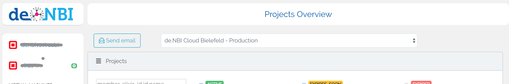

ADM trägt im Portal die der de.NBI Cloud in Bielefeld
zur Verfügung stehenden Ressourcen ein
(Cores, RAM, GPUs und Object-/Volumespeicher).
Anschließend können diese bei der Vergabe von Projekten
durch die Geschäftsstelle berücksichtigt werden.

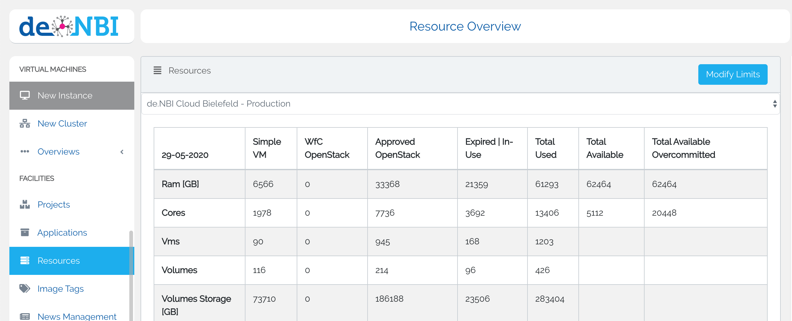

Das Portal nutzt das "Identity and Access Management System" Perun von ELIXIR
als Datenbank. Alle Angaben bzw. Änderungen werden in Perun abgelegt und
an die de.NBI Cloud Bielefeld propagiert (siehe IT-9.1.2).

## IT-9.2 Compute

An dieser Stelle sind ausschließlich für die Administration notwendige
IT-Verfahren beschrieben. Allgemeine Nutzungshinweise für Anwender,
z.B. für das Starten von VMs, sind nicht Teil dieser Dokumentation, sondern
gesondert als Anwenderdokumentation verfügbar unter <https://cloud.denbi.de/wiki/>.

### IT-9.2.1 Migration von virtuellen Maschinen

Die Migration von VMs kann aus verschiedenen Gründen erfolgen:

- Durch einen Defekt am darunterliegenden Hypervisor, dessen Behebung
   einen Neustart erfordert.
   Hier wird ein Neustart der VM durch eine geschickte Migration umgangen.
   Mögliche Defekte:
  - Wartung der Hardware (z.B. Austausch eines defekten Speichermoduls)
  - Wartung der Software (z.B. Aktualisierung des Kernels)
  - BIOS-Update
- Zur Umverteilung von virtuellen Maschinen zwischen mehreren bzw. allen Hypervisoren
  um die Auslastung der darunterliegenden Hardware zu reorganisieren und
  eine effizientere Nutzung der Ressourcen zu erreichen.

OpenStack unterstützt zwei Migrationstypen:

- **Live-Migration**\
  Erlaubt die Migration einer VM von einem Hypervisor
  auf einen anderen ohne jegliche Beeinflussung der VM (VM läuft weiter).
  Hierbei werden sowohl der lokalen Speicher (Root + Ephemeral
  Disk) als auch das RAM mit einem rsync-ähnlichen Verfahren inkrementell
  zwischen Quell- und Zielhypervisor abgeglichen.
  Beide Hypervisor müssen hierfür sehr ähnlich sein und z.B. dieselben
  CPU-Features unterstützen. Eine Live-Migration zwischen z.B. einem Intel-
  und einem AMD-basierten Hypervisor ist nur dann möglich, wenn der
  Befehlssatz der vCPU auf eine beiden Typen gemeinsame Befehlsschnittmenge
  eingeschränkt ist. In der de.NBI Cloud Bielefeld sind die
  Befehlssätze der vCPUs derzeit auf je einen gemeinsamen Typen für Intel
  bzw. AMD basierte Hypervisor eingeschränkt, so daß eine Live-Migration zwischen
  Intel bzw. AMD basierten Hypervisoren unabhängig von der tatsächlich
  verbauten CPU möglich sind.
  Die Live-Migration kann ausschließlich mit einem Account mit
  administrativen Rechten ausgeführt werden. Der Zielhost kann entweder
  vom Compute Scheduler automatisch ermittelt oder manuell bestimmt
  werden.

- **Migration**\
  Führt eine Offline-Migration mit anschließendem Neustart der VM
  durch. In der VM laufende Prozesse sowie jeglicher RAM-Inhalt
  gehen hierbei verloren. Allerdings findet diese Art der Migration
  Anwendung, wenn der CPU-Typ für eine Live-Migration zu stark abweicht.

### IT-9.2.2 Troubleshooting von virtuellen Maschinen

An dieser Stelle sind Lösungswege häufiger vorkommender
Probleme und die damit verbundenen IT-Verfahren beschrieben. Seltenere Vorkommnisse
im Zusammenhang mit virtuellen Maschinen sind im [Issue Tracker](https://yt.bi.denbi.de)
beschrieben.

#### IT-9.2.2.1 Fehlgeschlagen (Live-)Migration

Die Live-Migration kann manchmal fehlschlagen. Die betroffene virtuelle Maschine läuft
dann in der Regel noch auf dem ursprünglichen Hypervisor weiter, ist aber zugleich
teilweise oder auch vollständig zum neuen Zielhost migriert worden. Das Umschalten war nicht
erfolgreich, die virtuellen Maschine steht im Fehlerstatus. Die Problemlösung hängt im
Wesentlichen davon ab, in welchem Status (nicht OpenStack Status)
die virtuelle Maschine steht. Die Nova-Compute Log-Dateien geben ein Hinweis auf die Lösung
des Problems.

##### Kein Fehler in den Log-Dateien

Der Status der virtuellen Maschine wird manuell über einen Admin-Account
zurückgesetzt.

```shell script
openstack server set --state Active INSTANCE
```

##### Fehlermeldungen in mindestens einer Log-Datei

Wenn aus den Log-Dateien der beteiligten Hypervisor hervorgeht, dass die
allozierten Ressourcen in der OpenStack-Datenbank nicht mit der Realität
übereinstimmen, dann reicht es _nicht_, nur den Status zurückzusetzen.
-> [OS-177](https://yt.bi.denbi.de/issue/OS-177)

### IT-9.2.3 Cloud Images

#### IT-9.2.3.1 Images bereitstellen

Als Cloud Provider sind wir angehalten aktuelle Cloud Images bereitzuhalten.
Etwa alle 3-6 Monate - bei bekannt gewordenen Sicherheitslücken auch eher -
sollten neue Cloud Images erstellt und bereitgestellt werden.
Unterstützt werden Ubuntu LTS und Debian-basierte Cloud Images:

- [Ubuntu 22.04 Jammy LTS](https://cloud-images.ubuntu.com/jammy/current)
- [Ubuntu 24.04 Noble LTS](https://cloud-images.ubuntu.com/noble/current)
- [Ubuntu 26.04 Resolute LTS](https://cloud-images.ubuntu.com/resolute/current)
- [Debian 13 Trixie](https://cloud.debian.org/images/cloud/trixie/latest/)

Die Cloud Images sind abgesichert:

- Login nur via SSH-Public-Key, kein Root Account, Verbot von RSA-Schlüsseln <2048 Bit
- Fail2Ban

Das Python Skript `openstack/create_image.py` aus  dem Repository
[openstack-scripts](https://gitlab.ub.uni-bielefeld.de/opst/openstack-scripts) erweitert
aktuelle Ubuntu und Debian Cloud Images (u.a. Anpassung an die lokale Installation, Branding).

```shell script
$ source PROJEKT_openrc
$ python3 create_image.py --help
usage: create_image.py [-h] [--version VERSION] [--config CONFIG] 
                       [--configure_running_instance CONFIGURE_RUNNING_INSTANCE] [--do_not_clean]

Prepare Ubuntu/Debian base images for OpenStack cloud site Bielefeld

optional arguments:
  -h, --help            show this help message and exit
  --version VERSION     Ubuntu/Debian version. ( 18.04 | 20.04 | 22.04 | 10 | 11) are suppported values
  --config CONFIG       Path to config file
  --configure_running_instance CONFIGURE_RUNNING_INSTANCE
                        IP address of running instance
  --do_not_clean        Do not clean in case of failure or succesfull run
$ 
```

Zur vereinfachten maschinellen Verarbeitung z.B. durch das de.NBI Portal werden alle offiziellen Images
mit den Properties `os_distro` (z.B. `ubuntu`) und `os_version` (z.B. `20.04`) versehen.

Durch einen Administrator können so generierte Cloud Images veröffentlicht werden.

```shell script
openstack image set --public <image_id>
```

Alle so erzeugte Images werden zusätzlich in einem
[öffentlichen Bucket](https://openstack.cebitec.uni-bielefeld.de:8080/cloud-images)
im Object Storage hinterlegt.

#### IT-9.2.3.2 Images löschen

Veraltete öffentliche Cloud Images werden **nicht gelöscht**, sondern nur deaktiviert, damit für
laufenden virtuelle Maschinen die Referenz auf das verwendete Image weiterhin aufgelöst werden kann.

```shell script
openstack image set --deactivate <image_id>
```

Images können erst endgültig gelöscht werden, wenn sie von keiner virtuellen Maschine mehr 
referenziert werden. Die Löschung deaktivierter und nicht mehr referenzierte Ressourcen
erfolgt im Rahmen des Housekeeping (REDO-17)

### IT-9.2.4 Flavors

#### IT-9.2.4.1 Flavor erstellen

Der Standort Bielefeld stellt alle
[offiziellen Flavors der de.NBI Cloud (privates Repository/Login erforderlich)](https://github.com/deNBI/cloud-docs/blob/master/cloud-facts.md)
zur Verfügung. Die
Standard und High-Memory Flavors sind öffentlich, d.h. von jedem Projekt zu nutzen, sofern es
die zugewiesenen Resourcen zulassen. Die GPU-basierten Flavors sind privat und werden
gezielt Projekten freigegeben. Die Freigabe von Flavors für Projekte erfolgt derzeit manuell.

Beispiel zur Erstellung von Flavors:

```
openstack flavor create --ram 1536 --disk 50 --ephemeral 0 --swap 1024  --vcpus 2  --private
```

Beispielaufruf zur Freigabe/Sperrung privater Flavors:

```
openstack flavor set --project 3727bc448db74d748e72a03c5cdbcd72 TEST_FLAVOR
openstack flavor unset --project 3727bc448db74d748e72a03c5cdbcd72 TEST_FLAVOR
```

#### IT-9.2.4.2 Flavor löschen

Nicht mehr benötigte private oder öffentliche Flavors werden **nicht gelöscht**, sondern
nur als DEPRECATED markiert, damit für laufende virtuelle Maschinen die Referenz auf das
verwendete Flavor weiterhin aufgelöst und damit die Kalkulation der genutzten Ressourcen
(Accounting) für ein Projekt durchgeführt werden kann. 

**Der Name eines deprecated Flavors muß mit dem Suffix " DEPRECATED since Tag.Monat.Jahr"
gekennzeichnet werden.** (→ IT-9.2.4.3)

_Hinweis: Die OpenStack API unterstützt die Deaktivierung eines Flavors seit der Version
"Mitaka" nicht mehr._

Die Löschung als DEPRECATED und nicht mehr referenzierte Flavors erfolgt im Rahmen des
Housekeeping (REDO-17).

#### IT-9.2.4.3 Flavor ändern

Die OpenStack-API lässt nur sehr eingeschränkt nachträgliche Anpassungen an einem
existierenden Flavor zu. Ressourcen können prinzipiell nicht geändert werden und
auch die Sichtbarkeit lässt sich nachträglich nicht mehr anpassen.

Die einzige Möglichkeit, den Namen und die Sichtbarkeit eines Flavors zu ändern,
besteht darin, das entsprechende Flavor zu löschen und erneut mit angepasstem Namen
bzw. angepasster Sichtbarkeit unter derselben UUID neu zu erstellen.
Das Python Skript `openstack/adjust_flavor.py` aus dem Repository
[openstack-scripts](https://gitlab.ub.uni-bielefeld.de/opst/openstack-scripts)
implementiert dieses Vorgehen.

```shell
python3 adjust_flavor.py --name "TEST_FLAVOR DEPRECATED" TEST_FLAVOR 
```

Laufende Instanzen werden von Änderungen nicht beeinflusst, da die Spezifikationen
eines Flavors nur bei dessen Erstellung von _OpenStack Nova_ zu _libvirt_ übertragen werden.

### IT-9.2.5 Octavia Loadbalancer as a Service

Mittels der OpenStack-Komponente Octavia lässt sich an einer Floating IP eingehender Netzwerkverkehr
an mehrere VMs verteilen wodurch sowohl eine Lastverteilung als auch eine gewisse Ausfallsicherheit
erreicht werden kann.

#### IT-9.2.5.1 Bereitstellung des Octavia Amphora Image

Octavia startet zur Bereitstellung der Loadbalancer eigene Instanzen in einem privaten Netz.
Hierzu benutzt Octavia immer das Image mit dem Tag `amphora`.
Laut Installationsanleitung ist das Image mittels `diskimage-create.sh` zu generieren:
<https://docs.openstack.org/octavia/latest/admin/amphora-image-build.html>. Ein
vereinheitlichter Build-Prozess ist im Repository <https://gitlab.ub.uni-bielefeld.de/opst/octavia-amphora-image>
als CI-Pipeline verfügbar. Resultierende Images erscheinen anschließend unter
<https://gitlab.ub.uni-bielefeld.de/opst/octavia-amphora-image/-/packages>.
Folgende Schritte sind zur Image-Erstellung bzw. Aktualisierung nötig:

1. Erstelle im Falle eines Release-Upgrades einen neuen Branch (z.B. `zed`) auf Basis des bisherigen
   Branches (z.B. `yoga`): `git checkout -b zed yoga`. Aktualisiere das subrepo `octavia/` auf
   das zugehörige Release (z.B. `stable/zed`) mittels checkout und pull.
   Committe und pushe den neuen Branch dann mittels:
   `git push -u origin zed`. Der Push löst keinen Pipeline-Run aus.
2. Stoße Pipeline-Run manuell an unter
   <https://gitlab.ub.uni-bielefeld.de/opst/octavia-amphora-image/-/pipelines/new>
3. Entferne Tag von vorherigem Produktiv-Image:
   `openstack image unset --tag amphora amphora-yoga`
4. Benenne vorheriges Produktiv-Image um:
   `openstack image set --name "amphora-yoga-deprecated-$(date +"%Y-%m-%d")" amphora-yoga`
5. Lade neues Image (Ergebnis der Pipeline) herunter:
   <https://gitlab.ub.uni-bielefeld.de/opst/octavia-amphora-image/-/packages>
6. Lade neues Image in Glance hoch (z.B. für `zed` auf Production):
   `openstack image create --container-format bare --disk-format qcow2 --private --tag amphora
--file Downloads/amphora-x64-haproxy-prod-zed.qcow2 --property hw_architecture='x86_64'
--property hw_rng_model=virtio --project service amphora-zed --progress`

Mittels eines kontrollierten Loadbalancer-Failovers können die existierenden
Loadbalancer anschließend einzeln auf das neue Image aktualisiert werden:
`openstack loadbalancer failover <loadbalancer_id>`.

## IT-9.3 Controller

### IT-9.3.1 Backup der OpenStack Datenbank

Das OpenStack-Playbook erzeugt auf dem "Master"-Controller einen Cron-Eintrag der eine stündliche
Sicherungskopie (`mariadbdump`) der OpenStack-Datenbank in das CephFS speichert
(`/mnt/cephfs/opstadm/openstack_db/prod/<OPENSTACK RELEASE>/`). Die Sicherungskopie wird töglich
über das CeBiTec FS auf Band gespeichert (siehe [IT-18](#IT-18)).

## IT-9.4 Funktionalitätsprüfung

Bei einer Aktualisierung der Pakete, beispielsweise durch den regelmäßigen
Playbook-Run (IT-4.11), sind die für die Komponenten jeweils
separat vermerkten Verfahren anzuwenden.

Die OpenStack-Infrastruktur bietet eine Vielfalt von Funktionalitäten, deren
händische Überprüfung auf korrekte Funktion mit hohem Aufwand verbunden wäre.
Stattdessen werden hier vollautomatische, stündliche Testroutinen mittels Rally
(IT-4.10.3.6) durchgeführt.
Überwacht durch Zabbix werden hierbei fehlgeschlagene Funktionalitätsprüfungen
automatisiert den Administratoren per E-Mail-Benachrichtigung
mitgeteilt. Um eine Übersicht über Funktionalität und Performance zu bekommen,
existiert in Zabbix ein eigener `Screen` namens "OpenStack Rally Benchmark".

## IT-9.5 OpenStack-Installation löschen mit kolla-destroy

**Achtung! Dieser Abschnitt beinhaltet äußerst destruktive Operationen,
die nur nach Absprache mit allen ADM-Mitarbeitern und nur unter
4-Augen-Prinzip ausgeführt werden dürfen.**

Kolla bietet ein Kommando um sämtliche Container, Docker-Volumes und
Host-Informationen einer OpenStack-Installation zu entfernen.
Dies ist eventuell erforderlich um auf eine andere OpenStack-Version
zurück zu springen, beispielsweise bei Fehlfunktionen der Software
oder dem Testen von Upgrade-Prozessen in der Entwicklungsumgebung.

Um die Installation einer Infrastruktur **unwiderruflich** zu löschen,
wird folgender Kolla-Befehl ausgeführt (hier bei der Entwicklungsumgebung):

`run-kolla-ansible-dev destroy`

Vor Ausführung ist sicherzustellen, dass aktuelle Backups zur Verfügung
stehen (siehe IT-9.3.1).

Ein `destroy` funktioniert nicht bei compute-Knoten wenn diese laufende
QEMU-Prozesse haben, hierbei werden die entsprechenden Knoten übersprungen.

Eventuell stoppt der Kolla-Durchlauf da dieser ein `sudo docker ps` auf
`localhost` versucht, was bei den Jumphosts trivialerweise nicht funktioniert.
Zur Fortsetzung muss vorübergehend der Host `localhost` innerhalb der Gruppe
`deployment` der Ansible-Inventory-Datei auskommentiert werden.

Nach einem `destroy` bleiben die Kolla-Images auf den Hosts erhalten.

## IT-9.6 Einspielen eines Backups (Disaster-Recovery)

In seltenen Fällen ist es erforderlich, einen vorherigen Zustand der
OpenStack-Datenbank aus einem Backup einzuspielen. Dies ist erforderlich
wenn ein Rollback auf eine vorherige OpenStack-Version erfolgen muss oder
sämtliche Controller-Hosts gleichzeitig und unwiederbringlich abhanden kommen.

Um einen vorherigen Stand einzuspielen, müssen zunächst zwei der drei
`mariadb`-Container auf den Controllern gestoppt und die Daten gelöscht werden:

```
systemctl stop kolla-mariadb-container.service
docker rm mariadb
docker volume rm mariadb
```

Nun wird ein geeignetes Backup ausgewählt (siehe IT-9.3.1) und extrahiert:

```bash
zstd -d <PFAD_ZUM_GESPEICHERTEN_BACKUP> -o /tmp/mybackup.sql
```

Nun wird ein Hilfs-Container gestartet welcher das Backup vorbereitet:

```
docker run -u root --rm -it --volumes-from mariadb --name tmp_dbrestore \
   --volume mariadb_backup:/backup \
   <AKTUELLES_MARIADB_IMAGE> \
   /bin/bash
```

In einem zusätzlichem Terminal wird dann die Backup-Datei in den Hilfs-Container
kopiert:

`docker cp /tmp/mybackup.sql tmp_dbrestore:/`

Im `tmp_dbrestore`-Container erfolgt dann:

```
(tmp_dbrestore) $ cd /backup
(tmp_dbrestore) $ rm -rf /backup/restore
(tmp_dbrestore) $ mkdir -p /backup/restore/full
(tmp_dbrestore) $ mbstream -x -C /backup/restore/full/ < /mybackup.sql
(tmp_dbrestore) $ mariabackup --prepare --target-dir /backup/restore/full
```

Danach wird der Hilfs-Container beendet und der letzte laufende
`mariadb`-Container wird gestoppt:

`systemctl stop kolla-mariadb-container.service`

Nun wird wieder der Hilfs-Container erzeugt und folgende Schritte
werden durchgeführt:

```
docker run -u root --rm -it --volumes-from mariadb --name tmp_dbrestore \
   --volume mariadb_backup:/backup \
   <AKTUELLES_MARIADB_IMAGE> \
   /bin/bash
   
(tmp_dbrestore) $ rm -rf /var/lib/mysql/*
(tmp_dbrestore) $ rm -rf /var/lib/mysql/\.[^\.]*
(tmp_dbrestore) $ mariabackup --copy-back --target-dir /backup/restore/full
```

Damit ist das Einspielen des Backups abgeschlossen und der Hilfs-Container
kann beendet werden. Da die Datenbank über ein Galera-Cluster realisiert
ist, muss dieser speziell gestartet werden da der komplette Cluster abgeschaltet
worden ist:

`run-kolla-ansible-<prod,dev> mariadb_recovery -e mariadb_recover_inventory_name=<CONTROLLER_NAME>`

Hier muss der Controller angegeben werden, auf dem das Backup eingespielt worden ist.
Sollte es bei der Nutzung der Cloud zu unspezifischen Authentisierungsfehlern kommen,
so sollten entweder nacheinander die Controller oder alle Container-Dienste
neu-gestartet werden.

Der Befehl liegt hierbei temporäre Dateien in `/tmp/` auf dem deployment-Host
ab. Diese müssen nach dem Wiederherstellungsprozess gelöscht werden:
`rm /tmp/kolla*`. Andernfalls könnte bei einem zukünftigen Wiederherstellungsprozess
der Recovery-Befehl fehlschlagen, da die Datei von einem anderen Administrator schon
existiert.

### Problembehandlung nach einer Disaster-Recovery

Der Datenbank-Zustand spiegelt nicht immer den aktuellen Stand der
Hypervisor dar. Entweder existieren die in der Datenbank gelisteten
Instanzen nicht mehr oder es existieren Instanzen die nicht in der
Datenbank gelistet sind. Diese Inkonsistenzen müssen von einem Administrator
manuell behoben werden. Hierbei können die Logs der `nova_compute` Dienste
aufschlüsse über mögliche Inkonsistenzen liefern.

Seit der OpenStack-Version `2023.1` verweigern `nova_compute`-Container den Start,
wenn der dazugehörige Volume neu aufgesetzt wurde. Dies ist eine logische
Konsequenz durch die Ausführung des `destroy` commands. Die Meldung lautet
hierbei `nova.exception.InvalidConfiguration: No local node identity found,
but this is not our first startup on this host. Refusing to start`.
Hierbei fehlt in `nova_compute` die `compute_id`-Datei, welche
die ID des Hypervisors beinhaltet. Diese lässt sich über die Controller beziehen:
`openstack hypervisor list`. Die IDs werden dann, bei jeden Hypervisor, nachträglich
beigefügt:

```bash
echo "$HYPERVISOR_ID" > /tmp/compute_id
docker cp /tmp/compute_id nova_compute:/var/lib/nova/compute_id
```

## IT-9.7 Logdatenverarbeitung der OpenStack-Komponenten und Hypervisor

Das zur Installation von OpenStack verwendete Kolla richtet automatisch eine Infrastruktur
zur Aggregation von Logdaten ein.
Auf den Hypervisors sammelt Fluentd die Logeinträge ein und führt sie der
controllerseitigen Speicherkomponente OpenSearch zu.

### IT-9.7.1 Konfiguration von fluentd

Die Auswahl und Form der weitergeleiteten Logdaten ist durch von Kolla
generierte Standardkonfigurationen festgelegt. Diese Einstellungen sind
durch `.conf`-Dateien in den beiden Ordnern `filter` und `input` überschreibbar
bzw. erweiterbar:

```text
kolla.prod/config/fluentd
├── filter
│   ├── anonymization.conf
│   └── noise-reduction.conf
└── input
    ├── s3interceptor.conf
    └── systemd-journal.conf
```

## IT-9.8 Message Queueing

Die OpenStack-Installation verwendet für die interne Kommunikation
der einzelnen Dienste den Messaging-Service `rabbitmq`.
Die einzelnen Queues sind gespiegelt auf jedem Controller mithilfe von
Quorum-Queues. Sollte also ein Controller ausfallen, so ist dadurch der ungestörte
weitere Betrieb der API gewährleistet.

### IT-9.8.1 Fehlerbehebung rabbitmq

Der Service `rabbitmq` war, im laufe des langjährigen Betriebs, immer wieder von
Fehlern geprägt. Die Fehler zeigten sich durch unerwartete Seiteneffekte der
OpenStack-API: Befehle wurden durch die API abgesetzt, erreichten aber nie die
einzelnen OpenStack-Dienste. In der Vergangenheit bestand die einzige Lösung darin,
die Rabbitmq-Dienste zu entfernen und mittels `kolla-deploy` neu aufzuziehen.

Da die OpenStack-Cloud mitlerweile neue Features von `rabbitmq` verwendet, ist diese
Aktion nicht mehr zulässig und kann im weiteren Verlauf den Betrieb
sogar noch weiter beeinträchtigen.

Gängige Reparaturmaßnahmen sind hier dokumentiert:

1. [Fehlende Queue-Replicas](https://yt.bi.denbi.de/issue/OS-720/rabbitmq-Fehlerhafte-quorum-stream-queues-bei-reset)

# IT-10 Ceph

IT-10 beschreibt nicht-triviale IT-Verfahren für den Betrieb von Ceph.
Die Umstellung der Installation auf `cephadm` hat viele IT-Verfahren
vereinfacht. Die Umstellung ist dokumentiert in
[CEPH-123](https://yt.bi.denbi.de/issue/CEPH-123/cephadm-Erste-Erfahrungen)
und beeinhaltet den technischen Hintergrund der neuen Funktionsweise.

## IT-10.1 Allgemeine Administration

### Zugriff auf die Administration

Die Installation ist Container basiert mithilfe von [cephadm](https://docs.ceph.com/en/reef/cephadm/).
Dies bedeutet, dass keine "Bare-Metal"-Pakete von Ceph auf den einzelnen Knoten installiert sind.
Um Ceph administrieren zu können, muss im Vorfeld eine gesonderte "Ceph-Shell" gestartet werden.

Diese lässt sich auf jedem beliebigen [Ceph-Knoten](https://gitlab.ub.uni-bielefeld.de/opst/ceph/-/blob/master/hosts.ceph_denbi?ref_type=heads)
starten mithilfe dem Befehl `cephshell` über den `root`-Nutzer. Innerhalb der gesonderten Shell lässt sich Ceph wie
gewohnt mit dem klassischen `ceph`-Befehl bedienen. Skripte und weitere Werkzeuge werden automatisch nach `/opt/`
eingehängt.

### Host-Inventar

Ceph unterhält ein Register über alle Hosts und dessen Rollen. Als Beispiel für ein Host:

```bash
root@osterau:/opt/ceph/ceph-balancer-master# ceph orch host ls | grep ostrach
ostrach      172.21.49.173  MON,MGR,MDS,OSD,memorysolution2021
```

Der Eintrag beschreibt, dass dieser Knoten die Dienste MON,MGR,MDS und OSD bereitstellt.
Das letzte Label beschreibt die Hardware-Architektur nach Art der Beschaffung. Diese Information
ist notwendig für das Deployment von OSDs, da dies Informationen über die Festplatten-Struktur offenlegt.

Das Inventar wird vom Orchestrator genutzt, um sich automatisiert über SSH auf die Hosts einzuloggen und
um die Deployments zu verwalten. Die Label lassen sich bearbeiten durch `ceph orch host label <add,rm> <host>`.

Weitere Hosts lassen sich registrieren durch `ceph orch host add <HostName> <IP> <Labels>`. Bei neuen Hosts
muss vorher die [Ansible-Rolle](https://gitlab.ub.uni-bielefeld.de/opst/ceph/-/tree/master?ref_type=heads)
durchgelaufen sein, andernfalls kann der Orchestrator sich nicht mit dem neuen Host verbinden.

### Deployments

Die Arbeitsweise von `cephadm` ähnelt die von Kubernetes. Mithilfe von `YAML`-Dateien werden "Deployments"
beschrieben. Die Deployments legen fest, wo und in welcher Weise die Kernkomponenten von Ceph erstellt
werden.

Beispielsweise lassen sich die Deployments für OSDs folgendermaßen anzeigen:

```bash
ceph orch ls --export osd
```

Der Ceph-Orchestrator überwacht die Deployments und legt bei Bedarf automatisiert Daemons auf
Zielhosts. Änderungen an den Deployments werden mit `ceph orch apply -i <YAML-File>` eingespielt.
Sämtliche Änderungen sollten vorher mit dem Flag `--dry-run` überprüft werden.

## IT-10.2 Day-1 Ops

### Steuerung der Daemons

Im klassischen Ceph-Setup wurden einzelne Dienste durch dessen systemd-Units gesteuert.
In `cephadm` erfolgt dies alleine durch den Orchestrator. Dieser übernimmt
die Admin-Befehle, loggt sich per SSH auf die Zielknoten ein und führt dort
autonom die Orchestrierung der einzelnen Podman-Container durch.

Um alle Daemons anzuzeigen:

```bash
ceph orch ps
```

Die aufgelisteten Daemons lassen sich alle durch den Orchestrator steuern:

```bash
ceph orch daemon <start|stop|restart> <daemon_name>
```

Beispielsweise kann man somit eine "flappende" OSD stoppen: `ceph orch daemon stop osd.123`.
Hinweis: Die Befehle werden nicht instantan durchgeführt. Bis zur Ausführung kann es wenige
Minuten dauern.

Alternativ lassen sich einzelne Daemons auf dem Zielhost auch per `systemd` steuern.
Die Unit-Files haben hierbei die Form: `ceph-<cluster_id>@<daemon-type>.service`.
Um Beispielsweise die OSD 133 zu stoppen: `systemctl stop ceph-d8a6f365-99de-42f2-b32b-c9ea11df945c@osd.133.service`.

### OSD Deployment Files

Der Orchestrator verwaltet "Baupläne" für die einzelnen Komponenten für Ceph.
Für die alltägliche Administration sind die Deployments für die unterschiedlichen
OSD-Hosts am signifikantesten. Diese beschreiben, wie die OSDs strukturell
für die unterschiedlichen Host-Typen erstellt werden.

Alle registrierten Hosts im Ceph Cluster sind dafür entsprechend gelabeled.
Das Label entspricht in der Regel den Namen des Lieferanten und
das Beschaffungsjahr. Als Beispiel hat dieser Host das Label "memorysolution2021":

```bash
root@osterau:/# ceph orch host ls | grep ostrach
ostrach      172.21.49.173  MON,MGR,MDS,OSD,memorysolution2021
```

Das dazugehörige Deployment für "memorysolution" könnte so aussehen:

```yaml
service_type: osd
service_id: memorysolution2021
service_name: osd.memorysolution2021
placement:
  label: memorysolution2021
unmanaged: true
spec:
  data_devices:
    rotational: 1
    size: '8T:'
  db_devices:
    rotational: 0
    size: '1T:'
  encrypted: true
  objectstore: bluestore
```

Das Deployment besagt hier, dass dieses Deployment auf Hosts mit dem Label "memorysolution2021"
abzielt. Es beschreibt zusätzlich, dass alle rotierenden Laufwerke mit mindestens 8T Kapazität,
sowie alle SSDs mit mindestens 1T Kapazität berücksichtigt werden. Der Orchestrator würde
hierbei automatisiert die DB-Devices auf alle Datendisks aufteilen. Ebenso wird angegeben,
dass die OSDs verschlüsselt werden. Weitere Konfigurationsmöglichkeiten sind [hier](https://docs.ceph.com/en/latest/cephadm/services/osd/)
aufgeführt.

Das aktuell registrierte Deployment ist hierbei `unmanaged`. Das bedeutet, dass der Orchestrator
nicht mehr regelmäßig nach Disks im gesamten Cluster sucht um diese automatisiert zu deployen.

**Achtung:**
Die Deployments dürfen nur kurzzeitig auf `unmanaged: false` gesetzt werden wenn neue
OSDs erzeugt werden sollen. Nach Abschluss der Erstellung muss das dazugehörige
Deployment wieder auf `unmanaged: true` gesetzt werden. Dadurch soll sichergestellt werden,
dass die Erstellung von OSDs immer durch einen Mitarbeiter kontrolliert geschieht um,
gegebenen falls, bei Fehlern eingreifen zu können.

Um den Status zu ändern:

```bash
# Setze das Deployment auf "managed"
ceph orch set-managed osd.<deployment>

# Setze das Deployment auf "unmanaged"
ceph orch set-unmanaged osd.<deployment>
```

Sämtliche YAML-Definition für Deployments werden über [Ansible](https://gitlab.ub.uni-bielefeld.de/opst/ceph/-/tree/master/roles/cephadm/files/deployments?ref_type=heads)
auf alle Ceph-Knoten verteilt und sind verortet (innerhalb einer `cephshell`) unter
`/opt/ceph/deployments/`.

### Entfernen von OSDs

Sollte eine OSD defekt, oder kurz davor sein, so sollte diese aus dem Cluster entfernt werden.
Von einer beliebigen `cephshell` kann dies veranlasst werden mit `ceph orch osd rm <osd.id> --zap --destroy`.
Wenn die OSD noch aktiv sein sollte, so wird der Orchestrator die OSD auf 0 gewichten und
die PlacementGroups langsam entleeren. Abschließend wird die OSD im Cluster de-registriert
und die unterliegenden Disks auf Werkseinstellung zurückgesetzt.

Da die OSD mit `--zap` entfernt wird, wird auch automatisch
das dazugehörige VolumeGroup der DB-Devices verkleinert bzw.
das LVM gelöscht. Dies betirfft hauptäschlich OSDs die aus
zwei Komponenten bestehen: Rotierende Datendisk und Datenbank-LVM.

Der Status der Entleerung lässt sich mit `ceph orch osd rm status` verfolgen.
Wichtig ist hierbei, dass das dazugehörige OSD-Deployment auf `unmanaged` gesetzt
ist, ansonsten wird der Orchestrator die leeren Disks erkennen und direkt wieder
als neue OSD deployen.

Um dies an einen Beispiel für den Host `ostrach` zu überprüfen:

```bash
# Welches Hostlabel besitzt ostrach?
root@osterau:/# ceph orch host ls | grep ostrach
ostrach      172.21.49.173  MON,MGR,MDS,OSD,memorysolution2021

# ostrach hat demnach das "memorysolution2021" label, überprüfe
# das dazugehörige deployment:

root@osterau:/# ceph orch ls | grep osd.memorysolution2021
osd.memorysolution2021               38  8m ago     2d   <unmanaged>

# Das deployment ist also "unmanaged"
```

Sollte das Deployment `managed` sein, so lässt sich dies umstellen mit
`ceph orch set-unmanaged osd.memorysolution2021`.

Möchte man einen kompletten Knoten entleeren, so lässt sich der `rm`-Befehl
in einer Schleife durchführen:

```bash
for i in $(ceph osd tree-from <HOST> | grep osd | awk '{print $4}' | \
cut -d"." -f2); do ceph orch osd rm $i --zap; done;
```

### Austausch von OSDs

Das Verfahren beschreibt den Austausch einer OSD beispielhaft
an dem Host `ostrach`.

Entferne zunächst die auszutauschende OSD nach der obigen Anleitung.
Nach dem physischen Austausch sollte auf dem Ziel-Host nun
eine komplett leere Disk vorhanden sein. Der Orchestrator
sollte diese nach wenigen Minuten erkennen:

```bash
root@osterau:/opt/ceph/deployments# ceph orch device ls <ZIELHOST> --refresh
HOST   PATH          TYPE  DEVICE ID                                    SIZE  AVAILABLE  REFRESHED  REJECT REASONS
ostrach  /dev/sdg      hdd   SEAGATE_ST18000NM004J_WR50JKJW0000K33923DK  16.3T  Yes        10m ago
```

`--refresh` weist hierbei den Orchestrator an, **jetzt** nach neuen Disks zu suchen.
Sollten keine neuen Disk als `available` aufgelistet werden, so sollte der Befehl
wenige Minuten später wiederholt werden.

Nun muss der dazugehörige Host-Label des Zielhosts ermittelt werden um später
das korrekte Deployment anwenden zu können. 

```bash
# Welches Hostlabel besitzt ostrach?
root@osterau:/# ceph orch host ls | grep ostrach
ostrach      172.21.49.173  MON,MGR,MDS,OSD,memorysolution2021
```

Nun kann das dazugehörige Deployment in einem "dry-run" durchgeführt
werden. Innerhalb der `cephshell` existieren für jeden Hardware-Typ
entsprechende YAML-Definitionen:

`ceph orch apply -i /opt/ceph/deployments/memorysolution2021.yaml --dry-run`

Der Befehl wird zunächst nichts nennenswertes anzeigen, da der Orchestrator
im Hintergrund zunächst den Plan entwerfen muss. Nach ca. einer Minute
kann der selbige Befehl nochmal durchgeführt werden:

```bash
################
OSDSPEC PREVIEWS
################
+---------+---------------+-------+---------------------+--------------+-----+--------
|SERVICE  |NAME                 |HOST   |DATA                   |DB            |WAL  |
+---------+---------------+-------+---------------------+--------------+-----+--------
|osd      |memorysolution 2021  |ostrach  |/dev/sdg             |/dev/nvme1n1  |-    |
```

Wenn die Vorschau korrekt ist, so kann das Deployment ohne `--dry-run` angwendet werden.
Nach wenigen Minuten beginnt Ceph mit dem Deployment.

**Achtung**: Das Anwenden eines Deployments setzt automatisiert das Deployment auf
`managed`. Nach der Erstellung der OSD muss das Deployment wieder auf `unmanaged` gesetzt
werden:

`ceph set-unmanaged osd.memorysolution2021`

### Entfernen eines Ceph-Hosts

Um einen kompletten Host zu dekomissionieren müssen diese Schritte durchgeführt werden:

Sämtliche OSDs werden geleert und ggf. weitere Dienste werden abgeschaltet:

`ceph orch host drain <host> --zap-osd-devices`

**Achtung:** `drain` entfernt nicht nur OSDs. Es entfernt auch alle anderen Ceph-Komponenten
falls diese auf dem Host deployed sind. 

Nachdem alle Daemons vom Orchestrator entfernt wurden, kann der Host aus dem
Inventar entfernt werden:

`ceph orch host rm <host>`

### Hinzufügen eines neuen OSD-Hosts

Zunächst wird der neue Host im [Ceph-Playbook](https://gitlab.ub.uni-bielefeld.de/opst/ceph/)
entsprechend eingetragen. Die relevante Stelle befindet sich in `hosts.ceph_denbi`.
Sollte noch keine spezifische Host-Gruppe existieren, so wird diese nach
Vorbild der schon vorhandenen Host-Gruppen in `group_vars/` angelegt.

Sollte für diesem Host noch kein [Deployment-File](https://gitlab.ub.uni-bielefeld.de/opst/ceph/-/tree/master/roles/cephadm/files/deployments?ref_type=heads)
existieren, so wird dies ebenfalls hinzugefügt.

Anschließend kann das Playbook auf dem neuen Host ausgeführt werden mit:
`run-ansible-playbook -i hosts.ceph_denbi -l <HOST_NAME> -e '{ apt_allow_installs_and_upgrades: True }' site_denbi.yml`

Danach wird der Host neugestartet.

Über einen beliebigen Ceph-Host wird `cephshell` gestartet und der neue Host wird im
Inventar registriert:

`ceph orch host add <hostname> [ip-address]`

Abschließend werden dem Host Label hinzugefügt je nach Auszuführender Rolle.
Die Rollen-Namen entsprechen den einzelnen möglichen Ceph-Daemontypen, also:
`MON`, `MGR`, `MDS`, `RGW`, `OSD`. Zusätzlich, wenn der Host auch OSDs beinhaltet,
ein Label entsprechend der `group_vars/` zugehörigkeit des Hosts. Beispielsweise
`delta2023`.

Labels können erstellt bzw. entfernt werden mit:

```bash
ceph orch host label add <HOST> <LABEL>
ceph orch host label rm <HOST> <LABEL>
```

Ein Inventar-Eintrag für ein Host könnte wiefolgt aussehen:

```bash
root@osterau:/opt/ceph/deployments# ceph orch host ls | grep ostrach
ostrach      172.21.49.173  MON,MGR,MDS,OSD,memorysolution2021
```

Falls der neue Host OSDs bereitstellen soll, so wird die Crush-Map dafür
vorbereitet. Der neue Host muss in der Map positioniert werden
(siehe Ausgabe von `ceph osd tree | grep -v osd`).

Der Host wird im Vorfeld angelegt und an der Crush-Map eingefügt:

`ceph osd crush add-bucket $HOSTNAME host rack=<RACK_NAME>`

Die korrekte Position wird noch einmal durch `ceph osd tree` überprüft.

Abschließend können nun alle OSDs deployed werden. Die Vorgehensweise
ist identisch zum Verfahren der einzelnen OSD Erstellung.
Siehe [Austausch von OSDs](it-verfahren.md#austausch-von-osds).

### Balancieren der Datenlast

Ceph verteilt die Daten pseudo-randomisiert auf die einzelnen
PlacementGroups bzw. OSDs. Das sorgt dafür, dass die Daten **nicht**
gleichmäßig auf alle Disks verteilt werden. Während eine OSD
nur 40% belegt ist, kann eine andere schon bei 70% sein. Ceph verwendet
in der Standardinstallation das [Balancer-Modul](https://docs.ceph.com/en/reef/rados/operations/balancer/).
Dieses Modul ist jedoch deaktiviert worden, da der Balancer auf Pool-Ebene
arbeitet und nicht die gesamte Datenauslastung der PlacementGroups berücksichtigt.

Das Ausbalancieren der Datenlast erfolgt daher manuell durch eine Lösung aus der
Ceph-Community: [jj-balancer](https://github.com/TheJJ/ceph-balancer).

Sollte die Datenverteilung über die Zeit zu sehr auseinander driften, so sollte
der `jj-balancer` ausgeführt werden.  

Die Verteilung der Datenlast pro OSD lässt sich
sortiert anzeigen durch `ceph osd df | sort -nnk 17`. Die Auflistung
erfolgt aufsteigend.

Der `jj-balancer` ist in jeder `cephshell` verwendbar:

```bash
cephshell
cd /opt/ceph/ceph-balancer-master
./placementoptimizer.py -v balance --max-pg-moves 300 --ignore-ideal-pgcounts all --max-move-attempts 5 | tee /tmp/upmaps
# Es wird nun ein Plan ausgewertet mit einer Zusammenfassung der Datenbewegungen

# Der Plan bzw. die "upmapps" werden durchgeführt
bash /tmp/upmaps

# Den durchgeführten Plan löschen
rm /tmp/upmaps
```

Die Prozedur kann so oft wiederholt werden, bis der `jj-balancer` keine Optimierung mehr findet.

### PlacementGroup-Bewegungen rückgängig machen

Der CRUSH-Algorithmus definiert pseudo-zufällig den Ablageort
von PlacementGroups auf den OSDs. Die Ablageorte für PlacementGroups
lassen sich durch `upmap`-Einträge überschreiben.
Siehe [Balancieren der Datenlast](#balancieren-der-datenlast).

In einigen Ereignissen können die Ablageorte der PlacementGroups
neu bestimmt werden:

1. Neue OSDs werden registriert oder entfernt.
1. OSD-Hosts rebooten unerwartet oder sind für längere Zeit offline.
1. Änderungen an der CRUSH-Topologie.

Wurden PlacementGroups `remapped` und werden auf andere OSDs
verschoben (`backfill`) so kann die Migration gestoppt werden und
die PlacementGroups auf ihre ursprüngliche OSD **vor** dem Ereignis
gemapped werden. Dabei müssen die ursprünglichen OSDs aber aktiv sein!

Das dazugehörige Skript ist auf jedem Ceph-Knoten verfügbar:

```bash
cephshell
cd /opt/ceph/

# Ausgabe dient als dry-run
python3 upmap-remapped.py

# Danach kann man die evaluierten Befehle durchführen
python3 upmap-remapped.py | bash

# Eventuell muss der Befehl öfters durchgeführt werden.
# Solange bis keine remapped PGs mehr vorhanden sind
...
```

## IT-10.3 Troubleshooting

### `CLOCK_SKEW`-Warnung wird angezeigt

**Erklärung**: Die Ceph-Monitore sind zeitkritische Komponenten und für
die Kommunikation in einem Quorum müssen alle Monitore exakt dieselbe
Zeitmessung haben. Driften die Uhrzeiten zuweit auseinander, so kann dies
zu verschiedensten Fehlverhalten im gesamten Cluster führen.

**Lösung**: Auf allen Ceph-Knoten ist `chrony` installiert. Ein Dienst
welche sich um die Synchronisation der Uhrzeiten kümmert. Chrony gleicht
die Zeiten jedoch nicht "hart" an und nähert sich langsam der Idealen
Uhrzeit an. Bei einem Reboot von Ceph-Nodes kann dies jedoch durch
`chronyc -a makestep` forciert werden.

### backfill_tofull-Warnung

**Erklärung**: Ceph verteilt die Daten pseudo-randomisiert. Bei
Events welche die CRUSH-Map verändern werden teilweise
Daten neu verteilt. Hierbei können OSDs teilweise zuviele
PlacementGroups erhalten und Ceph verhindert den Transfer da dies
sonst die OSD auf das Maximum ausschöpfen würde.

**Lösung**: Siehe [hier](#balancieren-der-datenlast) um den
Crush-Algorithmus zu überschreiben um eine bessere Verteilung
der PlacementGroups zu erreichen. Dies ist insbesondere
notwendig wenn OSDs entfernt oder hinzugefügt werden und dadurch
die Balance durcheinander bringen. Wurden keine OSDs hinzugefügt/entfernt,
so kann die Datenverteilung dennoch aus der Balance fallen und
die besagte Warnung hervortreten. Das kann passieren wenn OSD-Hosts
neu starten, einige upmap-Einträge verworfen werden und die PG-Verteilung
somit wieder durch den allgemeinen CRUSH-Algorithmus läuft.
Hier reicht es das `upmap-remapped`-Skript auszuführen um die
"remapped"-PGs wieder auf die ursprünglichen OSDs zu registrieren.
Siehe [Placement-Group Bewegungen rückgängig machen](#placementgroup-bewegungen-rückgängig-machen).

### Ausfall eines Ceph-Knotens

**Erklärung:** Sollte ein gesamter Ceph-Knoten ausfallen, so wird der
Ceph-Cluster den Ausfall nach 10 Minuten durch den Ausgleich der Placementgroups
auf die anderen Knoten kompensieren. Dennoch sollte der Grund des Ausfalls
untersucht werden und dementsprechend korrigiert werden.

**Lösung:** Das BRF Team ist in der Lage, den Ausfall mittels einer VNC-Konsole
zum Knoten näher zu untersuchen. Gegebenenfalls sind Hardwarekomponenten defekt
und müssen durch die BRF nachbestellt und ausgetauscht werden. Die einzelnen Schritte
werden im Zabbix im betreffendem Event dokumentiert.

### Blocked Monitor Ops

**Erklärung:** In einigen Szenarien (Upgrade oder Ausfall) kann es vorkommen, dass
der Ceph-Cluster eine Warnung wegen hängender Monitor-Ops ausgibt. Die näheren Umstände,
warum dies geschieht sind unklar. Vermutet werden nicht abgeschlossene Monitor-Operationen
die bei einem Neustart des Services nicht aufgeräumt werden.

**Lösung:** Den aus der Warnmeldung hervorgehenden Monitor neustarten.

### Stuck Placement Groups

**Erklärung:** Während des Heilungsprozesses (z.B. nach dem Ausfall eines OSDs)
durchlaufen die betroffenen Placement Groups eine Reihe von Warnzuständen.
Ceph meldet Placement Groups mit ungewöhnlich langem Verbleib in einem
dieser Zustände als "stuck".

**Lösung:** Als "stuck stale" gemeldete OSDs lassen sich in der Regel durch Neustart
der betroffenen OSD Daemons korrigieren.

### Large omaps auf RADOS Gateway Bucket (Object Storage)

**Erklärung:** Omaps enthalten als Teil des RADOS Gateways die Metadaten von dort
gespeicherten Objekten. Eine große Anzahl von gespeicherten Objekten kann dazu führen,
dass die zugehörige Omap eine gewisse Größe überschreitet und eine Warnung auslöst.

**Lösung:** Erhöhung des Wertes der Konfigurationsoption
`osd_deep_scrub_large_omap_object_key_threshold`
sowie ggf. eine Erhöhung der Anzahl der Placement Groups des betroffenen Pools.

## IT-10.3 Funktionalitätsprüfung

Ceph beinhaltet ausreichend umfangreiche Selbsttest-Routinen über die Kommandozeile mittels `ceph -s`
und `ceph health detail`. Bei der Aktualisierung von Paketen ist es zwingend erforderlich,
dass der Zustand kontinuierlich überprüft wird.

Zusätzlich bietet die Manager-Komponente von Ceph ein
[Zabbix-Modul](https://www.zabbix.com/de/integrations/ceph), welche
sämtliche Probleme des Ceph an das Zabbix-Monitoring sendet. Dadurch
werden die Administratoren direkt über jegliche Vorfälle benachrichtigt.

# IT-11 Accounts

Es wird zwischen CeBiTec-Accounts (Nutzeraccounts der
Cloud-Administratoren im CeBiTec), Service-Accounts sowie administrativen
Accounts der Cloud-Infrastruktur unterschieden.

Die Regelungen zu Zugangsdaten und Secrets für alle Accounts sind in [IT-25](#it-25-secret-management) beschrieben.

## IT-11.1 Administrative Accounts der de.NBI Cloud

Die administrativen Accounts der de.NBI Cloud sind personengebundene
Accounts der Cloud-Infrastruktur mit administrativen Rechten.

### Anlegen/Anpassen der administrativen Accounts

Die Accounts werden bei der Installation/Konfiguration der Server
über hinterlegte öffentliche Schlüssel durch das Playbook _setupAccounts_
aus dem `init-user-setup`-Repository erzeugt. (→ IT 4).

1. Erzeugung eines Public-Private-Schlüsselpaars nach den
   [Richtlinien zum Gebrauch von kryptographischen
   Maßnahmen](richtlinien/Gebrauch_von_kryptographischen_Maßnahmen.md)
1. Ablage des öffentlichen Schlüsselteils im Ordner `roles/setupAccounts/files/public_keys`
   mit dem Accountnamen als Dateinamen
1. Anwendung des Playbooks _setupAccounts_ unter Angabe einer Hosts-Datei
   und ggf. eines Zielhosts:
   `ansible-playbook -i <hosts> -l <host> setupAccounts.yml`

Die Änderung des öffentlichen Schlüssels eines bestehenden Accounts
erfolgt durch den Austausch der Schlüsseldatei in
`roles/setupAccounts/files/public_keys` und die erneute Anwendung des
Playbooks _setupAccounts_.

### Löschen eines administrativen Accounts

Die Löschung eines administrativen Accounts erfolgt durch das Playbook
_setupCleanup_ aus dem `init-user-setup`-Repository.

1. Hinzufügen des zu löschenden Accountnamens zu `roles/setupCleanup/vars/main.yml`
   mit Angabe eines Grunds (Kommentar).
1. Entfernung des öffentlichen Schlüssels des zu löschenden Accounts aus dem Ordner
   `roles/setupAccounts/files/public_keys` um eine erneute Installation
   des Accounts zu unterbinden.
1. Anwendung des Playbooks _setupCleanup_ unter Angabe einer Hosts-Datei
   und ggf. eines Zielhosts:
   `ansible-playbook -i <hosts> -l <host> setupCleanup.yml`

## IT-11.2 Service-Accounts der Cloud-Infrastruktur

Die Service-Accounts der Cloud-Infrastruktur werden durch die entsprechenden
Ansible-Rollen bzw. -Tasks erstellt oder geändert. Der Prozess zur
Erstellung und Änderung eines Services-Accounts ist im
jeweiligen IT-Verfahren für OpenStack (→ IT 4.10) und Ceph (→ IT 4.11)
beschrieben.

## IT-11.3 CeBiTec-Accounts

Die administrativen Accounts der de.NBI Cloud (ADM und BRF, sowie externe Berater)
sind Nutzeraccounts im CeBiTec mit entsprechenden erweiterten Rechten bzw.
Gruppenzugehörigkeiten (opstadm, opstcon, support).

Die Erstellung, Löschung oder Anpassung der Accounts obliegt der BRF.

### Beantragung und Erstellung eines CeBiTec-Accounts

Ein CeBiTec-Account ist immer einem Kurs oder einer Arbeitsgruppe innerhalb des
CeBiTec zugeordnet. Jeder neue Benutzer muss für sich selbst einen Account durch
Ausfüllen eines [Formulars](https://www.cebitec.uni-bielefeld.de/account)
beantragen. Dabei sind mindestens folgende Angaben zu machen:

- die richtige Gruppe
- Vor- und Nachname,
- der gewünschte Name für den Account,
- das Passwort für den Account.

Nach Ausfüllen des Account-Formulars werden die Administratoren der ausgewählten
Gruppe über den offenen Account-Antrag per E-Mail informiert. Einer der
Administratoren muss daraufhin den Antrag im Bereich _Group Admin_ des myCeBiTec
Web-Interface entweder genehmigen oder ablehnen. Außerdem muss der Antragsteller
persönlich das Support-Büro aufsuchen, um seine Identität per offiziellem, gültigem
Lichtbildausweis nachzuweisen. Alternativ - falls dies nicht möglich ist - erfolgt
der Nachweis der Identität durch ein Videomeeting auf einer von der BRF betrieben
[Video-Meeting-Plattform](https://vconf.cebitec.uni-bielefeld.de). Nachdem er die
CeBiTec-Benutzungsordnung akzeptiert und das Account-Formular unterschrieben hat,
legt der CeBiTec Support den Account zur sofortigen Nutzung an.

### Externe Berater

Zur Unterstützung bei der Administration der Cloud können ggf. externe Berater
hinzugezogen werden. Der Zugang dieser Personengruppe zur de.NBI Cloud-Infrastruktur
ist ausschließlich über den dafür vorgesehenen Jumphost `jopstcon` möglich (→ IT 6.1).

### Löschen eines Accounts / Änderung des Status bzw. Gruppenzugehörigkeit

Wird ein Account nicht länger benötigt, weil z.B. der Inhaber das CeBiTec verlässt,
dann sollte die Löschung seines Accounts veranlasst werden, so dass belegte Ressourcen
wieder freigegeben werden und Zugangsrechte entfallen können.

Ändert sich der Status oder die Gruppenzugehörigkeit muss diese Änderung vom
Administrator der jeweiligen Gruppe umgesetzt werden um die Zugangsberechtigungen
entsprechend anzupassen.

Zu diesen Zwecken existieren entsprechende Funktionen im Bereich _UNIX Account_
und _Gruppenverwaltung_ der myCeBiTec-Benutzerverwaltung.

Außerdem sind alle Mitarbeiter(innen) verpflichtet, bei Ausscheiden aus dem CeBiTec,
etwaig erhaltene Schlüssel/Tokens und anderer Hard- oder Software zurückzugeben.

Hatte der Inhaber Zugriff auf administrative Komponenten des CeBiTec, der Cloud oder
der Netzwerkinfrastruktur, so muss sichergestellt sein das der Zugriff nach dem Löschen
des Accounts bzw. der Änderung der Gruppenzugehörigkeit nicht mehr besteht, dazu gehört
mindestens:

- Löschen von (öffentlichen) SSH Keys und Passwörtern auf Jump Host(s),
  Supervisor Engine(s) und Service-Prozessoren
- Löschen des lokalen Benutzers
- Änderung von Passwörtern von gemeinsam genutzten Accounts sowie Service-Accounts
- Änderung der in IT-25 genannten Secrets

## IT-11.4 GitLab-Accounts

Das GitLab der Universität Bielefeld wird als zentraler Verzeichnisserver genutzt und ist
unter der URL <https://gitlab.ub.uni-bielefeld.de> erreichbar. Die Anmeldung (Login) erfolgt
durch das User-Login (Single Sign On), das durch das Bielefelder IT-Servicezentrum (BITS) der
Universität Bielefeld bereitgestellt wird. Für externe Mitarbeiter ist eine gesonderte
Registrierung notwendig und möglich.

Das GitLab unterstützt Zwei-Faktor-Authentifizierung (2FA). Mindestens die Nutzer mit den Rollen
Besitzer(Owner) und Instandhalter (Maintainer) eines Repositories sind verpflichtet die 2FA
zur zusätzlichen Absicherung des Zugangs zu aktivieren.

Die Integrität bzw. Authentizität der in den genutzten Repositories hinterlegten Daten wird
durch signierte Commits gewährleistet. Alle Mitarbeiter, mindestens aber die Verantwortlichen
des jeweiligen Repositories (für den abschliessenden Merge-Commit in den Master Branch)
müssen einen PGP-Schlüssel zur Signierung von Commits nutzen um die Richtigkeit und Gültigkeit
des Datenstands zu bestätigen.

### Erstellen und Hinzufügen eines PGP-Schlüssels zur Signierung von Commits

Schritt-für-Schritt-Anleitung:

1. Herausfinden, welche E-Mail-Adresse im GitLab hinterlegt ist: `https://gitlab.ub.uni-bielefeld.de/-/profile`
1. Generieren eines persönlichen ed25519-GPG-Schlüssels: `gpg --full-generate-key --expert`.
   Siehe Beispielantworten unten.
1. Schlüssel-ID ermitteln: `gpg --list-keys de.NBI`
1. Exportieren des öffentlichen Schlüssels: `gpg --armor --export <key ID>`
1. Den öffentlichen Schlüssel zum Signieren eines Repository nutzen:

   ```Shell
   cd openstack/
   git config user.signingkey <key ID>
   git config commit.gpgsign true
   ```

1. Den öffentlichen Schlüssel ins GitLab importieren: `https://gitlab.ub.uni-bielefeld.de/-/profile/gpg_keys`
1. Anderen Mitarbeitern den _öffentlichen_ Schlüssel zum Import zur Verfügung stellen.
1. Ein Backup des privaten Schlüssels erstellen und dieses _sicher_ verwahren:
   `gpg --armor --export-secret-keys --export-options export-backup --output key-backup.priv <key ID>`

Beispielantworten zur Schlüsselgenerierung (**Anworten fett**, _Kommentar kursiv_):

- **10** ⟵ _(10) ECC (nur signieren)_
- **1** ⟵ _(1) Curve 25519_
- **21m** ⟵ _Schlüssel verfällt nach 21 Monaten_
- **j** ⟵ _Bestätigen: Key verfällt Jan 2022_
- **John Doe** ⟵ _Vorname Nachname_
- **<jdoe@cebitec.uni-bielefeld.de>** ⟵ _GitLab-Email-Adresse!_
- **Signierung von Commits der de.NBI Cloud Bielefeld** ⟵ _Kommentar_
- **f** ⟵ _Bestätigen: Eingaben korrekt_
- **Passphrase zum Schutz des privaten Schlüssels eingeben.**

# IT-12 Klassifikation und Kennzeichnung von Informationen

Das allgemeine Vorgehen zur Klassifikation und Kennzeichnung von Informationen ist in der
[Richtlinie zur Klassifikation und Kennzeichnung](richtlinien/Klassifizierung_Kennzeichnung_von_Informationen.md)
beschrieben. Werden Informationen der de.NBI Cloud Bielefeld hinzufügt, sind diese gemäß
der Richtlinie zu klassifizieren und zu kennzeichnen. Bestehende Klassifikationen und
Kennzeichnungen werden bei Änderung der Wertigkeit, der Sensibilität oder der
Wichtigkeit aktualisiert.

Unabhängig von offensichtlichen Änderungen findet einmal jährlich (zusammen mit der
Risikoanalyse) eine gemeinsame Neubetrachtung aller klassifizierter Informationen
statt.

# IT-13 Ausrollen von neuer Software

Das allgemeine Vorgehen zur Installation bzw. zur Aktualisierung von Software ist in der
[Richtlinie](richtlinien/Richtlinie_Software_Installation.md) zur Installation und
Aktualisierung von Software beschrieben. In der de.NBI Cloud kommt Ansible zum Provisionieren
der Hardware zum Einsatz (siehe IT-4).

## IT-13.1 Überprüfen geeigneter Softwarequellen

Die zur Installation zugelassenen Softwarequellen (Repositories oder Registries) müssen
überprüft werden. Die in der [Aufstellung der zugelassenen Software-Quellen](aufstellungen/software-quellen.md)
aufgelisteten Quellen sind für die Installation ohne weitere Prüfung zugelassen. Sofern
Software von einer Quelle installiert werden soll, die nicht gelistet ist, helfen
die folgenden Kriterien bei der Bewertung.

- **Reputation und Vertrauenswürdigkeit**
  - Bekanntheit der Quelle: Ist die Quelle allgemein anerkannt und etabliert?
    Sind die Entwickler oder das Unternehmen, das die Quelle bereitstellt, bekannt?
  - Community-Feedback: Gibt es positive Rückmeldungen oder Bewertungen von Nutzern
    oder der Entwickler-Community?
- **Sicherheitspraktiken**
  - Sicherheitsrichtlinien: Hat die Quelle klar definierte Sicherheitsrichtlinien
    zur Sicherstellung der Integrität und Sicherheit der bereitgestellten Software?
  - Werden automatisierte Schwachstellen-Scans durchgeführt und die Ergebnisse kommuniziert?
- **Aktualisierungsniveau**
  - Häufigkeit der Updates: Wie oft werden Software-Pakete oder Container-Images aktualisiert?
    _Aktive Quellen, die regelmäßig aktualisiert werden, sind oft sicherer.
    Zudem dient eine regelmäßige Aktualisierung als guter Indikator für
    eine schnellere Reaktionsfähigkeit bei Sicherheitsvorfällen._
  - Reaktionsfähigkeit auf Sicherheitsvorfälle: Wie schnell reagiert die Quelle auf
    Sicherheitsanfälligkeiten oder -vorfälle?
- **Code-Qualität und Transparenz**
  - Zugänglichkeit des Quellcodes: Ist der Quellcode (bei Open-Source-Software) öffentlich
    zugänglich? Können Dritte den Code überprüfen?
  - Code-Rezensionen: Gibt es einen klaren Prozess zur Überprüfung und Genehmigung von
    Änderungen?
- **Integrität und Signatur**
  - Digitale Signaturen: Bietet die Quelle die Möglichkeit, Software-Pakete oder
    Container-Images digital zu signieren?
    Können die Signaturen einfach überprüft werden?
  - Checksumme (z.B. SHA-256): Stellt die Quelle Überprüfungswerte zur Verfügung,
    um die Integrität der Software zu gewährleisten?
- **Dokumentation und Support**
  - Verfügbarkeit von Dokumentation: Gibt es ausreichende und klare Dokumentation zur
    Software, einschließlich Installationsanleitungen, Best Practices und Sicherheitsrichtlinien?
  - Support und Community: Bietet die Quelle Unterstützung (z.B. via Community-Foren, E-Mail-Support)
    und wie regiert sie auf Anfragen?
  
Es kann gute Gründe geben auch Quellen zu verwenden auf die nicht alle dieser Kritierien zutreffen.
Wichtig ist, dass eine Einschätzung durch mindestens zwei Personen erfolgt (4-Augen Prinzip, Ticket)
und bestenfalls in größerer Runde diskutiert wird.

# IT-14 Eramba

Eramba läuft intern in einem Webserver in der de.NBI Cloud Bielefeld.
Vorteilhaft ist hierbei die schnelle und sichere Erstellung von Backups mithilfe
der Funktionen von OpenStack (Snapshots und Volumes):

```text
Project:    Bielefeld-Services
fIP:        129.70.51.155
URL:        https://risks.bi.denbi.de
```

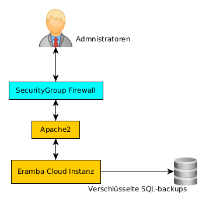

Die Web-Inhalte werden über einen `Apache2`-Webserver zum Nutzer übertragen.
Eramba selbst ist eine PHP-Applikation und die Nutzerdaten befinden sich in `/var/www/html/`.

## IT-14.1 Zugang

Die virtuelle Maschine beinhaltet eine SecurityGroup, welche nur Zugriffe aus
dem Netz der Uni Bielefeld zulässt
(129.70.0.0/16). Ebenfalls ist der Web-Zugriff zwangsweise durch HTTPS geregelt.

Für das TLS-Zertifikat verwendet diese virtuelle Maschine [LetsEncrypt](letsencrypt.org/).
Das Zertifikat wird hier voll-automatisiert erneuert (siehe `/etc/letsencrypt/renewal/`).
LetsEncrypt konfiguriert hierbei automatisiert den installierten `Apache2`-Webserver.

Der Zugang zur eigentlichen virtuellen Maschine ist über SSH möglich.

## IT-14.2 Encryption-at-rest und Backups

Eramba verwendet eine SQL-Datenbank. Diese Datenbank wird einmal wöchentlich
auf ein angehängtes mit LUKS verschlüsseltes Volume gespeichert und über das
CeBiTec zusätzlich auf Band gesichert (siehe [IT-18](#IT-18))
Die Systemdisk der Instanz ist ebenfalls mittels LUKS verschlüsselt.

Die Sicherung ist automatisiert durch `cron`:

`0 0 * * 3 /root/backupdb.sh > /dev/null`

## IT-14.3 Schlüssel

Sämtliche Schlüssel für das System sind abgelegt unter `/vol/opstadm`.
Der Zugang zu den Schlüsseln ist den Administratoren vorbehalten.

Folgende Schlüssel sind hinterlegt:

- `erambacred` Passphrase für den Eramba-Admin-Account
- `backupluks` LUKS-Passphrase um das Backup-Volume zu entschlüsseln.
- `erambabackup_luks_keyfile` Spezieller Schlüssel um das Backup-Volume mit `crypttab` zu entsperren.
- `eramba_rsa{.pub}` SSH-Keyfiles zur Instanz (`ubuntu`-Nutzer) - geschützt durch eine Passphrase.
- `eramba_backup.key{.pub}` SSH-Keyfiles zur Instanz für das Backup (`ubuntu` Nutzer) - 
  keine Passphrase, Zugang beschräbnkt auf die externe Service-Adresse (129.70.51.2) und
  das Backup Skript

# IT-15 Lieferantenbeziehungen

Neue Lieferantenbeziehungen müssen in der
[Aufstellung der Lieferanten](aufstellungen/lieferanten.md)
mit Namen, Laufzeit der Beziehung, Überwachungsverantwortlichen,
sowie einem Verweis auf die weitergehende Dokumentation (Ausschreibungstext,
EVB-IT Vertrag, sowie gegebenenfalls AV-Vertrag, Vertraulichkeits- und
Verpflichtungserklärung) eingetragen werden.

Eine Risikobeurteilung der Lieferantenbeziehung muss bei Inkrafttreten
oder Änderung erfolgen.

Für jeden Lieferanten (ausgenommen Lieferanten von IT-Infrastruktur-Komponenten)
ist im Issue-Tracker ein monatliches
REDO-Ticket anzulegen, welches die regelmäßige Überwachung und Überprüfung
der Beziehung dokumentiert.
Findet ein Informationsaustausch mit dem Lieferanten statt, muss der Umgang
mit Informationen, die Übertragung der Informationen und die Klassifizierung
von Informationen gemäß der Richtlinien abgestimmt werden.
Die Überwachung und Überprüfung der Lieferanten von IT-Infrastruktur-Komponenten
erfolgt jeweils bei Eintritt eines Gewährleistungsfalls innerhalb
des vereinbarten Gewährleistungszeitraums, und zwar nach erfolgter bzw.
ausgebliebener Gewährleistung.
Sicherheitsvorfälle, die durch den Lieferanten ausglöst worden sind oder dem
Lieferanten auffallen, sind unverzüglich dem Auftraggeber über
den zugewiesenen Ansprechpartner mitzuteilen.

## IT-15.1 Beispiel für die Überwachung/Überprüfung einer Lieferantenbeziehung

Die Überwachung/Überprüfung könnte beispielweise wie folgt dokumentiert sein:

### Teuto.net

Teuto.net ist ein IT Dienstleister der ADM und BRF beim Betrieb der
de.NBI Cloud unterstützt. Die Ausschreibungsunterlagen sowie die Verträge
liegen im
[CeBiTec Docs](https://docs.cebitec.uni-bielefeld.de/f/2028051).

#### Regelungen

- Es gab am 20.8.2020 ein KickOff Meeting, wo folgendes festgelegt/besprochen
  worden ist
- Ansprechpartner ist Jan Krüger, bzw. in Vertretung Alex Walender oder Christian Henke
- Teuto.net übernimmt zukünftig Support-Tätigkeiten im Bereich OpenStack
  und Ceph um ADM zu entlasten.
  - Anstehende Live-Upgrades vor allem von OpenStack sollen von teuto.net
  vorbereitet und begleitet werden.
  - Teuto.net gibt Workshops/Schulungen zu den Themen K8S, Prometheus,
  Penetration Testing und IT-Security (ADM + BRF)
- Teuto.net erhält Zugriff auf die zur Erbringung der Serviceleistung notwendigen
  Repositories (OpenStack, Ceph und  das ISMS)
- Teuto.net wird über die Regelung zum Umgang, der Übertragung und der
  Klassifizierung von Informationen gemäß der geltenden Richtlinien informiert.
- BRF stellt teuto.net Accounts und einen separater JumpHost (jopstcon) mit
  uneingeschränkten Zugriff auf die Entwicklungsumgebung und eingeschränkten
  Zugriff auf die Produktionsumgebung (Zugang, nur wenn notwendig) zur Verfügung.
  ADM legt anhand von anstehenden Services fest auf welche Server der
  Produktionsumgebung über personalisierte Accounts zugegriffen werden kann.
- Sicherheitsvorfälle werden umgehend dem Ansprechpartner mitgeteilt.
- ADM und BRF bekommen Zugang zum Ticket-System von teuto.net (GitLab)
- Es gibt 14-tägige protokollierte Meetings/TelKo (Protokoll im GitLab von teuto.net).

#### Zugangsregelungen/Accounts

Folgende Mitarbeiter von teuto.net haben derzeit Zugriff auf
das ISMS:

- Geschäftsführer
- Mitarbeiter OpenStack
- Mitarbeiter Ceph

Folgende Mitarbeiter von teuto.net haben einen Account im CeBiTec,
Zugriff auf den Jump Host (`jopstcon`) sowie Zugang zu den
OpenStack/Ceph-Repositories:

- Geschäftsführer
- Mitarbeiter OpenStack
- Mitarbeiter Ceph

# IT-16 Tickets

IT-16 beschreibt die Handhabung von Tickets als ein zentraler Bestandteil
des ISMS.

- Interne Aufgaben werden im Issue-Tracking-System YouTrack (YT) erstellt und
  bearbeitet (siehe IT-2).
- Externe Anfragen von Cloud-Kunden per E-Mail werden derzeit im YouTrack als
  Support-Tickets behandelt (Kontaktadresse: `service@bi.denbi.de`). Dies löst den vormals verwendeten (vom CeBiTec
  betreuten) [Request-Tracker](https://rt.cebitec.uni-bielefeld.de)
  ab (Kontaktadresse: `os-service@cebitec.uni-bielefeld.de`).

## IT-16.1 Externe Kommunikation

### Von Kunden

Kunden der Cloud können über die Service-Adresse `service@bi.denbi.de`
Support-Tickets erstellen. Diese sind für ADM sichtbar und je nach Komplexität
bearbeitet der jeweilige Mitarbeiter die Anfrage sofort oder erstellt daraus
eine interne Aufgabe.

- Die Zuweisung der Anfrage (Feld: "Assignee") erhält der Mitarbeiter, der diese zuerst sichtet.
  Bei Bedarf kann die Zuweisung, nach entsprechender Absprache, einem anderen
  Mitarbeiter zugeordnet werden.
- Die Tickets werden täglich zu den üblichen Service-Zeiten (werktags 9 - 17 Uhr)
  bearbeitet.
- Komplexere Anfragen sind Teil der wöchentlichen Besprechung von ADM und BRF.

### Zu Kunden

Bei Ereignisen wie angekündigte Wartungen, Störungen sowie Vorfällen können die
unterschiedlichen Nutzer wiefolgt kontaktiert werden:

- Reguläre de.NBI Cloud Bielefeld Nutzer
  - Kontakt über das [Portal](#it-913-denbi-portal)
- DSI BiFOS
  - Benachrichtigung über das [DSI-Portal](https://dsi.simplevm.uni-bielefeld.de)
  - OpenStack-User Addressen durch `openstack user list --domain dsi --long`
- Forschungszentrum Jülich ITS Ausfallumgebung
  - Siehe [COM-460](https://yt.bi.denbi.de/issue/COM-460/FZJ-ITS-Ausfallumgebung-erstellen)
- SRI-Sourmash
  - Siehe [COM-539](https://yt.bi.denbi.de/issue/COM-539/Mirroring-von-SRA-Sourmash-Signaturen)

## IT-16.2 Interne Aufgaben (Tickets)

Interne Tickets können von allen registrierten Mitgliedern der Organisation
"de.NBI Cloud Bielefeld" innerhalb des Ticketsystems erstellt
werden und dienen vor allem der Koordination und Dokumentation von Aufgaben im
Sinne des ISMS.

### Projektmanagement (Agile Boards)

Um den Arbeitsfluss bei der Bearbeitung von Tickets zu optimieren, kommen
Agile Boards zum Einsatz. Die Anzahl der Tickets auf dem Board sollten dem
zur Verfügung stehenden Zeitrahmen zur Bearbeitung
entsprechen und auch Fehlzeiten von Mitarbeitern (z.B. Urlaub) berücksichtigen.

In den wöchentlich stattfindenden Besprechungen müssen die Aufgaben auf dem
Agile Board besprochen und gegebenenfalls neu verteilt werden.

### Lebenszyklus eines Tickets

1. Erstellen eines Tickets unter der Wahl eines geeigneten Templates
   und initialem Status _"Open"_.
   Für _Common-Tickets vom Typ "Project"_ ist der Status _"Submitted"_
   zu setzen.
1. Zuweisen des Tickets an einen Mitarbeiter (_"Assignee"_). Die Zuweisung eines
   Tickets kann entweder im Rahmen der wöchentlichen Besprechung oder
   eigenverantwortlich an sich selbst erfolgen. Tickets
   aus den Bereichen OpenStack, Ceph und Common bzw. Zertifizierung sollten
   dem entsprechenden Agile Board hinzugefügt werden.
1. Auswählen eines Gutachters (_"Reviewer"_). Als Gutachter eines Tickets wird
   idealerweise der verantwortliche Mitarbeiter für den jeweiligen Bereich
   gemäß der
   [RASCI-Matrix](organisation.md#rasci-matrix-der-aufgabenverteilung-und-verantwortlichkeiten) gewählt.
   Alternativ darf diese
   Rolle auch von einem unterstützenden Mitarbeiter aus dem jeweiligen Bereich
   eingenommen werden.
   In jedem Fall darf die Rolle des Bearbeiters und des Gutachters nicht von
   der gleichen Person ausgefüllt werden, um das 4-Augen Prinzip bei der Bearbeitung
   eines Tickets zu erfüllen.
1. _nur Common-Tickets vom Typ "Projekt":_ Der Gutachter bestätigt die Kenntnisnahme durch Änderung
   auf den Status _"Open"_. Ab diesem Zeitpunkt darf das Ticket bearbeitet werden.
1. Sobald der _Assignee_ das Ticket bearbeitet, bekommt dieses den Status _"In Progress"_.
   Der Bearbeiter sollte den Bearbeitungsverlauf im Ticket dokumentieren.
1. Besteht bei der Bearbeitung eines Tickets seitens des _"Assignees"_ Diskussionsbedarf,
   so sollte der Status auf _"to be discussed"_ gesetzt und etwaige Fragen
   bei der wöchentlichen Besprechung geklärt werden.
1. Ist die Bearbeitung des Tickets abgeschlossen, dann bekommt das Ticket den
   Status _"to be reviewed"_.
   Nach erfolgter Begutachtung durch den _Reviewer_ setzt dieser den Status
   entweder auf _Fixed_ (keine Beanstandung) oder mit einem Kommentar im Ticket
   wieder auf _In Progress_ (Ticket muss überarbeitet werden).

### Verknüpfung zu GitLab/GitHub

In vielen Fällen gibt es zu einem Ticket im Issue-Tracker ein korrespondierendes
Ticket oder einen Merge-Request im verwendeten GitLab/GitHub. Dieses sollte, aus
Gründen der Übersichtlichkeit, immer am Anfang der Beschreibung in der
folgenden Form verlinkt werden:

```markdown
| https://gitlab.ub.uni-bielefeld.de/opst/openstack/-/merge_requests/86  |
|---|
```

Ergebnis:

| [https://gitlab.ub.uni-bielefeld.de/opst/openstack/-/merge_requests/86]()  |
|---|

### Best Practice

Es hat sich als sinnvoll herausgestellt, komplexe Aufgaben entweder in kleinere
Aufgaben zu unterteilen oder eine ToDo-Liste zum Abhaken in dem Ticket zu führen. Dieses
Vorgehen erleichtert es, die Bearbeitung eines Tickets zu unterbrechen und zu einem
späteren Zeitpunkt fortzuführen. Ideen und Gedanken zur Aufgabe sollten immer im
Ticket dokumentiert werden. Beides führt dazu, dass es dem Gutachter leichter fällt,
ein Ticket zu beurteilen.

### Templates

Der verwendete Issue-Tracker unterstützt _Templates_ für unterschiedliche
Arten von Tickets. Es gibt unterschiedliche Tickettypen, deren Verwendung
im folgenden kurz dargestellt wird:

#### Common

Kann ein Ticket keinem der anderen Ticket-Typen zugeordnet werden,
dann sollte Common verwendet werden. Als einziges Ticket-Template
unterstützt Common den Untertypen "Projekt". Im Hinblick auf die
Informationssicherheit muss ein Projekt der de.NBI Cloud Bielefeld
über ein solches Ticket gesteuert werden
(➝ [Informationssicherheit im Projektmanagement](richtlinien/Informationssicherheit_im_Projektmanagement.md)).
Die Wahl Projekt- und Sicherheitsverantwortlicher
wird beim Anlegen eines _"Common"_-Projekt-Tickets durch das Template
erzwungen.

#### OpenStack/Ceph/Zertifizierung(ISMS)

Aufgaben die den Themen OpenStack, Ceph sowie dem ISMS zugeordnet
werden, sollten als entsprechendes Ticket angelegt werden.

#### Softwareentwicklung (Software Development)

Softwareentwicklung im Rahmen der de.NBI Cloud Bielefeld muss gemäß
der Richtlinie zur sicheren Softwareentwicklung erfolgen. Das Template
_Software Entwicklung_ unterstützt dies mit einem vordefinierten Workflow und
erzwingt beim Anlegen des Tickets einen Projekt- und Sicherheitsverantwortlichen,
sowie einen Verweis auf ein Repository.

#### Wiedervorlagen (REDO)

Viele Betriebsprozesse der Cloud und des ISMS bedürfen der gewissenhaften
und rechtzeitigen Erledigung wiederkehrender Aufgaben.
Hier kommen im YouTrack sog. REDO-Tickets ins Spiel. Dieser in der
de.NBI Cloud Bielefeld eigens entwickelte Workflow ermöglicht zeitgesteuerte
Ticketstatus-Kreisläufe mit definierten Zustandsübergängen.

Ein Mitarbeiter kann so eine wiederkehrende Aufgabe in einem REDO-Ticket beschreiben
und unter Angabe des nächsten Fälligkeitsdatums und des gewünschten
Wiederholungsintervalls in das Tagesgeschäft integrieren.
Beteiligte Mitarbeiter werden rechtzeitig und ggf. nachdrücklich per Mail erinnert.

Während die Ticket-Beschreibung eines REDO-Tickets die zu erledigende
Aufgabenstellung enthalten muss, ist der Kommentarbereich unterhalb des
Tickets explizit zu Protokollierungszwecken vorgesehen, sodass automatisch
eine Historie bisheriger Ausführungen entsteht und für Nachvollziehbarkeit sorgt.

#### Sicherheitsvorfälle (Security Incidents)

Sicherheitsvorfälle müssen durch den Tickettyp _Security Incidents_ erfasst
und dokumentiert werden.
Der durch die IT-Sicherheitsrichtlinie zur Behandlung IT-Sicherheitsvorfällen
vorgegebene Ablauf wird durch das Template mit vorgegebenen Felder
unterstützt.

#### Protokolle und Berichte

Das Template _Protokolle und Berichte_ sollte für Protokolle wie
zum Beispiel dem Protokoll der wöchentlichen Gruppenbesprechung
und Berichte wie zum Beispiel dem wiederkehrenden ISMS-Statusbericht
an die Leitung der de.NBI Cloud Bielefeld verwendet werden.

### Feststellen von offenen Tickets

Bei der massiven Verwendung eines Issue-Trackers kann es vor allem bei
zurückgestellten Tickets passieren, dass diese im Laufe der Zeit aus dem
Fokus verschwinden. YouTrack erlaubt durch den Einsatz eines Filters
über alle Arten von Tickets, alle nicht geschlossenen Tickets aufzulisten.

Die so gefilterten Tickets werden einmal vierteljährlich ([REDO-15](https://yt.bi.denbi.de/issue/REDO-15))
von mindestens zwei MA (4-Augen-Prinzip) neu bewertet.

# IT-17 Business Continuity

IT-17 beinhaltet Verfahren, die bei einer schwerwiegenden Situation anzuwenden sind.
Definitionen über mögliche Betriebszustände bzw. das Vorgehen ist in der
entsprechenden Richtlinie _Business Continuity_ beschrieben.

## IT-17.1 Kommunikation zu Nutzern bei einem Notfall oder einer Krise

Wenn eine schwerwiegende Situation identifiziert worden ist und die Nutzer der Cloud
sind dadurch unmittelbar betroffen, so müssen sämtliche Nutzer
der Cloud über den Vorfall unterrichtet werden.

Der direkte Kontakt zu allen Nutzern der Cloud ist hierbei
durch das [Cloud-Portal](https://cloud.denbi.de/portal/webapp/#/userinfo)
der _de.NBI Cloud Governance_ möglich (siehe IT-9.1.3). Ein Mitarbeiter
der `ADM`-Gruppe loggt sich hierzu mittels ELIXIR-Account in das Portal
ein und navigiert im Menü zu _Facilities_ -> _Projects_.

Dort existiert eine Funktion zur Adressierung von E-Mails an alle Nutzer.
Die Mail sollte folgendes beinhalten:

- Welcher Vorfall ist eingetreten und welche Konsequenzen hat dies für
  die Ausführung der Geschäftsprozesse der Nutzer.
- Wurde die Vertraulichkeit der Nutzerdaten verletzt?
- Ungefährer Zeitraum bis wann die Krise anhält.
- Anbieten von Alternativen (siehe entsprechenden Unterpunkt).
- Eine Kontaktmöglichkeit (in der Regel `os-service@cebitec.uni-bielefeld.de`).

Bei neuen Erkenntnissen der Situation sind die Nutzer
der Cloud nach demselben Verfahren zu unterrichten.

## IT-17.2 Anbieten von Alternativen

Falls die Krise unvermeidlich kritische Geschäftsprozesse verhindert,
so muss den Nutzern eine Alternative zur Nutzung der Cloud-Services
gegeben werden.
Die de.NBI Cloud Bielefeld kontaktiert hierbei die _de.NBI Cloud Governance_,
mit dem Hinweis, dass in kurzfristiger Zeit die Dienste nicht wiederhergestellt werden können.
Diese kann dann, mithilfe der anderen de.NBI Cloud Standorten, die benötigten Compute und Storage-Ressourcen
für die Nutzer kurzfristig ersetzen.

## IT-17.3 Anbieten, dass in Ausnahmefällen Nutzerdaten exportiert werden können

Falls der allgemeine Zugriff auf die Daten der Cloud durch die Krise
dem Nutzer erschwert ist,
können in Einzelfällen die Nutzerdaten anderweitig dem Nutzer exportiert werden.
Die Möglichkeit hängt von der Schwere der Krise ab.

Nutzdaten können hierbei sein:

- Block-Devices der Instanzen. Siehe [OS-175](https://yt.bi.denbi.de/issue/OS-175).
- Volumes der Instanzen. Siehe [Anleitung](https://docs.ceph.com/en/latest/start/quick-rbd/).
- S3 Daten der Nutzer.

Die Übermittlung der Daten sollte hierbei der Richtlinie _Informationsübertragung_ konform sein.

## IT-17.4 Wiederherstellung von Geschäftsprozessen

Ein genaues Verfahren zur Wiederherstellung von Geschäftsprozessen ist
in einer Checklisten-Form nicht definierbar, da es unzählige Vorfälle
geben kann, die jeweils unterschiedliche Vorgehensweisen bei der
Wiederherstellung verlangen.

### Wiederanlaufplan

Sollte ein Krisenfall eintreten und Geschäftsprozesse müssen teilweise oder komplett
wiederhergestellt werden, so sollten zuerst die wichtigsten Komponenten wieder aufgebaut
werden.

Hier wird von einem Szenario ausgegangen, in der sämtliche sekundären phyischen
Assets nicht mehr existieren und neu beschafft werden müssen.
Es existieren lediglich Backups von den kritischen Diensten. Die Backups
beinhalten **nicht** die Daten der virtuellen Maschinen oder des
Storage-Systems, da diese aufgrund der Datenmenge nicht separat verwahrt werden
können. Der Wiederanlauf-Plan zielt hierbei ab, den primären Geschäftsprozess
"Anbieten von Compute und Storage-Kapazitäten" so schnell wie möglich,
in einem Minimalbetrieb, wieder durchführen zu können.

Wiederanlaufpläne können, je nach Handlungsunfähigkeit
(siehe [Richtlinie](richtlinien/Business_Continuity.md#definition-handlungsunfähigkeit))
, nicht weitergeführt werden. Bei der Durchführung ist das Arbeistzeitgesetz (ArbZG)
einzuhalten.

Neu-Anschaffungen bei einer Krisensituation müssen nicht zeitfordernd ausgeschrieben werden
und können direkt bezogen werden.

Anbei folgt eine Auflistung der zu wiederherstellenden Komponenten in
Reihenfolge der Wichtigkeit.

Übersicht:

| Arbeitsschritt / Beschaffung | Geschätzter zeitlicher Aufwand / Geschätzte Lieferzeit |
| --------------------------   | ------------------------------ |
| Bergung der Backups          | Wenige Stunden                 |
| Räumlichkeiten               | 3 Wochen                       |
| Netzwerk                     | 3 Wochen                       |
| OpenStack-Knoten             | 3 Wochen                       |
| Storage-Knoten               | 3 Wochen                       |
| Service-Knoten               | 1 Woche                        |
| Konfiguration und einspielen der Backups | 1 Woche            |
| Funktions /-Sicherheitstests und abschließende Freigabe | 2 Tage |

```mermaid
gantt
    title Wiederanlaufplan - Inkl. Funktionstests (RTO: max. 30 Tage)
    dateFormat  X
    axisFormat %d Tage
    
    section Vorbereitung
    Bergung der Backups : milestone, m1, 0, 0d
    
    section Parallele Beschaffung
    Räumlichkeiten (3 Wochen)   :active, b1, after m1, 21d
    Netzwerk (3 Wochen)         :active, b2, after m1, 21d
    OpenStack-Knoten (3 Wochen) :active, b3, after m1, 21d
    Storage-Knoten (3 Wochen)   :active, b4, after m1, 21d
    Service-Knoten (1 Woche)    :active, b5, after m1, 7d
    
    section Aufbau & Integration
    Konfiguration & Backup-Einspielung (1 Woche) : b6, after b1, 7d
    
    section Validierung
    Funktions- & Sicherheitstests (2 Tage) : b7, after b6, 2d
    
    section Ziel
    Minimalbetrieb & Freigabe (Tag 30) : milestone, m2, after b7, 0d
```

Insgesamt sollte die maximale Wiederanlaufzeit nicht mehr als **30 Tage** erfolgen
(Recovery Time Objective) um einen Minimalbetrieb aufnehmen zu können.

Die maximale Ausfallzeit bis zum letzten gültigen Backup der OpenStack-Datenbank
beziffert sich auf **24 Stunden** (Recovery Point Objective).

#### Bergung der Backups

Elementar für eine Wiederhestellung der Dienstfähigkeit ist die Beschaffung
der Backups sämtlicher Systeme.

Die Verfahren der Backups sind in [IT-18](it-verfahren.md#it-18-backup) beschrieben.

Müssen Backups ausserhalb der ehemaligen Räumlichkeiten transportiert werden,
so ist die [Richtlinie für die Handhabung von Speichermedien](richtlinien/Richtlinie_Handhabung_Speichermedien.md)
einzuhalten.

#### Räumlichkeiten

Um die primären Geschäftsprozesse durchführen zu können, sind geeignete
Räumlichkeiten, beziehungsweise Data-Center notwendig.

Bei Bedarf kann vorhandene Hardware weiter verwendet werden, daher sollten
die neuen Räumlichkeiten nicht unweit der vorherigen Data-Center entfernt
liegen. Es sind Räumlichkeiten vor zu ziehen, die ebenfalls nach
ISO27001 zertifiziert sind.

| Anbieter | Kontakt | Zertifiziert? |
| -----    | ------- | ------------- |
| BITel (Stadtwerke Bielefeld) | [Kontakt](https://www.bitel.de/geschaeftskunden/service/kontakt-fuer-geschaeftskunden.html) | [Zertifikat](https://www.bitel.de/fileadmin/content/documents/zertifikate/539472_ISMS17_2021-04-01_deutsch_logo_AZ.pdf) |
| OEDIV | [Kontakt](https://www.oediv.de/kontakt/) | [Zertifikat](https://www.oediv.de/fileadmin/_processed_/d/c/csm_kpmg-zert-2021-de-2_f8f17fb85c.jpg) |
| MarcanT GmbH | [Kontakt](https://www.marcant.net/leistungen/ueber-uns/kontakt) | [Zertifikat](https://www.certipedia.com/quality_marks/9108630744) |
| Datacenter One | [Kontakt](https://dc1.com), Tel: +49 (0) 711 25290-0 | [Zertifikat](https://www.dc1.com/zertifikate/) |
| Westfalenwind IT - windCores | [Kontakt](info@windcores.de), Tel: +49 052516825750 | [Zertifikat](https://www.windcores.de/sicherheit/) |

#### Netzwerk

Es werden überwiegend verteilte Systeme für den Cloud Betrieb verwendet.
Ohne eine Netzwerkinfrastruktur ist kein Betrieb möglich.
Da OpenStack für virtuelle Maschinen software-definierte
Netzwerklösungen anbietet, gibt es relativ lose Anforderungen für die Hardware.
Ein "Vendor-Lock" ist daher nicht gegeben, daher ist die Anzahl der Spezifikationen
überschaubar:

Geforderte Spezifikationen:

| Spezifikation | Begründung |
| ------------- | ---------- |
| 10GE / 40GE Ports | Ein Storage-System benötigt hohen Durchsatz von mindestens 40G. Der Status-Quo der Compute-Knoten nutzt 10G-Bandbreiten. |
| Ausreichende Anzahl an Ports | Je nach Minimalbetrieb sollten ausreichend Ports für die Anzahl der Compute und Storage-Knoten vorhanden sein. Bezüglich einer Ausfallsicherheit sollten pro Server mindestens zwei Ports eingerechnet werden. |
| VLAN-Tagging  | Eine Isolation der Netzwerksegmente ist bezüglich der Informationssicherheit zwingend erforderlich. |
| Layer3-Funktionalität | Der Switch sollte in der Lage sein, zwischen einzelnen Sub-Netzen routen zu können. |

Mögliche Lieferanten bezüglich Netzwerk-Komponenten:

| Lieferant | Kontakt |
| --------- | ------- |
| Delta Computers | [Kontakt](https://www.deltacomputer.com/requestform/server/) |
| Thomas-Krenn | [Kontakt](https://www.thomas-krenn.com/de/unternehmen/kontakt-tk/notfallrufnummer.html) (Notfallrufnummern) |

#### OpenStack-Knoten

Ähnlich wie bei den Netzwerkkomponenten besteht bei den OpenStack-Knoten kein
Vendor-Lockin. Das bedeutet, dass hierfür keine spezielle Hardware nötig ist.
Die geforderte Hardware muss lediglich einige Spezifikationen aufweisen.
Als Referenz können ähnliche Server-Typen vergangener
[Beschaffungen](https://docs.cebitec.uni-bielefeld.de/index.php/apps/files/?dir=/grp_openstack_adm/de.NBI%20Ausschreibungsunterlagen&fileid=2612666)
herangezogen werden.

Bezüglich eines Minimalbetriebes ist erforderlich:

| Typ | Begründung | Anzahl |
| --- | ---------  | ------ |
| Controller | Die Controller koordinieren die API und die Steuerung der Hypervisor. | 3 |
| Compute | Um Compute-Ressourcen anbieten zu können, bedarf es eine ausreichende Anzahl an Hypervisor. | 8 |

Mögliche Lieferanten:

| Lieferant | Kontakt |
| --------- | ------- |
| Delta Computers | [Kontakt](https://www.deltacomputer.com/requestform/server/) |
| Memory Solution GmbH | [Kontakt](https://www.memorysolution.de/Kontakt/) |
| Thomas-Krenn | [Kontakt](https://www.thomas-krenn.com/de/unternehmen/kontakt-tk/notfallrufnummer.html) (Notfallrufnummern) |

#### Storage Knoten

Während die Hypervisor einen begrenzten Speicher für die Root-Festplatten haben,
bedarf es jedoch größeren und redundanten Speicher. Wie bei den anderen Komponenten existieren für die
Storage-Komponenten kein Vendor-Lockin, da Ceph flexibel jede Art von persistenten
Speicher verwenden kann.
[Beschaffungen](https://docs.cebitec.uni-bielefeld.de/index.php/apps/files/?dir=/grp_openstack_adm/de.NBI%20Ausschreibungsunterlagen&fileid=2612666)
herangezogen werden.

Die wichtigsten Spezifikationen pro Storage-Knoten sind:

| Komponente | Begründung |
| ---------- | ---------- |
| 24 mechanische Festplatten mit je mindestens 10TB Speicher | Es ist wirtschaftlicher soviele Festplatten wie möglich in einem Knoten zu verorten als mehrere Knoten zu erwerben. |
| Pro Festplatte mindestens 500G SSD-Speicher | Festplatten profitieren von einem schnellen SSD-Cache. |
| Pro Festplatte mindestens 8GB Hauptspeicher | Analog zu dem SSD-Cache benötigen die Storage-Einheiten einen zusätzlichen Cache-Speicher in Form von Hauptspeicher. |

Da Ceph eine dreifach-replikation anstrebt, sollten für einen Minimalbetrieb mindestens 9 Server
beschafft werden.

Mögliche Lieferanten:

| Lieferant | Kontakt |
| --------- | ------- |
| Delta Computers | [Kontakt](https://www.deltacomputer.com/requestform/server/) |
| Memory Solution GmbH | [Kontakt](https://www.memorysolution.de/Kontakt/) |

#### Service Knoten

Diese Maschinen werden benötigt, um die Infrastruktur zu überwachen und weitere Services anzubieten.
Diese sind jedoch nicht fundamental Wichtig für die Aufrechterhaltung der Geschäftsprozesse und haben von daher die niedrigste Priorität.
Die Knoten bedarfen keiner spezieller Architektur, da die laufenden Dienste nicht
rechen oder speicherintensiv sind.

#### Konfiguration und einspielen der Backups

Dank der Ansible-Playbooks lassen sich die einzelnen Server schnell
und automatisiert konfigurieren.
Eine Anleitung bezüglich der Playbooks lässt sich finden in
[IT-20.1 Regelmäßige Playbook-Durchläufe](it-verfahren.md#it-20-patchen-der-systeme).

Die Wiederherstellung der OpenStack-Datenbank ist in [IT 9.6](it-verfahren.md#it-96-einspielen-eines-backups-disaster-recovery)
dokumentiert.

### Beanspruchung von vorhandener Dokumentation

Jede einzelne Komponente unserer Infrastruktur beinhaltet
Dokumentationen über:

- Installation
- Betrieb
- typische Fehlerbehandlung
- Funktionsprüfungen

Diese finden sich jeweils in den IT-Verfahren oder im YouTrack (IT-2).
Letzteres ist besonders hilfreich, da dort sämtliche bekannte Fehler
mitsamt Fehlerbehebung dokumentiert sind. Die Erfahrung zeigt hierbei,
dass dieselben Fehler sich häufig wiederholen.

### Notfalländerungen

In Ausnahmefällen können Änderungen der Systeme von dem allgemeinen
Vorgehen abweichen (anders als in IT-4.1).
Änderungen an Systeme können somit direkt erfolgen.
Dies hat den Zweck, dass die Fehlersuche und Behebung
in einer Ausnahmesituation beschleunigt wird.
Dazu gelten folgende Bedingungen:

- Es muss akut eine schwerwiegende Situation (Notfall oder Krise) vorliegen.
- Die Vorgaben zum sicheren Betrieb bzw. zur Änderungen von Konfigurationen
  sollten (wenn möglich) eingehalten werden.
- Nachdem die Änderung erfolgreich war, muss diese nachträglich
  gemäß [A8.32](erklaerung-zur-anwendbarkeit.md#a832-änderungssteuerung)
  dokumentiert werden.

### Notfallabschaltung

Ist innerhalb der Krise Gefahr im Verzug und diese Gefahr
lässt sich in kürzester Zeit nicht beheben, so kann
die oberste Leitung eine Notfallabschaltung anordnen.
Ist die oberste Leitung nicht kontaktierbar, so können
Mitarbeiter der `ADM` und `BRF` im
Ausnahmefall eine Notabschaltung anordnen.
Dies ist notwendig, wenn der laufende Betrieb der Infrastruktur
gravierende Schäden an der Informationssicherheit verursacht.
Dies ist beispielsweise gegeben durch:

- Hacker-Angriffe, insbesondere durch Crypto-Trojaner
- Ausfall der Klimaanlage im Datacenter
- Gravierende Probleme der Stromversorgung
- Entdeckter Einbruch im Datacenter

Dies ist jedoch als _Ultima Ratio_ anzusehen und stellt
somit ein Extremfall dar.

Ist der Remote-Zugriff auf die Infrastruktur gegeben,
so können sämtliche Maschinen per Ansible heruntergefahren werden.
Für die OpenStack-Infrastruktur (innerhalb des OpenStack-Repository):

`run-ansible -i hosts.prod.kolla -b -m shell -a "poweroff"`

Für das Storage-System (innerhalb des Ceph-Repository):

1. Setzen der Flags: `ceph osd set` und jeweils `noout`, `nobackfill`, `norecover`.
2. Herunterfahren der Maschinen: `run-ansible -i hosts.ceph_denbi -b -m shell -a "poweroff"`

Ist der Remote-Zugriff nicht mehr gegeben, so muss die `BRF`
die Infrastruktur manuell abschalten:

- per VNC-Konsole
- manuell vor Ort

Die Nutzer werden umgehend von der Notfallabschaltung unterrichtet.
Die Ursache für die Notfallabschaltung wird mit höchster Priorität
untersucht.

Ist die Ursache der Notfallabschaltung geklärt, so können über die VNC-Konsole
die Infrastruktur wieder hochgefahren werden.
Sämtliche Komponenten der Infrastruktur müssen auf Funktionsweise
geprüft werden. Hierbei können die entsprechenden IT-Verfahren der
jeweiligen Komponenten in diesem Dokument zur Hilfe gezogen werden.

### Abschaltungen bei einem Blackout/Brownout der Energieversorgung

Seit bekannt werden der [Energiekrise](https://www.wirtschaft.nrw/system/files/media/document/file/energiebericht-nordrhein-westfalen-2022.pdf)
im Jahr 2022, wurde seitens der Universität, eine [Rundverfügung](assets/2022-12-11%20Rundverfuegung_Stromausfall.pdf)
bekannt gemacht. Im Falle eines längeren Stromausfalls müssen hierbei
Notfallpläne vorliegen. Sollte die de.NBI Cloud von einem längeren
Ausfall betroffen sein, so ist ein koordiniertes Abschalten und
Anschalten der Infrastruktur notwendig. Dies dient dazu, um Fehlverhalten
der Software, sowie potentiell schädliche Spannungsspitzen zu vermeiden.

Ein wichtiger Faktor ist hierbei die Kommunikationsfähigkeit im Ernstfall.
Sämtliche Administratoren, sowie die obere Leitung, stehen via einem
externen und sicheren Messenger im Kontakt.

Die Detektierung eines akuten bzw. bevorstehendem Ausfall ist hierbei nicht
trivial. Offene Kanäle zur Informationsbeschaffung können hierbei sein:

1. Die Bekanntmachung über Notfallkanäle der Universität ([EVALARM](https://www.uni-bielefeld.de/themen/hilfe-notfall/evalarm/))
1. Öffentliche Meldungen der Medien
1. Partiell ausfallende Maschinen oder IPMI-Meldungen bezüglich störungen der Stromversorgung

Sollte ein Mitarbeiter die Meldung eines möglichen Blackouts feststellen, so
müssen umgehend die anderen Mitarbeiter, sowie die obere Leitung, benachrichtigt
werden.

Bei unerwarteten und kurzen Unterbrechungen (Brownout) die Sekunden bis wenige
Minuten andauern, sind die vitalsten Komponenten der Infrastruktur per USV
gesichert. Zusätzlich sollten hierbei die Dieselgeneratoren der Universität
anspringen und die Maschinen an einer USV weiterhin mit Energie beliefern.
Die Generatoren, sowie deren konstanten Belieferung mit Diesel, sind
außerhalb des Scopes. Die Garantie über einen störungsfreien Ablauf kann
hierbei nicht kontrolliert werden.

Sollten sich daher längere Blackout-Perioden ankündigen, so ist der Prozess der
Notfallabschaltung (siehe Oben) einzuhalten. Auch hierbei sind sämtliche
Gerätschaften so lange ausgeschaltet zu lassen, bis von der Leitung der Universität
eine entsprechende Entwarnung verkündet worden ist.

## IT-17.5 Mobiles Arbeiten

Mitarbeiter der de.NBI Cloud haben die Möglichkeit, durch Heimarbeit
(bzw. Remote-Zugriff) die Geschäftsprozesse aufrechtzuerhalten.
Das genaue Vorgehen ist in IT-6.1 beschrieben und
unabhängig einer Krise anwendbar.

# IT-18 Backup

Das Backup umfasst die für den Betrieb und die für den Ernstfall zur
Wiederherstellung notwendigen Daten der Cloud Infrastruktur aber **keine**
Daten von Kunden(-projekten). Das IT-Verfahren beschreibt das Backup
der Kopien der folgenden Dienste:

- Zabbix (Monitoring)
- YouTrack (Issue Tracker → Dokumentation)
- Openstack (Cloud Framework)
- Eramba (Risikomanagement → Dokumentation)
- Services (Service Datenbank))
- Bind9 (DNS)
- Service DB (Galera)
- OCI (Container Registry) 

## Sicherung

Die oben beschriebenen Dienste sichern die Daten  GPG encrypted in
den Cloud Storage (CephFS, `/mnt/cephf/backup`). Dieser Schritt der
Sicherung (Service → Cloud Storage) ist abhängig vom dem zu sichernden Service. 

Auf den Service Servern (aktiv ist nur derjenige mit der externen IP) läuft
ein Cron-Job unter der UID root, der die Backup-Skripte unter /usr/local/sbin/backup_*
triggert.

Durch einen Pull Mechanismus (Cron, jopst) werden die verschlüsselten Kopien ins
CeBiTec (`/vol/opstadm/backup`) übertragen und auf einer virtuellen Tape-Library
auf Band gesichert.

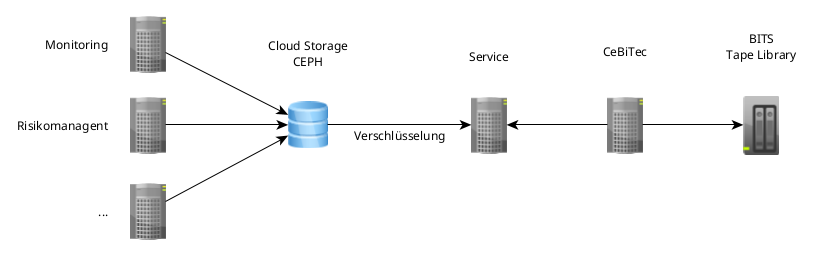

Die Details zu dem Vorgang sind dem entsprechenden
[Ansible Task](https://gitlab.ub.uni-bielefeld.de/opst/openstack/-/blob/2024.1_Kolla/playbook/roles/services/tasks/202-backup.yml?ref_type=heads)
zu entnehmen.

Der Nutzer 'opstbackup'  hat auf  jopst und jopst2  eine Shell. Secret und SSH-Key sind 
unter /vol/opstadm/secrets/backup zu finden. Auf jopst läuft ein CronJob unter der 
uid von opstbackup.

```
5 12 * * * /vol/opstadm/backups/backup.sh
```

### Verschlüsselung

Nach [A18.1.3](erklaerung-zur-anwendbarkeit.md#a1813-schutz-von-aufzeichnungen) müssen Aufzeichnungen
geschützt werden. Alle Datenbank Sicherungdateien werden vor der Übertragung ins CeBiTec FS mittels
GPG verschlüsselt. Der private und öffentliche Schlüssel liegt in
`/vol/opstadm/keys/de.NBI_Cloud_Bielefeld*.` und ist auschliesslich den Mitarbeiter von ADM
zugänglich.

## Wiederherstellung / Prüfen des Backups

Der Prozess zur Wiederherstellung von Daten aus dem Backup ist unabhängig von dem Service.

1. Backup vom Rechenzentrum von Band anfordern
2. Passenden Datenbankcontainer (postgres oder mariadb) starten.
3. Backup entschlüsseln und in den Datenbankcontainer "pipen".
4. Genereller Test auf das "vorhanden sein" von Service spezifischen Daten.
   Ein funktioneller Test ist u.U. nicht möglich.
5. Einspielen des Backups (nur für die Wiederherstellung).

# IT-19 DSGVO Auskunftsanfragen

Die Datenschutz-Grundverordnung sieht, wie das aktuelle Datenschutzrecht in § 34 BDSG, ein
Auskunftsrecht für betroffene Personen vor. Danach kann der Betroffene von einem Verantwortlichen
Auskunft über dort gespeicherte personenbezogene Daten verlangen. Im Folgenden soll näher auf den
dafür erforderlichen Prozess eingegangen werden.

Eine zuverlässige und zeitnahe Beantwortung von Auskunftsverlangen kann nur durch einen
strukturierten Prozess gewährleistet werden. Ein solcher Prozess umfasst neben konkreten
Ablaufregelungen zur Umsetzung auch die Festlegung von Zuständigkeiten im Unternehmen.

## Verfahrensschritte nach Eingang eines Auskunftsverlangens

Geht bei der de.NBI Cloud (über die Kontaktadresse <os-service@cebitec.uni-bielefeld.de>)
ein Auskunftsverlangen eines Betroffenen ein, dann sollte in folgenden Schritten vorgegangen
werden:

1. **Überprüfung, ob es sich überhaupt um ein Auskunftsverlangen handelt**
   Da Auskunftsverlangen nicht immer eindeutig formuliert sind, ist immer eine genaue Prüfung
   von eingehenden Anfragen erforderlich. Auch eine vermeintliche Kundenbeschwerde kann im
   Einzelfall als Auskunftsverlangen auszulegen sein. Umgekehrt stellt nicht jedes
   Auskunftsersuchen ein Auskunftsverlangen im datenschutzrechtlichen Sinne dar.
2. **Versendung einer Eingangsbestätigung an den Antragssteller**
   Die Eingangsbestätigung signalisiert dem Antragssteller direkt, dass seine Anfrage ernst
   genommen wird und ein entsprechender Prozess zur Bearbeitung vorhanden ist.
3. **Prüfung der Identität des Antragsstellers**
   Da die abgefragten Informationen zahlreiche personenbezogene Daten enthalten, muss
   sichergestellt sein, dass der Antragssteller auch wirklich der Betroffene ist,
   dem das Auskunftsrecht zusteht. Deshalb muss vor Beantwortung der Anfrage die
   Identität des Antragsstellers überprüft werden.
4. **Prüfung, ob personenbezogene Daten der betroffenen Person verarbeitet wurden**

- **Wenn keine Daten vorhanden sind: Negativmitteilung an den Betroffenen**
   Wenn keine personenbezogenen Daten des Betroffenen verarbeitet wurden, dann muss
   dies der betroffenen Person mitgeteilt werden. Es ist eine sogenannte
   Negativauskunft zu erteilen, dass keine personenbezogenen Daten zu der betroffenen
   Person gespeichert sind.
- **Wenn Daten vorhanden sind: Zusammenstellung und unverzügliche Beantwortung**
   Die Informationen müssen dem Betroffenen unverzüglich (max. 2-3 Wochen) in einer präzisen,
   transparenten, verständlichen und leicht zugänglichen Form sowie in einer klaren und
   einfachen Sprache zur Verfügung gestellt werden. In der Regel wird der betroffenen Person
   eine Kopie der personenbezogenen Daten zur Verfügung gestellt.

# IT-20 Patchen der Systeme

## IT-20.1 Regelmäßige Playbook-Durchläufe

Mithilfe der regelmäßigen Playbook-Durchläufe wird sichergestellt, dass der Soll-Zustand der Ansible-Rollen
auf der IT-Infrastruktur abgebildet wird. Bei regelmäßiger Durchführung wird somit ein homogener Zustand
innerhalb der einzelnen Servergruppen erreicht.
Zusätzlich werden vorhandene Software-Pakete aktualisiert und
somit auch eventuell in der Zwischenzeit aufgetretene Softwareschwachstellen geschlossen.

Die Durchläufe werden im 2-Wochen-Rythmus durchgeführt und in einem [REDO-Ticket](https://yt.bi.denbi.de/issue/REDO-3)
festgehalten. Die Abarbeitung der einzelnen Server-Gruppen erfolgt hierbei in einer Checkliste.

Die Playbook-Durchläufe beinhalten folgende Server-Gruppen:

- Komplette OpenStack-Infrastruktur (Development sowie Production)
- Ceph Storage Cluster
- Service-Knoten

Die folgenden Kapitel beschreiben die einzuhaltenden Abläufe für die einzelnen Gruppen.
Am Ende folgt eine Markdown-Checkliste als Vorlage für das Ticket zum schrittweisen abarbeiten.

### Vorbereitung

Vor dem Start des Playbook-Runs muss sicher gestellt werden, dass auf der neusten Version
des aktuellen Hauptbranches gearbeitet wird. Ggf, können noch offene, fertige Merge-Requests
vorher geprüft und gemerged werden. Der Hash des letzten Commits muss mitprotokolliert werden.

Außerdem sollte im [Zabbix](#it-5-zabbix) ein Maintainance-Window angelegt werden
für die Hostgruppen `Openstack` und `Openstack Development`, während des Playbook Runs,
um unnötige E-Mail-Benachrichtigungen zu vermeiden.

Nach jedem Teilschritt (Pre-Playbook und Kolla-Playbook, jeweils auf dev und prod)
muss die Funktionalität der Cloud getestet werden, wie in [IT-4.10.3.6](#it-41036-rally)
beschrieben. Nur wenn hier keine Fehler auftreten, darf mit dem nächsten Schritt fortgefahren werden.

### OpenStack-Knoten

Für die OpenStack-Infrastruktur werden zwei Ansible-Rollen verwendet:

- Das [Pre-Playbook](https://gitlab.ub.uni-bielefeld.de/opst/openstack)
- Das [Kolla-Deployment](https://gitlab.ub.uni-bielefeld.de/opst/openstack-kolla)

#### Pre-Playbook

Bevor das Produktivsystem aktualisiert wird, wird die Ansible-Rolle zunächst
auf dem Testsystem ausgeführt. Sollte es dabei zu unerwarteten Komplikationen
kommen, so würden diese wahrscheinlich auch auf dem Produktivsystem auftreten.
Somit lassen sich eventuelle Verfügbarkeits-Risiken für die Nutzer der Cloud (Produktivsystem) minimieren.

Zunächst werden die Openstack-Controller bearbeitet, dann die Netzwerk-Controller und schließlich die Compute-Knoten.

#### Kolla-Rolle

Anschließend wird die Kolla-Rolle ausgeführt.

Die vollständige Ausführung kann hierbei einige Stunden Zeit beanspruchen.

Siehe [IT-21 Kolla-Images](it-verfahren.md#it-21-kolla-images) bzgl. der verwendeten Docker-Images.

### Ceph Storage Cluster

Die Bearbeitung der Ceph-Knoten bedarf keiner bestimmten Reihenfolge. Es dürfen aber
dennoch nicht alle Knoten zeitgleich aktualisiert werden.

   >`dl` Das Verfahren befindet sich derzeit in Überarbeitung, um auf ein Container-basiertes Setup umzusteigen. 
   Auf Grund der ausschließlich internen Verfügbarkeit von Ceph ist dies unkritisch. 
   S. [CEPH-123](https://yt.bi.denbi.de/issue/CEPH-123/cephadm-Erste-Erfahrungen),
   [CEPH-139](https://yt.bi.denbi.de/issue/CEPH-139/Update-Playbook-run-for-new-ceph-images)

### Service-Knoten

Aktuell unterhalten wir zwei (fast) identische Service Server, welche im HA-Verbund
sowohl die internen als auch die externen Dienste für die Cloud-Infrastruktur zur Verfügung stellen.

Nahezu alle Dienste laufen innerhalb eigener Docker-Container. Da die Docker-Engine bei einem
Playbook-Durchlauf nicht aktualisiert wird, ist die direkte Ausführung meistens
problemlos möglich:

### Vorlage Checkliste Playbook-Run

```markdown
## OpenStack

* [ ] Create [Zabbix maintenance](https://zabbix.bi.denbi.de/zabbix.php?action=maintenance.list) window 
  for host groups *OpenStack* and *OpenStack Development*
  * Add a buffer of at least another hour to accommodate for hourly file integrity checks
  * Check Zabbix problems page regularly during playbook run
* [ ] Check for outstanding MR
* [ ] Check out branch `2024.1_Kolla` and pull
  * Note Revision hash: `hash`

## OpenStack-Standard

### Development (standard playbook)

* Run standard playbook with package update
  * [ ] control dev
    `run-ansible-playbook -i hosts.dev.kolla -e '{ apt_allow_installs_and_upgrades: True }' -l control site_dev.yml`
  * [ ] network_control dev
    `run-ansible-playbook -i hosts.dev.kolla -e '{ apt_allow_installs_and_upgrades: True }' -l network_control site_dev.yml`
  * [ ] compute dev
    `run-ansible-playbook -i hosts.dev.kolla -e '{ apt_allow_installs_and_upgrades: True }' -l compute site_dev.yml`
  * [ ] Run [Rally](https://gitlab.ub.uni-bielefeld.de/opst/isms/-/blob/development/it-verfahren.md?ref_type=heads#rally) 
  to verify functionality

### Production

* Run standard playbook with package update
  * [ ] control
    `run-ansible-playbook -i hosts.prod.kolla -e '{ apt_allow_installs_and_upgrades: True }' -l control site_prod.yml`
  * [ ] network_control
    `run-ansible-playbook -i hosts.prod.kolla -e '{ apt_allow_installs_and_upgrades: True }' -l network_control site_prod.yml`
  * [ ] compute
    `run-ansible-playbook -i hosts.prod.kolla -e '{ apt_allow_installs_and_upgrades: True }' -l compute site_prod.yml`
  * [ ] Run [Rally](https://gitlab.ub.uni-bielefeld.de/opst/isms/-/blob/development/it-verfahren.md?ref_type=heads#rally) 
  to verify functionality

## OpenStack-Kolla

### Create new (temporary) OpenStack Kolla Images

* [ ] Checkout https://gitlab.ub.uni-bielefeld.de/opst/openstack-kolla-images (master branch)
* [ ] Run `./upgrade.py`to write rebuild files in each container subdirectory
* [ ] Create a merge request to force a rebuild of all kolla-images
* [ ] Change/Uncomment temporary `openstack_tag_suffix: "-mr-XXX"` in kolla-dev globals.yaml (replace with actual MR id)

### Development (kolla playbook with MR images)

* Run kolla playbook ...
  * [ ] Pull MR images
    ` run-kolla-ansible-dev pull`
  * [ ] RabbitMQ
    `run-kolla-ansible-dev deploy --tags rabbitmq`
  * [ ] Everything beside RabbitMQ and Neutron
    `run-kolla-ansible-dev deploy --skip-tags rabbitmq --skip-tags neutron`
  * [ ] Neutron
    `run-kolla-ansible-dev deploy --tags neutron`
  * [ ] Run [Rally](https://gitlab.ub.uni-bielefeld.de/opst/isms/-/blob/development/it-verfahren.md?ref_type=heads#rally) 
  to verify functionality

### Create new OpenStack Kolla Images

* [ ] Merge MR to force rebuild of all kolla-images again
    * [ ] wait for images to finish building
* [ ] Comment out `openstack_tag_suffix: "-mr-XXX"` in kolla-dev globals.yaml

### Development (kolla playbook)

* Run kolla playbook ...
  * [ ] Pull MR images
    ` run-kolla-ansible-dev pull`
  * [ ] RabbitMQ
    `run-kolla-ansible-dev deploy --tags rabbitmq`
  * [ ] Everything beside RabbitMQ and Neutron
    `run-kolla-ansible-dev deploy --skip-tags rabbitmq neutron`
  * [ ] Neutron
    `run-kolla-ansible-dev deploy --tags neutron`
  * (No rally since it's functionally the same as with the pre-merge images)

### Production (kolla playbook)

* Run kolla playbook ...
  * [ ] Pull latest images
    ` run-kolla-ansible-prod pull`
  * [ ] RabbitMQ
    `run-kolla-ansible-prod deploy --tags rabbitmq `
  * [ ] Everything beside RabbitMQ and Neutron
    `run-kolla-ansible-prod deploy --skip-tags rabbitmq --skip-tags neutron`
  * [ ] Neutron
    `run-kolla-ansible-prod deploy --tags neutron`
  * [ ] Run [Rally](https://gitlab.ub.uni-bielefeld.de/opst/isms/-/blob/development/it-verfahren.md?ref_type=heads#rally) 
  to verify functionality

## Service

* Run standard playbook with package update
  * [ ] `seseke`
    `run-ansible-playbook -i hosts.prod.kolla -e '{ apt_allow_installs_and_upgrades: True }' -l seseke site_services.yml`
  * [ ] `silberbach`
    `run-ansible-playbook -i hosts.prod.kolla -e '{ apt_allow_installs_and_upgrades: True }' -l silberbach site_services.yml`
```

# IT-21 Kolla-Images

## Erzeugung der Kolla-Images

Die Erzeugung von zur Produktion einzusetzenden Kolla-Docker-Images erfolgt durch Änderungen im
GitLab-Repository `openstack-kolla-images` und nachfolgendem (geprüftem) Merge der Änderungen
in den Master-Branch.

Die CI-Pipeline des GitLab-Repositories erzeugt automatisiert (als Reaktion auf Änderungen des
Repository-Inhalts) die in den Beschreibungsdateien definierten Kolla-Docker-Images und zwar in
folgenden Schritten (pro Image):

- Nach Identifizierung des Namens des zu erstellenden Images lädt die Pipeline das upstream-Image aus
  der externen Kolla-Projekt-Registry von Quay und erstellt eine Cache-Kopie in der
  internen Docker-Registry im GitLab innerhalb des genannten Repositories.
- Auf Basis dieser Cache-Kopie werden nun ggf. definierte Anpassungen vorgenommen.
  - Die Anpassungen sind innerhalb eines Dockerfiles im `build`-Verzeichnis des jeweiligen Images zu
    definieren. Jedes Dockerfile muss mit den folgenden Zeilen beginnen:

    ```docker
    ARG BASE_IMAGE
    FROM $BASE_IMAGE
    ```

  - Änderungen dieser Anpassungen sind jederzeit möglich und als Basis für den Bau kann
    jederzeit die Cache-Kopie herangezogen werden, selbst wenn die externe Kolla-Projekt-Registry diese
    Basisversion des Images nicht mehr bereitstellt.
- Anschließend erfolgt ein Zwischenschritt, der die Softwarepakete des Images auf den neusten Stand bringt.
  Das hierzu verwendete Dockerfile befindet sich im globalen Verzeichnis `kolla-general-build-dir`.
- Zuletzt erhält das Image den Image-Tag des entsprechenden OpenStack-Releases und steht ebenfalls
  in der internen Docker-Registry im GitLab bereit. Entwicklungs- und Produktionsumgebung greifen dann
  bei Bedarf auf dieses Image zu.

### Verwendung von Merge Requests zur Funktionsprüfung geänderter Kolla-Images

**Achtung: Merge Requests sind bis zur erfolgreichen Funktionsprüfung im Status _Draft_ zu
halten um vorzeitige Produktivschaltung zu verhindern**.

Merge Requests im GitLab stoßen die CI-Pipeline an und erzeugen vorläufige Images mit speziellen
Image-Tags. Mittels dieser Tags sind die im Merge Request vorgenommenen Änderungen iterativ in der
Entwicklungscloud auf Funktion zu prüfen, ohne die Produktions-Image-Tags antasten zu müssen.
Ein Rollback auf die bereits erprobten Produktions-Image-Tags ist dann jederzeit möglich. Es
können innerhalb der Kolla-Konfiguration spezielle Overrides mit der Endung `_image_full` gesetzt werden
um temporär die durch den Merge Request generierten Images zu verwenden. Sollen alle Images aus dem
Merge Request bezogen werden (z.B. um eine großflächige Aktualisierung (kein Release-Upgrade) zu testen),
so ist stattdessen die Konfigurationsvariable `openstack_tag_suffix` temporär anzupassen.
Das Image-Tag eines Merge Requests endet in der Regel auf `-mr-XX`, z.B. `zed-ubuntu-jammy-mr-14`.
Der `openstack_tag_suffix` würde in diesem Fall dann `-mr-14` lauten.

Hier ein Beispiel für den temporären Einsatz des innerhalb des Merge Requests
mit der Nummer 50 auf Basis des Zed-Releases erzeugten Horizon-Images:

`playbook/group_vars/openstack_kolla/999-globals.yml`

```yaml
[…]
horizon_image_full: "gitlab.ub.uni-bielefeld.de:4567/opst/openstack-kolla-images/horizon:zed-ubuntu-jammy-mr-50"
```

### Weitere OpenStack-Komponente hinzufügen

Images weiterer OpenStack-Komponenten werden folgendermaßen hinzugefügt
(hier am Beispiel von Kolla-Toolbox mit Release Zed):

```bash
cd openstack-kolla-images/
mkdir -p images/kolla-toolbox/zed-ubuntu-jammy
./upgrade.py kolla-toolbox zed-ubuntu-jammy
```

Die Datei `.gitlab-ci.yml` ist anschließend in der jeweiligen Kategorie (hier `general`) um einen Eintrag
für die entsprechende Komponente zu erweitern:

```yaml
general:
  extends: .kolla_image
  parallel:
    matrix:
      - IMAGE:
          - "keepalived"
          - "kolla-toolbox"          <---
[…]
        RELEASE_TAG:
          - "zed-ubuntu-jammy"
```

## Upgrade von Images auf neuere Versionen aus der externen Kolla-Projekt-Registry

Die neuste Version eines Kolla-Images in der externen Kolla-Projekt-Registry kann mithilfe des
Scripts `upgrade.py` als neue Basis des intern erzeugten Kolla-Images gesetzt werden.
Das Script aktualisiert die in der Datei `digest` befindliche Docker-Image-Prüfsumme, welche
dann in nachfolgenden CI-Pipeline-Durchläufen berücksichtigt wird.

Außerdem wird der aktuelle Unix-Zeitstempel in die Datei `rebuild` geschrieben um
eine Neuerstellung des Images via CI zu erzwingen, damit ggf. die Aktualisierung der
enthaltenen Softwarepakete erfolgen kann, auch wenn sich der Digest nicht geändert hat.

## Rollback von einem im Merge Request erzeugten Image zurück auf erprobte Produktions-Images

Der Rollback auf Produktions-Images findet durch Rückänderung des von Kolla verwendeten
Image-Tags statt.
Diese Rückänderung beschränkt sich in der Regel auf Kolla-Variablen mit der Endung `_image_full`
bzw. bei alle Images betreffenden Vorgängen auf `openstack_tag_suffix` in der `globals.yml`.

# IT-22 Beschaffungen / Ausschreibungen

IKT Produkte mit einem Warenwert über 20K Euro müssen nach dem Vergabegesetz
ausgeschrieben werden. Eine Ausnahme kann dann gemacht werden, wenn begründet
werden kann, warum es für die Stabilität und die Systemsicherheit von Bedeutung ist,
dass ein bestimmter Lieferant gewählt werden muss. Ein möglicher Grund kann
beispielsweise der Folgeauftrag zur Erweiterung eines bestehenden Systems sein.

Produkte die der IT- und Büro-Grundausstattung zuzuordnen sind (Notebooks,
Monitore, Schreibtisch, ... ) können ohne Ausschreibung und Bestellanforderung
direkt in den Katalogen über die ITBs bzw. die de.NBI Verwaltung bestellt werden.

## Personen

| Name                         | Organisation | Funktion                            | Anmerkung      |
|------------------------------|--------------|-------------------------------------|----------------|
| Viktor Rudko                 | IBG-5        | IT-Beauftragter                     | IT Ausstattung |
| Jan Krüger                   | IBG-5        | IT-Beauftragter                     | Cloud          |
| Dr. Tanja Dammann-Kalinowski | IBG-5        | Verwaltung de.NBI                   |                |
| Martina Kreutzer             | IBG-2-5-TAV  | AnsprechpartnerIn in der Verwaltung |                |
| Karl Beumers                 | IBG-2-5-TAV  | Leitung TAV                         |                |

## IT-22.1 IKT-Produkte  

Eine Ausschreibung für IKT-Produkte folgt in der Regel dem folgenden Schema:

1. Festlegen der Anforderungen
    - Berücksichtigung der Systemstabilität und der Informationssicherheit
    - Die Anforderungen werden in der gemeinsamen wöchentlichen Besprechung
      diskutiert.
1. Sichten des Marktes
    - Vorabeinholen mindestens eines Angebots aufgrund der festgelegten Anforderungen
    - ggf. Austausch mit bisherigen Lieferanten
1. Überprüfen des Budgets
    - im Falle einer Ausschreibung ggf. Aufteilung in Lose
1. Detaillierte Beschreibung der zu beschaffenden Komponenten und
   Systeme
    - Austausch in der Montagsbesprechung

## IT-22.2 IKT-Services

Eine Bestellanforderung bzw. Ausschreibung von IKT-Services ist, vor allem wenn
die Informationssicherheit direkt betroffen ist, deutliche aufwändiger. Die folgende
Aufstellung erfolgt in der Regel in mehreren Durchläufen, ist beispielhaft für
Supportleistungen und hat keinen Anspruch auf Vollständigkeit.

1. Festlegen der Anforderungen; zu berücksichtigen sind u.a.

- Art der zu erbringenden Leistung
- Auf welche (sensitiven) Informationen muss gegebenenfalls Zugriff gewährt
    werden um die Leistung zu erbringen? ->  **Muss dies ggf. mit einer gesonderten Klausel
    im Vertrag berücksichtigt werden.**
- Welche Systeme sind davon betroffen? -> **z.B. nur das Entwicklungssystem**
- Hat die Erbringung der Leistung Auswirkung auf das Tagesgeschäft? Müssen ggf. Dritte
    informiert werden? -> **IKT Lieferkette**
- Diskutieren der festgelegten Anforderungen in der Montagsbesprechung

2. Sichten des Marktes

- Gespräche mit potenziellen Lieferanten ->  **Können die festgelegten Forderungen erfüllt werden?**
- Qualifikationen der Lieferanten (z.B. in dem Zusammenhang sinnvolle ISO/BSI Zertifikate)
- Vorabeinholen eines Angebots aufgrund der festgelegten Anforderungen
- ggf. Ausstausch mit dem bisherigen Lieferanten -> **z.B. für einen Folgeauftrag**

3. Festlegen des Budgets

- ggf. Anpassen der Anforderungen

4. Detaillierte Leistungsbeschreibung

- die Punkte aus 1) detailliert formuliert
- Zeitraum der Leistungserbringung
- Austausch in der Montagsbesprechung

## IT-22.3 Bestellung

Die Bestellung von IKT-Produkten und -Services erfolgt über die Beschaffungsabteilung
des FZJ mittels einer elektronischen Bestellanforderungen (eBanf).
Jede Beschaffung unterliegt den 
[Allgemeinen Einkaufbedingungen](aufstellungen/anlagen/AllgemeineEinkaufsbedingungen.pdf)
ggf. mit Ergänzungen (z.B. Vertraulichkeitserklärung).
Welche Ergänzungen sinnvoll sind, muss vor allem bei der Leistungsbeschreibung von Services
bzw. Support immer im Einzelfall im Zusammenarbeit mit der Beschaffungsabteilung
entschieden werden und sollte sich an den Vorgaben der Organisation und an den Empfehlungen in der
[ISO 27002 Kapitel 5.19 bis 5.22](richtlinien/ISO/ISO_27002_2022-08_german_english.pdf)
bzgl. der Informationssicherheit orientieren.
Die Beschaffungsabteilung informiert den Besteller (i.d.R It-Beauftragten) über die Vergabe mit
den daran geknüpften Bedingungen.

## IT-22.4 Beschaffung von energieeffizienten Geräten

Da die de.NBI Cloud eine IT-Infrastruktur betreibt, die auf rechenintensive Workloads
spezialisiert ist, sind Bedenken hinsichtlich des Klimawandels gegeben.
In den Medien lassen sich immer mehr Berichterstattungen hinsichtlich den Betrieb von
Datacenter und Energie-Effizienz finden. Es kommen die ersten Anfragen von Kunden die
explizit nach ihren CO² Fussabdruck ihres Projekts/ ihrer VM fragen.

Der Hauptfaktor bezüglich dem Impact ist in diesem Fall der Energieverbrauch innerhalb
der Datacenter. Die Auswahl der Hardware hat hierbei einen entscheidenen Einfluss
auf den allgemeinen Stromverbrauch. Da sich die Leistungen und Spezifikationen
von neuer Hardware sich stetig ändert, können hier keine expliziten Vorgaben gemacht werden.

Der folgende Leitfaden zur Beschaffung von energieeffizienten Geräten, basiert auf Erfahrungswerten:

- Hinsichtlich von Grafikbeschleunigern gibt es große Unterschiede im Stromverbrauch. Es hat sich gezeigt, das vor allem
  die kleinen Mainstream GPUs hinsichtlich ihrer Effiziens deutlich besser abschneiden, als das HighEnd Modell der
  gleichen GPU Generation.
  - Die Erfahrung der letzten Jahre hat gezeigt, das den meisten wissenschaftlichen Anwendern Mainstream GPUs zur
    Beschleunigung ihrer Anwendung reichen, sofern nicht beispielsweise grosse LLM trainiert werden (müssen).
  - Mehrere "kleine" GPUs können eine "grosse" GPU ersetzen, wenn beispielsweise nur das benötigte VRAM der Grund
    für eine große GPU sind - das nist häufig der Fall bei der Inferenz von grossen LLM's.

| Modell | Klassifizierung | typ. IDLE Verbrauch in W | typ. Vollast Verbrauch in W | typischer Einsatzzweck |
| ------ | --------------- | ------------------------ | --------------------------- | ---------------------- |
| H100   | HighEnd         | bis zu 100               | bis zu 700                  | DL Training            |
| A100   | HighEnd         | bis zu 70                | bis zu 400                  | DL Training            |
| L40S   | Universal       | ca. 30                   | bis zu 300                  | DL Inferenz/Training   |
| L4     | Mainstream      | ca. 10                   | 70                          | DL Inferenz/Training   |

- Die Workloads in der Cloud sind oftmals hinsichtlich in ihrer parallelität optimiert.
  - CPUs mit wenig Kernen aber hohen Basistakt sind bezogen auf ihre Rechenleistung weniger effizient
    als CPUs mit niedrigerem Basistakt und vielen Kernen.
  - Nicht nur die maximale Leistungsaufnahme (TDP), sondern auch der Verbrauch im
    Leerlauf ist im Cloud Umfeld ein wichtiger Faktor, da Cloud Ressourcen im Gegensatz zu Resourcen in HPC
    nicht dauerhaft ausgelastet sind.
- Die Vorgaben des DataCenter hinsichtlich der Betriebsumgebung müssen berücksichtigt werden.
  Neue Rechenzentren arbeiten mit Einblastemperaturen >= 26 Grad (bei Luftkühlung) oder Wasserkühlung um
  die gesetzlichen Vorgaben für der Gesamteffiziens des DC zu erfüllen.

Für die allgemeine Orientierung sind die Dokumente vorheriger Beschaffungen zu betrachten:

- [Beschaffung 2024](https://yt.bi.denbi.de/issue/OS-620/Beschaffung-2024-Ausschreibung-GPU-General-Purpose-Server)
- [Beschaffung 2023](https://yt.bi.denbi.de/issue/COM-327/Beschaffung-2023)

# IT-23 Bewusstsein und Kontrolle von Sicherheitsmaßnahmen

Um die Wahrscheinlichkeit von Sicherheitsvorfällen durch menschliche Fehler der Mitarbeitenden
der de.NBI Cloud Bielefeld zu minimieren ist eine wiederholte Sensibilisierung der Mitarbeitenden,
sowie der Nutzer und von direkten Partnern und Kolleg*innen in Hinblick auf Sicherheitsmaßnahmen unerlässlich. 

## IT-23.1 Regelmäßige Sensibilisierungstrainings

Folgende Maßnahmen werden für die Sensibilisierung regelmäßig in Form eines
REDO-Tickets durchgeführt (REDO-32):

- Aushang von Poster, welches auf grundlegende Sicherheitsmaßnahmen hinweist.
  Die volle Beschreibung der empfohlenen Sicherheitsmaßnahmen ist dort mittels
  QR-Code [verlinkt](https://cloud.denbi.de/it-security) und verweist auf einen Eintrag im de.NBI Cloud Wiki.
  Administratoren anderer de.NBI Cloud Standorte sind explizit dazu angehalten, die dort aufgelisteten Punkte
  um weitere zu ergänzen.
  Das Review von Änderungen dieses Wikis obliegt Mitarbeitenden der de.NBI Cloud Bielefeld sowie der de.NBI Cloud Governance.
  

- Durchführen von regelmäßigen unangekündigten Sensibilisierungstrainings:
  Durch ein REDO-Ticket wechselt vierteljährig in festgelegter Reihenfolge (alphabetisch sortiert nach Namenskürzeln der
  Mitglieder des Teams `ADM`) die Verantwortlichkeit für diese Aufgabe. Dabei ist im Kern folgenes Vorgehen vorgesehen:
  - Die verantwortliche Person tritt an die Leitung heran und lässt sich die geplante Maßnahme durch diese genehmigen
  - Die Maßnahmen werden über einen mit der Leitung abgesprochenen Zeitrahmen durchgeführt.
  - Die im Zusammenhang mit dieser Maßnahme aufgetretenen sicherheitsrelevanten Ereignisse werden protokolliert
  - Nach Abschluss des Zeitrahmens werden die Ergebnisse zusammengetragen und im darauffolgenden Management-Review
  mit der Leitung besprochen. 
  Ziel des Gesprächs ist es, notwendige Maßnahmen abzuleiten, wenn die protokollierten Ergenbisse
  eine Notwendigkeit für entsprechende Maßnahmen aufzeigen.

Die möglichen Arten von Sensibilisierungstrainings sowie die jeweiligen vierteljährigen Ergebnisse werden in einer
[gesonderten Aufstellung](aufstellungen/sensibilisierungsmassnahmen.md) aufgelistet. 

# IT-24 Prozess für Anträge mit personenbezogenen Daten

Der Prüf- und Unterzeichnungsprozess für AV-Verträge, auf den sich die Kooperationspartner
(Uni Bielefeld und FZJ ) geeinigt haben, ist der folgende:

1. Für jedes neue Projekt mit sensitiven Daten ist der 
  [AV-Mustervertrag](./vertraege/AVV/AV_Template_deNBI.docx) von
  der jeweiligen Projektleitung auszufüllen – ggf. mit Unterstützung der 
  de.NBI-Geschäftsstelle.
1. Der ausgefüllte [AV-Mustervertrag](./vertraege/AVV/AV_Template_deNBI.docx) wird anschließend 
   durch die de.NBI-Geschäftsstelle vorgeprüft.
1. Die de.NBI-Geschäftsstelle verfasst einen [Prüfvermerk](./vertraege/AVV/Prüfvermerk_Template.docx),
  in dem festgehalten wird, ob es eine Abweichung vom Muster gibt oder nicht.
  Liegt eine Abweichung vor, verfasst die de.NBI-Geschäftsstelle eine Bewertung und
  erläutert die Abweichung. 
1. Der ausgefüllte [AV-Mustervertrag](./vertraege/AVV/AV_Template_deNBI.docx) und der
  Prüfvermerk werden anschließend von der de.NBI-Geschäftsstelle an die zuständige Stelle
  des FZJ (Abteilung R-A derzeit [Frau Felicitas Jung](https://intranet.fz-juelich.de/profile/p201513)
  und Prof. Dr. Alexander Sczyrba) und auf Seiten der UBI an FFT (zuständige Referentin,
  derzeit [Dr. Antonia Langhof](https://ekvv.uni-bielefeld.de/pers_publ/publ/PersonDetail.jsp?personId=83823))
  zur Prüfung geschickt.
1. Gibt es keine Abweichung vom AV-Mustervertrag, würde UBI FFT ohne vertiefte Prüfung unterzeichnen.
  Auf Seiten des FZJ wäre dann analog zu klären, wie dort intern weiter vorgegangen werden soll.
1. Gibt es eine Abweichung vom AV-Mustervertrag, muss eine vertiefte Prüfung vorgenommen werden.
  Das FZJ macht eine vertiefte Prüfung und würde sich anschließend mit FFT abstimmen, wie
  weiter verfahren werden soll. Kommt man auf beiden Seiten zu dem Schluss, dass das Projekt trotz
  Abweichungen im AV-Muster durchgeführt werden kann und alle notwendigen Unterlagen vorliegen,
  werden beide Seiten den AV unterzeichnen. Kommt man zu dem Schluss, dass aus irgendeinem Grund nicht
  unterzeichnet werden kann, findet Rücksprache mit der de.NBI-Geschäftsstelle statt, um das weitere
  Vorgehen abzustimmen.

# IT-25 Secret-Management

>`dl` Derzeit wird ein neues Secret-Management auf Basis von OpenBao aufgesetzt.
-> [COM-645](https://yt.bi.denbi.de/issue/COM-645/OpenBao-Secret-Vault)

Die Zugangsdaten (Passwort, Schlüssel, etc.) der administrativen Accounts der
Cloud-Infrastruktur und der Service-Accounts sind im CeBiTec-Dateisystem bevorzugt im
YAML-Format unter `/vol/opstadm/secrets` für die Produktionsumgebung bzw.
unter `/vol/opstconsult/secrets` für die Entwicklungsumgebung hinterlegt.
Alle OpenStack-spezifischen Secrets werden in dem jeweiligen Unterordner
`kolla_prod` bzw. `kolla_dev` gespeichert.

Die wichtigsten Passwortdateien für das Release 2024.1 liegen somit an den folgenden Orten:

- `kolla_prod`: `/vol/opstadm/secrets/kolla_prod/passwords.yml.2024.1`
- `kolla_dev`: `/vol/opstconsult/secrets/kolla_dev/passwords.yml.2024.1`

Eine Änderung der Credentials eines Services bzw. Service-Accounts darf
**ausschließlich** durch Anpassung der jeweiligen Konfigurationsdatei erfolgen.
Alle Konfigurationsdateien sind Git-versioniert und durch das Unix-Rechtesystem
vor unbefugtem Zugriff geschützt.

Wo möglich sind die Dateien zusätzlich symmetrisch verschlüsselt mit einem Passwort,
das allen Mitgliedern von ADM bekannt ist und dezentral bei jeden gespeichert wird. Insbesondere sind alle YAML-Dateien als
[Ansible-Vault](https://docs.ansible.com/projects/ansible/latest/vault_guide/vault.html) verschlüsselt,
alle SSH-Keys mit dem gemeinsamen Passwort als Passphrase geschützt und alle übrigen Dateien mit `gpg -c` verschlüsselt.

Die Ansible Vaults können mit dem Kommandozeilenbefehl `ansible-vault edit` bearbeitet werden.
Eine neue Datei wird per `ansible-vault encrypt` initial verschlüsselt.

Für GPG-verschlüsselte Dateien kann die Datei per `gpg -d` entschlüsselt werden (per Default nach stdout). Zum Editieren einer
existierenden Datei muss der entschlüsselte Inhalt in einer temporären Datei zwischengespeichert werden. Diese wird dann editiert und
per `gpg -c` wieder verschlüsselt. Die temporäre Datei muss anschließend manuell gelöscht werden!

Insbesondere bei Änderung des Keystone-Admin-Passworts bedarf es der anschließenden
Aktualisierung an weiteren Orten:

- Kolla (`run-kolla-ansible-prod reconfigure -t common,keystone`)
  - Perun-Keystone-Adapter (`-t controller_pka`)
- Service Hosts
  - Änderung des `controller.admin_password` (in `/vol/opstadm/secrets/openstack/service.yml`)
  - openrc (`-t service_openrc`)
    - Resources Available Exporter (`-t service_resources_available`)
    - Resource Overview (`-t service_resource_overview`)
    - Neutron HA Routers (`-t service_neutron_ha_routers`)
  - Rally (`-t service_rally`)

Die Konfigurationsdateien der Entwicklungsumgebung können sowohl von den
Mitarbeitern der BRF und ADM (als Mitglied der Unix-Gruppe `opstadm`), als auch von
externen Mitarbeitern (als Mitglied der Unix-Gruppe `opstconsult`) geändert werden.

>`dl` Momentan für nicht-ADM nicht möglich, auf Grund der Verschlüsselung.
Nach COM-645 dann wieder feingranulareres Rechtemanagement.

| Datei | Beschreibung |
|-------|--------------|
|`openstack/common_dev.yml` | Secrets der Common-Rolle |
|`openstack/openstack_dev.yml` | Secrets der OpenStack-Rolle |

Die Konfigurationsdateien der Produktionsumgebung (inkl. der internen
und externen Services) können ausschließlich von den Mitarbeitern der
BRF und ADM (über die Unixgruppe opstadm) geändert werden.

| Datei                   | Beschreibung                                                            |
|-------------------------|-------------------------------------------------------------------------|
| `ceph_denbi.yml`        | Secrets des Ceph-Playbooks                                              |
| `eramba`                | Secrets von Eramba                                                      |
| `init_user_setup.yml`   | Secrets des Init-User-Setup-Playbooks (siehe Administrative Accounts)   |
| `openvas`               | Secrets des Greenbone Security Managers                                 |
| `openstack/common.yml`  | Secrets des OpenStack-Playbooks (`common`-Rolle)                        |
| `openstack/service.yml` | Secrets der Service-Playbooks (`service`-Rolle bzw. `extservice`-Rolle) |
| `zabbix_user`           | Secrets des Monitorings (Zabbix)                                        |