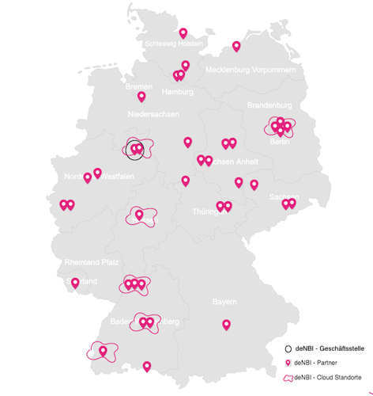
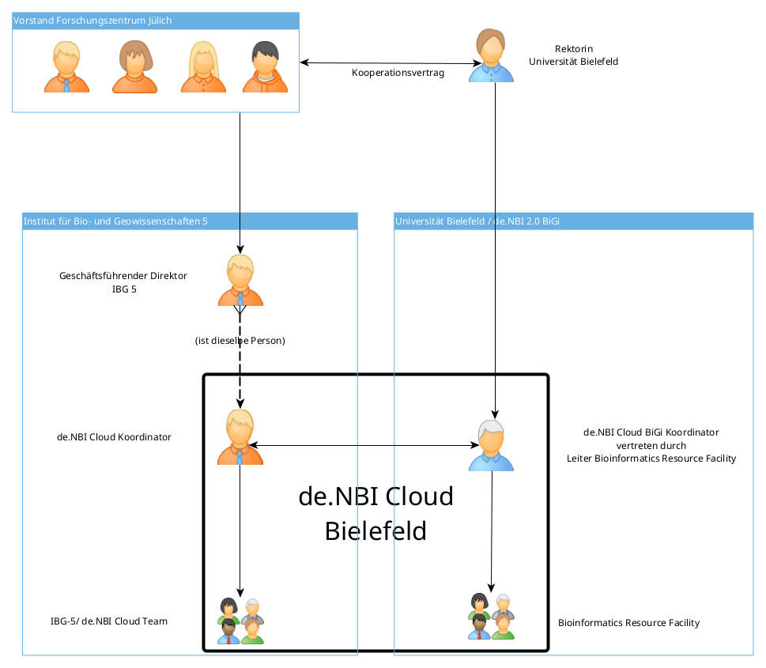
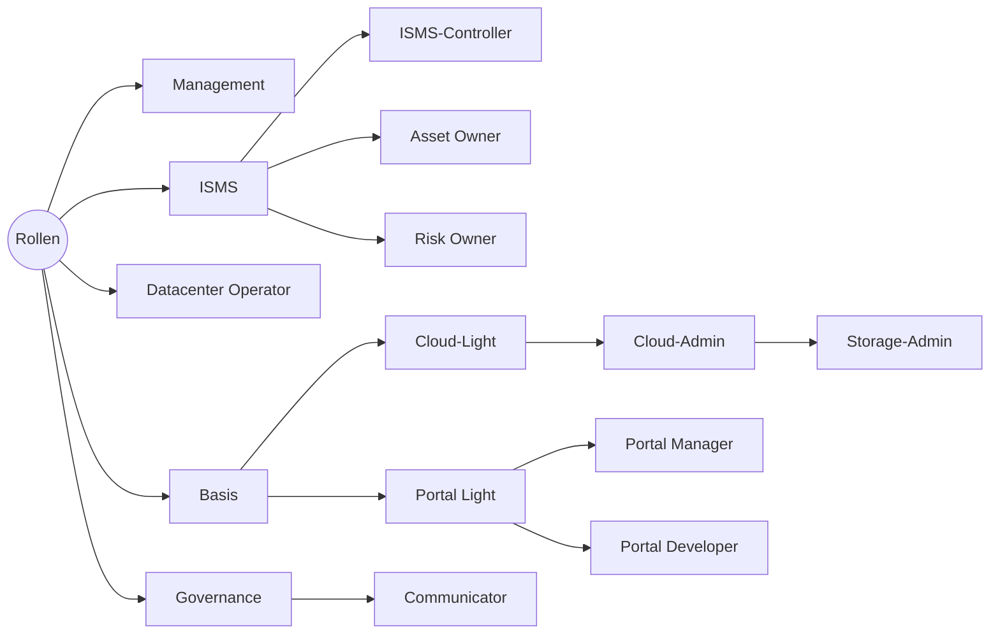

# Organisation

[[_TOC_]]

# Allgemeines

## Systembeschreibung

### de.NBI

Das Deutsche Netzwerk für Bioinformatik-Infrastruktur – de.NBI ist ein nationales
akademisches Netzwerk, welches Serviceleistungen im Bereich Bioinformatik für die
Lebenswissenschaften und Biomedizin anbietet.

Die de.NBI-Partner organisieren Schulungsveranstaltungen, Kurse und Sommerschulen
zu Software-Tools sowie Standards und bieten Rechenkapazität in Form einer Cloud an,
um Forscher dabei zu unterstützen, ihre Daten effektiver zu nutzen.

Siehe [https://www.denbi.de](https://www.denbi.de)

### de.NBI Cloud

de.NBI entwickelt und betreibt seit Ende 2016 ein Verbund-Cloud-System (de.NBI-Cloud)
und stellt Rechen- und Speicherkapazitäten bereit. Die Cloud wird in einem
Kollaborationsprojekt der Universitäten Bielefeld, Freiburg, Gießen, Heidelberg,
Tübingen, DKFZ Heidelberg, EMBL Heidelberg, Uni Heidelberg und der Charité Berlin
bereitgestellt.
Die Infrastruktur ist dabei an jedem Standort unabhängig von den anderen Standorten
aufgestellt. Jeder Standort untersteht organisatorisch immer jeweils der zugehörigen
Universität und agiert daher eigenständig. Die einzigen gemeinschaftlichen Vorgaben,
die Pflichten des Cloud-Anbieters und des Cloud-Kunden, sind hierbei in
den allgemeinen [Nutzungsbestimmungen](richtlinien/Nutzungsbestimmungen_de.NBI_Cloud_V1.2.pdf)
festgehalten.

Siehe [https://www.denbi.de/cloud](https://www.denbi.de/cloud)

### de.NBI Cloud Portal

Das de.NBI Portal, betrieben von der de.NBI Cloud Governance, übernimmt
die koordinierende Funktion erlaubt es potentiellen Nutzern unter Angabe einer Beschreibung der geplanten Art der Nutzung
und der benötigten Resourcen sowie einer Laufzeit, Anträge für einen zeitlich begrenzten Zugang zu Rechen- sowie Speicherkapazitäten
in der de.NBI Cloud zu stellen. Dabei können verschiedene Projekttypen ausgewählt werden, wobei für den Kontext
der de.NBI Cloud Bielefeld die Projekttypen *Openstack* und *SimpleVM* von Relevanz sind.
Nach einer Genehmigung des Cloud-Projekts durch die Cloud Governance, werden Projekte in zweiter Instanz von den
Administratoren und Betreiber der jeweiligen Rechenstandorte begutachtet. 
Nach erfolgreicher Zustimmung auch durch die Betreiber des Standorts findet eine Zuweisung des Cloud-Projekts an
den entsprechenden Cloud-Standort, beispielsweise der de.NBI Cloud Bielefeld statt.

Siehe [https://cloud.denbi.de/](https://cloud.denbi.de/)

### de.NBI Cloud Bielefeld

Die de.NBI Cloud Bielefeld wird als Teil des de.NBI Projekts an der
Universität Bielefeld betrieben und bietet folgende Dienstleistungen an:

- Rechenkapazitäten (Infrastructure-as-a-Service)
- Speicherkapazitäten (u.a. Storage-as-a-Service)

Diese Leistungen sind kostenfrei nutzbar im Rahmen von Forschungsprojekten.
Projektantragsteller sind Lebenswissenschaftler von deutschen Forschungseinrichtungen.

Die de.NBI Cloud macht als Dienstleister keine Zusagen bezüglich der
Güte der erbrachten Leistungen. Die Vergabe von Cloud-Ressourcen
erfolgt nach dem „first come, first served“-Prinzip.
Schadensersatzansprüche bezüglich dieser Leistungen werden beiderseitig
ausgeschlossen. Jegliche Abweichungen vom Regelbetrieb der Cloud werden
bestmöglich, in den definierten Arbeitszeiten des Cloud-Standorts
(i.d.R. werktags, 8-16 Uhr), behoben. Dies beinhaltet jedoch keine
Garantien bezüglich des Datenerhalts oder der Verfügbarkeit der
angebotenen Services.
Siehe auch _§ 2  Verfügbarkeit_ der
[de.NBI-Cloud-Nutzungsbestimmungen](richtlinien/Nutzungsbestimmungen_de.NBI_Cloud_V1.3.pdf).

Der Standort der Daten sowie der Gerichtsstand sind Bielefeld.

### SimpleVM

SimpleVM ist ein in der de.NBI Cloud Bielefeld betriebener Service und zugleich
ein Projekttyp, welcher innerhalb der de.NBI Cloud Bielefeld betrieben wird. 
Dieser Service ist primär darauf ausgelegt, die bereits beschriebenen Dienstleistungen
(Rechen- und Speicherkapazitäten) für Nutzer mit geringer Erfahrung im
Bereich Cloud-Computing zur Verfügung zu stellen und ermöglicht eine schnelle aber sichere 
Konfiguration sowie Nutzung besagter Resourcen.

## Abgrenzung zum Bielefelder IT-Servicezentrum (BITS)

Die Infrastruktur ist im abgeschlossenen Bereich des Center for Biotechnology (CeBiTec)
innerhalb des Bielefelder IT-Servicezentrums (BITS) der Universität Bielefeld
verortet. Das BITS stellt die grundlegende Infrastruktur (Strom, Kühlung, Netzzugang
und  Räumlichkeiten) für die de.NBI Cloud Bielefeld zur Verfügung.
Die Dienstgüte-Zusicherung seitens des BITS erfolgt auf _Best-Effort_-Basis.

## Abgrenzung zur Infrastruktur des Center for Biotechnology (CeBiTec)

Die BioInformatics Resource Facility (BRF) betreibt für das CeBiTec eine
IT-Infrastruktur für die wissenschaftliche Forschung und den Lehrbetrieb.
Grundlegende Dienste wie die Arbeitsumgebung, Jump Host, Maildienste, Cloudspeicher und
die Netze/Netzwerkkonfiguration werden von der de.NBI Cloud zu administrativen Zwecken
in Anspruch genommen. Die Dienstgüte-Zusicherung seitens des CeBiTec erfolgt auf
_Best-Effort_-Basis.

## Erwartungen der Kunden / Hauptanforderungen an die Cloud

### Datensicherheit

Die Kunden der de.NBI Cloud erwarten eine sichere Speicherung ihrer Daten.
Außerdem ist die Verortung der Daten in Deutschland relevant, da so die deutschen
Datenschutzgesetze gelten.
Eine unabhängig zertifizierte hohe Informationssicherheit in allen Bereichen ist die
Basis für tieferes Vertrauen.

### Verfügbarkeit

Die Kunden erwarten eine hohe Verfügbarkeit aller Services, insbesondere während
der üblichen Dienstzeiten des deutschen Forschungssektors.
Sie setzen voraus, den ihnen zugeteilten Ressourcenumfang jederzeit voll
ausschöpfen zu können.
Des Weiteren gehen sie davon aus, dass die de.NBI Cloud langfristig zur Verfügung
steht und nehmen sie als integrale Rechenressource in die Planung
zukünftiger Forschungsprojekte auf. Viele NFDI-Projekte nutzen die Resourcen der
de.NBI Cloud.

### Ausstattung

Die Kunden erwarten moderne Technik mit leistungsfähigen Prozessoren, schnellen
Datentransferraten und performantem, umfangreichem Festspeicher. Mit dem KI-Hype
werden auch verstärkt GPUs nachgefragt.

### Benutzerfreundlichkeit / Support

Die Kunden erwarten eine unkomplizierte Beantragung sowie eine übersichtliche
Oberfläche zur Verwaltung ihrer Ressourcen.
Teils wird auch eine vereinfachte Inanspruchnahme der Ressourcen gewünscht wie sie Beispielsweise
via SimpleVM zur Verfügung gestellt wird.

## Finanzierung

Die de.NBI Cloud Bielefeld war von 2016 bis Ende 2021 Teil des deutschlandweiten,
BMBF-finanzierten Projekts _de.NBI_ und ist ab Januar 2022 innerhalb
der Helmholtz-Gemeinschaft als Teil des Forschungszentrums Jülich verstetigt worden.

Die der Cloud, Governance und Portal/SimpleVM zugeordneten Stellen (6 Stellen) werden
seit dem 1.1.2022 vom Forschungszentrum Jülich finanziert. Weitere personelle Ressourcen 
(Hardware-Support, BRF) werden über die Universität Bielefeld finanziert.

Die Hardware der Cloud wurde bis Dezember 2021 fast ausschließlich aus Mitteln
des BMBF im Rahmen des Projekts _de.NBI_ finanziert.
Zum Betrieb der Cloud wird teils die Infrastruktur der Universität Bielefeld genutzt:
Netzwerkaußenanbindung, Datacenter, Strom und Kühlung.

Ab dem 1.1.2022 ist das Forschungszentrum Jülich für die Beschaffung und Inbetriebnahme
neuer Hardware, sowie für zum Betrieb der Cloud notwendige kostenpflichtige bzw.
lizenzpflichtige Software hauptverantwortlich. Im Etat sind hierfür ca. 1.4 Mio Euro pro Jahr
vorgesehen.  Die Universität Bielefeld bringt über Projekte (z.B. NFDI) weitere Mittel
in die Infrastruktur ein.

# Grundsätzliches

## Grundsätze für den IT-Einsatz

Die Beschaffung, Entwicklung und der Einsatz von IT-Anwendungen (beispielsweise
Software zur Textverarbeitung) und IT-Systemen (beispielsweise Server-
und Speichersysteme oder mobile IT-Geräte) erfolgen nach Maßgabe der am 
Forschungszentrum Jülich geltenden Regelungen. 

Das Forschungszentrum Jülich ist als öffentlicher Auftraggeber an die
Beschaffungsordnung gebunden. Der Einkauf trägt dafür Sorge, dass die gesetzlichen
Rahmenbedingungen eingehalten werden. Siehe
[Ansprechpartner](https://intranet-live.fz-juelich.de/de/organisation/gm/ueberuns/ansprechpartner/ansprechpartner_einkauf_neu/team-infrastruktur)
.

## Gesamtverantwortlichkeit

Die de.NBI Cloud Bielefeld wird gemeinschaftlich vom Forschungszentrum Jülich (FZJ) und der
Universität Bielefeld betrieben, insbesondere von
den beiden Gruppen _de.NBI Cloud Team (ADM und PRT, Forschungszentrum Jülich,
als Teil des _IBG-5_) und _Bioinformatics Resource Facility_
(BRF, Universität Bielefeld).

Der Kooperationsvertrag zwischen der Universität Bielefeld und dem Forschungszentrum Jülich
regelt den Betrieb der de.NBI Cloud Bielefeld. Die Entscheidungsbefugnisse und
Verantwortlichkeiten sind in dem Vertrag wie folgt geregelt:

- Entscheidungen werden nach Möglichkeit gemeinsam getroffen, es sei denn, die Situation erfordert
  eine sofortige Entscheidung (Gefahr in Verzug). In diesem Fall ist der jeweilige Partner für
  die Entscheidungsfindung verantwortlich.
- Die finale Entscheidungsbefugnis, mit Ausnahme bei Gefahr in Verzug, liegt bei der benannten Ansprechperson
  des Forschunsgzentrum Jülich.
- Sollte die benannte Ansprechperson des Forschungszentrum Jülich nicht erreichbar sein, übernimmt
  die benannte Ansprechperson der UNIVERSITÄT die Entscheidungsfindung.
- Alle Entscheidungen und einschlägigen Maßnahmen sind zu dokumentieren.

Die Gruppe BRF ist in erster Linie für die Inbetriebnahme der Hardware und der Netzwerkkonfiguration zuständig.
Die Gruppe ADM ist vorrangig für die Beschaffung, Installation und den Betrieb der Hardware gemäß
ihren Bestimmungen (IaaS), dem Betrieb Cloud-spezifischen Services und dem ISMS zuständig.  
Die Gruppe PRT ist für die Entwicklung und Betrieb des Portal und SimpleVM zuständig. 
Die Zuständigkeiten unter  Rollen/[Zuordnung](#zuordnung) detailliert aufgeführt.

### Personen

#### Universität Bielefeld - de.NBI 2.0

Leitung: Prof. Dr. Jens Stoye dauerhaft vertreten durch **Dr. Stefan Albaum** (`sa`)

##### Bioinformatics Resource Facility (BRF)

- Achim Neumann (`an`)
- Rainer Orth (`ro`)
- Björn Fischer (`bf`)
- Ralf Nolte (`rn`)
- Torsten Kasch (`tk`)
- Volker Tölle (`vt`)

#### Forschungszentrum Jülich - IBG 5 - de.NBI Cloud Team

Leitung: **Prof. Dr. Alexander Sczyrba** (`as`)
Sekretariat: Dunya Fakhro

##### de.NBI Cloud Administration (ADM)

- Alex Walender (`aw`)
- Christian Henke (`ch`)
- Dorian Lehmenkühler (`dl`)
- Jan Krüger (`jk`)
- Viktor Rudko (`vr`)

##### de.NBI Cloud Governance Portal / SimpleVM (PRT)

- David Weinholz (`dw`)
- Dr. Nils Hoffmann (`nh`)
- Peter Belmann (`pb`)
- Viktor Rudko (`vr`)

# Organisation der IT-Sicherheit

## IT-Sicherheitsorganisation

_Die [IT-Sicherheitsleitlinie](informationssicherheitsleitlinie.md) der
de.NBI Cloud Bielefeld regelt verbindlich den Aufbau der
IT-Sicherheitsorganisation._

## Dokumentation von IT-Verfahren

Siehe [it-verfahren.md](it-verfahren.md).

## Rollen

### Management

Die Führungsebene trägt die Verantwortung für das ISMS. Zu ihren Kernaufgaben
gehören die Bereitstellung der dafür notwendigen Ressourcen, die Festlegung der allgemeinen
strategischen Ausrichtung des gesamten Scopes, sowie die definierte Setzung von übergeordneten 
Zielen und Zielen im Bereich der Informationssicherheit.

Die folgenden Rollen stellen sicher das der Betrieb und die Prozesse **sicher** im Sinne der
Informationssicherheit sind.

### ISMS

Die Verantwortung für das ISMS liegt beim zuständigen ISMS-Team. Dieses Team ist
federführend verantwortlich für die Definition der Prozesse, kritischen Assets sowie der
zugehörigen Richtlinien und Governance-Strukturen. Wesentlich ist hierbei die Durchführung
eines umfassenden Asset-basierten Risikomanagements, welches sowohl Compliance als auch
Risk Management umfasst. Zu den Kernaufgaben zählen die Planung und Durchführung regelmäßiger
Audits zur Überprüfung der Wirksamkeit, die Erstellung sämtlicher notwendigen Dokumentationen
sowie das Monitoring mittels definierter Key Performance Indicators (KPIs). Des Weiteren ist
das Team für die Gewährleistung des kontinuierlichen Verbesserungsprozesses durch periodische
Reviews verantwortlich.

| Kompetenz | Maßnamen zum Erwerb |  Frequenz |
| --- | --- | --- |
| I1 - Pflege/Aufbau des ISMS inkl. Asset und Risikomanagement | (interne) Schulungen | jährlich |
| I2 - Interner Auditor 27001 | Schulungen, Interne Audits | alle 3 Jahre |
| I3 - tiefgreifendes Verständnis mindestens einer Norm zur IS |  (interne) Schulungen, Teilnahem an Audits | alle 3 Jahre |

#### ISMS-Controller

Der ISMS Controller fungiert als zentrale Schnittstelle und primärer
Koordinator für das gesamte Managementsystem. Zu seinen Hauptaufgaben gehört die Organisation
und die Dokumentation der Management Review. Er ist verantwortlich für die Strukturierung
dieses wichtigen Governance-Events, einschließlich der Erstellung des entsprechenden
Berichtswesens (Reporting). Darüber hinaus übernimmt dieser Controller die Kommunikation mit
der Zertifizierungsstelle; er koordiniert alle Interaktionen mit externen Prüfern und stellt
sicher, dass die Anforderungen der Norm während Audits transparent und effizient erfüllt werden.

#### Asset Owner

Im Sinne der ISO 27001 hat eine Person in der Rolle des Asset Owners
die Zuständigkeit für einen gegebenen Wert.  Ein Asset Owner ist im Gegensatz zum Risk Owner
oftmals nicht in der Position, ein das Asset betreffendes Risiko zu modifizieren. Die Rolle wird
im [Asset-/Risikomanagement](risikomanagement.md) Individuuen oder Gruppen zugeordnet.

#### Risk Owner

Im Gegensatz zum Asset Owner trägt der Risk Owner das Risiko für
ein Asset. Die Rolle des Risk-Owners muss einer Person zugeordnet werden, die über genügend
Entscheidungsgewalt verfügt, um Maßnahmen auf den Weg zu bringen, die das Risiko für das Asset
verringern.  Die Rolle wird im [Asset-/Risikomanagement](risikomanagement.md) Individuuen oder
Gruppen zugeordnet.

### DataCenter Operator

Der Datacenter Operator ist verantwortlich für die physische InteIgrität
und Verfügbarkeit der Recheninfrastruktur. Die Kernaufgaben umfassen die Installation und
Instandhaltung der Hardware inkl. der selbstbetreuten Netzwerk-Switche. Diese Rolle erfordert
eine enge und kontinuierliche Kommunikation mit dem Rechenzentrum der Universität zur Koordination
von Wartungen, Erweiterungen und Störungen. 

| Kompetenz | Maßnamen zum Erwerb |  Frequenz |
| --- | --- | --- |
| **DC1** - Verständnis von Server Hardware und deren Betrieb, Netzwerk/Firewall | (interne) Schulungen, Tech-Newsticker, Blogs, ... | jährlich |

### Basis

Die Rolle des 'Cloud Basis' Verantwortlichen bildet die technische Grundlage für
den Betrieb des Portal und der Cloud Infrastruktur. Die Kernkompetenzen
liegen auf Cloud Computing Grundlagen, sowie allgemeine Prinzipien des Projektmanagements.

| Kompetenz |  Maßnamen zum Erwerb | Frequenz |
| ---  | --- | --- |
| **B1** - Grundlagen Datenschutz    | Schulung AG (UniBi, FZJ), zusätliche Online Schulung  | alle 3 Jahre |
| **B2** - Grundlagen Informationssicherheit bzw. Informationssicherheitsmanagement | Schulung AG, Montagsbesprechung | regelmässig |
| **B3** - Grundlagen CloudComputing | Online Tutorials (Wiki) bzw. Teilname an Workshops    | einmalig, beim OnBoarding |
| **B4** - Grundlagen Unix/Linux     | Online Tutorials (Wiki) bzw. Teilname an Workshops    | einmalig, beim OnBoarding | 

#### Cloud-Light

Die Cloud-Light Rolle erfordert grundlegende Kenntnisse und Verständnisse aller Betriebsprozesse.
Darüber hinaus sollte ein MA in Cloud-Light Rolle im Notfall in der Lage sein eine
Notfall-Abschaltung durchzuführen, und den Betrieb wiederherzustellen bzw. sichern. 

| Kompetenz |  Maßnamen zum Erwerb | Frequenz |
| ---  | --- | --- |
| **CL1** - [Patchen der Systeme/IT-20](./it-verfahren.md#it-20-patchen-der-systeme) | PB-RUN | jährlich |
| **CL2** - [Backup/IT-18](./it-verfahren.md#it-18-backup)| Einspielen des Backups | jährlich |
| **CL3** - [Business Continuity/IT-17](./it-verfahren.md#it-17-backup) | Begleiten der Desaster-Discovery Übung | alle 3 Jahre |

Darüber kann ein Mitarbeiter in der Rolle für die Validierung im 4-Augen Prozess einpringen, sofern es die
Personalsituation erfordert.

##### Cloud-Admin

Ein Cloud-Admin hat ein tiefgehendes  Verständnis  aller It-Verfahren und ist primär für den
operativen Betrieb, die Wartung und Weiterentwicklung des Virtualisierungsframeworks OpenStack,
der Storage-Infrastruktur Ceph und deren anhängende Services zuständig. Die Verantwortung
erstreckt sich über den gesamten Lebenszyklus – von der  Installation, dem Management bis hin zum
Troubleshooting (auch auf Code-Ebene),  sowie Deployment und Upgrades. Drüber hinaus agiert der Admin
als Ansprechpartner im Bereich des Level 2/3 Supports und übernimmt Schlüsselaufgaben im 
Incident- und Vulnerability Management. 

| Kompetenz | Maßnamen zum Erwerb |  Frequenz |
| --- | --- | --- |
| **C1** - Linux Administration  inkl. OpenStack/Ceph | (interne) Schulungen, Meetings, Tech-Newsticker, Workshops, Hackathons, ... | jährlich |
| **C2** - OpenStack Administration/Development       | Konferenzen (interne) Schulungen, Meetings, Workshops, Hackathons, ...      | jährlich |
| **C3** - Ceph Administration/Development            | (interne) Schulungen, Meetings, Workshops, Hackathons, ...                  | jährlich |

###### Storage-Admin

Der Storage Admin trägt die federführende Verantwortung für das Design, die Konfiguration und
die strategische Weiterentwicklung der auf Ceph aufbauenden Speicherinfrastruktur. Diese Rolle
geht über den reinen Betrieb hinaus und definiert die Architekturrichtlinien für unsere
Speicherinfrastruktur. Das Kernkompetenzfeld ist hierbei das tiefgreifende Expertenwissen
über die Ceph Architecture.

#### Portal-Light

Die Ausübung der Portal-Light Rolle erfordert grundlegende Kenntnisse über den Betrieb des 
Cloud-Portals sowie über SimpleVM. 
Dies umfasst Verständnisse über den Aufbau der beiden genannten Systeme sowie die Fähigkeit
des Durchführung eines Deployments der jeweiligen Komponenten für den Fall der Notwendigkeit,
beispielsweise für das Einspielen von Notfall-Patches oder für das grundlegende Wiederherstellen
bzw. Mithilfe beim Wiederherstellen der Syteme in Fall von Teil- oder Komplettausfällen
(Disaster-Recovery),

| Kompetenz | Maßnamen zum Erwerb | Frequenz |
| --- | --- | --- |
| **PL1** - Grundlagen IT-Automatisierung / Deployment mit Konfigurationsmanagement-Tool Ansible | (interne)  Schulungen, Meetings, Konferenzen, Workshops | jährlich |

##### Portal-Manager

Diese Rolle ist zuständig für das Projektmanagement und das Change Management für die das Cloud Portal
und den SimpleVM Service.
Sie leitet die Projektentwicklung organisatorisch und steuert die Umsetzung.
Die mittel- und langfristige Entwicklungsstrategie erarbeitet diese Rolle federführend
in enger Abstimmung mit dem Management und den Plattform-Entwicklern.
Fundierte Kenntnisse im agilen Arbeiten (z. B. Scrum) sind zwingend erforderlich. 

| Kompetenz | Maßnamen zum Erwerb | Frequenz |
| --- | --- | --- |
| **PM1** - Agiles Softwaremanagement unter Anwendung von Scrum | (interne) Schulungen, Meetings, Konferenzen, Workshops | jährlich |

##### Portal-Developer

Mitarbeitende mit der Rolle Portal/SimpleVM Developer sind verantwortlich für die Entwicklung, 
die Implementierung und den Betrieb des de.NBI Cloud Portals sowie der SimpleVM-Umgebung.
Das Aufgabengebiet umfasst dabei auch die Pflege der
Nutzerdokumentation, den Kundensupport und das Nutzer-Training in Form von Workshops.
Die Architektur und die genutzten Technologien der genannten Platformen erfodern grundlegende
Kenntnisse in der Entwicklung von Backend- sowie Frontend-Komponenten im Webbereich, sowie 
der Orechstrierung von Software-Stacks mithilfe von Containerisierungstechnologien wie etwa Docker. 
Zur Sicherstellung der Qualität werden umfassende Teststrategien entwickelt und umgesetzt. 
Dazu zählen Unit‑, Integrations‑, End‑to‑End‑ und Performance‑Tests,
deren Ausführung und Auswertung automatisiert über CI‑Pipelines (z. B. GitLab CI, GitHub Actions) erfolgt.
Durch kontinuierliches Monitoring, Logging und Alerting
wird der laufende Betrieb gewährleistet und ein effektives Incident‑Management ermöglicht.
Diese Rolle ist als Erweiterung der Portal-Light-Rolle zu vestehen.

| Kompetenz | Maßnamen zum Erwerb | Frequenz |
| --- | --- | --- |
| **PD1** - Softwareentwicklung mit Backend- und Frontend-Webframeworks, Fokus auf Python und Typescript | (interne) Schulungen, Meetings, Konferenzen, Workshops | jährlich |
| **PD2** - Grundlagen Containerisierung | (interne)  Schulungen, Meetings, Konferenzen, Workshops | jährlich |
| **PD3** - Sichere Webentwicklung (Secure Coding, OWASP‑Top‑10, Threat Modeling, Code‑Reviews, SAST/DAST) | Interne und externe Schulungen (z.B. 2‑tägiger „Secure‑Coding‑Workshop“ mit Praxis‑Labs, OWASP‑ASVS‑Zertifikat), Online-Kurse, Workshops | jährlich |

### de.NBI  

Die Rolle 'de.NBI Governance' agiert als zentraler strategischer Prüfpunkt
für alle eingehenden Projektanträge. Die Hauptaufgabe besteht darin, eingehende Projektanträge
einer umfassenden Plausibilitätsprüfung zu unterziehen und gegebenenfalls die benantragten Resourcen
im Dialog zu korrigieren. Genehmigten Projekte werden unter Berücksichtigung der zur Verfügung stehenden
Resourcen am jeweiligen Standort auf die de.NBI Cloud Standorte verteilt. Die Governance agiert als
zentraler Vermittler, der bei spezifischen Ressourcenanfragen geeignete Domänenexperten identifiziert
und zusammenführt.

#### de.NBI Communicator

Der de.NBI Communicator fungiert als Aushängeschild unserer Organisation
im externen Umfeld und ist verantwortlich für die Sichtbarkeit der de.NBI Cloud. Die Hauptaufgaben
umfassen die aktive externe Präsenzpflege, welche durch die Teilnahme an Fachworkshops, Konferenzen
und Messen erfolgt. Darüber hinaus ist diese Rolle ein Ansprechpartner für externe Partnerbeziehungen,
wie beispielsweise Elixir LifeScience AAI. Der Communicator sichert somit nicht nur den Informationsfluss
nach außen, sondern stärkt aktiv die externe Reputation und die Akzeptanz des gesamten Systems
in der wissenschaftlichen Community.

## Zuordnung

| Rolle | Personen |
| ----- | -------- |
| Management | **as**, sa |
| ISMS | ADM, (PRT,BRF) |
| ISMS-Controller | jk |
| Asset Owner | alle, siehe [Risikomanagement](./risikomanagement.md) bzw. [Eramba](./it-verfahren.md#it-14-eramba) |
| Risk Owner  | Managmenent (ADM,PRT,BRF), siehe [Risikomanagement](./risikomanagement.md) bzw. [Eramba](./it-verfahren.md#it-14-eramba) |
| DataCenter Operator | BRF (ADM) |
| Basis | ADM, PRT |
| Cloud-Admin | ADM  |
| Storage-Admin | aw |
| de.NBI Governance | pb, nh |
| de.NBI Communicator | nh |
| Portal Manager | pb, PRT |
| Portal Developer | dw, vr |
| Cloud-Light   | PRT |
| Portal-Light | ADM |

## Kompetenzen

Aus den Rollen und der dafür notwendigen Kompetenzen ergibt sich eine [Kompentenz-Matrix](./aufstellungen/kompetenzmatrix.md) 
der Mitarbeiter.

## Schulungen

Aus der [Kompentenz-Matrix](./aufstellungen/kompetenzmatrix.md) ergibt sich der Schulunbgsbedarf der einzelnen Mitarbeiter.
Im Rahmen des Management-Review müssen fällige Massnahmen festgelegt und dem jeweiligen MA mitgeteilt werden.