# Prozesse

[[_TOC_]]

## Governance und Compliance-Management

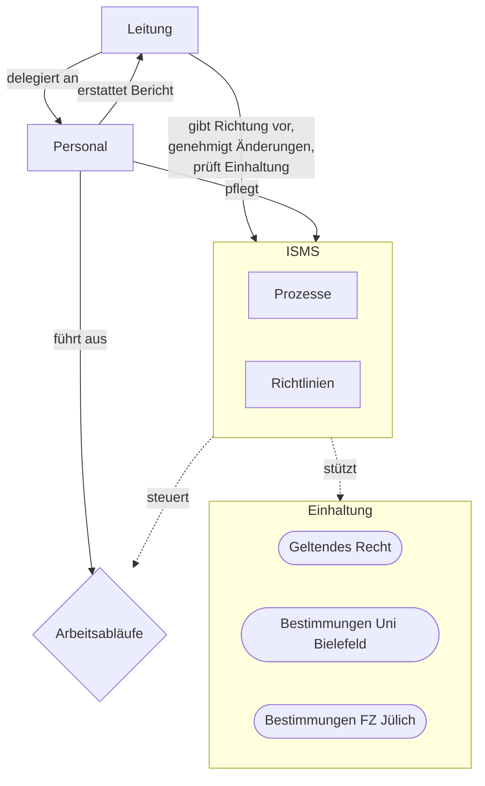

## Risikomanagement

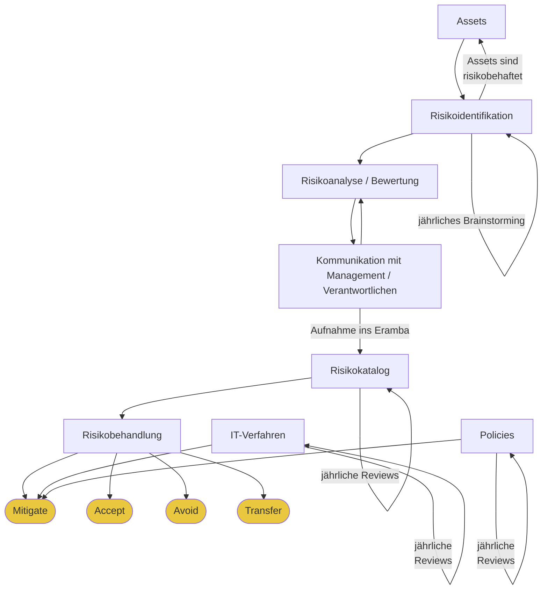

## Schwachstellenmanagement

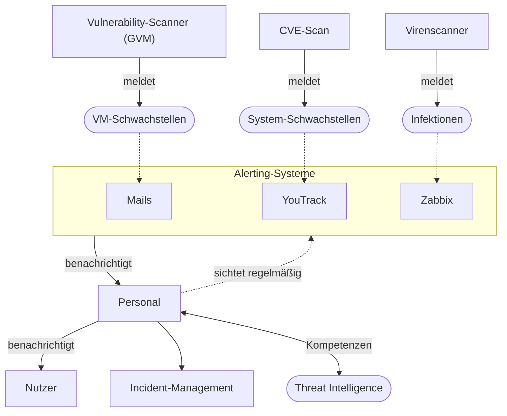

## Sensibilisierung und Kompetenzaufbau

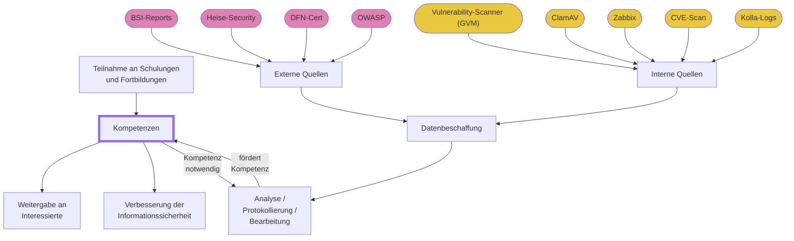

## Incident-Management

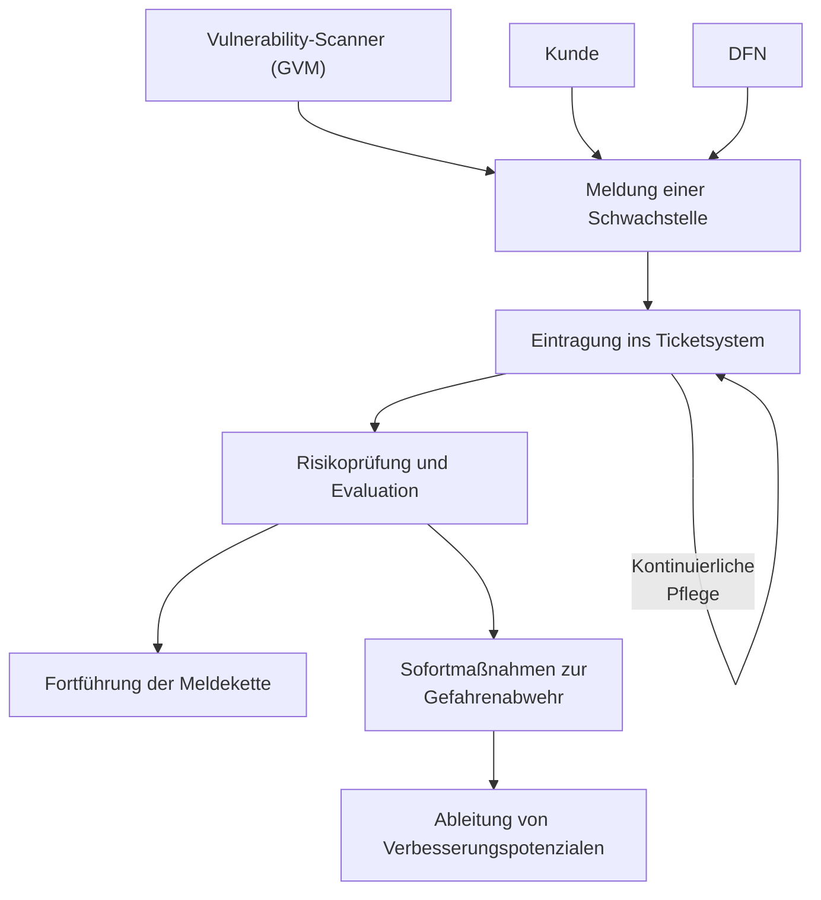

## Business-Continuity-Management

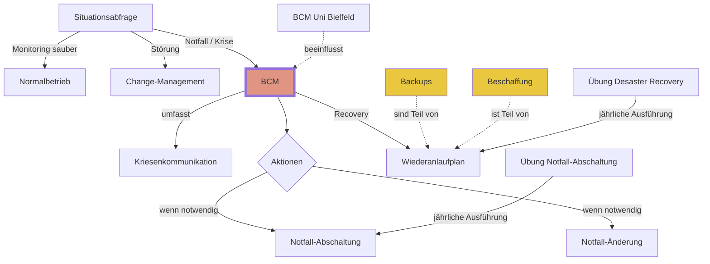

## Change-Management

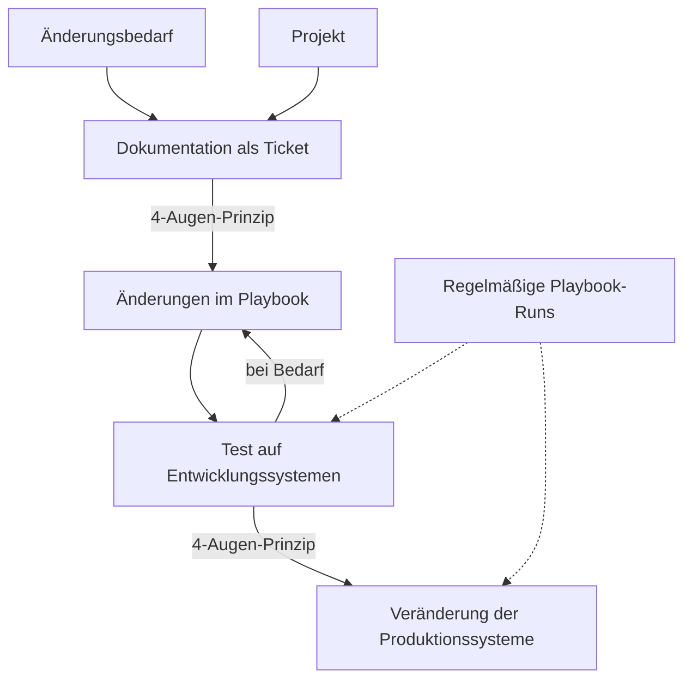

## Projekt-Management

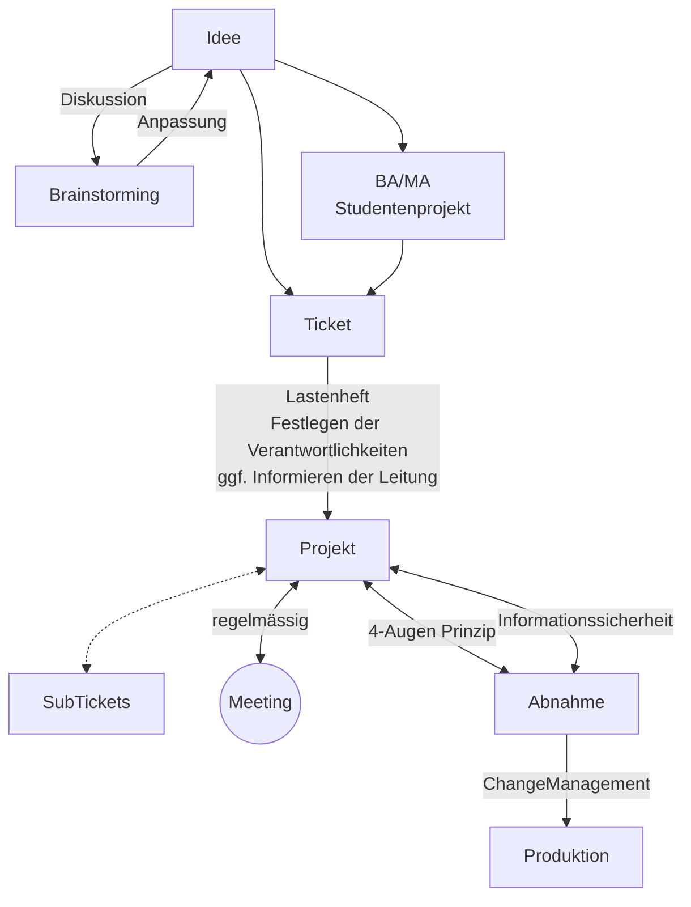

## Nutzerinteraktion

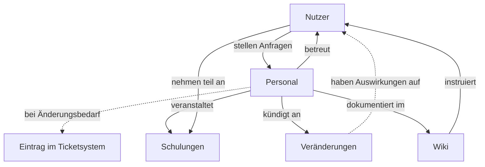

## Technischer Betrieb

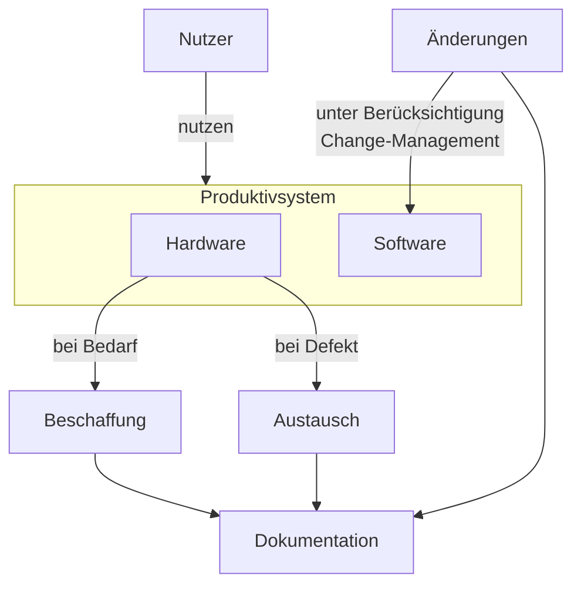

## Wiederkehrende Aufgaben

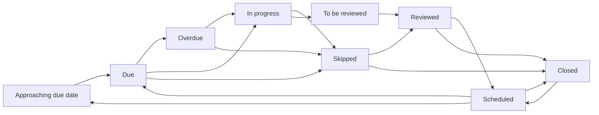
