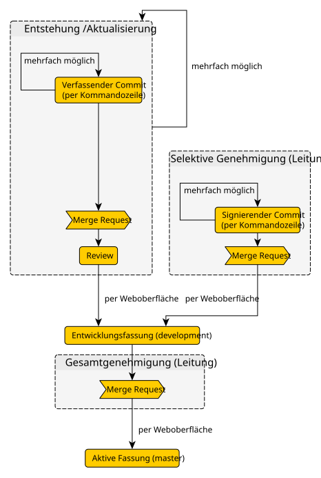

# Regelungen zur Dokumentation

Die Dokumente innerhalb des hier vorliegenden Verzeichnisses bilden
die Vorgabedokumentation. Diese ist zur schnellen Auffindbarkeit
von Informationen als Dokumentenbaum strukturiert und
zwecks Lenkung in ein Versionskontrollsystem integriert (⟶
_Lenkung dokumentierter Informationen_). Alle Dokumente haben ein
Ablaufdatum und müssen in regelmäßigen Abständen auf
Gültigkeit überprüft werden (⟶ 
_Prüfung dokumentierter Informationen_)

Die zudem erforderliche Nachweisdokumentation (z.B. Protokolle,
ausgefüllte Checklisten, Durchführungsbeschreibungen,
Änderungszuordnung) wird durch den Einsatz des
Aufgabenverwaltungssystems _YouTrack_ in Kombination mit
dem Versionskontrollsystem _Git_ erbracht.

## Lenkung dokumentierter Informationen

Änderungen an der Vorgabedokumentation werden stets nach dem
4-Augen-Prinzip durch sog. _Merge Requests_ vorgenommen 
(⟶ _Änderung an der Dokumentation_)

Freigegebene Vorgaben sind für berechtigte
Personen  ausschließlich nach vorheriger Authentifizierung
zugänglich.
Eine Möglichkeit des Zugangs bietet das _GitLab_-Webinterface.
Jeder Mitarbeiter ist hierbei in der Lage, die
Authentizität einer Freigabe durch kryptografische Signaturtests
unabhängig zu prüfen.

Es besteht jederzeit die Möglichkeit, über das
eingesetzte Versionskontrollsystem die vollständige Historie
sowie sämtliche Autoren freigegebener Vorgaben nachzuvollziehen.
Die freigebende Person kann über denselben Mechanismus zudem alle
Unterschiede zur vorigen Freigabeversion einsehen.
Das System dient gleichzeitig als Archivierungssystem.

Ein möglicher Datenverlust wird durch die dezentrale Funktionsweise
erschwert.

Neu genehmigte Dokumente werden innerhalb des jeweiligen
Mitarbeiterkreises bekannt gemacht und verteilt (⟶ Gültigkeit
der Dokumentation).

## Änderung der Dokumentation

Änderungen an der Dokumentation dürfen nur von berechtigten Personen 
durchgeführt werden. Da das ISMS im GitLab der Universität Bielefeld
gehostet wird, wird hierfür das Berechtigungssystem von GitLab 
genutzt (⟶ [IT-11](it-verfahren.md#it-114-gitlab-accounts)).

Die untenstehende Abbildung zum Dokumentationsprozess definiert den technischen
Ablauf innerhalb der Git-basierten Dokumentenverwaltung
zur Erstellung bzw. Genehmigung von Dokumentation.
Der Vorgang der selektiven Genehmigung betrifft hier einzelne Dokumente bzw.
Richtlinien während die Gesamtgenehmigung den gesamten aktuellen Dokumentenstand umfasst. 

### Erstellung dokumentierter Informationen

Jeder Erstellung oder Änderung geht eine Aufgabe (Ticket) 
im Aufgabenmanagementsystem (aktuell YouTrack) voraus.
Die Aufgabe sollte neben einer zugewiesenen verantwortlichen Person auch
eine vollständige und eindeutige Beschreibung der Aufgabe enthalten. Ideen
und externes Material sollten genauso Bestandteil der Aufgabenbeschreibung 
sein wie auch mögliche Diskussionen zur Aufgabe.

Der Aufgabenbeschreibung folgt die Erstellung eines neuen Zweigs (Branch) im 
Git des ISMS (in der Regel auf der Basis des letzten Entwicklungszweigs). Der 
Name sollte auf die Aufgabe hinweisen. (Beispiel: _CER-79/ISMS-Prozesse_). 
Hinweis: Auch kleine Änderungen dürfen niemals direkt in den Entwicklungszweig
geschrieben werden, sondern bedürfen immer der Zustimmung mindestens einer 
weiteren berechtigten Person (Freigabe nach dem 4-Augen-Prinzip).

Commits in den Branch müssen so dokumentiert werden, daß der Reviewer des 
Merge-Requests einfach nachvollziehen kann, worauf sich der Commit bezieht 
(Beispiel: _CER-79: initiale Struktur_ ).

Eine abgeschlossene Aufgabe wird durch einen Merge-Request vom Bearbeiter
an mindestens eine weitere berechtigte Person in den Entwicklungszweig des 
ISMS übertragen (Freigabe nach dem 4-Augen-Prinzip).

### Gültigkeit der Dokumentation

Änderungen am ISMS werden dann gültig, wenn die Änderungen der Entwicklungsfassung
(Development Branch) in die aktive Fassung (Master Branch) mittels eines Merge-Requests
durch eine berechtigte Person (Leitung) bestätigt und somit genehmigt werden.
Die Leitung ist angehalten, dem Bearbeiter bzw. der mit der Sichtung betrauten
Person (Reviewer) eine Rückmeldung zu genehmigten oder abgelehnten Merge-Requests zu geben.

Die Mitarbeiter der de.NBI Cloud Bielefeld betreffende Änderungen (zum Beispiel 
Arbeitsanweisungen, Richtlinien, ö.ä.) sind den betroffenen Personen unverzüglich 
mitzuteilen.

## Prüfung dokumentierter Informationen

Die Prüfung der Dokumente des ISMS erfolgt mit Hilfe der 
[Audit-Funktionalität von Eramba](aufstellungen/audits.md#interne-audits).
Die Dokumente des ISMS werden in regelmäßigen Abständen auf ihre Gültigkeit 
hin überprüft und sind mit einem Review-Datum versehen. Das Review-Datum 
richtet sich dabei nach der Art der hinterlegten Informationen.

Unabhängig von festgelegten Gültigkeitszeiträumen gilt: Wenn Informationen
bekannt werden, die Änderungen an der Dokumentation zur Folge haben bzw. 
notwendig machen (zum Beispiel bei Gesetzesänderungen oder Richtlinien), 
dann muss die Anpassung der Dokumente zeitnah erfolgen.

## Bewertung des Informationssicherheitsmanagementsystems

Das Informationssicherheitsmanagementsystem **muss** durch die 
Leitung als _wiederkehrende Aufgabe_ im YouTrack regelmässig (mindestens halbjährlich)
bewertet werden. Hierbei wird insbesondere betrachtet:

- Grad der Verankerung in der Organisation
- Fortschritt zur Erreichung der Ziele
- Reaktionsfähigkeit auf Störungen und Vorfälle
- Aktualität der Verantwortlichkeiten

Siehe auch [Managementbewertungen](managementbewertungen/managementbewertungen.md).
