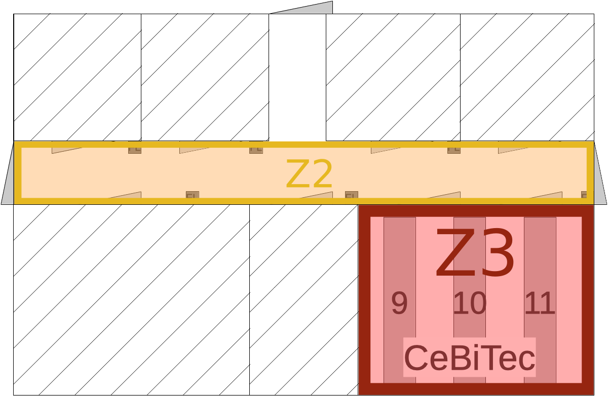
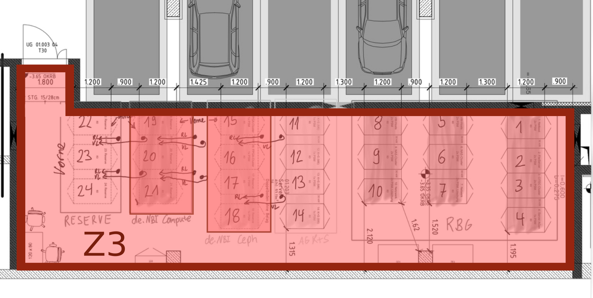

# Zugangssteuerungsrichtlinie

|                 |                                             |
|-----------------|---------------------------------------------|
| Version:        | 1.3                                         |
| Version vom:    | 11.06.2026                                  |
| Erstellt durch: | Jan Krüger, Christian Henke                 |
| Genehmigt am:   | 29.06.2026 (sa), 30.06.2026 (as)            |
| durch:          | Stefan Albaum (sa), Alexander Sczyrba (as)  |

## ChangeLog

- Version 1.3 vom 11.06.2026: Zonenkategorien, Zugangsarten/-erteilung präzisiert
- Version 1.2 vom 08.01.2024: Anpassung an die ISO 27001:2022 und Typos 
- Version 1.1 vom 03.06.2022: Physische Sicherheitsperimeter (Zonenkonzept)
- Version 1.0 vom 01.04.2021
- DRAFT vom 24.03.2021: initialer Entwurf

## Zweck, Anwendungsbereich und Anwender

Der Zweck dieser Richtlinie ist die Zugangsregelung
zu verschiedenen Systemen, Gerätschaften, Einrichtungen und Informationen auf 
Basis der an den jeweiligen Zugang gestellten Sicherheitsanforderungen.

Die Richtlinie gilt für den gesamten Anwendungsbereich des ISMS,
d.h. für alle Systeme, Gerätschaften, Einrichtungen und 
Informationen, die in diesem Rahmen genutzt werden.

Anwender der Richtlinie sind alle Mitarbeiter.

## Referenzen

- ISO 27001/27002 Abschnitt 5.15 Zugangssteuerung 
- [Informationssicherheitsleitlinie](UniBi/2019-06-14_Informationssicherheitsleitlinie_Universitat_Bielefeld.pdf)
- [Informationsübertragung](Informationsuebertragung.md)
- [Klassifikation und Kennzeichnung von Informationen](Klassifizierung_Kennzeichnung_von_Informationen.md)
- [IT-Sicherheitsrichtlinie für Datacenter](../richtlinien/UniBi/IT-Sicherheitsrichtlinie_Datacenter.pdf)

## Zugangssteuerung

Die aktuellen Zugänge werden in einer [separaten Aufstellung](../aufstellungen/zugaenge.md) gepflegt.

Die Zugangssteuerungsrichtlinie folgt grundsätzlich den beiden Prinzipien:

**Kenntnis nur, wenn nötig:** Man erhält nur Zugang zu Informationen, die zur 
Ausführung der eigenen Aufgaben benötigt werden (unterschiedliche Aufgaben/Funktionen 
bedeuten unterschiedliche Berechtigungen und damit ein unterschiedliches Zugangsprofil).

**Nutzung nur, wenn nötig:** Man erhält nur Zugang zu den Einrichtungen zur 
Informationsverarbeitung (IT-Ausrüstung, Anwendungen, Verfahren, Räume), die zur 
Ausführung der eigenen Aufgaben, Tätigkeiten oder Funktionen benötigt werden.

## Zugangsarten, -verfahren und Überprüfung

Der Zugang zu Systemen wird basierend auf dem Nutzerstatus (Mitarbeiter oder Kunde) 
und dem jeweiligen Zugriffsszenario geregelt. Die Vergabe, Überwachung und Entziehung 
von Berechtigungen erfolgen wie folgt:

1. **Mitarbeiterzugänge**
  Zugangsberechtigungen für Mitarbeiter der de.NBI Cloud Bielefeld werden im Rahmen des 
  On-/Offboarding-Prozesses vergeben und sind abhängig von der zugehörigen Gruppe 
  innerhalb der Cloud. Die finale Genehmigung liegt beim jeweiligen Management. Ändert
  sich der Status eines Mitarbeiters zum Beispiel durch Kündigung, Ruhestand 
  oder Versetzung so muss der Zugang zu den Systemen entfernt oder entsprechend angepasst
  werden.  Die Überwachung der Aktualität und Pflege der Zugänge erfolgt durch ein wiederkehrendes 
  Ticket in YouTrack, dessen Assignee gleichzeitig die verantwortliche Person für die 
  Zugangskontrolle ist.

2. **Kundenzugänge**
  Kunden erhalten Zugriff über einen Projektantrag im zentralen Portal. Die Berechtigungen
  sind direkt an das jeweilige Projekt gebunden. Die de.NBI Governance steuert den Lebenszyklus
  dieser Projekte, von der Initiierung bis zur Beendigung. Mit Ende der Laufzeit eines
  Cloud-Projekts und der propagierten Bestätigung von der de.NBI-Geschäftsstelle muß das
  Projekt (inklusive aller noch aktiven Ressourcen) sowie ggf. die dazugehörigen Nutzer
  gelöscht werden.

## Sicherheitsanforderungen

Der Zugang auf die Cloud-Infrastruktur darf ausschließlich über das CeBiTec 
mittels eines nicht privilegierten Nutzeraccounts mit festgelegten Rollen über
einen Jump Host erfolgen. Auf der Cloud-Infrastruktur dürfen zur eindeutigen
Zuordnung von Tätigkeiten nur personalisierte, privilegierte Accounts genutzt
werden. 

Der Zugriff auf die Cloud-Services (IaaS, SimpleVM, ...) muss über das Nutzermanagement
der Cloud erfolgen.
Die von der de.NBI-Geschäftsstelle propagierten Cloud-Projekte und -Nutzer sollten
automatisiert angelegt werden. Alle automatisiert angelegten Nutzer sollten 
Standard-Nutzer ohne erweiterte Rechte sein. Privilegierte Accounts müssen, bis 
auf lokale Service- oder Notfall-Nutzer, immer personengebunden sein.

Die Richtlinie zur Informationsübertragung bzw. zur Kennzeichnung und Klassifikation
von Informationen ist zu berücksichtigen und anzuwenden.

Das Managementnetz der Cloud-Infrastruktur muss vom Netz der virtuellen Maschinen 
und dem API-Zugang logisch oder physikalisch getrennt sein.

Der Zugang bzw. der physikalische Zugriff auf die Hardware-Infrastruktur im 
Datacenter ist durch die _IT-Sicherheitsrichtlinie für Datacenter_ geregelt.
Der Mitarbeiterstatus in ADM bzw. BRF berechtigt zum Zutritt der internen Bereiche
der Zonenkategorien `Z2`.
Es sind die untenstehenden physischen Sicherheitsperimeter zu beachten.

## Physische Sicherheitsperimeter

### Zonenkategorien

- **`Z1` - Öffentlicher Bereich**
- **`Z2` - Interne Bereiche**
  - Abschließbar, ggf. mit Logging
- **`Z3` - Besonders schützenswerte Räume**
  - Zugang nur für stark eingeschränkten Personenkreis
  - Abschließbar, mit Logging
  - Videoüberwachung
  - Brandmeldeanlage
  - Löschanlage

### Zonen

#### Datacenter UHG (V0-200)

Für das Datacenter UHG V0-200 gilt die Zonenkategorie `Z2`. Für die dortige Zelle der de.NBI Cloud gilt
die Zonenkategorie `Z3`.

#### Datacenter CITEC (01.203)

Für das Datacenter in CITEC 01.203 gilt die Zonenkategorie `Z3`.

#### Datacenter W01-178

Für den Raum W01-178 gilt die Zonenkategorie `Z3`.

#### Büroraum N7-101

Für den Büroraum N7-101 gilt die Zonenkategorie `Z2`.

**Die Vorgesetzten haben die Einhaltung der Richtlinie sicherzustellen
und weisen die Mitarbeiter ggf. auf Defizite hin.**
