# Asset und Risikomanagement &ndash; de.NBI Cloud Bielefeld

[[_TOC_]]

| |                                                                           |
|-----|-----------------------------------------------------------------------|
| Version:           | 2.1                                                    |
| Datum der Version: | 25.06.2026                                             |
| Erstellt durch:    | Alex Walender                                          |
| Genehmigt am:      | 29.06.2026 (sa), 30.06.2026 (as)                       |
| durch:             | Stefan Albaum (sa), Alexander Sczyrba (as)             |

---

## Changelog

- 2.1 vom 25.06.2026: Abschnitt "Risikoentfernung" hinzugefügt
- 2.0 vom 24.03.2025: Nähere Erläuterung zu Assets und deren Flows, allgemeine Überarbeitung.
- 1.1 vom 07.03.2024: Verweis auf Risikoinventur FZJ
- 1.0 vom 07.03.2024: Neuer Umgang mit Restrisiken und Vorgehen in Eramba
- 0.3 vom 28.05.2021: Definition und Umgang mit Restrisiken, neue Grafik
- 0.2 vom 24.04.2021: Initial

## Einführung

Dieses Dokument beschreibt den Prozess des Asset- und Risikomanagements der de.NBI Cloud Bielefeld
nach [ISO27001](richtlinien/ISO/ISO_27001_2023-04_german_english.pdf).
Es definiert den allgemeinen Prozess 
und bietet einen Leitfaden zum Einsatz der Software [Eramba](https://www.eramba.org/).

Eramba ist ein Werkzeug zur Umsetzung von diversen
"Governance und Compliance"-Standards.
Wesentliches Merkmal von Eramba ist die Möglichkeit, Werte (Assets) zu bestimmen
und Risiken zu erfassen und zu analysieren.
Ebenfalls unterstützt das Werkzeug den Verbesserungsprozess des Risikomanagements durch
diverse Automatismen, wie beispielsweise das Benachrichtigen über anstehende Reviews.

## Eramba als Managementsystem

Die Risikomanagementsoftware Eramba ist zugänglich für die Mitarbeiter von ADM und BRF.
Entsprechende Zugänge sind bei einem Verantwortlichen des Systems
anzufordern (siehe [RASCI-Matrix](organisation.md#rasci-matrix-der-aufgabenverteilung-und-verantwortlichkeiten)).

Das System ist ausschließlich aus dem Flächen-LAN der Uni Bielefeld zugänglich über die Adresse
<https://risks.bi.denbi.de>.

### Technische Details und Aufbau von Eramba

Siehe [IT-Verfahren](it-verfahren.md) IT-14 Eramba.

## Festlegung des Kontexts

Der Kontext des Risikomanagements bezieht sich komplett auf den Geltungsbereich
des ISMS.

### Rollen und Verantwortlichkeit

Die Rollen und die dazugehörigen Verantwortlichen werden im ISMS festgelegt.
Siehe [Organisation](organisation.md).

## Asset-Management

In der ISO 27001 bezieht sich der Begriff "Assets" auf alle Ressourcen, die für eine
Organisation von Wert sind und geschützt werden müssen. Dies umfasst physische Ressourcen
wie Gebäude, Geräte und Hardware, aber auch digitale Ressourcen wie Daten, Software, 
Netzwerke, Informationen und Prozesse.

Das Asset-Management ist hierbei nicht zu verwechseln mit der
[Inventar-Datenbank](it-verfahren.md#it-3-ikt-produkte-hardware).

Es wird zwischen primären und sekundären Werten unterschieden:

- **Primäre Assets** sind grundlegende Geschäftsprozesse, sowie
  daraus ableitend Informationen mit einem erhöhten Schutzbedarf.
- **Sekundäre Assets** sind all die Entitäten, die für die Existenz und 
  Aufrechterhaltung der primären Assets notwendig sind. Das sind beispielsweise 
  Hardware, Software oder Personal.
  
Für jedes identifizierte Asset werden entsprechend Eigner 
(in Eramba **Guardian**) festgelegt.

Assets werden in einem regelmäßigen Zyklus reviewed. Hierbei wird überprüft, ob die
Informationen noch ihre Gültigkeit haben. Die Daten werden darauf hin korrigiert
(siehe [Review von Items](#review-von-items-in-eramba)).

Sämtliche Werte werden in Eramba unter den Menüpunkt `Asset Identification` festgehalten.
Hierbei lassen sich neue Werte mithilfe des Actions-Menüs erstellen.

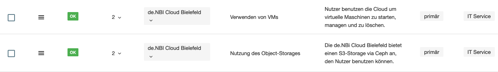

Die folgenden Punkte sind bei der Eintragung von Assets in Eramba zu beachten:

- `Related Business Unit` ist die de.NBI Cloud Bielefeld.
- Dem Wert muss ein aussagekräftiger Name gegeben werden.
- Das `Label` wird als `primär` oder `sekundär` angegeben.
- Mittels `Typ` wird der Wert in eine grobe Kategorie eingeordnet (Siehe Asset-Quellen).
- Der `Owner` ist die oberste Leitung.
- Der `Guardian` ist der Verantwortliche des Assets.
- Bei `Related Assets` werden Verknüpfungen zwischen Assets erstellt.
- Das Review-Datum ist Anfang des kommenden Jahres.
- Im Tab "Zusätzliche Informationen" werden weitere Felder ausgefüllt.
  - "Speicherort" wo sich das Asset im Informationsgehalt finden lässt (falls anwendbar)
  - "Zabbix Gruppe / Host" falls es sich bei dem Asset um Hardware handelt
  - "Weiterführende Dokumentation" beinhaltet einen Verweis ins ISMS.
  - "Zulässiger Gebrauch"

Eine typische Auflistung von Bedrohungen und Schwachstellen lassen sich in
Eramba unter `Asset Based Risk Management` finden.
Die dortigen Einstellungen lassen sich finden unter `Settings` -> `Vulnerabilities/Threats`.

### Asset-Quellen

Assets haben stets eine Typ-Definition:

- **Geschäftsprozess**: Assets, welche einen grundlegenden Prozess definieren.
  Beispielsweise "das Anbieten von Compute und Storage-Ressourcen"
- **IT-Service**: Ansammlung von Werkzeugen und Schnittstellen.
- **Software**: Einzelne und atomare Software-Komponenten.
- **Hardware**: Physische Komponenten, wie beispielsweise Server.
- **Network**: Jeweils physische und virtuelle Komponenten bezüglich der Netzwerk-Schicht.
- **Data-Asset**: Die eigentlichen Informationen im Kontext. Diese beinhalten eine weitere
  Funktion (siehe Data-Flows).

### Data-Flows

Ist ein Asset vom Typ "Data-Asset", so müssen dafür **Data-Flows** angelegt werden
(`Asset-Management` -> `Data-Flows`).

Data-Flows beschreiben, **wie** Daten in einer Organisation fließen können.
Die Daten können hierbei mehrere Stufen (nachfolgend Stage genannt) haben.
Die Stages beschreiben hierbei folgende Zustände, welche für jedes Data-Asset definiert
werden müssen:

- **Collected**: Wie werden die Informationen erzeugt oder gesammelt?
- **Stored**: Wo sind die Informationen gespeichert?
- **Modified**: An welcher Stelle können Informationen modifiziert werden?
- **Transit**: Wie können Informationen in andere Bereiche fließen?
- **Deleted**: Wann werden Informationen gelöscht?

Für jede definierte Stage können mehrere Beziehungen zu Richtlinien,
IT-Verfahren und auch Risiken definiert werden.
Beispielsweise gibt es Zusammenhänge zwischen Datensicherungs-Richtlinien
und abgespeicherten Backups in der **Stored**-Stage.

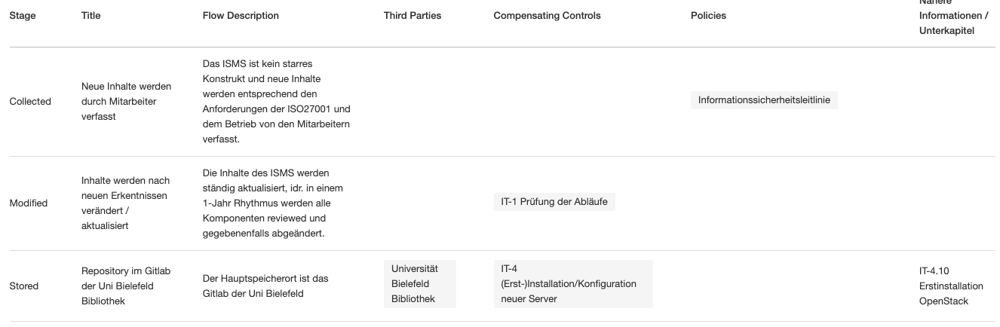

In einigen Stages kann es Schnittstellen und
Wechselwirkungen zu Lieferanten geben, diese
werden in Eramba als "Third-Parties" definiert.

Einzelne Berichte zu Data-Flows lassen sich in einem Menüpunkt
erzeugen:

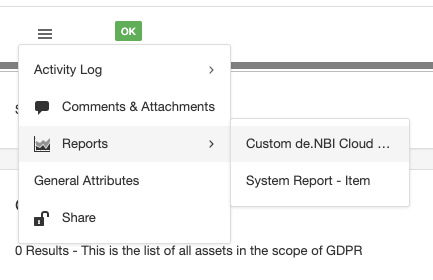
  
Sämtliche Data-Flows werden ebenfalls jährlich reviewed.

## Risiko-Assessment

Das Risiko-Assessment befasst sich mit folgenden Kerndisziplinen:

- Risikoidentifikation
- Risikoanalyse und -bewertung
- Risikobehandlung

Ein jährliches Review (am Anfang eines Jahres) beinhaltet auch ein erneutes Risiko-Assessment.
Ebenfalls erfordern erhebliche Veränderungen des Systems 
oder das Hinzufügen / Entfernen von Werten ein zusätzliches Risiko-Assessment.

### Risikoidentifikation

Für jedes definierte **Asset** sind Risiken
zu identifizieren und zu dokumentieren. Die Beschreibung des Risikos sollte dabei in
einer Ausführlichkeit erfolgen, sodass Dritte mit Sachverstand eine eindeutige Vorstellung
der Inhalte dieses Risikos haben können.

Die Eigner sind hierbei mit der
[RASCI-Matrix](organisation.md#rasci-matrix-der-aufgabenverteilung-und-verantwortlichkeiten)
und den dort gelisteten 
Verantwortlichen abzustimmen. Beispielsweise sollte bei Risiken bezüglich der
Storage-Lösung auch derjenige der Eigner sein, dessen Aufgabenbereich in der 
Storage-Lösung behaftet ist.

Die Risikoidentifikation für die de.NBI Cloud Bielefeld wird mithilfe
von Brainstorming-Sessions, sowie mit Informationen von vergangenen
(Risiko-)Vorfällen erstellt. Die Inhalte werden intern in YouTrack 
in einem [REDO-Ticket](https://yt.bi.denbi.de/issue/REDO-26/Risiko-Brainstormung-und-Neubetrachtung-aller-klassifizierter-Informationen) 
festgehalten.

Hierbei werden vergangene Incidents oder andere Problemsituationen des vergangenen Jahres
mit einbezogen und entsprechende Risiken analysiert und verfasst.

Die gesammelten Ideen für eine Erweiterung bzw. eine Verbesserung
des Risikomanagementsystems werden hierbei durch die Gruppe `ADM` jährlich erfasst
und in Eramba eingetragen. Neue Einträge im Risikomanagementsystem
werden im Managementreview diskutiert.

### Risikoanalyse und Bewertung

Risiken, die im vorherigen Schritt identifiziert wurden, werden nun einer Analyse unterzogen.
Dabei wird für das vorgegebene Risikoszenario die **Auswirkung** und 
**Eintrittswahrscheinlichkeit** bestimmt.

Die Auswirkung und die Eintrittswahrscheinlichkeit werden hierbei in Stufen eingeschätzt.
Diese sind in den nachfolgenden Tabellen aufgeführt. Zur besseren Einstufung sind
Umschreibungen erstellt worden, die mehrere Aspekte aufführen, sodass diese Tabelle
für die Bewertung von Risiken bezüglich primären als auch für sekundäre Assets
genutzt werden kann. Sind mehrere Umschreibungen für eine Stufe vorhanden, so
zählt immer die treffende aus einer Stufe.

Für die **Auswirkung** gilt:

| Wert | Name | Beschreibung |
|------|------|--------------|
| 4 | Sehr Hoch | **Verfügbarkeit:** Viele/Alle Nutzer können für einen langen Zeitraum keine Services nutzen (≥ 2 Wochen). **Ansehen:** Das Ansehen der de.NBI Cloud Bielefeld ist auf längere Zeit ruiniert, da die Mehrzahl der Kunden kein Vertrauen mehr hat. |
| 3 | Hoch | **Verfügbarkeit:** Wenige Nutzer können für einen längeren Zeitraum die Services nicht nutzen (< 2 Wochen). **Ansehen:** Das Ansehen der de.NBI Cloud Bielefeld wird kurzfristig schlechter, da einige Aspekte nicht zufriedenstellend für mehrere Kunden waren. |
| 2 | Mittel | **Verfügbarkeit:** Wenige Nutzer können für einen kurzen Zeitraum die Services nicht nutzen (≥ 1 Stunde). **Ansehen:** Es wird schlecht über die de.NBI Cloud Bielefeld gesprochen, da wenige Nutzer unzufrieden sind.  |
| 1 | Gering | **Verfügbarkeit:** Kurze Unterbrechungen, welche die Nutzung der Services nicht (wesentlich) beeinträchtigen. **Ansehen:** Wenige Nutzer sind mit einigen Leistungen nicht zufrieden. |

*Anmerkung*: Die Auswirkung beinhaltet bewusst keine finanziellen Metriken, 
da die de.NBI Cloud Bielefeld keine finanziellen Ziele verfolgt bzw. verfolgen
kann.

Für die **Eintrittswahrscheinlichkeit** gilt:

| Wert | Name | Beschreibung |
|------|------|---------------|
| 4    | Oft  | Mehrmals im Quartal |
| 3    | Häufig | Mehrmals im Jahr |
| 2    | Wahrscheinlich | Einmal im Jahr |
| 1    | Unwahrscheinlich | Seltener als einmal im Jahr / Noch nie beobachtet |

Diese beiden Werte der Komponenten werden miteinander multipliziert und ergeben
dadurch pro Risiko eine Risikokennzahl.

Nachdem die Risiken mit Auswirkung und Eintrittswahrscheinlichkeit bewertet wurden,
werden diese in farblich gekennzeichnete Klassen unterteilt:

- Grün (Pauschal Akzeptiert)
- Gelb (Moderates Risiko)
- Rot (Hohes Risiko)

Die Matrix zeigt an, wie die Kombination von Auswirkung und Eintrittswahrscheinlichkeit
in den Klassen eingeteilt werden:

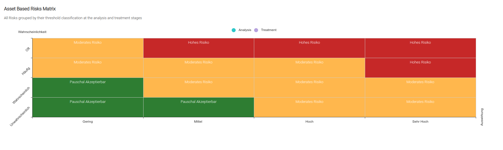

Aus der Klassifikation der Risiken ist folgende Vorgehensweise anzuwenden:

| Risikoklasse | Vorgehensweise |
|--------------|----------------|
| Grün        | In dieser Risikoklasse sind die Risiken pauschal akzeptiert. Eine Begründung, sowie weitere risiko-reduzierende Maßnahmen sind nicht notwendig.|
| Gelb        | Für Risiken dieser Klasse muss eine Maßnahme ergriffen werden. Kann keine Maßnahme ergriffen werden, so muss diese Entscheidung vom Risikoeigner begründet sein. |
| Rot         | Für diese Risikoklasse muss eine Maßnahme ergriffen werden, die das Risiko reduziert. Sämtliche Risiken dieser Klasse müssen der oberen Leitung in einem Bericht mitgeteilt werden. Falls dieses Risiko nicht mitigiert werden kann, so muss dies ebenfalls begründet werden. |

Dieser Prozess lässt sich unter dem Menüpunkt `Asset Based Risk Management` festlegen.
Unter diesem Menüpunkt befindet sich eine komplette Auflistung an erfassten Risiken
mitsamt ihrer Risikoabschätzung.

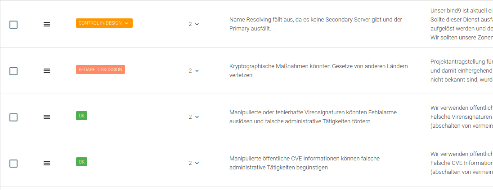

Bei der Erstellung einer Risikoabschätzung in Eramba müssen folgende Punkte beachtet werden:

- Dem neuen Risiko muss ein kurzer und treffender `Titel` gegeben werden.
- Unter `Description` sollte kurz dargestellt werden, warum dieses Risiko relevant ist.
- Als `Risk Guardian` muss der zugehörige Risikoeigner definiert werden.
- `Risk Originator` bezeichnet der Träger des Risikos.
- Als Review-Datum wird ein beliebiger Freitag in der Zukunft eingetragen.
  - Hierbei sollten die Review-Daten möglichst auf das ganze Jahr verteilt werden.
- In `Applicable Assets` müssen alle Assets verknüpft werden, die mit dem Risiko zusammenhängen.
- `Threat Tags` müssen passend zur Bedrohung ausgewählt werden und sollten durch eine kurze 
  Beschreibung in `Threat Description` erklärt werden.
- `Vulnerabilities Tags` und `Vulnerabilities Description` müssen ähnlich zu den 
  Bedrohungen ausgefüllt werden.
- Mit dem Unterpunkt `Treatments` müssen entsprechende Risikobehandlungen verknüpft werden (siehe Risikobehandlung).
- Ein zusätzliches Tag mit dem Namen `Bedarf Diskussion` wird gesetzt.

## Risikobehandlung

Sind Risiken identifiziert worden,
so müssen diese entsprechend behandelt werden.
Folgende Tabelle erläutert sämtliche Methoden der Risikobehandlung
sowie deren Beschreibung:

| Risikobehandlung | in Eramba | Beschreibung |
|------------------|-----------|--------------|
| Abgeschwächt | Mitigate | Es werden Maßnahmen definiert, die ein Risiko auf ein akzeptablen Wert reduzieren. Dies ist die bevorzugte Methode. |
| Akzeptiert | Accept | Das identifizierte Risiko wird akzeptiert. Nur bei einer Risikoklassifizierung von "Grün" **ohne** Begründung verwendbar. |
| Vermieden | Avoid | Risiken werden vermieden, indem durch Verzicht das Risiko nicht mehr erzeugt wird. |
| Übertragen | Transfer | Übertragung von Teilen des Risikos an andere Parteien (z.B Versicherungen oder Dienstleister). |

Grundsätzlich bedürfen all jene Risiken einer Behandlung, deren Risikoklassifikation
"Gelb" oder "Rot" sind. Können diese Risiken nur akzeptiert werden, so muss eine
Begründung dafür in dem Risiko verfasst werden und von der oberen Leitung
zur Ketnnissnahme vorgelegt. Diese Risiken werden in Eramba mit dem Tag `Bedarf Diskussion`
gekennzeichnet und nach dem nächsten Managementreview entfernt.

Die als "Grün" bewerteten Risiken sind per se akzeptiert und hier muss keine weitere
Maßnahme ergriffen werden.

Für Risiken, die abgeschwächt werden sollen, sind geeignete Maßnahmen zu identifizieren.
Vorhandene Maßnahmen, Richtlinien bzw. Verfahren lassen sich hier im ISMS finden:

- [IT-Verfahren](it-verfahren.md)
- [ISO 27001](erklaerung-zur-anwendbarkeit.md)
- [Richtlinien](richtlinien)

Existiert noch keine gewünschte Maßnahme für ein neu identifiziertes Risiko,
so wird eine Maßnahme dafür entwickelt und entsprechend dem Risko als "geplant"
angeheftet. Parallel dazu wird in YouTrack ein Ticket erstellt und im
neuen Eramba-Control darauf verwiesen. Die Arbeiten am neuen Control
werden **nicht** in Eramba dokumentiert. Sind die Arbeiten
im Ticket abgeschlossen und im optimalen Falle im ISMS beschrieben,
so wird das dazugehörige Item in Eramba, entsprechend dem Inhalten,
umgeschrieben. Entspringen aus dem Ticket neue IT-Verfahren oder Richtlinien,
so werden diese entsprechend in Eramba eingetragen.

Wird eine Risikobehandlung aufgestellt, so muss klar beschrieben sein:

- Ob das Risiko abgemindert, akzeptiert oder verschoben wird.
- Welche Assets damit verbunden sind.
- Wo wird diese Behandlung beschrieben und dokumentiert?
  (Prozess, YouTrack-Issue, Richtlinie, etc.)
- Wer verantwortlich ist für diese Maßnahme.

### Umgang mit Restrisiken

Sollte nach einer Risikobehandlung ein Restrisiko bestehen, welches nicht in der 
Risikoklasse grün behaftet ist (pauschal akzeptierbar), dann muss dies 
der oberen Leitung in einem folgenden Managementbericht mitgeteilt werden.
Diese Risiken müssen mit "Bedarf Diskussion" gekennzeichnet sein.
Hier wird ebenfalls im Risiko eine Begründung verfasst, warum
das Risiko nicht weiter mitigiert werden kann.
Bei schwerwiegenden Risken, bei der der Schweregrad nicht ausreichend
gemindert werden kann, werden diese **immer** bei dem nächsten
Management-Review nochmals aufgeführt.

### Eramba

Eramba bietet die Möglichkeit, sogenannte _Controls_ zu beschreiben.
Controls sind letztendlich übersetzt _Maßnahmen_ durch die eine
Risikobehandlung beschrieben wird.

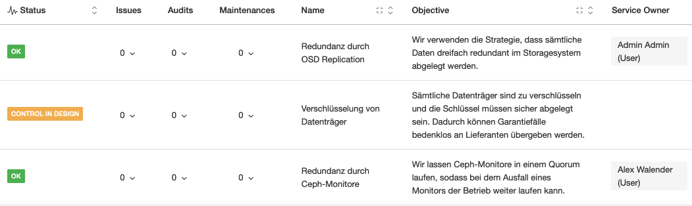

Ermittelt werden diese in Eramba unter `Controls Catalogue` -> `Internal Controls`.
Unter dem `Action` Menüpunkt lassen sich dann neue Controls hinzufügen.
Im Katalog sind sämtliche IT-Verfahren eingepflegt.
Sollten Risiken identifiziert worden sein, für denen es noch kein geeignetes
Verfahren gibt, so kann dieser Ort als Platzhalter für neue IT-Verfahren
verwendet werden. Bedarf das Risiko ein größeres Change-Projekt, so muss dies
im Eramba als Projekt mit einer spezifischen Deadline gekennzeichnet werden.
Das Projekt wird dazu parallel im YouTrack dokumentiert. Entsprechende
Verweise zwischen YouTrack-Ticket und Eramba-Item werden beschrieben.

Zu Controls sind folgende Punkte zu beachten:

- Die Maßnahme beinhaltet Titel welche äquivalent eine Komponente im ISMS darstellt.
  - Beispielsweise die Kapitelnummer im IT-Verfahren.
- `Description` beschreibt eine kurze inhaltliche Beschreibung der Maßnahme.
- `Documentation URL` beinhaltet ein Verweis, der die Maßnahme detailliert beschreibt.
- Mit `Status` wird definiert, ob die Maßnahme schon umgesetzt worden ist (Production) oder
  noch in der Umsetzung ist bzw. geplant ist (Design). Design-Tickets haben immer
  einen Verweis auf ein Ticket im YouTrack.
- Mit `Service Owner` ist der Verantwortliche für diese Maßnahme anzugeben.
- Im Menüpunkt `Audits` wird ein jährlicher Review festgelegt. Dieser ist immer
  Anfang des nächsten Jahres. Für Unterkapitel (beispielsweise in den IT-Verfahren)
  ist ein jährliches Review nicht notwendig. Es reicht die Hauptkapitel mit einem
  Review-Datum zu versehen.

## Risikokommunikation

Das Risikomanagement muss allen involvierten Mitarbeitern von ADM und BRF
kommuniziert werden. Dies geschieht bei der initialen Risikoidentifikation
und bei den jährlichen Reviews. Sämtliche Mitarbeiter haben Zugriff auf das
Risikomanagementsystem und müssen sich den aktuellen Entwicklungen der darin
enthaltenen Risiken bewusst sein.

Wesentliche Diskussionen über Risiken werden in den wöchentlichen Meetings angeregt
und entsprechend in den Protokollen aufgezeichnet.
Vorher sind neu identifizierte Risiken getagged mit "Bedarf Diskussion" bis diese
von der oberen Leitung, den beiden Arbeitsgruppen und insbesondere dem Risikoeigner 
diskutiert worden sind.

Werden schwerwiegende neue Risiken ermittelt (Klassifiziert mit _rot_), so werden diese
umgehend der obersten Leitung gemeldet. Der obersten Leitung werden ebenfalls Risiken gemeldet, die
im Restrisiko nicht als _grün_ klassifiziert worden sind.

## Risikoüberwachung

Eramba bietet eine Überwachung des Risikomanagementsystems an. Hierbei bieten sich eine
Vielzahl an Filtereinstellungen an, um einen besseren Überblick über gravierende Risiken
zu gewinnen oder sich einem bestimmten Teilbereich zu widmen.

Wesentlich für die Eintragung neuer Risiken und Assets ist die Angabe eines Review-Datums.

Eramba warnt den Nutzer sobald Reviews überfällig sind und kennzeichnet die zugehörigen Risiken
und Assets entsprechend. Zusätzlich generiert Eramba ein umfangreiches Audit-Log,
macht damit Fehler verfolgbar und erschwert außerdem eine unbemerkte Manipulation
der enthaltenen Daten.

### Review von Items in Eramba

Sämtliche Komponenten (Items) in Eramba werden einmal im Jahr reviewed:

- Risiken
- Assets mitsamt Data-Flows
- Controls
- Policies

Die anstehenden Reviews werden im Dashboard von Eramba angezeigt:

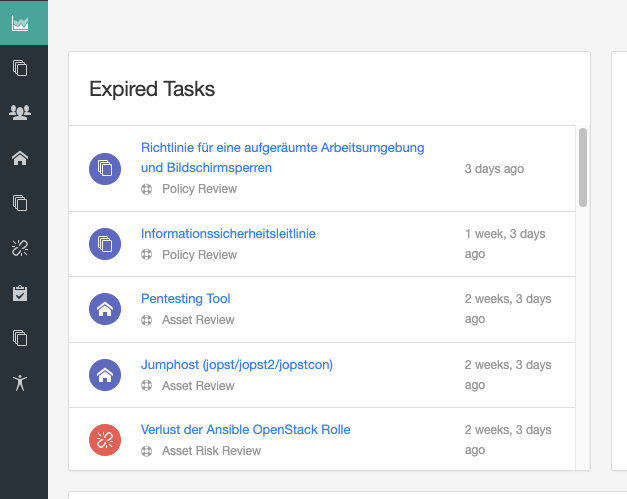

In den Reviews wird festgehalten, ob die Inhalte dem Sollzustand
entsprechen und ob die Verantwortlichkeiten korrekt sind.

Hierbei existiert pro Item eine Auflistung über alle
durchgeführten Reviews:

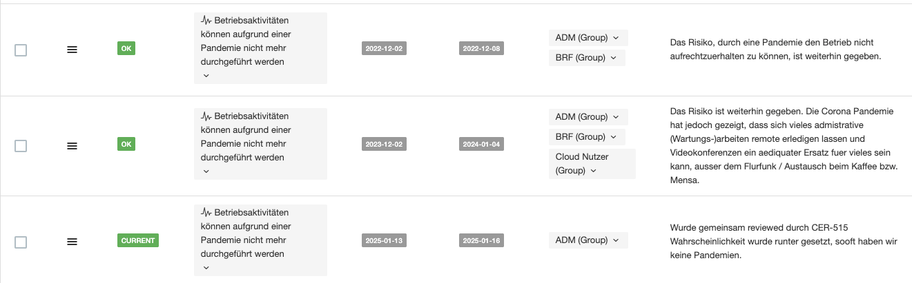

Bei abgelaufenen (Expired) Reviews, werden diese zeitnah
reviewed:

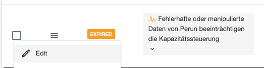

Gibt es keine Veränderungen im Item, so wird das Review
mit "Keine Veränderung" gekennzeichnet und geschlossen.
Das Item erhält dann ein neues Review-Datum im nächsten Jahr.
Ebenfalls wird im Review eingetragen, wer dieses durchgeführt hat.
Es existiert hierbei keine harte Festlegung, bis wann abgelaufene Items
reviewed werden müssen. Jeder Mitarbeiter ist dazu angehalten
sich in einem regelmäßigen Turnus um abgelaufene Items zu kümmern.

Sind Controls **nicht** korrekt, so wird das Review auf `Failed`
gesetzt und für die Behebung im YouTrack ein neues Ticket eröffnet
und verlinkt. Nach erfolgreicher Schließung wird für das Item
in Eramba ein neues Review hinzugefügt und der Status wird
auf `Passed` gesetzt.

Kleinere Veränderungen dürfen in einem Review direkt behoben werden
und bedürfen keines weiteren Tickets im YouTrack. Falls Änderungen
vollzogen worden sind, werden diese kurz im Review-Item
beschrieben:

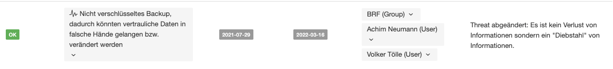

Veränderungen lassen sich jederzeit in der History nachvollziehen:

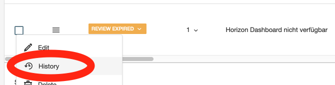`

Dies bedeutet nicht, dass Komponenten nur dann überprüft werden dürfen,
wenn sich das Review-Datum nähert.
Auch außerhalb des jährlichen Review-Zyklus sind Reviews vorgesehen.
Abhängig von den täglichen Geschäftsprozessen und dem Bekanntwerden
neuer Bedrohungen müssen bei erheblichen Änderungen die Risiken 
erneut betrachtet und bewertet werden. Unter erhebliche Änderungen
fallen beispielsweise:

- Integration neuer Hardware: Aufstockung oder Austausch der Infrastruktur 
- Erweiterung/Anpassung der Netzwerk-Infrastruktur oder Konfiguration 
- Physikalischer Umzug von Hardware an einen neuen/anderen Standort
- Aktualisierung und Umstrukturierung von Software:
  - Major Release Updates
  - Containerisierung

### Risikoinventur der Forschungszentrum Jülich GmbH

Das Forschungszentrum Jülich führt eine jährliche Risikoinventur durch.
Siehe [Risikoinventur](aufstellungen/risikoinventur-fzj.md).

## Entfernung von Risiken

Sollte bei einem Risiko-Review auffallen, dass das Risiko obsolet geworden
ist, so kann das Risiko unter folgenden Bedingungen entfernt werden:

- Die Entfernung muss in Abstimmung mit dem Risikoeigner erfolgen.
- Die Entfernung muss von der oberen Leitung besprochen sein (Management-Review).

Hierzu können in Eramba bei den Risiken das "Bedarf Diskussion"-Tag
gesetzt zur Übersicht gesetzt werden.
Ähnlich zu der Risikoidentifikation werden diese
Risiken im nächsten Management-Review diskutiert und bei Zusage
durch die obere Leitung entfernt.

In Eramba werden zu entfernende Risiken in den "Papierkorb" verschoben.
Die Leerung des Papierkorbs ist technisch nicht möglich und dient
als ewige Aufzeichnung vergangener Risiken.

## Beziehungen zwischen Risiken und Maßnahmen

Wie in der Richtlinie beschrieben, werden Risiken
durch diverse Maßnahmen (IT-Verfahren, Richtlinien usw.)
mitigiert. Werden Maßnahmen nicht zeitnah reviewed, so könnten
diese eventuell nicht mehr in ausreichendem Maße wirksam sein
und das zusammenhängende Risiko würde wieder "aktiv" sein.

Eramba überprüft hierbei automatisiert diesen "Gesundheitszustand"
jedes Items und zeigt eventuelle Missstände auf:

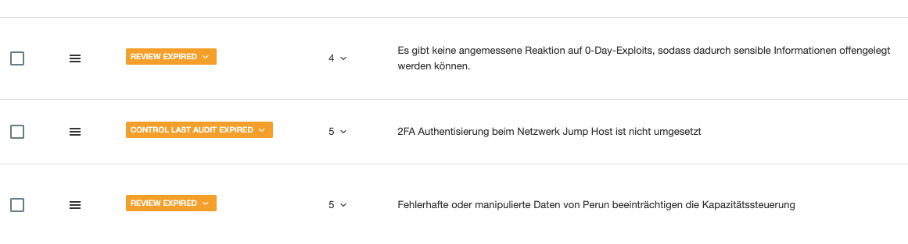

# Anhang

Die folgenden gelisteten Informationen können als Hilfe bei der Bewertung und
Identifizierung von neuen Risiken verwendet werden:

| Information                           | Offenlegung | Verlust |
|---------------------------------------|-------------|---------|
| de.NBI Cloud Wiki                     | ●           | ●●      |
| Öffentliches de.NBI Cloud GitHub-Repo | ●           | ●●●     |
| Privates de.NBI Cloud GitHub-Repo     | ●●          | ●●●     |
| DNS-Zoneneinträge                     | ●           | ●●●     |
| Zugangsdaten der Mitarbeiter          | ●●●●        | ●●●     |
| OS Service RequestTracker             | ●●●         | ●       |
| Eramba                                | ●●●●        | ●●●●    |
| CVE-Scans                             | ●●●         | ●●      |
| OpenVAS                               | ●●          | ●●      |
| Festplatte einer VM                   | ●●●●        | ●●      |
| Zabbix-Datenbank                      | ●●●         | ●●●     |
| YouTrack                              | ●●●         | ●●●●    |
| RocketChat                            | ●●●●        | ●●●     |
| OpenStack-Datenbank                   | ●●●         | ●●●●    |
| ISMS                                  | ●●          | ●●●●    |
| Ansible Playbooks                     | ●●          | ●●●●    |
| Ansible Secret Vars                   | ●●●●        | ●●●     |
| Daten einer Ceph OSD                  | ●●●●        | ●       |
| Logdaten der Server                   | ●●●●        | ●●      |

Legende:

| Grad | Beschreibung                                                                                                                        |
|------|-------------------------------------------------------------------------------------------------------------------------------------|
| ●    | Offenlegung ist gefahrlos möglich                                                                                                   |
| ●●   | Offenlegung führt zu geringfügiger Verlegenheit oder geringfügigen betrieblichen Unannehmlichkeiten                                 |
| ●●●  | Offenlegung hat signifikante, kurzfristige Auswirkungen auf den Betriebsablauf oder taktische Ziele;                                |
| ●●●● | Offenlegung hat schwerwiegende Auswirkungen auf langfristige strategische Zielsetzungen und gefährdet den Bestand der Organisation. |
| ●    | Verlust ist gefahrlos möglich                                                                                                       |
| ●●   | Verlust führt zu geringfügiger Verlegenheit oder geringfügigen betrieblichen Unannehmlichkeiten                                     |
| ●●●  | Verlust hat signifikante, kurzfristige Auswirkungen auf den Betriebsablauf oder taktische Ziele;                                    |
| ●●●● | Verlust hat schwerwiegende Auswirkungen auf langfristige strategische Zielsetzungen und gefährdet den Bestand der Organisation.     |
